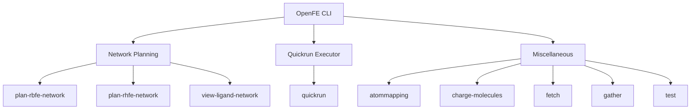

The OpenFE Command Line Interface (CLI) provides a comprehensive set of tools for setting up, executing, and analyzing free energy calculations. This interface is designed to make common workflows accessible to both beginners and advanced users while maintaining the flexibility of the underlying Python library.

## CLI Architecture Overview

The CLI is organized into three main command categories, each serving distinct purposes in the free energy calculation workflow:



The main CLI entry point is defined in [openfecli/cli.py](openfecli/cli.py#L36-L45), which provides access to all subcommands through a unified interface. The command organization follows the logical workflow of free energy calculations: from network planning and setup through execution to results analysis.

## Network Planning Commands

### Relative Binding Free Energy (RBFE) Network Planning

The `plan-rbfe-network` command is the primary tool for setting up binding free energy calculations. This command automates the complex process of creating an optimal network of ligand transformations and preparing them for execution.

**Key Features:**
- Automatic ligand network optimization
- Partial charge generation for consistency across transformations
- Protocol configuration with customizable repeats
- Protein and cofactor handling

**Basic Usage:**
```bash
openfe plan-rbfe-network --molecules ./ligands/ --protein ./protein.pdb --output ./alchemicalNetwork
```

The command supports extensive customization through YAML configuration files and various parameters for mapper selection, scoring functions, and network planning algorithms [openfecli/commands/plan_rbfe_network.py](openfecli/commands/plan_rbfe_network.py#L120-L144).

### Relative Hydration Free Energy (RHFE) Network Planning

For solvation free energy calculations, the `plan-rhfe-network` command provides similar functionality but focuses on vacuum-to-solvent transformations:

```bash
openfe plan-rhfe-network --molecules ./ligands/ --output ./hydrationNetwork
```

This tool is particularly useful for testing and validation purposes, offering a straightforward way to set up hydration free energy campaigns [openfecli/commands/plan_rhfe_network.py](openfecli/commands/plan_rhfe_network.py#L120-L135).

### Network Visualization

The `view-ligand-network` command allows you to visualize planned networks:

```bash
openfe view-ligand-network alchemicalNetwork/ligand_network.graphml
```

This generates visual representations of the transformation network, helping you understand the connectivity and optimization of your planned calculations [openfecli/commands/view_ligand_network.py](openfecli/commands/view_ligand_network.py#L6-L17).

## Execution Commands

### Quickrun Executor

The `quickrun` command executes individual transformations that have been planned by the network planning tools:

```bash
openfe quickrun alchemicalNetwork/transformation_1.json --work-dir ./run1 --output results1.json
```

This command handles the complete execution of a single transformation, including file management, result collection, and error handling [openfecli/commands/quickrun.py](openfecli/commands/quickrun.py#L17-L33).

> [!TIP]
> Quickrun automatically creates working directories and manages temporary files, ensuring clean execution environments for each transformation. Use the `--work-dir` option to specify custom locations for better organization of large calculation campaigns.

## Utility and Analysis Commands

### Atom Mapping Analysis

The `atommapping` command provides tools for examining and validating atom mappings between ligand pairs:

```bash
openfe atommapping --mol ligand1.sdf --mol ligand2.sdf --mapper kartograf --output mapping.png
```

This is essential for debugging mapping issues and understanding the correspondence between atoms in molecular transformations [openfecli/commands/atommapping.py](openfecli/commands/atommapping.py#L16-L29).

### Partial Charge Generation

The `charge-molecules` command generates partial charges for molecular sets:

```bash
openfe charge-molecules --molecules ./ligands/ --output charged_ligands.sdf --n-cores 4
```

This ensures consistent charge assignments across all molecules in a calculation network, which is critical for accurate free energy calculations [openfecli/commands/generate_partial_charges.py](openfecli/commands/generate_partial_charges.py#L30-L43).

### Results Gathering and Analysis

The `gather` command collects and analyzes results from multiple transformations:

```bash
openfe gather ./results/ --report ddg --output network_results.tsv
```

This powerful tool supports multiple analysis modes:
- `dg`: Maximum likelihood estimates of absolute ΔG values
- `ddg`: Relative binding free energies (ΔΔG)
- `raw`: Individual leg results for detailed analysis

The gather command automatically handles result validation, error detection, and statistical analysis across the entire network [openfecli/commands/gather.py](openfecli/commands/gather.py#L593-L640).

### Resource Management

The `fetch` command provides access to tutorials and example resources:

```bash
openfe fetch tutorial-rbfe
```

This downloads and sets up tutorial materials, making it easy to get started with OpenFE workflows [openfecli/commands/fetch.py](openfecli/commands/fetch.py#L51-L57).

### System Testing

The `test` command runs the OpenFE test suite to verify your installation:

```bash
openfe test --long
```

This comprehensive testing ensures that all components are functioning correctly in your environment [openfecli/commands/test.py](openfecli/commands/test.py#L12-L25).

## Common Command Patterns

| Workflow | Commands | Purpose |
|---------|----------|---------|
| **Complete RBFE Campaign** | `plan-rbfe-network` → `quickrun` → `gather` | Full binding free energy calculation |
| **Quick Mapping Check** | `atommapping` | Validate ligand transformations |
| **System Validation** | `test` → `fetch` → `charge-molecules` | Environment setup and testing |
| **Results Analysis** | `gather` → `view-ligand-network` | Post-calculation analysis and visualization |

## Parameter System

OpenFE CLI uses a sophisticated parameter system that provides type checking, validation, and help text generation. Common parameter types include:

- **MOL_DIR**: Directory containing molecular files
- **PROTEIN**: Protein structure file
- **OUTPUT_DIR**: Directory for calculation output
- **NCORES**: Number of processing cores
- **OVERWRITE**: File overwrite protection

These parameters ensure consistent behavior across commands and provide helpful error messages for incorrect usage.

> [!TIP]
> Most commands support YAML configuration files for advanced customization. Use the `--yaml-settings` option to specify custom mapper configurations, scoring functions, and protocol parameters without having to remember complex command-line arguments.

## Next Steps

After mastering these CLI basics, you may want to explore:

- [Running Your First Free Energy Calculation](4-running-your-first-free-energy-calculation) for a complete walkthrough
- [Alchemical Free Energy Calculations Fundamentals](6-alchemical-free-energy-calculations-fundamentals) for deeper theoretical understanding
- [Network-Based Molecular Transformations](7-network-based-molecular-transformations) for advanced network planning concepts

The CLI provides a solid foundation for free energy calculations, while the Python API offers additional flexibility for custom workflows and advanced research applications.