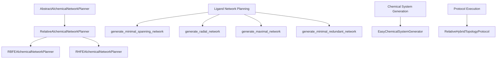

Network-based molecular transformations represent a fundamental paradigm in computational chemistry where free energy calculations are organized as interconnected graphs rather than isolated pairwise comparisons. This approach enables efficient exploration of chemical space through strategic pathway planning, error cancellation, and thermodynamic cycle closure.

## Core Architecture

The OpenFE framework implements network-based transformations through a hierarchical architecture that separates concerns between ligand network planning, chemical system generation, and protocol execution. The foundation rests on the `AbstractAlchemicalNetworkPlanner` interface [openfe/setup/alchemical_network_planner/abstract_alchemical_network_planner.py#L9](openfe/setup/alchemical_network_planner/abstract_alchemical_network_planner.py#L9), which defines the contract for all network planning implementations.

### Network Planning Hierarchy

The `RelativeAlchemicalNetworkPlanner` serves as the concrete implementation base [openfe/setup/alchemical_network_planner/relative_alchemical_network_planner.py#L46](openfe/setup/alchemical_network_planner/relative_alchemical_network_planner.py#L46), orchestrating three key components:

1. **Ligand Mappers**: Tools for establishing atom correspondence between molecules
2. **Mapping Scorers**: Functions evaluating transformation quality and feasibility  
3. **Network Planners**: Algorithms optimizing the graph topology for computational efficiency

## Network Planning Strategies

OpenFE provides multiple network generation algorithms, each optimized for different computational scenarios:

### Minimal Spanning Network

The `generate_minimal_spanning_network` function creates the most computationally efficient topology by connecting all ligands with the minimum number of edges while maximizing total mapping scores [openfe/setup/ligand_network_planning.py#L208](openfe/setup/ligand_network_planning.py#L208). This approach minimizes computational cost while maintaining connectivity through high-quality transformations.

### Radial Network

The radial (hub-and-spoke) topology centers all transformations around a single reference ligand [openfe/setup/ligand_network_planning.py#L49](openfe/setup/ligand_network_planning.py#L49). This strategy provides consistent reference points and simplifies analysis, making it ideal for lead optimization campaigns where all compounds are compared to a common scaffold.

### Maximal Network

For comprehensive exploration, the `generate_maximal_network` generates all possible pairwise mappings [openfe/setup/ligand_network_planning.py#L157](openfe/setup/ligand_network_planning.py#L157). While computationally intensive, this approach maximizes pathway redundancy and provides the most robust error cancellation through cycle closure.

## Specialized Network Planners

### Relative Binding Free Energy (RBFE) Networks

The `RBFEAlchemicalNetworkPlanner` specializes in protein-ligand binding calculations [openfe/setup/alchemical_network_planner/relative_alchemical_network_planner.py#L289](openfe/setup/alchemical_network_planner/relative_alchemical_network_planner.py#L289). Key features include:

- **Adaptive Protocol Settings**: Automatic adjustment of simulation parameters based on transformation characteristics
- **Net Charge Handling**: Specialized treatment for transformations involving charge changes
- **Protein Context Integration**: Proper handling of protein-ligand complex formation and solvent effects

The planner accepts ligands, solvent, protein, and optional cofactors to construct complete binding thermodynamic cycles [openfe/setup/alchemical_network_planner/relative_alchemical_network_planner.py#L350](openfe/setup/alchemical_network_planner/relative_alchemical_network_planner.py#L350).

### Relative Hydration Free Energy (RHFE) Networks

The `RHFEAlchemicalNetworkPlanner` focuses on solvation thermodynamics by comparing ligand binding in solvent versus vacuum [openfe/setup/alchemical_network_planner/relative_alchemical_network_planner.py#L225](openfe/setup/alchemical_network_planner/relative_alchemical_network_planner.py#L225). This approach enables:

- **Solvation Energy Decomposition**: Separation of binding and desolvation contributions
- **Vacuum Simulations**: Specialized handling of non-periodic boundary conditions
- **Transferability Assessment**: Evaluation of ligand properties across different environments

> [!TIP]
> The chemical system generator automatically configures vacuum simulations with "nocutoff" nonbonded methods when detecting transformations involving vacuum states, ensuring proper treatment of long-range electrostatics.

## Transformation Construction

Each network edge represents a molecular transformation with associated thermodynamic protocols. The transformation construction process involves:

1. **Mapping Generation**: Atom correspondence establishment through configurable mappers
2. **System Preparation**: Chemical system generation for both endpoint states
3. **Protocol Assignment**: Simulation protocol configuration and parameter adaptation
4. **Network Assembly**: Integration of individual transformations into a coherent graph

The framework supports protocol adaptation based on transformation characteristics, particularly for charge-changing mutations where simulation parameters require special consideration [openfe/setup/alchemical_network_planner/relative_alchemical_network_planner.py#L314](openfe/setup/alchemical_network_planner/relative_alchemical_network_planner.py#L314).

## Integration and Extensibility

The network-based architecture seamlessly integrates with OpenFE's broader ecosystem:

- **Storage Systems**: Network metadata and results are managed through specialized storage clients
- **Analysis Tools**: Network-wide analysis enables thermodynamic cycle validation and error estimation
- **Visualization Utilities**: Network plotting capabilities provide insight into transformation pathways and computational efficiency

> [!TIP]
> The modular design allows users to mix and match mappers, scorers, and network planners to create customized workflows optimized for specific chemical systems and computational resources.

## Practical Applications

Network-based transformations excel in scenarios requiring:

- **Lead Optimization**: Efficient exploration of structure-activity relationships through targeted networks
- **Selectivity Studies**: Comparative analysis across multiple protein targets
- **Property Prediction**: Systematic evaluation of physicochemical properties across chemical series
- **Method Validation**: Thermodynamic cycle closure provides internal consistency checks

The network approach transforms individual free energy calculations into a coherent thermodynamic framework, enabling more robust predictions and deeper chemical insights than isolated pairwise comparisons.

For detailed implementation guidance, see [Atom Mapping and Molecular Transformations](9-atom-mapping-and-molecular-transformations) and [Ligand Network Planning Algorithms](10-ligand-network-planning-algorithms). Protocol-specific details are covered in [Relative Binding Free Energy (RBFE) Protocols](12-relative-binding-free-energy-rbfe-protocols) and [Absolute Binding Free Energy (ABFE) Protocols](13-absolute-binding-free-energy-abfe-protocols).