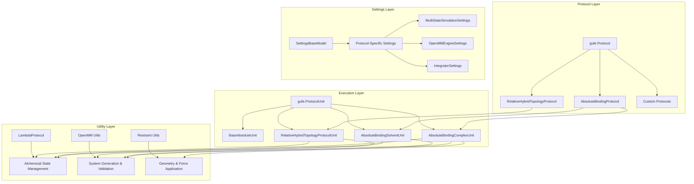

The OpenFE protocol system provides a comprehensive, extensible framework for executing free energy calculations through a well-architected hierarchy of protocols, units, and settings. This framework enables reproducible, scalable computational chemistry workflows while maintaining flexibility for custom method development.

## Architecture Overview

The protocol system follows a layered architecture that separates concerns between high-level workflow orchestration, specific calculation protocols, and detailed simulation settings. This design enables both ease of use for standard workflows and extensibility for advanced users.

## Core Protocol Classes

### Relative Free Energy Protocols

The `RelativeHybridTopologyProtocol` [openfe/protocols/openmm_rfe/equil_rfe_methods.py#L496](openfe/protocols/openmm_rfe/equil_rfe_methods.py#L496) implements ligand-to-ligand transformations using hybrid topology systems. This protocol supports multiple sampling methods including Hamiltonian Replica Exchange, Self-Adjusted Mixture Sampling, and Independent Window Sampling.

Key features include:
- **Hybrid topology construction** for seamless alchemical transformations
- **Multi-state sampling** with configurable replica exchange strategies
- **Comprehensive analysis** including overlap matrices and replica transition statistics
- **Adaptive settings** that automatically configure parameters based on molecular properties

The protocol creates `RelativeHybridTopologyProtocolUnit` instances [openfe/protocols/openmm_rfe/equil_rfe_methods.py#L683](openfe/protocols/openmm_rfe/equil_rfe_methods.py#L683) that execute individual transformations, with results aggregated in `RelativeHybridTopologyProtocolResult` [openfe/protocols/openmm_rfe/equil_rfe_methods.py#L276](openfe/protocols/openmm_rfe/equil_rfe_methods.py#L276).

### Absolute Free Energy Protocols

The `AbsoluteBindingProtocol` [openfe/protocols/openmm_afe/equil_binding_afe_method.py#L517](openfe/protocols/openmm_afe/equil_binding_afe_method.py#L517) handles ligand binding calculations through separate complex and solvent phases. This protocol builds on the `BaseAbsoluteUnit` [openfe/protocols/openmm_afe/base.py#L86](openfe/protocols/openmm_afe/base.py#L86) which provides common functionality for absolute calculations.

The protocol creates two distinct unit types:
- **Complex phase**: `AbsoluteBindingComplexUnit` [openfe/protocols/openmm_afe/equil_binding_afe_method.py#L914](openfe/protocols/openmm_afe/equil_binding_afe_method.py#L914) for bound state simulations
- **Solvent phase**: `AbsoluteBindingSolventUnit` [openfe/protocols/openmm_afe/equil_binding_afe_method.py#L1262](openfe/protocols/openmm_afe/equil_binding_afe_method.py#L1262) for unbound state simulations

Both phases incorporate Boresch restraints for proper standard state corrections and provide detailed structural analysis capabilities.

## Settings and Configuration

### Hierarchical Settings System

The protocol framework uses a sophisticated settings hierarchy based on `SettingsBaseModel` that provides type validation, default values, and comprehensive documentation:

| Settings Class | Primary Purpose | Key Parameters |
|---|---|---|
| `MultiStateSimulationSettings` [openfe/protocols/openmm_utils/omm_settings.py#L544](openfe/protocols/openmm_utils/omm_settings.py#L544) | Alchemical sampling control | `sampler_method`, `n_replicas`, `time_per_iteration` |
| `OpenMMEngineSettings` [openfe/protocols/openmm_utils/omm_settings.py#L314](openfe/protocols/openmm_utils/omm_settings.py#L314) | MD engine configuration | `compute_platform`, `gpu_device_index` |
| `IntegratorSettings` [openfe/protocols/openmm_utils/omm_settings.py#L353](openfe/protocols/openmm_utils/omm_settings.py#L353) | Integration parameters | `timestep`, `langevin_collision_rate` |
| `OpenMMSolvationSettings` [openfe/protocols/openmm_utils/omm_settings.py#L50](openfe/protocols/openmm_utils/omm_settings.py#L50) | System solvation | `solvent_model`, `solvent_padding` |

### Protocol-Specific Settings

Each protocol defines specialized settings classes that inherit from the base settings:

- **Lambda Settings**: Control alchemical switching functions and window distributions [openfe/protocols/openmm_rfe/equil_rfe_settings.py#L33](openfe/protocols/openmm_rfe/equil_rfe_settings.py#L33)
- **Alchemical Settings**: Configure soft-core potentials and charge handling [openfe/protocols/openmm_rfe/equil_rfe_settings.py#L50](openfe/protocols/openmm_rfe/equil_rfe_settings.py#L50)
- **Partial Charge Settings**: Manage charge calculation methods and backends [openfe/protocols/openmm_utils/omm_settings.py#L231](openfe/protocols/openmm_utils/omm_settings.py#L231)

> [!TIP]
> The settings system uses Pydantic models with automatic validation, ensuring that invalid configurations are caught early with clear error messages. This prevents common mistakes like incompatible timestep values or unsupported sampling methods.

## Lambda Protocol System

### Alchemical State Management

The `LambdaProtocol` class [openfe/protocols/openmm_rfe/_rfe_utils/lambdaprotocol.py#L14](openfe/protocols/openmm_rfe/_rfe_utils/lambdaprotocol.py#L14) provides sophisticated control over alchemical transformations through configurable switching functions. It manages the progression of different energy components (electrostatics, sterics) throughout the transformation pathway.

Key capabilities include:
- **Multiple switching functions** with customizable parameters
- **Charge singularity avoidance** through naked charge detection [openfe/protocols/openmm_rfe/_rfe_utils/lambdaprotocol.py#L231](openfe/protocols/openmm_rfe/_rfe_utils/lambdaprotocol.py#L231)
- **Visualization tools** for lambda schedule inspection and validation

The `RelativeAlchemicalState` [openfe/protocols/openmm_rfe/_rfe_utils/lambdaprotocol.py#L291](openfe/protocols/openmm_rfe/_rfe_utils/lambdaprotocol.py#L291) extends this framework with specific parameters for relative transformations, handling insertion/deletion processes and core component scaling.

## Execution and Orchestration

### Protocol Unit Execution

Protocol units implement the core execution logic through standardized interfaces:

1. **Preparation Phase**: System setup, charge assignment, and topology construction
2. **Equilibration Phase**: Energy minimization and gradual system relaxation
3. **Production Phase**: Alchemical sampling with configured methods
4. **Analysis Phase**: Result processing and statistical analysis

The `BaseAbsoluteUnit` [openfe/protocols/openmm_afe/base.py#L86](openfe/protocols/openmm_afe/base.py#L86) provides a template method pattern that standardizes this workflow while allowing customization at each stage.

### Result Management

Protocol results implement comprehensive analysis interfaces:

- **Free Energy Estimation**: MBAR-based analysis with uncertainty quantification
- **Overlap Assessment**: Matrix-based evaluation of sampling efficiency
- **Replica Analysis**: Transition statistics and state distribution monitoring
- **Structural Analysis**: Trajectory inspection and restraint geometry validation

> [!TIP]
> Results are stored in structured formats that enable both immediate analysis and post-processing. The system maintains full provenance information, allowing traceability from final results back to original input parameters.

## Extension Framework

### Custom Protocol Development

The framework supports extension through well-defined interfaces:

1. **Protocol Subclassing**: Inherit from `gufe.Protocol` for new calculation types
2. **Unit Implementation**: Create specialized `ProtocolUnit` classes for execution logic
3. **Settings Definition**: Design configuration classes using `SettingsBaseModel`
4. **Result Handling**: Implement `ProtocolResult` for output management

### Utility Integration

The protocol system integrates with specialized utility modules:
- **OpenMM Utils** [openfe/protocols/openmm_utils/](openfe/protocols/openmm_utils/): System generation and validation
- **Restraint Utils** [openfe/protocols/restraint_utils/](openfe/protocols/restraint_utils/): Geometry management and force application
- **Charge Generation** [openfe/protocols/openmm_utils/charge_generation.py](openfe/protocols/openmm_utils/charge_generation.py): Partial charge calculation workflows

This modular architecture enables rapid development of new methods while leveraging existing, validated components.

## Next Steps

To deepen your understanding of the protocol system:

- Explore [Relative Binding Free Energy (RBFE) Protocols](12-relative-binding-free-energy-rbfe-protocols) for specific implementation details
- Review [Absolute Binding Free Energy (ABFE) Protocols](13-absolute-binding-free-energy-abfe-protocols) for complex transformation workflows
- Study [Custom Protocol Development](20-custom-protocol-development) for extension guidance
- Examine [High-Throughput Execution and Orchestration](22-high-throughput-execution-and-orchestration) for scaling considerations

The protocol system serves as the foundation for reproducible free energy calculations, providing both the flexibility needed for research and the robustness required for production workflows.