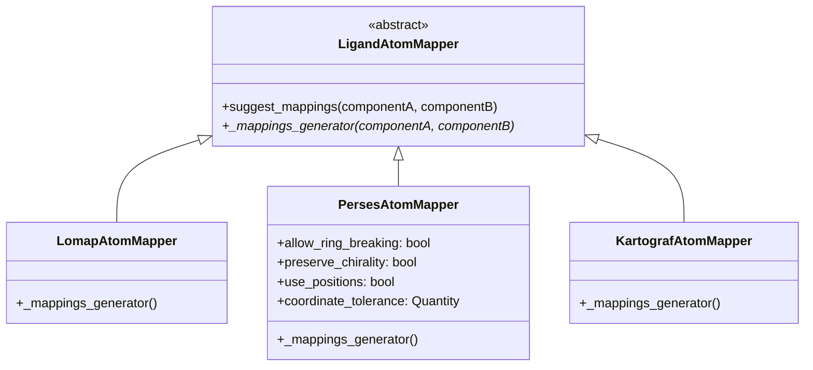

Atom mapping is a fundamental process in free energy calculations that establishes correspondence between atoms in different molecular states. This process enables the construction of alchemical pathways where molecules are gradually transformed from one state to another, allowing for the computation of relative free energy differences.

## Core Architecture

The atom mapping system in OpenFE is built around an extensible architecture that supports multiple mapping algorithms and scoring functions. The foundation is the `LigandAtomMapper` abstract base class, which defines the interface for generating atom correspondences between `SmallMoleculeComponent` instances [ligandatommapper.py#L11-L17].

## Implementation Classes

### Base Mapper Interface

The `LigandAtomMapper` class serves as the foundation for all mapping implementations. It requires subclasses to implement the `_mappings_generator` method, which returns an iterable of atom mapping dictionaries [ligandatommapper.py#L19-L38]. The public `suggest_mappings` method converts these dictionaries into `LigandAtomMapping` objects [ligandatommapper.py#L40-L65].

### Lomap Integration

The `LomapAtomMapper` provides a wrapper around the Lomap library's maximum common substructure (MCS) algorithm. This mapper is imported directly from the Lomap package and adapted to match OpenFE's API [lomap_mapper.py#L9].

### Perses Integration

The `PersesAtomMapper` offers sophisticated mapping capabilities with configurable parameters:

- **allow_ring_breaking**: Controls whether only full molecular cycles should be mapped
- **preserve_chirality**: Enforces strict chirality preservation in mappings
- **use_positions**: Utilizes spatial coordinates for mapping decisions
- **coordinate_tolerance**: Defines the distance tolerance for position-based mapping [perses_mapper.py#L52-L80]

The implementation constructs a Perses `AtomMapper` and processes the resulting mappings, with optional chirality preservation [perses_mapper.py#L82-L110].

## Scoring Systems

OpenFE provides comprehensive scoring functions to evaluate the quality of atom mappings:

### Lomap Scorers

The Lomap scoring suite includes multiple specialized metrics [lomap_scorers.py#L4-L16]:
- `atomic_number_score`: Evaluates atomic number consistency
- `default_lomap_score`: Standard Lomap scoring function
- `ecr_score`: Edge consistency ratio scoring
- `heterocycles_score`: Heterocycle mapping quality
- `hybridization_score`: Hybridization state preservation
- `mcsr_score`, `mncar_score`, `tmcsr_score`: Various substructure matching scores

### Perses Scorer

The `default_perses_scorer` provides normalized scoring with optional position-based evaluation [perses_scorers.py#L37-L121]. It considers multiple factors:
- Number of mapped atoms
- Aromatic atom correspondence
- Heavy atom mapping quality
- Ring structure preservation

> [!TIP]
> The Perses scorer normalization uses weighted combinations of different mapping aspects (1.0 for total atoms, 0.8 for aromatic, 0.5 for heavy atoms, 0.4 for ring atoms) to enable cross-comparison between different molecular pairs [perses_scorers.py#L111-L117].

## Command Line Interface

The atom mapping functionality is accessible through the `openfe atommapping` command, which provides tools for examining specific mappings between ligand pairs [atommapping.py#L16-L40].

### Usage Patterns

The CLI supports two main output modes:

1. **Dictionary Output**: Prints the atom mapping correspondence directly to console [atommapping.py#L68-L71]
2. **Visualization**: Generates PNG images showing the mapped molecular structures [atommapping.py#L74-L97]

The command requires exactly two molecules and a mapper specification, using the `generate_mapping` utility to ensure single mapping results [atommapping.py#L43-L65].

## Integration with Alchemical Networks

Atom mappings serve as the foundation for molecular transformations in alchemical networks. Each mapping defines a specific transformation pathway between two molecular states, enabling the systematic construction of free energy calculation networks.

The mapping quality directly impacts the reliability and efficiency of subsequent free energy calculations. High-quality mappings with good chemical intuition and minimal structural perturbations lead to more accurate and convergent simulations.

> [!TIP]
> When selecting a mapper for your workflow, consider the trade-off between mapping coverage and quality. Lomap typically provides faster, more conservative mappings, while Perses offers more sophisticated position-aware mapping at the cost of increased computational complexity.

## Next Steps

After establishing atom mappings, you can explore [Ligand Network Planning Algorithms](10-ligand-network-planning-algorithms) to understand how individual mappings are combined into comprehensive alchemical networks, or proceed to [Chemical System Generation and Validation](11-chemical-system-generation-and-validation) to learn about preparing molecular systems for simulation.