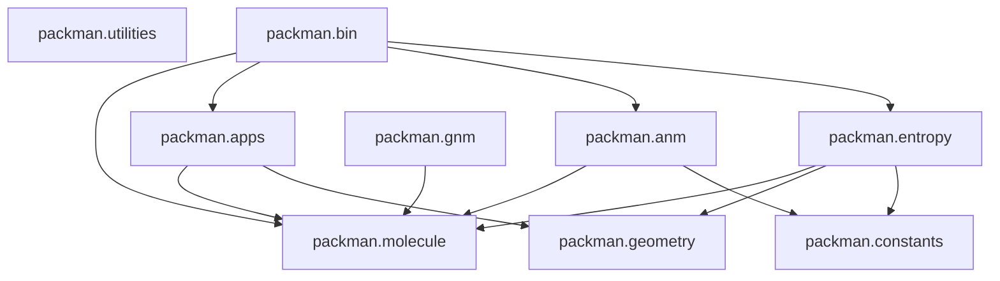
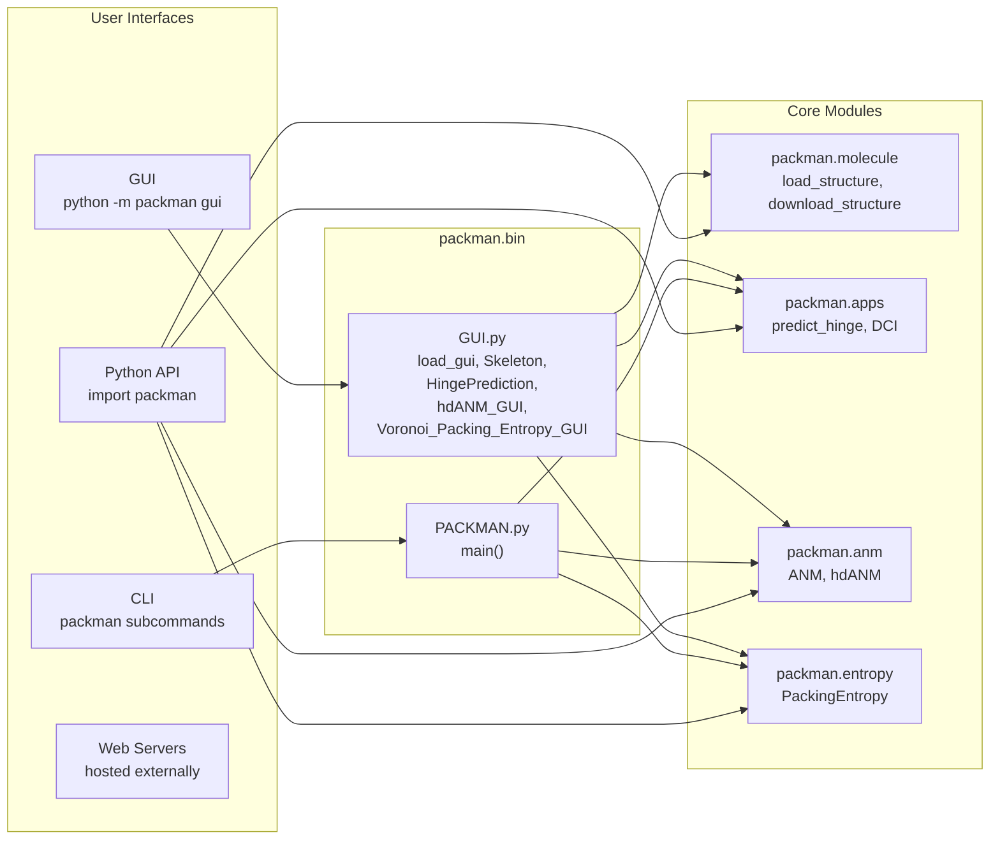

# PACKMAN Overview

<details>
<summary>Relevant source files</summary>

The following files were used as context for generating this wiki page:

- [.github/workflows/python-package.yml](.github/workflows/python-package.yml)
- [README.md](README.md)
- [additional codes/ScanAlpha.py](additional codes/ScanAlpha.py)
- [docs/source/index.rst](docs/source/index.rst)
- [packman/__init__.py](packman/__init__.py)
- [packman/bin/GUI.py](packman/bin/GUI.py)
- [setup.py](setup.py)

</details>


This page introduces the PACKMAN project: what it is, what scientific problems it addresses, how the codebase is organized, and how to access it. For installation details, see [Installation](#1.1). For detailed interface usage, see [User Interfaces](#1.2).

---

## What is PACKMAN?

**PACKMAN** (**PACK**ing and **M**otion **AN**alysis) is a Python library for studying protein molecular structures and their dynamics through the property of *protein packing* — the spatial arrangement of atoms within a folded protein. The central approach is to model protein packing using **alpha shapes** (a subset of Delaunay tessellations applied to backbone atoms), which exposes structurally significant features such as hinge locations, domain boundaries, and per-residue packing entropy.

- **PyPI package name:** `py-packman`
- **Current version:** `1.4.13` ([packman/__init__.py:16]())
- **License:** MIT

The root package re-exports symbols from its major submodules so that a plain `import packman` gives access to the full API:

[packman/__init__.py:1-12]()

Sources: [packman/__init__.py:1-16](), [README.md:4-8](), [docs/source/index.rst:12-41]()

---

## Scientific Applications

PACKMAN bundles four distinct analysis capabilities, each grounded in a peer-reviewed method:

| Application | Scientific Method | Primary Code Entity | Subpackage |
|---|---|---|---|
| Hinge Prediction | Alpha shapes on backbone atoms | `predict_hinge()` | `packman.apps` |
| hdANM | Hinge-domain Anisotropic Network Model | `hdANM` class | `packman.anm` |
| Packing Entropy | Voronoi tessellation on atom coordinates | `PackingEntropy` class | `packman.entropy` |
| DCI | GNM cross-correlations + Ward clustering | `DCI` class | `packman.apps` |

Each application has a corresponding CLI sub-command (`hinge`, `hdanm`, `entropy`, `dci`) and a GUI panel. For detailed documentation see [Analysis Applications](#4) and [Network Models](#5).

Sources: [README.md:59-66](), [docs/source/index.rst:25-37](), [setup.py:21-35]()

---

## Package Structure

The `packman` package is organized into nine subpackages. `packman.molecule` is the foundational data layer; all other analysis modules consume it.

**packman subpackage responsibilities**

| Subpackage | Responsibility |
|---|---|
| `packman.molecule` | Protein data model: `Protein`, `Model`, `Chain`, `Residue`, `Atom`, `Bond` |
| `packman.apps` | High-level analysis apps: `predict_hinge`, `DCI`, CLI wrappers |
| `packman.anm` | Anisotropic Network Models: `ANM`, `hdANM` |
| `packman.gnm` | Gaussian Network Model: `GNM` |
| `packman.entropy` | Packing entropy: `PackingEntropy` |
| `packman.geometry` | Geometric primitives: `AlphaShape`, `Circumsphere` |
| `packman.utilities` | Helper functions: `superimpose`, `RMSD`, `load_hinge`, `WriteOBJ` |
| `packman.constants` | Lookup tables: `amino_acid_molecular_weight`, `atomic_weight`, `kidera_factors` |
| `packman.bin` | Entry points: `GUI.py` (GUI), `PACKMAN.py` (CLI `main()`) |

**Diagram: packman subpackage dependency structure**



Sources: [setup.py:21-35](), [packman/__init__.py:7-12](), [packman/bin/GUI.py:21-25]()

---

## User Interfaces

PACKMAN can be accessed through four distinct interfaces.

| Interface | How to Invoke | Code Entry Point |
|---|---|---|
| GUI | `python -m packman gui` | `packman/bin/GUI.py`: `load_gui()` → `Skeleton` |
| CLI | `packman <subcommand> [args]` | `packman/bin/PACKMAN.py`: `main()` |
| Python API | `import packman` | `packman/__init__.py` |
| Web Servers | Browser (hosted externally) | — |

**Diagram: interface-to-code-entity mapping**



### GUI

Launch the graphical interface with:

```
python -m packman gui
```

The GUI is implemented in [packman/bin/GUI.py:53-114]() as a `tkinter`-based app. The `Skeleton` class hosts four panels:

- `HomePage` — links to documentation and web servers
- `HingePrediction` — runs `predict_hinge()` and outputs `.hng` files
- `hdANM_GUI` — runs `hdANM`, saves eigenvectors/eigenvalues, and generates movies
- `Voronoi_Packing_Entropy_GUI` — runs `PackingEntropy` and writes per-residue entropy tables

### CLI

The `packman` console script (registered via `packman=packman.bin.PACKMAN:main` in [setup.py:42]()) exposes subcommands: `hinge`, `hdanm`, `entropy`, `dci`. See [Command-Line Interface](#7) for full argument documentation.

### Python API

After `pip install py-packman`, all major symbols are importable directly:

```python
import packman
mol = packman.molecule.load_structure("1EXR.cif")
```

### Web Servers

Four hosted web servers provide browser-based access to PACKMAN analyses without requiring a local installation:

| Server | Analysis |
|---|---|
| packman.bb.iastate.edu | Hinge Prediction |
| hdanm.bb.iastate.edu | hdANM |
| packing-entropy.bb.iastate.edu | Packing Entropy |
| dci.bb.iastate.edu | DCI |

Sources: [README.md:32-57](), [packman/bin/GUI.py:53-114](), [setup.py:42]()

---

## Runtime Dependencies

Installed automatically via `pip`:

| Dependency | Role |
|---|---|
| `numpy` | Array math throughout all modules |
| `scipy` | Delaunay tessellation, eigendecomposition |
| `networkx` | Alpha shape graphs in `packman.geometry` |
| `scikit-learn` | Calinski-Harabasz scoring in DCI |
| `mlxtend` | Utility functions |
| `tqdm` | Progress bars in long-running computations |
| `typing_extensions` | Backported type hints for Python 3.8 compatibility |

Sources: [setup.py:74]()

---

## Related Research Publications

Each major feature corresponds to a published method:

| Feature | Publication DOI |
|---|---|
| PACKMAN molecule API | `10.1093/bioadv/vbac007` |
| Hinge Prediction | `10.1016/j.jmb.2019.11.018` |
| Structural Compliance (ANM) | `10.1002/prot.25968` |
| hdANM | `10.1016/j.bpj.2021.10.017` |
| Packing Entropy | `10.1021/acsomega.2c00999` |
| DCI | `10.1093/bioinformatics/btac159` |

Sources: [README.md:59-66](), [docs/source/index.rst:31-37]()

---

## Wiki Navigation

| Topic | Wiki Page |
|---|---|
| Installation (pip, source, dependencies) | [Installation](#1.1) |
| GUI, CLI, API, web server usage | [User Interfaces](#1.2) |
| Package layout and inter-module dependencies | [Package Architecture](#2) |
| `Protein`, `Chain`, `Residue`, `Atom` data model | [Molecular Data Model](#3) |
| `predict_hinge`, `DCI`, `PackingEntropy` | [Analysis Applications](#4) |
| `ANM`, `hdANM`, `GNM` | [Network Models](#5) |
| `AlphaShape`, `Circumsphere` | [Geometry Module](#6) |
| All CLI subcommand arguments | [Command-Line Interface](#7) |
| GUI panels in detail | [Graphical User Interface](#8) |
| `packman.utilities` and `packman.constants` | [Utilities and Constants](#9) |
| Test suite structure and how to run tests | [Testing](#10) |

---