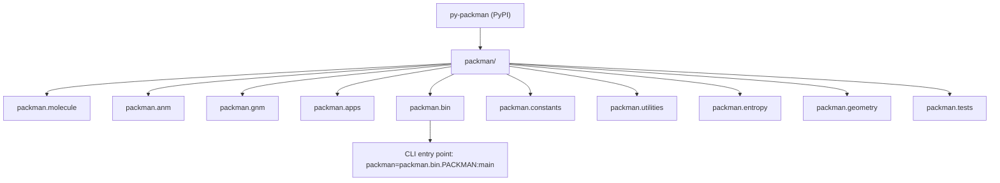
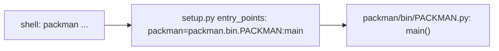

# Installation

<details>
<summary>Relevant source files</summary>

The following files were used as context for generating this wiki page:

- [.github/workflows/python-package.yml](.github/workflows/python-package.yml)
- [.gitignore](.gitignore)
- [LICENSE](LICENSE)
- [README.md](README.md)
- [additional codes/ScanAlpha.py](additional codes/ScanAlpha.py)
- [docs/source/index.rst](docs/source/index.rst)
- [packman/__init__.py](packman/__init__.py)
- [packman/bin/GUI.py](packman/bin/GUI.py)
- [setup.py](setup.py)

</details>


This page covers all methods for installing PACKMAN, its required dependencies, supported Python versions, and how to verify a successful install. For information on how to use PACKMAN after installation, see the User Interfaces page ([1.2](#1.2)).

---

## Overview

PACKMAN is distributed as the PyPI package `py-packman`. The import name inside Python is `packman`. The package is registered under an MIT license.

**Current version:** `1.4.13` (defined at [packman/__init__.py:16]())

---

## Supported Python Versions

The CI matrix in [.github/workflows/python-package.yml:26-27]() tests against the following interpreter versions:

| Python Version | Tested in CI |
|---|---|
| 3.8 | ✓ |
| 3.9 | ✓ |
| 3.10 | ✓ |
| 3.11 | ✓ |
| 3.12 | ✓ |

---

## Installation Methods

### Method 1 — pip (Recommended)

```bash
pip install py-packman
```

This installs the package and all required dependencies automatically. The `packman` CLI entry point is registered as part of this install ([setup.py:42]()).

### Method 2 — From Source

```bash
git clone https://github.com/Pranavkhade/PACKMAN
cd PACKMAN
python setup.py install
```

This is useful for development or to access unreleased changes. For editable installs (used in CI), the command is:

```bash
pip install --editable .
```

as shown at [.github/workflows/python-package.yml:39]().

---

## Dependencies

The following packages are declared as required in `install_requires` at [setup.py:74]():

| Package | Purpose |
|---|---|
| `numpy` | Array math, matrix operations |
| `scipy` | Eigendecomposition, Delaunay tessellation |
| `networkx` | Graph construction for alpha shapes and DCI |
| `mlxtend` | Additional ML utilities |
| `scikit-learn` | Clustering (Ward hierarchical, Calinski-Harabasz) |
| `tqdm` | Progress bars |
| `typing_extensions` | Backport of type hints for Python 3.8 compatibility |

### Optional Dependency — tkinter

The GUI ([packman/bin/GUI.py]()) requires `tkinter`, which is a built-in Python module. It is not listed in `install_requires` because it ships with most Python distributions. If it is missing, the import at [packman/bin/GUI.py:27-34]() will catch the exception and print an informative message rather than crashing.

---

## What Gets Installed

The following diagram maps the top-level `packman` package to its installed subpackages and the CLI entry point.

**Installed package structure**



Sources: [setup.py:21-36](), [setup.py:42]()

---

## Package Data Included

Two categories of non-Python files are bundled with the install ([setup.py:38-40]()):

| Package | Files |
|---|---|
| `packman.bin` | `logo.ico` (GUI window icon) |
| `packman.tests` | `data/*.hng`, `data/*.pdb`, `data/*.cif` (test fixtures) |

---

## Entry Point Mapping

The following diagram shows how the `packman` shell command maps to Python code after installation.

**CLI entry point resolution**



Sources: [setup.py:42](), [setup.py:71-73]()

---

## Verifying the Installation

After installation, verify the package version from Python:

```python
import packman
print(packman.__version__)
```

The `__version__` string is defined at [packman/__init__.py:16]() and is read by `setup.py` at build time via the `get_version()` helper at [setup.py:10-16]().

You can also verify the CLI is available:

```bash
packman --help
```

---

## Running the Test Suite

The test suite uses `pytest`. After installing the package, run:

```bash
pip install pytest
pytest
```

The CI workflow at [.github/workflows/python-package.yml:36-41]() also installs `typing-extensions` separately before running tests, though this is already covered by `install_requires` in normal installs.

For details on what the test suite covers, see the Testing page ([10](#10)).

---