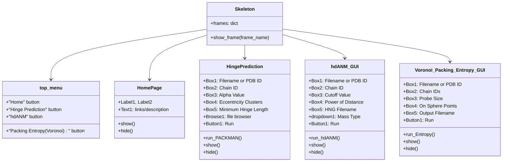

# User Interfaces

<details>
<summary>Relevant source files</summary>

The following files were used as context for generating this wiki page:

- [.github/workflows/python-package.yml](.github/workflows/python-package.yml)
- [README.md](README.md)
- [additional codes/ScanAlpha.py](additional codes/ScanAlpha.py)
- [docs/source/index.rst](docs/source/index.rst)
- [packman/__init__.py](packman/__init__.py)
- [packman/apps/__init__.py](packman/apps/__init__.py)
- [packman/apps/predict_hinge.py](packman/apps/predict_hinge.py)
- [packman/bin/GUI.py](packman/bin/GUI.py)
- [packman/bin/PACKMAN.py](packman/bin/PACKMAN.py)
- [packman/molecule/__init__.py](packman/molecule/__init__.py)
- [setup.py](setup.py)

</details>


This page describes all four ways to interact with PACKMAN: the graphical user interface (GUI), the command-line interface (CLI), the Python API, and the hosted web servers. Each interface exposes the same underlying analysis capabilities — hinge prediction, hdANM, packing entropy, and DCI — through a different access pattern.

For details on the analysis functions themselves, see [Analysis Applications](#4) and [Network Models](#5). For installation instructions, see [Installation](#1.1).

---

## Overview

The entry point for both the GUI and CLI is the `main()` function in [packman/bin/PACKMAN.py:141-148](). At runtime it inspects `sys.argv` to decide which interface to launch.

**Interface routing diagram:**

```mermaid
flowchart TD
  cmd["\"python -m packman ...\""]
  main["\"main() in packman/bin/PACKMAN.py\""]
  gui_branch{"\"sys.argv[1] == 'gui'?\""}
  load_gui["\"load_gui() in packman/bin/GUI.py\""]
  load_cli["\"load_cli() in packman/bin/PACKMAN.py\""]
  IO["\"IO() - argparse\""]
  hinge_cli["\"hinge_cli()\""]
  hdanm_cli["\"hdanm_cli()\""]
  entropy_cli["\"entropy_cli()\""]
  dci_cli["\"dci_cli()\""]

  cmd --> main
  main --> gui_branch
  gui_branch -- "yes" --> load_gui
  gui_branch -- "no" --> load_cli
  load_cli --> IO
  IO --> hinge_cli
  IO --> hdanm_cli
  IO --> entropy_cli
  IO --> dci_cli
```

Sources: [packman/bin/PACKMAN.py:141-152](), [packman/bin/GUI.py:112-114]()

---

## Graphical User Interface (GUI)

### Launching

```bash
python -m packman gui
# or
python3 -m packman gui
```

The `main()` function detects the `gui` argument and calls `load_gui()` from [packman/bin/GUI.py:112-114](), which instantiates the `Skeleton` class and starts the Tkinter event loop.

### Structure

The GUI is built on Tkinter. The `Skeleton` class ([packman/bin/GUI.py:53-90]()) is the root `tk.Tk` window. It manages four content panels and one navigation bar, switching between them with `show_frame()`.



Sources: [packman/bin/GUI.py:53-114](), [packman/bin/GUI.py:122-387](), [packman/bin/GUI.py:395-602](), [packman/bin/GUI.py:610-734]()

### Panel Input Fields

| Panel | Key Inputs | Defaults |
|---|---|---|
| **HingePrediction** | Filename/PDB ID, Chain ID, Alpha Value, Eccentricity Clusters, Min Hinge Length | Alpha=`2.8`, Clusters=`4`, MinLen=`5` |
| **hdANM_GUI** | Filename/PDB ID, Chain ID, Cutoff Value, Power of Distance, `.hng` Filename, Mass Type | Cutoff=`15`, Power=`0`, HNG=`output.hng`, Mass=`Molecular Weight` |
| **Voronoi_Packing_Entropy_GUI** | Filename/PDB ID, Chain IDs (comma-separated), Probe Size, On Sphere Points, Output Filename | Probe=`1.4`, Points=`30`, Output=`voronoi_packing_entropy_output.txt` |

### GUI Results Display

- **Hinge Prediction**: opens a `tk.Toplevel` popup listing hinge ID, chain, residue range, and p-value per hinge; includes checkboxes for selecting hinges and a "Save HNG file" button to export the `.hng` format required by hdANM. See [packman/bin/GUI.py:268-387]().
- **hdANM**: opens a `tk.Toplevel` popup to save eigenvectors/eigenvalues as `.csv` files and generate curvilinear or linear motion movies as `.pdb`/`.cif`. See [packman/bin/GUI.py:535-601]().
- **Packing Entropy**: writes per-residue entropy to the specified output file and shows a notification dialog on completion. See [packman/bin/GUI.py:712-733]().

For full GUI documentation, see [Graphical User Interface (GUI)](#8).

---

## Command-Line Interface (CLI)

### Entry Point

After installation with `pip install py-packman`, the `packman` command is registered as a console script ([setup.py:42]()):

```
packman=packman.bin.PACKMAN:main
```

### Subcommands

The CLI uses Python's `argparse` with subparsers ([packman/bin/PACKMAN.py:36-87]()). Each subcommand maps to a `_cli` wrapper function.

```mermaid
flowchart LR
  packman["\"packman (console script)\""]
  hinge["\"packman hinge\""]
  hdanm["\"packman hdanm\""]
  entropy["\"packman entropy\""]
  dci["\"packman dci\""]
  hinge_cli_fn["\"hinge_cli(args, mol)\""]
  hdanm_cli_fn["\"hdanm_cli(args, mol)\""]
  entropy_cli_fn["\"entropy_cli(args, mol)\""]
  dci_cli_fn["\"dci_cli(args, mol)\""]

  packman --> hinge --> hinge_cli_fn
  packman --> hdanm --> hdanm_cli_fn
  packman --> entropy --> entropy_cli_fn
  packman --> dci --> dci_cli_fn
```

Sources: [packman/bin/PACKMAN.py:36-130](), [packman/apps/__init__.py:16-19]()

### Subcommand Arguments

**`packman hinge`**

| Argument | Type | Default | Description |
|---|---|---|---|
| `alpha` (positional) | float | — | Alpha shape parameter (e.g. `2.8` for closed, `4.5` for open) |
| `filename` (positional) | str | — | Path to PDB/CIF file |
| `--pdbid` | str | — | Download structure by PDB ID before analysis |
| `--e_clusters` | int | `4` | Number of eccentricity clusters |
| `--minhnglen` | int | `5` | Minimum hinge length |
| `--chain` | str | — | Chain ID to analyze |
| `--generateobj` | file | — | Path to write `.obj` file (requires `--chain`) |

**`packman hdanm`**

| Argument | Type | Default | Description |
|---|---|---|---|
| `filename` (positional) | str | — | Path to PDB/CIF file |
| `hngfile` (positional) | str | — | Path to `.hng` file |
| `--pdbid` | str | — | Download structure by PDB ID |
| `--chain` | str | — | Chain ID |
| `--dr` | float | `15` | Distance cutoff for ANM |
| `--power` | float | `0` | Power of distance |
| `--mass` | str | `residue` | Mass type: `unit`, `residue`, or `atom` |
| `--scale` | int | `2` | Movie scale factor |
| `--frames` | int | `10` | Number of movie frames |
| `--modes` | int | `10` | Number of modes to output |
| `--ca_to_aa` | bool | `False` | Project Cα motion onto all atoms |
| `--make_tar` | flag | — | Package output into `.tar.gz` |

**`packman entropy`**

| Argument | Type | Default | Description |
|---|---|---|---|
| `filename` (positional) | str | — | Path to PDB/CIF file |
| `--type` | str | — | Entropy type (e.g. `PackingEntropy`) |
| `--pdbid` | str | — | Download structure by PDB ID |
| `--chains` | str | `None` | Comma-separated chain IDs; `None` means all chains |
| `--probe_size` | float | `1.4` | Surface probe radius in Å |
| `--onspherepoints` | int | `30` | Points generated around each atom for surface |

**`packman dci`**

| Argument | Type | Default | Description |
|---|---|---|---|
| `filename` (positional) | str | — | Path to PDB/CIF file |
| `--pdbid` | str | — | Download structure by PDB ID |
| `--chain` | str | `None` | Chain ID |
| `--cutoff` | float | `7.0` | Distance cutoff for DCI |
| `--n_com` | int | `None` | Number of communities |

### Shared Parameters

All subcommands accept two web-server-oriented parameters ([packman/bin/PACKMAN.py:82-84]()):

| Argument | Default | Description |
|---|---|---|
| `--outputfile` | `stdout` | File to write results to |
| `--logfile` | `stderr` | File to write log messages to |

### Example Invocations

```bash
# Download 1prw.pdb and run hinge prediction on chain A
packman hinge --pdbid 1prw 2.8 1prw.pdb --chain A

# Run hdANM using a pre-computed .hng file
packman hdanm 1prw.pdb 1prw.hng --chain A --dr 15 --mass residue

# Calculate packing entropy for all chains
packman entropy 1prw.pdb --probe_size 1.4 --onspherepoints 30

# Run DCI community detection
packman dci 1prw.pdb --chain A --cutoff 7.0
```

For the full CLI reference, see [Command-Line Interface](#7).

---

## Python API

The `packman` package is importable after installation. The top-level `__init__.py` re-exports all major subpackages ([packman/__init__.py:7-12]()):

```python
from packman.molecule import *
from packman.apps import *
from packman.bin import *
from packman.anm import *
from packman.constants import *
from packman.utilities import *
```

### Common API Patterns

**Load a structure and run hinge prediction:**

```python
from packman import molecule
from packman.apps import predict_hinge

mol = molecule.load_structure('1prw.pdb')
backbone = [atom for residue in mol[0]['A'].get_backbone() for atom in residue if atom is not None]
predict_hinge(backbone, outputfile=open('output.txt', 'w'), Alpha=2.8)
```

**Run hdANM:**

```python
from packman import molecule
from packman.anm import hdANM

mol = molecule.load_structure('1prw.pdb')
calpha = [i for i in mol[0]['A'].get_calpha() if i is not None]
model = hdANM(calpha, dr=15, power=0, hng_file='1prw.hng')
model.calculate_hessian(mass_type='residue')
model.calculate_decomposition()
```

**Calculate packing entropy:**

```python
from packman import molecule
from packman.entropy import PackingEntropy

mol = molecule.load_structure('1prw.pdb')
result = PackingEntropy(mol[0].get_atoms(), probe_size=1.4, onspherepoints=30)
```

### API to Code Entity Map

```mermaid
flowchart TD
  api["\"import packman\""]
  mol_module["\"packman.molecule\""]
  apps_module["\"packman.apps\""]
  anm_module["\"packman.anm\""]
  entropy_module["\"packman.entropy\""]

  load_structure["\"molecule.load_structure()\""]
  download_structure["\"molecule.download_structure()\""]
  predict_hinge_fn["\"apps.predict_hinge()\""]
  hdANM_class["\"anm.hdANM\""]
  PackingEntropy_class["\"entropy.PackingEntropy\""]
  DCI_class["\"apps.DCI\""]

  api --> mol_module --> load_structure
  mol_module --> download_structure
  api --> apps_module --> predict_hinge_fn
  apps_module --> DCI_class
  api --> anm_module --> hdANM_class
  api --> entropy_module --> PackingEntropy_class
```

Sources: [packman/__init__.py:1-12](), [packman/molecule/__init__.py:29-43](), [packman/apps/__init__.py:16-19]()

---

## Web Servers

Four hosted web servers provide browser-based access to PACKMAN analyses without local installation. They use the same CLI argument interface internally (note the `--outputfile` and `--logfile` parameters in [packman/bin/PACKMAN.py:82-84]() are designated for web server use).

| Analysis | URL |
|---|---|
| Hinge Prediction | `https://packman.bb.iastate.edu/` |
| hd-ANM | `https://hdanm.bb.iastate.edu/` |
| Packing Entropy | `https://packing-entropy.bb.iastate.edu/` |
| DCI | `https://dci.bb.iastate.edu/` |

Sources: [README.md:53-57](), [packman/bin/PACKMAN.py:82-84](), [docs/source/index.rst:24-28]()

---

## Interface Comparison

| Feature | GUI | CLI | Python API | Web Server |
|---|---|---|---|---|
| Launch | `python -m packman gui` | `packman <subcommand>` | `import packman` | Browser |
| Hinge Prediction | ✓ | `packman hinge` | `predict_hinge()` | ✓ |
| hdANM | ✓ | `packman hdanm` | `hdANM` class | ✓ |
| Packing Entropy | ✓ | `packman entropy` | `PackingEntropy` class | ✓ |
| DCI | ✗ | `packman dci` | `DCI` class | ✓ |
| Scripting / automation | ✗ | ✓ | ✓ | ✗ |
| HNG file export | ✓ (interactive) | via output file | manual | ✓ |
| Requires installation | ✓ | ✓ | ✓ | ✗ |

Sources: [README.md:33-46](), [packman/bin/PACKMAN.py:36-129](), [packman/bin/GUI.py:53-114]()

---