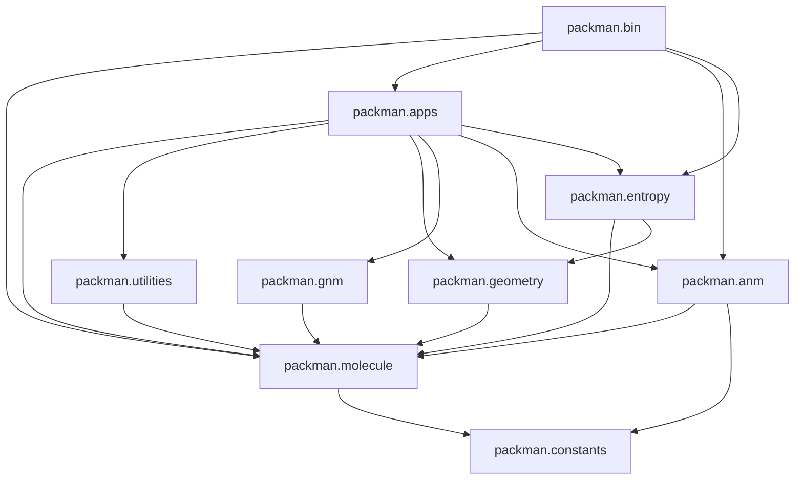
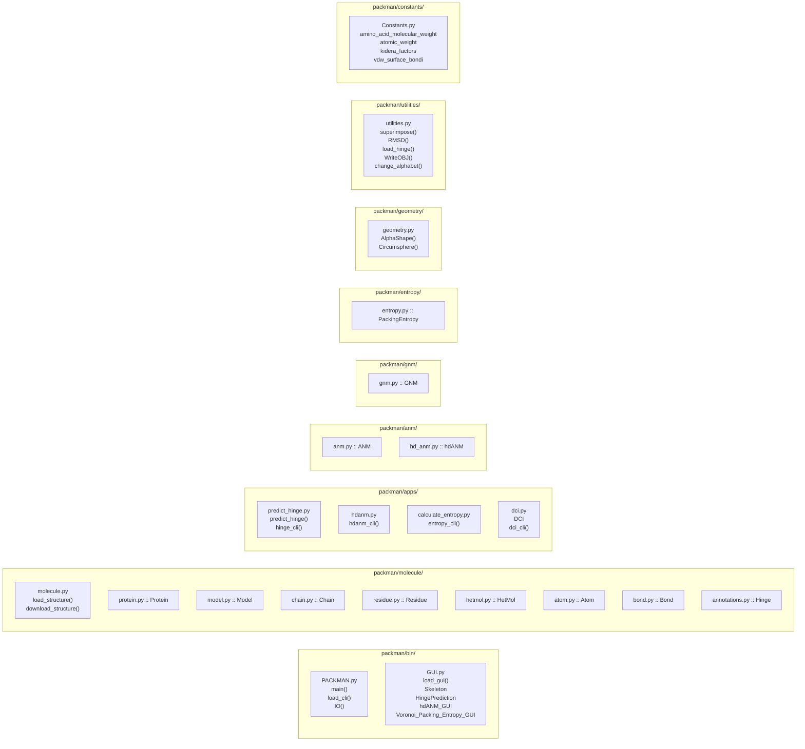
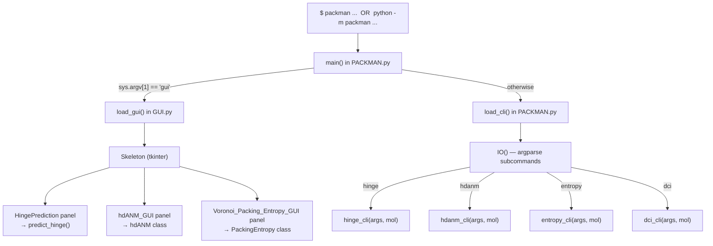

# Package Architecture

<details>
<summary>Relevant source files</summary>

The following files were used as context for generating this wiki page:

- [.github/workflows/python-package.yml](.github/workflows/python-package.yml)
- [README.md](README.md)
- [additional codes/ScanAlpha.py](additional codes/ScanAlpha.py)
- [docs/source/index.rst](docs/source/index.rst)
- [docs/source/packman.anm.hd_anm.rst](docs/source/packman.anm.hd_anm.rst)
- [docs/source/packman.anm.rst](docs/source/packman.anm.rst)
- [docs/source/packman.apps.rst](docs/source/packman.apps.rst)
- [docs/source/packman.bin.rst](docs/source/packman.bin.rst)
- [docs/source/packman.constants.Constants.rst](docs/source/packman.constants.Constants.rst)
- [docs/source/packman.constants.rst](docs/source/packman.constants.rst)
- [docs/source/packman.molecule.rst](docs/source/packman.molecule.rst)
- [docs/source/packman.rst](docs/source/packman.rst)
- [docs/source/packman.utilities.rst](docs/source/packman.utilities.rst)
- [docs/source/packman.utilities.utilities.rst](docs/source/packman.utilities.utilities.rst)
- [packman/__init__.py](packman/__init__.py)
- [packman/apps/__init__.py](packman/apps/__init__.py)
- [packman/apps/predict_hinge.py](packman/apps/predict_hinge.py)
- [packman/bin/GUI.py](packman/bin/GUI.py)
- [packman/bin/PACKMAN.py](packman/bin/PACKMAN.py)
- [packman/molecule/__init__.py](packman/molecule/__init__.py)
- [setup.py](setup.py)

</details>


This page describes the physical layout of the `packman` Python package, the responsibility of each subpackage, and the dependency relationships between them. It covers the source tree as it exists under `packman/` and the external libraries the package depends on.

For details on any individual subpackage, follow the links in the sections below. For installation instructions, see page [1.1](#1.1). For the user-facing interfaces (GUI, CLI, API), see page [1.2](#1.2).

---

## Source Tree

The installable package root is `packman/`. All subpackages live directly beneath it.

```
packman/
├── __init__.py          # Re-exports molecule, apps, bin, anm, constants, utilities
├── molecule/            # Molecular data model and file I/O
├── apps/                # High-level analysis applications
├── anm/                 # ANM and hdANM network models
├── gnm/                 # GNM network model
├── entropy/             # Packing entropy (Voronoi/sphere-point method)
├── geometry/            # Alpha shapes and circumsphere geometry
├── utilities/           # Superimposition, RMSD, OBJ export, helpers
├── constants/           # Amino acid weights, atomic weights, Kidera factors, VdW radii
├── bin/                 # CLI entry point (PACKMAN.py) and GUI (GUI.py)
└── tests/               # pytest test suite with test data
```

Sources: [setup.py:21-36](), [packman/__init__.py:1-16](), [docs/source/packman.rst:1-21]()

---

## Subpackage Responsibilities

| Subpackage | Key Public Symbols | Responsibility |
|---|---|---|
| `packman.molecule` | `load_structure`, `download_structure`, `Protein`, `Model`, `Chain`, `Residue`, `HetMol`, `Atom`, `Bond`, `Hinge` | Parse PDB/CIF files; provide the core object hierarchy consumed by all other modules |
| `packman.apps` | `predict_hinge`, `hinge_cli`, `DCI`, `dci_cli`, `entropy_cli`, `hdanm_cli` | Analysis applications assembled from lower-level modules |
| `packman.anm` | `ANM`, `hdANM` | Anisotropic Network Model and hinge-domain ANM |
| `packman.gnm` | `GNM` | Gaussian Network Model (Kirchhoff matrix) |
| `packman.entropy` | `PackingEntropy` | Per-residue packing entropy via Voronoi tessellation |
| `packman.geometry` | `AlphaShape`, `Circumsphere` | Delaunay-based alpha shapes and circumsphere computation |
| `packman.utilities` | `superimpose`, `RMSD`, `load_hinge`, `WriteOBJ`, `change_alphabet` | Shared helper functions |
| `packman.constants` | `amino_acid_molecular_weight`, `atomic_weight`, `kidera_factors`, `vdw_surface_bondi` | Static lookup tables; no internal dependencies |
| `packman.bin` | `main` (entry point), `load_cli`, `load_gui` | Dispatch to CLI (`PACKMAN.py`) or GUI (`GUI.py`) |
| `packman.tests` | test modules + `data/` | pytest suite and fixture data (`.pdb`, `.cif`, `.hng`) |

Sources: [packman/__init__.py:7-12](), [packman/apps/__init__.py:1-19](), [packman/molecule/__init__.py:1-43](), [packman/bin/PACKMAN.py:1-152](), [packman/bin/GUI.py:1-35](), [setup.py:21-40]()

---

## Top-Level `__init__.py` Exports

`packman/__init__.py` star-imports five subpackages, making their symbols available directly under the `packman` namespace:

[packman/__init__.py:7-12]()

```python
from .molecule import *
from .apps import *
from .bin import *
from .anm import *
from .constants import *
from .utilities import *
```

`gnm`, `entropy`, and `geometry` are **not** re-exported at the top level; they must be imported by their full path (e.g. `from packman.entropy import PackingEntropy`).

Sources: [packman/__init__.py:1-16]()

---

## Dependency Graph

**Diagram 1 — Inter-subpackage dependencies (import-time)**



Sources: [packman/bin/PACKMAN.py:12-18](), [packman/bin/GUI.py:21-24](), [packman/apps/predict_hinge.py:29-31](), [packman/apps/__init__.py:16-19]()

---

## Module-to-File Mapping

**Diagram 2 — Code entities mapped to source files**



Sources: [packman/molecule/__init__.py:29-43](), [packman/apps/__init__.py:16-19](), [setup.py:21-36](), [docs/source/packman.molecule.rst:1-23](), [docs/source/packman.anm.rst:1-17](), [docs/source/packman.apps.rst:1-16]()

---

## Entry Points and Interface Layer

The `packman.bin` subpackage is the only consumer of all four user-facing interfaces. The `main()` function in `packman/bin/PACKMAN.py` is registered as the `packman` console script entry point.

[setup.py:42-43]()

```
SCRIPTS=['packman=packman.bin.PACKMAN:main']
```

**Diagram 3 — Runtime dispatch from entry points**



Sources: [packman/bin/PACKMAN.py:95-152](), [packman/bin/GUI.py:53-114](), [setup.py:42-43]()

---

## External Dependencies

The package declares the following third-party runtime requirements:

| Library | Used By |
|---|---|
| `numpy` | `molecule`, `anm`, `gnm`, `entropy`, `geometry`, `apps` |
| `scipy` | `apps` (hinge statistics, plane fitting), `anm`, `gnm` |
| `networkx` | `geometry` (alpha shape graph), `apps` (eccentricity), `gnm` |
| `scikit-learn` | `apps` (KMeans clustering in hinge prediction, CH scoring in DCI) |
| `mlxtend` | `apps` (permutation test in hinge prediction) |
| `tqdm` | Progress bars in long-running computations |
| `typing_extensions` | Type annotations (Python < 3.10 compatibility) |

Optional (not declared, imported conditionally):

| Library | Used By |
|---|---|
| `tkinter` | `packman.bin.GUI` (standard library on most platforms) |

Sources: [setup.py:74](), [packman/bin/GUI.py:27-34]()

---

## Relationship to Other Wiki Pages

| Subpackage | Detailed documentation |
|---|---|
| `packman.molecule` | See page [3](#3) — Molecular Data Model |
| `packman.apps` | See page [4](#4) — Analysis Applications |
| `packman.anm` | See pages [5.1](#5.1), [5.2](#5.2) — ANM and hdANM |
| `packman.gnm` | See page [5.3](#5.3) — GNM |
| `packman.geometry` | See page [6](#6) — Geometry Module |
| `packman.bin` (CLI) | See page [7](#7) — Command-Line Interface |
| `packman.bin` (GUI) | See page [8](#8) — Graphical User Interface |
| `packman.utilities`, `packman.constants` | See page [9](#9) — Utilities and Constants |
| `packman.tests` | See page [10](#10) — Testing |

---