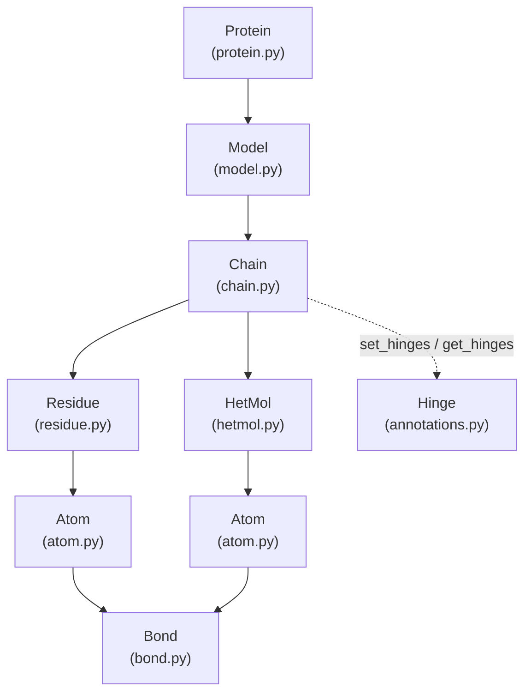
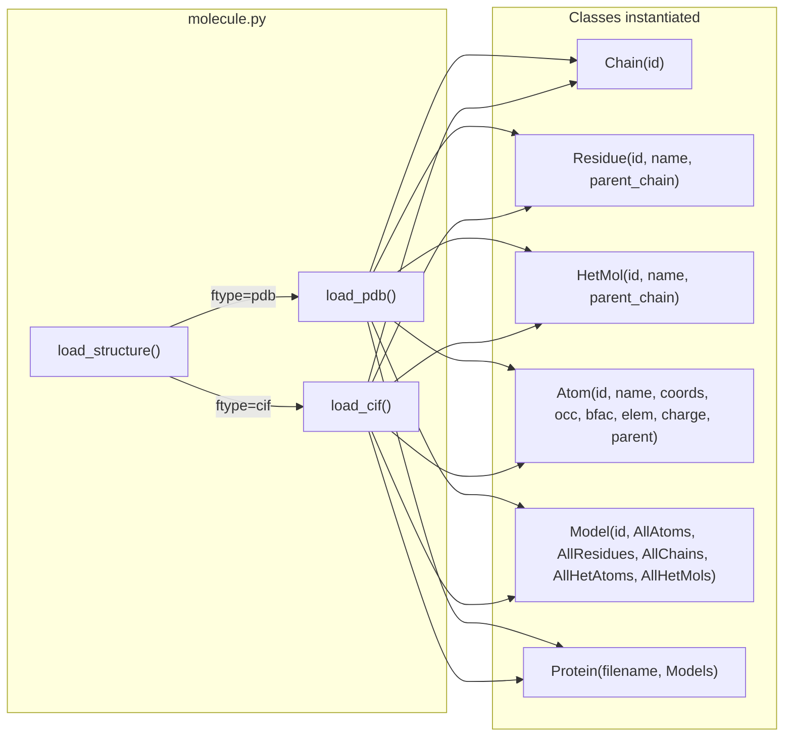
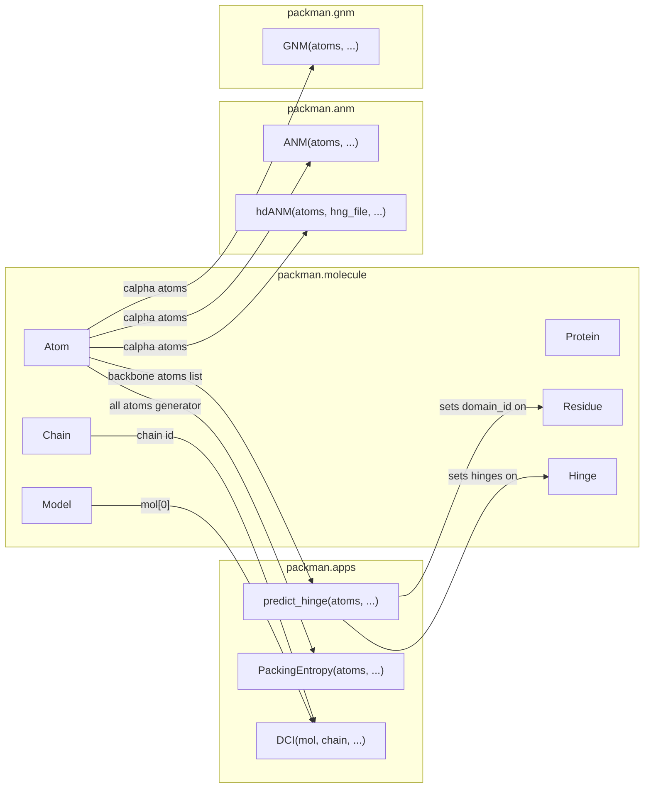

# Molecular Data Model

<details>
<summary>Relevant source files</summary>

The following files were used as context for generating this wiki page:

- [packman/apps/__init__.py](packman/apps/__init__.py)
- [packman/apps/predict_hinge.py](packman/apps/predict_hinge.py)
- [packman/bin/PACKMAN.py](packman/bin/PACKMAN.py)
- [packman/molecule/__init__.py](packman/molecule/__init__.py)
- [packman/molecule/chain.py](packman/molecule/chain.py)
- [packman/molecule/model.py](packman/molecule/model.py)
- [packman/molecule/molecule.py](packman/molecule/molecule.py)
- [packman/molecule/protein.py](packman/molecule/protein.py)
- [packman/molecule/residue.py](packman/molecule/residue.py)

</details>


The `packman.molecule` subpackage is the foundational data layer of PACKMAN. It defines the object hierarchy used to represent a parsed protein structure file, and every other module in the library — hinge prediction, network models, entropy calculations — operates on objects from this module.

This page covers the hierarchy concept, the classes involved, and how the hierarchy is constructed during file parsing. For details on loading and downloading structure files, see page [3.1](#3.1). For `Protein`, `Model`, and `Chain` API reference, see [3.2](#3.2). For `Residue`, `HetMol`, see [3.3](#3.3). For `Atom`, `Bond`, and `Hinge`, see [3.4](#3.4).

---

## Object Hierarchy

PACKMAN represents a structural biology file as a strict parent–child tree. Each level of the tree wraps the level below it.

**Hierarchy levels:**

| Level | Class | File | Description |
|---|---|---|---|
| 1 (top) | `Protein` | `packman/molecule/protein.py` | The root object; holds all models from a file |
| 2 | `Model` | `packman/molecule/model.py` | One conformational frame; PDB `MODEL` record |
| 3 | `Chain` | `packman/molecule/chain.py` | A single polymer chain within a model |
| 4a | `Residue` | `packman/molecule/residue.py` | An amino acid residue (from `ATOM` records) |
| 4b | `HetMol` | `packman/molecule/hetmol.py` | A heterogeneous molecule (from `HETATM` records) |
| 5 | `Atom` | `packman/molecule/atom.py` | A single atom with 3D coordinates |
| 6 | `Bond` | `packman/molecule/bond.py` | A covalent or non-covalent bond between two atoms |

The annotation class `Hinge` lives at [packman/molecule/annotations.py]() and is attached to `Chain` objects after hinge prediction runs.

---

**Object Hierarchy Diagram**



Sources: [packman/molecule/__init__.py:1-43](), [packman/molecule/protein.py:26-50](), [packman/molecule/model.py:59-99](), [packman/molecule/chain.py:30-52](), [packman/molecule/residue.py:35-60]()

---

## Module Layout

The `packman.molecule` package exports all hierarchy classes directly from its `__init__.py`:

```
packman/molecule/
├── __init__.py       # exports all public symbols
├── molecule.py       # load_structure(), download_structure(), batch_download()
├── protein.py        # Protein class
├── model.py          # Model class
├── chain.py          # Chain class
├── residue.py        # Residue class
├── hetmol.py         # HetMol class
├── atom.py           # Atom class
├── bond.py           # Bond class
└── annotations.py    # Hinge class
```

The public API is:

```python
from packman import molecule

# Functions
molecule.load_structure(filename, ftype='cif')
molecule.download_structure(pdbid, ...)

# Classes
molecule.Protein
molecule.Model
molecule.Chain
molecule.Residue
molecule.HetMol
molecule.Atom
molecule.Bond
molecule.Hinge
```

Sources: [packman/molecule/__init__.py:1-43]()

---

## How Structures Are Parsed Into the Hierarchy

When `load_structure()` is called, it delegates to either `load_pdb()` or `load_cif()` in [packman/molecule/molecule.py](). Both parsers build the hierarchy bottom-up: atoms are created first, then assigned to residues, residues to chains, and chains to a model. A `Protein` wraps all models.

**Parsing and Object Construction Flow**



Sources: [packman/molecule/molecule.py:39-157](), [packman/molecule/molecule.py:160-441](), [packman/molecule/molecule.py:451-481]()

During PDB parsing, the `ATOM` record populates `AllAtoms` / `AllResidues` / `AllChains`, while `HETATM` records populate `AllHetAtoms` / `AllHetMols`. Both share the same `AllChains` dictionary. See [packman/molecule/molecule.py:66-131]() for the PDB loop.

For CIF files, frame number is read from `_atom_site.pdbx_PDB_model_num`, and `auth_` fields are preferred over `label_` fields for chain, residue, and atom IDs. See [packman/molecule/molecule.py:199-278]().

---

## Parent–Child Navigation

Every object holds a reference to its parent. This allows upward traversal at any point in the hierarchy.

| Object | `.get_parent()` returns |
|---|---|
| `Model` | `Protein` |
| `Chain` | `Model` |
| `Residue` | `Chain` |
| `HetMol` | `Chain` |
| `Atom` | `Residue` or `HetMol` |

Downward traversal uses `get_*` generator methods:

| Object | Downward methods |
|---|---|
| `Protein` | `__iter__` (yields `Model` objects), `get_models()` |
| `Model` | `get_chains()`, `get_residues()`, `get_atoms()`, `get_hetmols()`, `get_hetatoms()` |
| `Chain` | `get_residues()`, `get_hetmols()`, `get_atoms()`, `get_hetatoms()` |
| `Residue` | `get_atoms()`, `get_atom(key)` |
| `HetMol` | `get_atoms()`, `get_atom(key)` |

A common access pattern using `mol[0]` (first model by index):

```python
mol = molecule.load_structure('1prw.cif')
for chain in mol[0].get_chains():
    for residue in chain.get_residues():
        calpha = residue.get_calpha()
```

Sources: [packman/molecule/protein.py:48-49](), [packman/molecule/model.py:109-190](), [packman/molecule/chain.py:84-298](), [packman/molecule/residue.py:96-127]()

---

## Residues vs. HetMols

`Residue` and `HetMol` are parallel classes at the same level of the hierarchy but represent different record types in a structure file.

| Property | `Residue` | `HetMol` |
|---|---|---|
| Source record | `ATOM` (PDB) / `ATOM` (CIF) | `HETATM` (PDB) / `HETATM` (CIF) |
| Typical content | Standard amino acids | Ligands, water, ions, modified residues |
| C-alpha access | `get_calpha()` | — |
| Backbone access | `get_backbone()` | — |
| Tip atom access | `get_tip()` | — |
| Entropy storage | `get_entropy()` / `set_entropy()` | — |
| Domain ID | `get_domain_id()` / `set_domain_id()` | — |

Both classes expose `get_atoms()`, `get_atom(key)`, `get_id()`, `get_name()`, `get_parent()`, and the custom `get_property()` / `set_property()` pinboard mechanism.

Sources: [packman/molecule/residue.py:35-341](), [packman/molecule/chain.py:54-64]()

---

## Bonds

Bond objects are constructed by `Model.calculate_bonds()` ([packman/molecule/model.py:547-641]()). Bond information is sourced from:

1. `CONECT` records in PDB files
2. `_struct_conn` sections in CIF files
3. Hardcoded per-residue connectivity tables (`aa_connectivity` dict in [packman/molecule/model.py:22-43]())

Each `Bond` holds references to both of its `Atom` objects and carries a bond type string (`'covalent'`, `'covalent-single'`, `'hydrogen'`, `'non-covalent'`, `'other'`).

For CIF files, bonds are automatically calculated during `load_cif()` ([packman/molecule/molecule.py:437-440]()). For PDB files, `Model.calculate_bonds()` must be called explicitly after loading.

The `Model` also maintains an internal `networkx.Graph` (`__ModelGraph`) used for torsion angle calculations and bond-based rotation via `set_torsion()`.

---

## The Hinge Annotation

After running hinge prediction (see page [4.1](#4.1)), `Hinge` objects are stored on the `Chain` using `Chain.set_hinges()` and retrieved via `Chain.get_hinges()`. A `Hinge` object records:

- The alpha value used for prediction
- The list of `Residue` elements comprising the hinge
- Statistical data and p-value for the prediction

Simultaneously, each `Residue` in the hinge gets a domain ID of the form `'FL0'`, `'FL1'`, … (flexible linker), while non-hinge residues receive `'DM0'`, `'DM1'`, … (domain). These are set via `Residue.set_domain_id()` and read via `Residue.get_domain_id()`.

Sources: [packman/molecule/chain.py:92-99](), [packman/molecule/chain.py:164-170](), [packman/molecule/residue.py:129-141](), [packman/apps/predict_hinge.py:301-323]()

---

## Custom Properties

Every class in the hierarchy (`Model`, `Chain`, `Residue`, `HetMol`, `Atom`) exposes a generic key-value store via:

- `set_property(property_name, value)`
- `get_property(property_name)`

This is backed by a private `__properties` dict on each object and is intended for user-defined annotations. For example, a residue can be flagged as disordered, or an atom can store label properties read from a CIF `label_asym_id` field.

The `Residue.set_entropy()` / `get_entropy()` methods store packing entropy values inside this same `__properties` dict under the key `'PackingEntropy'`.

Sources: [packman/molecule/residue.py:162-177](), [packman/molecule/residue.py:241-257](), [packman/molecule/chain.py:120-135](), [packman/molecule/model.py:221-237]()

---

## How Other Modules Consume the Data Model

Every PACKMAN analysis module accepts objects from `packman.molecule` as input. The diagram below maps module entry points to the molecule objects they require.

**Module Dependencies on packman.molecule**



Sources: [packman/apps/predict_hinge.py:34-65](), [packman/molecule/model.py:394-408](), [packman/bin/PACKMAN.py:116-129]()

---

## NMR Multi-Model Handling

When a file contains more than two `MODEL` frames (typical of NMR ensembles), the loader recalculates the B-factor field for each atom. Instead of the value from the file, the B-factor is set to the scalar standard deviation of the atom's position across all frames:

```
B-factor = sqrt( Var(x) + Var(y) + Var(z) )
```

This is applied in both `load_pdb()` ([packman/molecule/molecule.py:134-151]()) and `load_cif()` ([packman/molecule/molecule.py:413-430]()). The resulting `Protein` object still contains all frames as separate `Model` instances, accessible by index (e.g., `mol[0]`, `mol[1]`, …).

Sources: [packman/molecule/molecule.py:134-157](), [packman/molecule/molecule.py:413-441]()

---