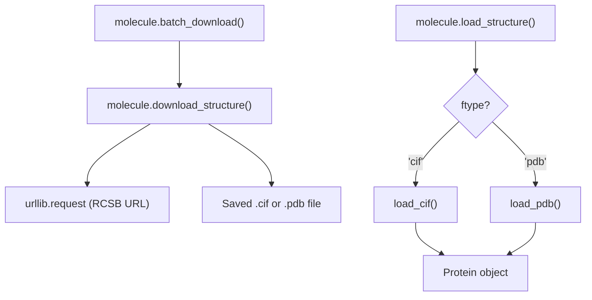
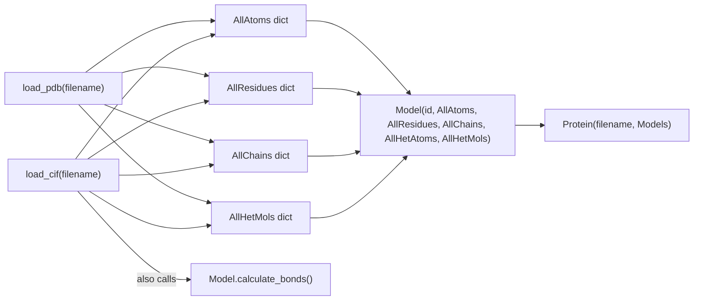
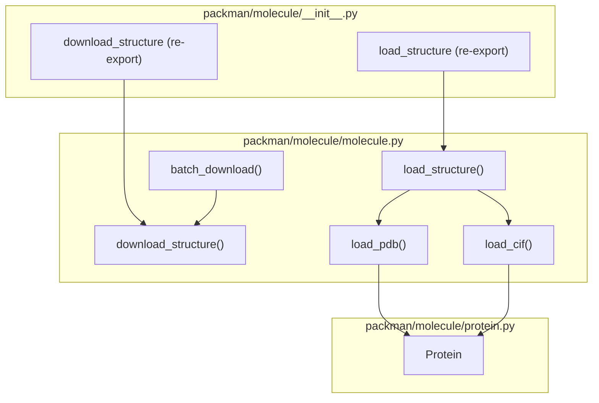

# Loading and Downloading Structures

<details>
<summary>Relevant source files</summary>

The following files were used as context for generating this wiki page:

- [docs/_static/gallary/bond_rotate.png](docs/_static/gallary/bond_rotate.png)
- [docs/source/tutorials/GNM.rst](docs/source/tutorials/GNM.rst)
- [docs/source/tutorials/alpha_shape.rst](docs/source/tutorials/alpha_shape.rst)
- [docs/source/tutorials/bond_rotate.rst](docs/source/tutorials/bond_rotate.rst)
- [docs/source/tutorials/molecule.rst](docs/source/tutorials/molecule.rst)
- [packman/apps/__init__.py](packman/apps/__init__.py)
- [packman/apps/predict_hinge.py](packman/apps/predict_hinge.py)
- [packman/bin/PACKMAN.py](packman/bin/PACKMAN.py)
- [packman/molecule/__init__.py](packman/molecule/__init__.py)
- [packman/molecule/chain.py](packman/molecule/chain.py)
- [packman/molecule/model.py](packman/molecule/model.py)
- [packman/molecule/molecule.py](packman/molecule/molecule.py)

</details>


This page documents how PACKMAN fetches and parses molecular structure files. It covers the three public functions — `load_structure()`, `download_structure()`, and `batch_download()` — along with the two internal parsers (`load_pdb` and `load_cif`), their parameters, and the `Protein` object they return.

For details about what the returned `Protein` object contains and how to navigate its hierarchy, see [Protein, Model, and Chain](#3.2). For background on the overall `packman.molecule` data model, see [Molecular Data Model](#3).

---

## Overview

All structure I/O lives in `packman/molecule/molecule.py`. The public API is re-exported from `packman/molecule/__init__.py` under the `packman.molecule` namespace.

The typical workflow is:

1. **Download** a structure from RCSB using `download_structure()` or `batch_download()`.
2. **Load** the saved file into a `Protein` object using `load_structure()`.

Both steps can be done independently: you can load a locally stored file without downloading, and you can download without immediately loading.

**Call flow diagram** — public entry points to internal parsers:



Sources: [packman/molecule/molecule.py:451-570](), [packman/molecule/__init__.py:28-30]()

---

## `load_structure()`

**Signature:**

```
load_structure(filename: str, ftype: str = 'cif') -> Protein
```

**Location:** [packman/molecule/molecule.py:451-481]()

**Description:** Dispatches to either `load_pdb` or `load_cif` based on the file extension or the `ftype` parameter. Returns a fully constructed `Protein` object.

**Format detection logic:**

1. Attempts to extract an extension from `filename` by splitting on `'.'` and checking index `[1]`.
2. If the extracted extension is `'cif'` or `'pdb'`, it overrides the `ftype` parameter.
3. Falls back to `ftype` if the filename has no recognized extension.

| Parameter  | Type  | Default  | Description                                         |
|------------|-------|----------|-----------------------------------------------------|
| `filename` | `str` | required | Path to the structure file                          |
| `ftype`    | `str` | `'cif'`  | Format override if extension is absent or ambiguous |

**Return value:** A `packman.molecule.Protein` object.

**Example usage:**

```python
from packman import molecule

mol = molecule.load_structure('1prw.cif')
# Equivalent — ftype inferred from extension:
mol = molecule.load_structure('1prw.cif', ftype='cif')
# Explicit PDB:
mol = molecule.load_structure('1prw.pdb', ftype='pdb')
```

Sources: [packman/molecule/molecule.py:451-481](), [docs/source/tutorials/molecule.rst:28-32]()

---

## `download_structure()`

**Signature:**

```
download_structure(pdbid: str, save_name: str = None, ftype: str = 'cif', biological_assembly: bool = False)
```

**Location:** [packman/molecule/molecule.py:490-530]()

**Description:** Downloads a structure from the RCSB Protein Data Bank using `urllib.request`. Saves the file locally. Does not return a `Protein` object — call `load_structure()` afterward.

| Parameter              | Type   | Default  | Description                                                                 |
|------------------------|--------|----------|-----------------------------------------------------------------------------|
| `pdbid`                | `str`  | required | Four-character PDB entry ID (e.g., `'1prw'`)                               |
| `save_name`            | `str`  | `None`   | Filename base to save to. If `None`, uses `pdbid` as the filename base      |
| `ftype`                | `str`  | `'cif'`  | File format: `'cif'` for mmCIF, `'pdb'` for legacy PDB format             |
| `biological_assembly`  | `bool` | `False`  | If `True`, fetches the biological assembly instead of the asymmetric unit   |

**URL construction logic:**

| `ftype` | `biological_assembly` | URL pattern                                          |
|---------|-----------------------|------------------------------------------------------|
| `'cif'` | `False`               | `https://files.rcsb.org/view/<pdbid>.cif`           |
| `'cif'` | `True`                | `https://files.rcsb.org/view/<pdbid>-assembly1.cif` |
| `'pdb'` | `False`               | `https://files.rcsb.org/view/<pdbid>.pdb`           |
| `'pdb'` | `True`                | `https://files.rcsb.org/view/<pdbid>.pdb1`          |

**Output file naming:** The extension is always appended automatically. If `save_name='1prw'` and `ftype='cif'`, the file is written to `1prw.cif`.

**Example usage:**

```python
from packman import molecule

# Download default CIF format
molecule.download_structure('1prw')

# Download as PDB, save to custom name
molecule.download_structure('1prw', save_name='my_protein', ftype='pdb')

# Download biological assembly
molecule.download_structure('4hla', biological_assembly=True)

# Typical combined workflow
molecule.download_structure('1prw')
mol = molecule.load_structure('1prw.cif')
```

Sources: [packman/molecule/molecule.py:490-530](), [docs/source/tutorials/molecule.rst:21-32]()

---

## `batch_download()`

**Signature:**

```
batch_download(entry_list: List[str], save_location: str = 'structure_files', ftype: str = 'cif', biological_assembly: bool = False) -> bool
```

**Location:** [packman/molecule/molecule.py:532-569]()

**Description:** Downloads multiple structures in parallel using Python's `multiprocessing.dummy.Pool`. Duplicates in `entry_list` are removed automatically. A `tqdm` progress bar is shown during download.

| Parameter              | Type        | Default              | Description                                                      |
|------------------------|-------------|----------------------|------------------------------------------------------------------|
| `entry_list`           | `List[str]` | required             | List of PDB IDs to download                                      |
| `save_location`        | `str`       | `'structure_files'`  | Directory to save downloaded files; created if absent            |
| `ftype`                | `str`       | `'cif'`              | File format: `'cif'` or `'pdb'`                                 |
| `biological_assembly`  | `bool`      | `False`              | Passed through to `download_structure()` for each entry          |

**Concurrency:** Uses `multiprocessing.cpu_count()` workers. Each worker calls `download_structure()` for a single entry. Failed downloads are reported but do not abort the batch.

**Note:** The internal `single_download` helper ([packman/molecule/molecule.py:554-558]()) currently calls `download_structure(entry)` without forwarding `save_location`, `ftype`, or `biological_assembly`. Files are saved in the current working directory rather than `save_location`.

**Example usage:**

```python
from packman import molecule

molecule.batch_download(['1prw', '1exr', '4hla'])
```

Sources: [packman/molecule/molecule.py:532-569]()

---

## Internal Parsers

These functions are called by `load_structure()` and are not part of the public API. They are defined in `packman/molecule/molecule.py` and not re-exported from `packman/molecule/__init__.py`.

### `load_pdb(filename)`

**Location:** [packman/molecule/molecule.py:39-157]()

Reads a `.pdb` file line by line. Recognizes `ATOM` and `HETATM` record types. Constructs the object tree: `Chain` → `Residue`/`HetMol` → `Atom`.

**Multi-model handling:** Splits the file on `'\nMODEL'`. If more than two models are present (NMR data), the B-factor field is overwritten with the scalar standard deviation of each atom's coordinates across all frames. [packman/molecule/molecule.py:134-157]()

**Bond calculation:** Does **not** call `calculate_bonds()`. Bond information is available from `CONECT` records but requires explicit calls to `Model.calculate_bonds()`.

### `load_cif(filename)`

**Location:** [packman/molecule/molecule.py:160-441]()

Reads mmCIF format by splitting on `'loop_\n'` and `'#'` subsection markers. Uses column name detection from lines starting with `'_atom_site.'`.

**Key difference from PDB parser:** `load_cif` calls `Model.calculate_bonds()` automatically for each model after loading ([packman/molecule/molecule.py:438-440]()). This populates bond data from the `_struct_conn` section of the CIF file.

**Multi-model handling:** Same B-factor override logic as `load_pdb` when more than two models are detected.

**Atom ID preference:** Prefers `auth_*` fields (author-assigned IDs) over `label_*` fields (mmCIF-assigned IDs) for chain, residue, and atom identification. Stores the `label_*` values as atom properties when both are present.

**Diagram — parser outputs and object construction:**



Sources: [packman/molecule/molecule.py:39-157](), [packman/molecule/molecule.py:160-441]()

---

## Supported File Formats

| Format | `ftype` value | Extension | Notes                                                                 |
|--------|---------------|-----------|-----------------------------------------------------------------------|
| mmCIF  | `'cif'`       | `.cif`    | Default. Includes automatic bond calculation from `_struct_conn`.    |
| PDB    | `'pdb'`       | `.pdb`    | Legacy format. Bond records (`CONECT`) parsed on-demand.             |

The mmCIF format is preferred because it carries richer annotation data that PACKMAN uses for bond calculation and structural annotations.

---

## CLI Usage

The CLI (`packman/bin/PACKMAN.py`) uses these functions via the `--pdbid` flag. When `--pdbid` is provided, `download_structure()` is called before `load_structure()`:

```python
molecule.download_structure(args.pdbid, save_name=args.filename.split('.')[0], ftype=args.filename.split('.')[1])
mol = molecule.load_structure(args.filename, ftype=extension)
```

[packman/bin/PACKMAN.py:112-120]()

For full CLI documentation including all subcommands, see [Command-Line Interface](#7).

---

## Function and Module Map

**Diagram — code entity relationships for structure I/O:**



Sources: [packman/molecule/__init__.py:28-30](), [packman/molecule/molecule.py:451-569]()

---