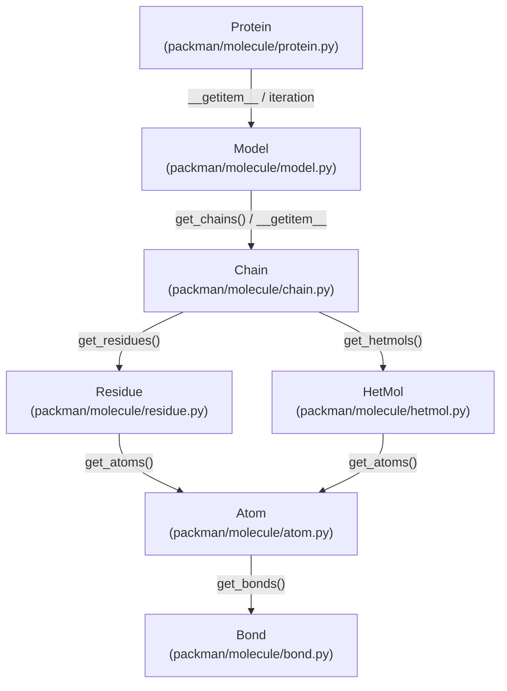
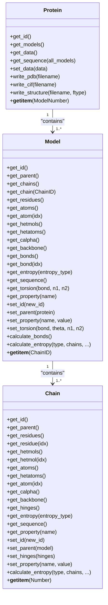

# Protein, Model, and Chain

<details>
<summary>Relevant source files</summary>

The following files were used as context for generating this wiki page:

- [packman/molecule/chain.py](packman/molecule/chain.py)
- [packman/molecule/model.py](packman/molecule/model.py)
- [packman/molecule/molecule.py](packman/molecule/molecule.py)
- [packman/molecule/protein.py](packman/molecule/protein.py)
- [packman/molecule/residue.py](packman/molecule/residue.py)

</details>


This page documents the three topmost classes in the PACKMAN molecular data model: `Protein`, `Model`, and `Chain`. It covers constructors, all get/set methods, iteration and subscript access patterns, upward/downward navigation through the hierarchy, and file output methods.

For how structures are loaded to produce `Protein` objects, see [Loading and Downloading Structures](#3.1). For the lower-level classes (`Residue`, `HetMol`, `Atom`, `Bond`) that `Chain` contains, see [Residue and HetMol](#3.3) and [Atom, Bond, and Annotations](#3.4).

---

## Hierarchy Overview

Every structure parsed by PACKMAN is represented as a tree rooted at `Protein`. Navigating the tree always follows this order:

**Object Hierarchy Diagram**



Sources: [packman/molecule/protein.py:26-201](), [packman/molecule/model.py:59-99](), [packman/molecule/chain.py:30-73]()

Each level stores a reference back to its parent via `get_parent()`:

| Level | Class | Parent Class | Parent Method |
|---|---|---|---|
| `Protein` | `Protein` | *(none)* | — |
| `Model` | `Model` | `Protein` | `get_parent()` |
| `Chain` | `Chain` | `Model` | `get_parent()` |
| `Residue` | `Residue` | `Chain` | `get_parent()` |
| `HetMol` | `HetMol` | `Chain` | `get_parent()` |
| `Atom` | `Atom` | `Residue` or `HetMol` | `get_parent()` |

---

## The `Protein` Class

**File:** [packman/molecule/protein.py:26-201]()

`Protein` is the root of the object tree. It is created automatically by `load_structure()` and should not be constructed manually.

### Constructor

```python
Protein(id: int, Models: List[Model])
```

| Parameter | Type | Description |
|---|---|---|
| `id` | `int` or `str` | Typically the filename passed to the loader |
| `Models` | `List[Model]` | All `Model` frames parsed from the file |

### Get Methods

| Method | Return Type | Description |
|---|---|---|
| `get_id()` | `int` | The filename/ID used to create the object |
| `get_models()` | generator | Yields the entire `Models` list as one item — use direct iteration instead |
| `get_data()` | list of str | Raw annotation lines from the source file (non-coordinate records) |
| `get_sequence(all_models=False)` | str | FASTA-format sequence from the first (or all) model(s) |

### Set Methods

| Method | Parameters | Description |
|---|---|---|
| `set_data(data)` | `data`: list of str | Stores raw annotation lines; called by loaders |

### Output Methods

| Method | Parameters | Description |
|---|---|---|
| `write_pdb(filename)` | `filename`: str | Writes a `.pdb` format file |
| `write_cif(filename)` | `filename`: str | Writes a PDBx/mmCIF `.cif` format file |
| `write_structure(filename, ftype='cif')` | `filename`: str, `ftype`: str | Dispatches to `write_pdb` or `write_cif` based on `ftype` or file extension |

`write_structure` infers the format from the filename extension when possible:

```python
prot.write_structure('output.pdb')   # writes PDB
prot.write_structure('output.cif')   # writes CIF (default)
prot.write_structure('output', ftype='pdb')  # explicit format
```

Sources: [packman/molecule/protein.py:109-201]()

### Iterating Over Models

`Protein` supports direct Python iteration and subscript access via `__getitem__`. Iteration uses 0-based indexing:

```python
# Iterate all models
for model in prot:
    print(model)

# Access a specific model by 0-based index
first_model = prot[0]
```

> **Note:** Model IDs (from `model.get_id()`) are 1-based integers. The 0-based index used in subscript access (`prot[0]`) is separate from the Model's own ID. The `__repr__` of `Model` shows both: `<Model 1 Index: 0>`.

Sources: [packman/molecule/protein.py:48-52](), [packman/molecule/model.py:97-98]()

---

## The `Model` Class

**File:** [packman/molecule/model.py:59-700+]()

`Model` represents one frame or conformer of the structure. PDB files with a single structure have one model; NMR ensemble files have multiple. For multi-model files, B-factors are replaced by the scalar standard deviation of atomic positions across all frames.

### Constructor

```python
Model(id, AllAtoms, AllResidues, AllChains, AllHetAtoms, AllHetMols)
```

| Parameter | Type | Description |
|---|---|---|
| `id` | `int` | 1-based frame number |
| `AllAtoms` | `Dict[int, Atom]` | All ATOM-record atoms keyed by atom ID |
| `AllResidues` | `Dict[str, Residue]` | All residues keyed by `"<num><ChainID>"` |
| `AllChains` | `Dict[str, Chain]` | All chains keyed by chain ID string |
| `AllHetAtoms` | `Dict[int, Atom]` | All HETATM-record atoms keyed by atom ID |
| `AllHetMols` | `Dict[str, HetMol]` | All hetero molecules keyed by `"<num><ChainID>"` |

### Get Methods

| Method | Return Type | Description |
|---|---|---|
| `get_id()` | `int` | 1-based model ID |
| `get_parent()` | `Protein` | Parent `Protein` object |
| `get_chains()` | generator of `Chain` | All chains, sorted by chain ID |
| `get_chain(ChainID)` | `Chain` | Single chain by ID string (e.g., `'A'`) |
| `get_residues()` | `list` of `Residue` | All residues across all chains |
| `get_atoms()` | generator of `Atom` | All ATOM-record atoms, sorted by atom ID |
| `get_atom(idx)` | `Atom` or `None` | Specific atom by numeric ID, searches residues then hetmols |
| `get_hetmols()` | generator of `HetMol` | All `HetMol` objects |
| `get_hetatoms()` | generator of `Atom` | All HETATM-record atoms |
| `get_calpha()` | `list` of `Atom` | C-alpha atoms from all residues |
| `get_backbone()` | `list` of `list` | Backbone atoms (N, CA, C, O) per residue |
| `get_bonds()` | generator of `Bond` | All bonds (requires `calculate_bonds()` first) |
| `get_bond(idx)` | `Bond` or `None` | Specific bond by ID |
| `get_entropy(entropy_type)` | `float` | Sum of per-residue entropy values |
| `get_property(property_name)` | any | User-defined property by key |
| `get_sequence()` | `str` | FASTA sequences joined across all chains |
| `get_torsion(bond, neighbor1, neighbor2, radians=True)` | `float` | Torsion angle around a bond |

### Set Methods

| Method | Parameters | Description |
|---|---|---|
| `set_id(new_id)` | `int` | Reassign model ID |
| `set_parent(new_parent)` | `Protein` | Set parent `Protein` |
| `set_property(property_name, value)` | any key, any value | Attach arbitrary user data |
| `set_torsion(bond, theta, neighbor1, neighbor2, radians=True)` | see below | Rotate atoms around a bond to achieve a target torsion angle |

### Calculate Methods

| Method | Description |
|---|---|
| `calculate_bonds()` | Builds bond graph from CONECT records (PDB) or `_struct_conn` section (CIF), then supplements with dictionary-based residue connectivity |
| `calculate_entropy(entropy_type, chains, probe_size, onspherepoints)` | Runs `PackingEntropy` and stores results on each residue |

### Subscript and Iteration

`Model` supports subscript access by chain ID string:

```python
chain_a = model['A']   # returns Chain object via __getitem__
```

Sources: [packman/molecule/model.py:94-96](), [packman/molecule/model.py:100-410]()

---

## The `Chain` Class

**File:** [packman/molecule/chain.py:30-333]()

`Chain` holds all `Residue` objects (protein atoms) and `HetMol` objects (non-protein atoms) for a single chain identifier within a model.

> **Note:** Iterating over a `Chain` with `get_residues()` yields only residues (ATOM records). Use `get_hetmols()` for ligands, waters, and other non-standard molecules (HETATM records).

### Constructor

```python
Chain(id: str)
```

| Parameter | Type | Description |
|---|---|---|
| `id` | `str` | Single-character chain identifier (e.g., `'A'`) |

### Get Methods

| Method | Return Type | Description |
|---|---|---|
| `get_id()` | `str` | Chain ID string |
| `get_parent()` | `Model` | Parent `Model` object |
| `get_residues()` | generator of `Residue` | All residues, sorted by residue number |
| `get_residue(idx)` | `Residue` or `None` | Single residue by integer sequence number |
| `get_hetmols()` | generator of `HetMol` | All hetero molecules, sorted by number |
| `get_hetmol(idx)` | `HetMol` or `None` | Single `HetMol` by integer ID |
| `get_atoms()` | generator of `Atom` | All ATOM-record atoms across all residues |
| `get_hetatoms()` | generator of `Atom` | All HETATM-record atoms across all hetmols |
| `get_atom(idx)` | `Atom` or `None` | Atom by numeric ID, searches residues then hetmols |
| `get_calpha()` | generator of `Atom` | C-alpha atoms from all residues |
| `get_backbone()` | `list` of `list` | Backbone atoms (N, CA, C, O) per residue |
| `get_hinges()` | `list` of `Hinge` | Hinge annotations stored after `predict_hinge()` |
| `get_entropy(entropy_type)` | `float` | Sum of per-residue entropy values for this chain |
| `get_property(property_name)` | any | User-defined property by key |
| `get_sequence()` | `str` | FASTA-format sequence for this chain |
| `get_bonds()` | generator | All bonds in this chain (requires prior bond calculation) |

### Set Methods

| Method | Parameters | Description |
|---|---|---|
| `set_id(new_id)` | `str` | Reassign chain ID |
| `set_parent(parent)` | `Model` | Set parent `Model` |
| `set_hinges(new_hinges)` | `list` of `Hinge` | Append hinge annotations to the chain |
| `set_property(property_name, value)` | any key, any value | Attach arbitrary user data |

### Calculate Methods

| Method | Description |
|---|---|
| `calculate_entropy(entropy_type, chains, probe_size, onspherepoints)` | Delegates to `Model.calculate_entropy()` on the parent model |

### Subscript Access

`Chain` supports subscript access by residue/hetmol number. It tries `Residues` first, then `HetMols`:

```python
residue_42 = chain[42]   # returns Residue or HetMol
```

Sources: [packman/molecule/chain.py:54-71]()

---

## Navigating the Hierarchy

**Hierarchy Navigation Diagram**

```mermaid
flowchart LR
    prot["prot\n:Protein"]
    model0["prot[0]\n:Model"]
    modelA["prot[0]['A']\n:Chain"]
    residue42["chain.get_residue(42)\n:Residue"]
    calpha["residue.get_calpha()\n:Atom"]
    parent_chain["atom.get_parent()\n:Chain"]
    parent_model["chain.get_parent()\n:Model"]
    parent_prot["model.get_parent()\n:Protein"]

    prot -->|"prot[0]"| model0
    model0 -->|"model['A']"| modelA
    modelA -->|"get_residue(42)"| residue42
    residue42 -->|"get_calpha()"| calpha
    calpha -->|"get_parent()"| parent_chain
    parent_chain -->|"get_parent()"| parent_model
    parent_model -->|"get_parent()"| parent_prot
```



Sources: [packman/molecule/protein.py:48-52](), [packman/molecule/model.py:94-96](), [packman/molecule/chain.py:66-70](), [packman/molecule/residue.py:96-102]()

### Common Traversal Patterns

**All atoms in a structure:**
```python
for atom in prot[0].get_atoms():
    print(atom.get_id(), atom.get_location())
```

**All residues in chain A:**
```python
for residue in prot[0]['A'].get_residues():
    print(residue.get_id(), residue.get_name())
```

**All C-alpha atoms in a model:**
```python
calpha_atoms = prot[0].get_calpha()
```

**Navigate from atom back to protein:**
```python
chain   = atom.get_parent().get_parent()   # Chain
model   = chain.get_parent()               # Model
protein = model.get_parent()               # Protein
```

**FASTA sequence for chain B:**
```python
seq = prot[0]['B'].get_sequence()
```

---

## Method Reference Summary

The following diagram maps the three classes to their key callable members:

**Class–Method Reference Diagram**



Sources: [packman/molecule/protein.py:54-201](), [packman/molecule/model.py:100-408](), [packman/molecule/chain.py:75-333]()

---

## Custom Properties

All three classes support an arbitrary key–value store via `set_property` / `get_property`. This allows user annotations without modifying class definitions.

```python
prot[0]['A'].set_property('disordered', True)
val = prot[0]['A'].get_property('disordered')  # True
```

Properties on `Model` and `Chain` work identically and are stored in a private `__properties` dictionary. They are not persisted when writing to PDB or CIF.

Sources: [packman/molecule/model.py:221-237](), [packman/molecule/model.py:375-392](), [packman/molecule/chain.py:120-136](), [packman/molecule/chain.py:172-188]()

---

## Writing Structures

`Protein.write_structure()` is the recommended output method. It dispatches to `write_pdb` or `write_cif` based on the file extension or the explicit `ftype` argument.

| Format | Method | Extension |
|---|---|---|
| PDB | `write_pdb(filename)` | `.pdb` |
| PDBx/mmCIF | `write_cif(filename)` | `.cif` |
| Auto-detect | `write_structure(filename, ftype)` | either |

The mmCIF format is the default and recommended output format, as it supports structures larger than 99,999 atoms and has richer metadata fields. The PDB format is considered frozen by the wwPDB.

When writing CIF from a PDB-sourced `Protein`, non-coordinate annotations are stored under synthetic `_annotation_index_N` keys. CIF-sourced annotations are written back verbatim.

Sources: [packman/molecule/protein.py:109-200]()

---

## Notes on Model Indexing

- **PDB files:** Model IDs are assigned starting from 0 (using `enumerate`), so `prot[0].get_id()` returns `0`.
- **CIF files:** Model IDs are 1-based, so `prot[0].get_id()` returns `1`.
- In either case, `prot[0]` always accesses the first model by list position.

The `__repr__` of `Model` shows both the ID and the 0-based list index for clarity: e.g., `<Model 1 Index: 0>`.

Sources: [packman/molecule/molecule.py:131](), [packman/molecule/molecule.py:409](), [packman/molecule/model.py:97-98]()

---