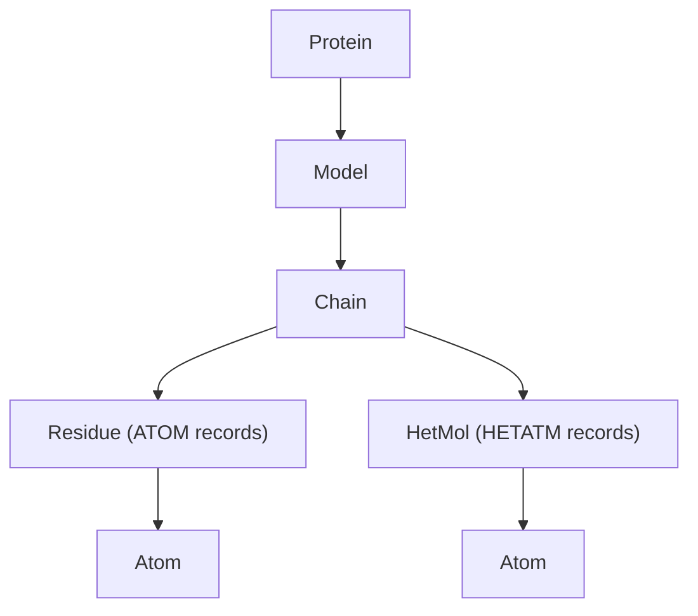
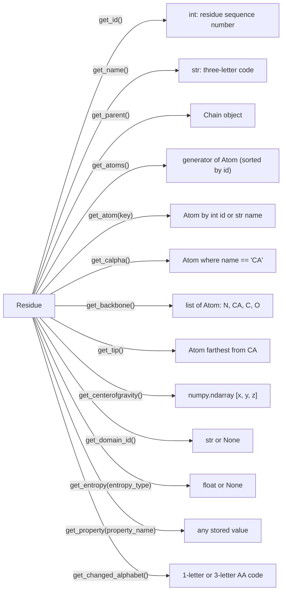
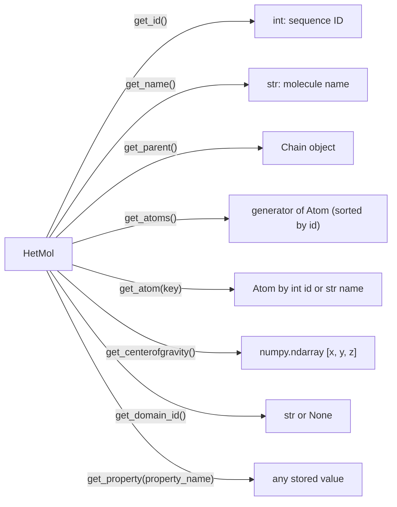
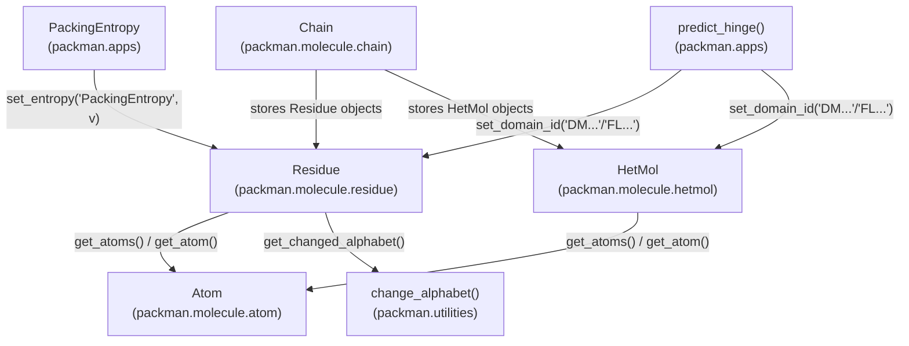

# Residue and HetMol

<details>
<summary>Relevant source files</summary>

The following files were used as context for generating this wiki page:

- [packman/molecule/hetmol.py](packman/molecule/hetmol.py)
- [packman/molecule/protein.py](packman/molecule/protein.py)
- [packman/molecule/residue.py](packman/molecule/residue.py)

</details>


## Purpose and Scope

This page documents the `Residue` and `HetMol` classes from `packman.molecule`. Both classes sit at the same level in the molecular hierarchy — directly below `Chain` and directly above `Atom` — but they represent different chemical entities. `Residue` models standard amino acid residues (from `ATOM` records in PDB files), while `HetMol` models heterogeneous molecules such as ligands, cofactors, and modified residues (from `HETATM` records).

For the classes above this level (`Protein`, `Model`, `Chain`), see [3.2](#3.2). For the `Atom` and `Bond` classes that sit below, see [3.4](#3.4). For how structures are loaded and these objects are populated, see [3.1](#3.1).

---

## Position in the Hierarchy

**Hierarchy diagram: Molecular object model**



Sources: [packman/molecule/residue.py:35-50](), [packman/molecule/hetmol.py:29-46]()

Both `Residue` and `HetMol` store their child `Atom` objects in an internal dictionary keyed by atom ID, with a parallel name-to-atom lookup dictionary (`__Atoms_Names`). Atoms are assigned to a residue/hetmol at parse time via `__setitem__`.

---

## Residue

Defined in [packman/molecule/residue.py:35-341]().

### Constructor

```python
Residue(id: int, name: str, parent: Chain)
```

| Parameter | Type | Description |
|-----------|------|-------------|
| `id` | `int` | Residue sequence number as in the PDB file |
| `name` | `str` | Three-letter amino acid code (e.g. `"ALA"`) |
| `parent` | `Chain` | The `Chain` object this residue belongs to |

Internal state initialized at construction:

- `__Atoms`: `None` until first atom is added via `__setitem__`
- `__Atoms_Names`: `{}` — parallel name-to-atom lookup
- `__domain_id`: `None` — populated by hinge prediction
- `__properties`: `{}` — stores computed or user-defined annotations

Sources: [packman/molecule/residue.py:51-61]()

---

### Get Methods

**Diagram: Residue get method map**



Sources: [packman/molecule/residue.py:79-185]()

#### Atom Accessors

| Method | Argument | Returns | Notes |
|--------|----------|---------|-------|
| `get_atoms()` | — | `generator` of `Atom` | Sorted by atom ID |
| `get_atom(key)` | `int` or `str` | `Atom` or `None` | Tries ID first, then name |
| `get_calpha()` | — | `Atom` or `None` | Finds atom with `name == 'CA'` |
| `get_backbone()` | — | `list[Atom]` or `None` | Returns atoms named `N`, `CA`, `C`, `O` |
| `get_tip()` | — | `Atom` or `None` | Atom farthest from `CA`; `CA` itself for `GLY` |

`get_calpha()` iterates atoms and returns the first where `name == 'CA'`. [packman/molecule/residue.py:260-270]()

`get_backbone()` is a list comprehension over `get_atoms()` filtering on names `N`, `CA`, `C`, `O`. [packman/molecule/residue.py:292-301]()

`get_tip()` finds the atom with maximum Euclidean distance from `CA` using `Atom.calculate_distance()`. For `GLY`, it returns `CA` directly since glycine has no side chain. If `CA` is absent, `CA` is used as a fallback with a logged warning. [packman/molecule/residue.py:303-328]()

#### Center of Gravity

`get_centerofgravity()` computes a geometric centroid (all atoms given equal mass `= 1`) and returns a `numpy.ndarray` of shape `(3,)`. True atomic masses are not yet applied. [packman/molecule/residue.py:272-290]()

#### Domain ID

`get_domain_id()` returns the domain label set by the hinge prediction algorithm. The domain label format is:

| Prefix | Meaning |
|--------|---------|
| `DM` + number | Rigid domain |
| `FL` + number | Flexible linker (hinge region) |

This field is `None` until hinge prediction has been run. See [4.1](#4.1) for the hinge prediction workflow.

Sources: [packman/molecule/residue.py:129-140]()

#### Entropy Storage

`get_entropy(entropy_type)` reads from the internal `__properties` dict. The only currently recognized `entropy_type` value is `"PackingEntropy"`. If the entropy has not been calculated, a `logging.warning` is emitted. [packman/molecule/residue.py:142-160]()

#### Custom Properties

`get_property(property_name)` and `set_property(property_name, value)` provide a general-purpose key/value store on each residue. Any hashable Python object is a valid key. This can hold user-defined annotations (e.g., disorder flags, experimental labels). [packman/molecule/residue.py:162-177](), [packman/molecule/residue.py:241-257]()

#### Alphabet Conversion

`get_changed_alphabet()` calls `change_alphabet()` from `packman.utilities` on `self.get_name()`, converting between three-letter and one-letter amino acid codes. See [9](#9) for `change_alphabet`. [packman/molecule/residue.py:179-185]()

---

### Set Methods

| Method | Argument | Description |
|--------|----------|-------------|
| `set_id(new_id)` | `int` | Overwrite the residue sequence number |
| `set_name(new_name)` | `str` | Overwrite the residue name |
| `set_parent(new_parent)` | `Chain` | Re-assign the parent chain |
| `set_domain_id(new_domain_id)` | `str` | Assign a `DM`/`FL` domain label |
| `set_entropy(entropy_type, value)` | `str`, `float` | Store computed entropy in `__properties` |
| `set_property(property_name, value)` | any, any | Store arbitrary key-value annotation |

`set_entropy()` validates that `entropy_type` is `"PackingEntropy"` before writing. Invalid types emit a `logging.warning` and are not stored. [packman/molecule/residue.py:225-239]()

Sources: [packman/molecule/residue.py:187-257]()

---

### Entropy Calculation Entry Point

```python
Residue.calculate_entropy(
    entropy_type: str,
    chains=None,
    probe_size: float = 1.4,
    onspherepoints: int = 30
)
```

This method does not perform the calculation locally. It delegates upward through the hierarchy: `self.get_parent().get_parent().calculate_entropy(...)`, which resolves to `Model.calculate_entropy()`. Results are then stored back on each residue via `set_entropy()`. For full documentation of the entropy algorithm, see [4.3](#4.3).

Sources: [packman/molecule/residue.py:330-341]()

---

## HetMol

Defined in [packman/molecule/hetmol.py:29-228]().

`HetMol` represents non-standard chemical entities (ligands, water molecules, cofactors, ions) that appear as `HETATM` records in PDB files. Its interface is a subset of `Residue`'s interface, without the amino-acid-specific methods.

### Constructor

```python
HetMol(id: int, name: str, parent: Chain)
```

| Parameter | Type | Description |
|-----------|------|-------------|
| `id` | `int` | HetMol sequence ID from the PDB file |
| `name` | `str` | Molecule name (e.g. `"HOH"`, `"ATP"`) |
| `parent` | `Chain` | The parent `Chain` object |

Internal state mirrors `Residue`: `__Atoms`, `__Atoms_Names`, `__domain_id`, `__properties`. [packman/molecule/hetmol.py:47-56]()

---

### Get Methods

**Diagram: HetMol get method map**



Sources: [packman/molecule/hetmol.py:77-133]()

`get_atoms()` yields atoms sorted by their ID key. [packman/molecule/hetmol.py:102-108]()

`get_atom(key)` accepts an `int` (atom ID) or `str` (atom name). Tries `__Atoms[key]` first, then `__Atoms_Names[key]`, returns `None` on failure. [packman/molecule/hetmol.py:160-175]()

`get_centerofgravity()` computes an equal-mass centroid and returns a `numpy.ndarray`. Currently uses `i.Coordinates` directly (not `i.get_location()`). [packman/molecule/hetmol.py:209-228]()

`get_domain_id()` and `get_property()` behave identically to the `Residue` equivalents. [packman/molecule/hetmol.py:110-133]()

---

### Set Methods

| Method | Argument | Description |
|--------|----------|-------------|
| `set_id(new_id)` | `int` | Overwrite the HetMol ID |
| `set_name(new_name)` | `str` | Overwrite the molecule name |
| `set_parent(new_parent)` | `Chain` | Re-assign the parent chain |
| `set_domain_id(new_domain_id)` | `str` | Assign a `DM`/`FL` domain label |
| `set_property(property_name, value)` | any, any | Store arbitrary key-value annotation |

Sources: [packman/molecule/hetmol.py:135-206]()

---

## Residue vs. HetMol: Feature Comparison

| Feature | `Residue` | `HetMol` |
|---------|-----------|----------|
| `get_id()` | ✓ | ✓ |
| `get_name()` | ✓ | ✓ |
| `get_parent()` | ✓ | ✓ |
| `get_atoms()` | ✓ | ✓ |
| `get_atom(key)` | ✓ | ✓ |
| `get_centerofgravity()` | ✓ | ✓ |
| `get_domain_id()` | ✓ | ✓ |
| `get_property()` / `set_property()` | ✓ | ✓ |
| `set_domain_id()` | ✓ | ✓ |
| `get_calpha()` | ✓ | ✗ |
| `get_backbone()` | ✓ | ✗ |
| `get_tip()` | ✓ | ✗ |
| `get_entropy()` / `set_entropy()` | ✓ | ✗ |
| `calculate_entropy()` | ✓ | ✗ |
| `get_changed_alphabet()` | ✓ | ✗ |

Sources: [packman/molecule/residue.py:79-341](), [packman/molecule/hetmol.py:77-228]()

---

## Class Interaction Diagram

**Diagram: Residue and HetMol relationships to other classes**



Sources: [packman/molecule/residue.py:260-341](), [packman/molecule/hetmol.py:177-188](), [packman/molecule/residue.py:179-185]()

---

## Usage Examples

**Iterating atoms of a residue:**

```python
# mol is a loaded Protein object
for residue in mol[0]['A'].get_residues():
    for atom in residue.get_atoms():
        print(atom.get_name(), atom.get_location())
```

**Accessing specific atoms:**

```python
residue.get_calpha()            # C-alpha atom
residue.get_backbone()          # [N, CA, C, O] atom list
residue.get_atom('CB')          # by name
residue.get_atom(142)           # by atom ID
residue.get_tip()               # atom farthest from CA
```

**Reading domain assignment after hinge prediction:**

```python
domain_label = residue.get_domain_id()   # e.g. 'DM0', 'FL0'
```

**Custom annotations:**

```python
residue.set_property('is_disordered', True)
residue.get_property('is_disordered')    # True
```

**Accessing HetMol atoms (e.g. a ligand):**

```python
for hetmol in mol[0]['A'].get_hetmols():
    print(hetmol.get_name(), hetmol.get_centerofgravity())
    for atom in hetmol.get_atoms():
        print(atom.get_name())
```

---