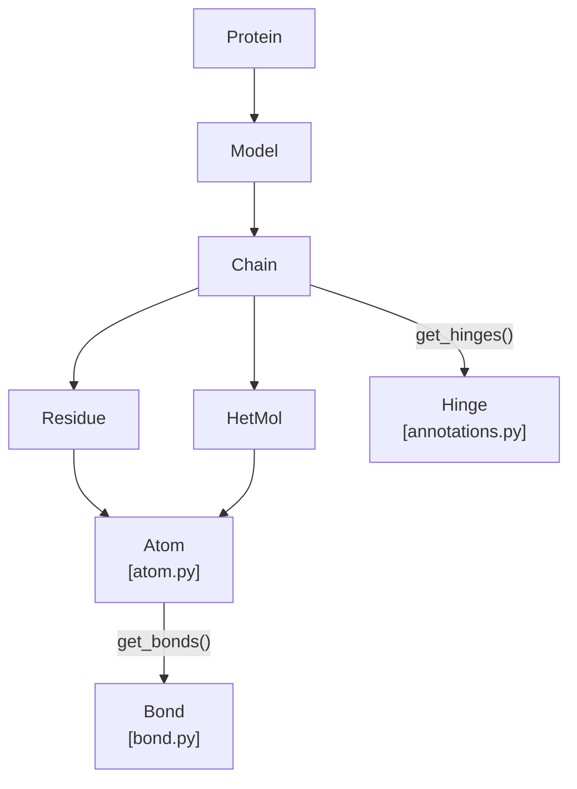
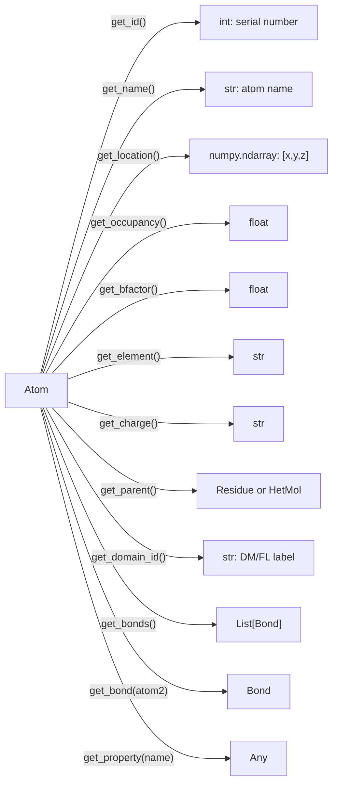
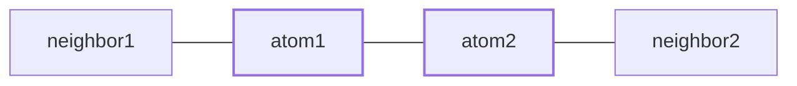
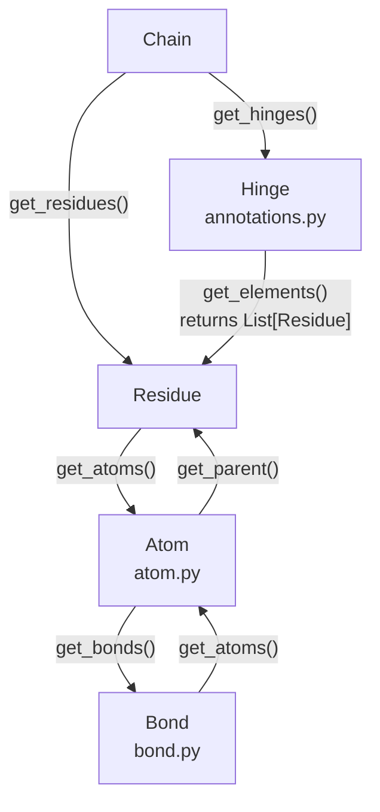

# Atom, Bond, and Annotations

<details>
<summary>Relevant source files</summary>

The following files were used as context for generating this wiki page:

- [packman/molecule/annotations.py](packman/molecule/annotations.py)
- [packman/molecule/atom.py](packman/molecule/atom.py)
- [packman/molecule/bond.py](packman/molecule/bond.py)

</details>


This page documents the three lowest-level classes in the `packman.molecule` hierarchy: `Atom`, `Bond`, and `Hinge`. These classes represent individual atoms in a structure, covalent and non-covalent connections between atoms, and hinge annotations produced by the hinge prediction algorithm respectively.

For the parent containers that hold `Atom` objects (i.e., `Residue` and `HetMol`), see [3.3](#3.3). For information on how hinge prediction populates `Hinge` objects on a `Chain`, see [4.1](#4.1).

---

## Position in the Molecular Hierarchy

**Diagram: Object Hierarchy with File Locations**



`Atom` sits at the bottom of the containment hierarchy. `Bond` connects pairs of `Atom` objects but is not itself part of the containment chain. `Hinge` is a side-channel annotation attached to `Chain`, not embedded in the `Residue`→`Atom` path.

Sources: [packman/molecule/atom.py:34-70](), [packman/molecule/bond.py:25-54](), [packman/molecule/annotations.py:32-52]()

---

## Atom

**Class:** `packman.molecule.Atom`  
**File:** [packman/molecule/atom.py]()

`Atom` is the fundamental data-bearing unit. Every atom parsed from a PDB or CIF file becomes an `Atom` instance, storing the fields defined in the wwPDB record format.

### Constructor

[packman/molecule/atom.py:58-70]()

| Parameter | Type | Description |
|---|---|---|
| `id` | `int` | Atom serial number from the structure file |
| `AtomName` | `str` | Atom name (e.g., `CA`, `N`, `OG1`) |
| `Coordinates` | `numpy.ndarray` | 3-element array `[x, y, z]` in Ångströms |
| `Occupancy` | `float` | Occupancy value |
| `bfactor` | `float` | B-factor / temperature factor |
| `Element` | `str` | Chemical element symbol |
| `Charge` | `str` | Formal charge (currently stored as `str`) |
| `parent` | `Residue` or `HetMol` | The containing residue or hetero-molecule |

Two internal stores are also initialized at construction: `__properties` (a dict for user-defined annotations) and `__Bonds` (a list of `Bond` objects).

### Get Methods

**Diagram: Atom Getters and the Data They Return**



Sources: [packman/molecule/atom.py:79-201]()

| Method | Return Type | Notes |
|---|---|---|
| `get_id()` | `int` | Serial number as read from the file |
| `get_name()` | `str` | Atom name string |
| `get_location()` | `numpy.ndarray` | 3D coordinate array |
| `get_occupancy()` | `float` | |
| `get_bfactor()` | `float` | Also used for RMSF in NMR structures |
| `get_element()` | `str` | |
| `get_charge()` | `str` | Will become `float` in a future version |
| `get_parent()` | `Residue` / `HetMol` | Containing residue |
| `get_domain_id()` | `str` | Delegates to `get_parent().get_domain_id()`; returns labels like `DM1` or `FL1` after hinge prediction |
| `get_bonds()` | `List[Bond]` | All bonds involving this atom |
| `get_bond(atom2)` | `Bond` | Specific bond to `atom2` (accepts `Atom` object or integer atom ID) |
| `get_property(name)` | any | Retrieves from the `__properties` dict |

#### `get_bond()` lookup detail

[packman/molecule/atom.py:184-201]()

If `atom2` is passed as an `int`, the method resolves it to an `Atom` by walking up to the `Model` via `get_parent().get_parent().get_parent()` and calling `Model.get_atom(atom2)`. The intersection of both atoms' bond lists is returned.

### Set Methods

| Method | Parameter | Notes |
|---|---|---|
| `set_id(new_id)` | `int` | |
| `set_name(new_name)` | `str` | |
| `set_parent(new_parent)` | `Residue` / `HetMol` | |
| `set_location(new_location)` | `numpy.ndarray` | |
| `set_occupancy(new_occupancy)` | `float` | |
| `set_bfactor(new_bfactor)` | `float` | |
| `set_elment(new_element)` | `str` | Note: typo in method name (`set_elment`) |
| `set_charge(new_charge)` | `str` | |
| `set_property(name, value)` | any | Stores in `__properties` dict |
| `set_bond(new_bond)` | `Bond` | Appends to `__Bonds` list |

Sources: [packman/molecule/atom.py:203-295]()

> **Note:** The method for setting the element is spelled `set_elment` (missing the 'e') in the current codebase. [packman/molecule/atom.py:252-258]()

### Distance Calculation

```
Atom.calculate_distance(another_atom) -> float
```

[packman/molecule/atom.py:298-307]()

Computes the Euclidean distance in Ångströms between the calling atom and `another_atom` using `numpy.linalg.norm`. This is used extensively by ANM/GNM contact cutoff checks and by packing entropy calculations.

### Custom Properties

Both `get_property` and `set_property` operate on an internal dict `__properties`. This is a general-purpose annotation store: any Python-hashable key can be used to attach arbitrary data to an `Atom` instance. This mechanism is shared across `Atom`, `Bond`, `Residue`, `HetMol`, and `Chain`.

---

## Bond

**Class:** `packman.molecule.Bond`  
**File:** [packman/molecule/bond.py]()

`Bond` represents a connection between exactly two `Atom` objects. It is not part of the containment hierarchy; instead, it is referenced from each of its two atoms via their `__Bonds` list.

### Constructor

[packman/molecule/bond.py:45-54]()

| Parameter | Type | Description |
|---|---|---|
| `id` | `int` | Bond serial identifier |
| `atom1` | `Atom` | First atom in the bond |
| `atom2` | `Atom` | Second atom in the bond |
| `type` | `str` | Bond type string (see allowed values below) |
| `source` | `str` or `None` | Origin of the bond information (e.g., `CONNECT` record, algorithm) |

Bonds whose connectivity is not explicitly listed in the structure file are assigned using the rule-based algorithm described in: Zhang et al., *J Cheminform* 4, 26 (2012).

### Allowed Bond Types

[packman/molecule/bond.py:47]()

| Type String | Meaning |
|---|---|
| `non-covalent` | |
| `covalent` | Generic covalent |
| `covalent-single` | Single bond |
| `covalent-double` | Double bond |
| `covalent-triple` | Triple bond |
| `ionic` | |
| `hydrogen` | Hydrogen bond |
| `salt-bridge` | |
| `other` | Catch-all |

`set_type()` validates against this list and logs a warning on invalid input.

### Get Methods

| Method | Return | Notes |
|---|---|---|
| `get_id()` | `int` | |
| `get_atoms()` | `(Atom, Atom)` | Returns a tuple `(atom1, atom2)` |
| `get_type()` | `str` | |
| `get_source()` | `str` | |
| `get_property(name)` | any | Custom annotation store |
| `get_torsion(neighbor1, neighbor2, radians=True)` | `float` | Torsion angle in radians or degrees |

Sources: [packman/molecule/bond.py:60-124]()

### Set Methods

| Method | Parameter | Notes |
|---|---|---|
| `set_atoms(new_pair)` | `(Atom, Atom)` | Validates tuple length == 2 |
| `set_type(new_type)` | `str` | Validated against allowed list |
| `set_property(name, value)` | any | Custom annotation store |
| `set_torsion(theta, neighbor1, neighbor2, radians=True)` | `float` | Rotates the structure |

Sources: [packman/molecule/bond.py:127-198]()

### Torsion Angles

**Diagram: Torsion Angle Four-Atom Requirement**



Both `get_torsion` and `set_torsion` require four atoms: the two atoms in the bond (`atom1`, `atom2`) plus one neighbor each. The actual computation is delegated to `Model.get_torsion()` and `Model.set_torsion()` respectively. The `radians` parameter (default `True`) controls units.

[packman/molecule/bond.py:109-124](), [packman/molecule/bond.py:182-198]()

`get_torsion` reads the current dihedral angle; `set_torsion` rotates the atoms to achieve the target angle `theta`.

---

## Hinge Annotation

**Class:** `packman.molecule.Hinge`  
**File:** [packman/molecule/annotations.py]()

`Hinge` is an annotation object produced by the hinge prediction algorithm (`predict_hinge`). It is not part of the `Protein > Model > Chain > Residue > Atom` containment chain, but instances are stored on `Chain` objects and retrieved via `Chain.get_hinges()`. For the algorithm that creates these objects, see [4.1](#4.1).

### Constructor

[packman/molecule/annotations.py:47-52]()

| Parameter | Type | Description |
|---|---|---|
| `hid` | `int` | Unique hinge identifier |
| `alpha_value` | `float` | The alpha parameter used when this hinge was detected |
| `elements` | `List[Residue]` | Residue objects that constitute the hinge region |
| `stats` | `List[float]` | Statistical summary of the hinge (e.g., mean/median/mode of B-factors) |
| `p` | `float` | p-value from the permutation test |

### Get Methods

| Method | Return | Notes |
|---|---|---|
| `get_id()` | `int` or `None` | |
| `get_alpha_value()` | `float` or `None` | Alpha parameter at which this hinge was detected |
| `get_elements()` | `List[Residue]` | The residues forming this hinge |
| `get_stats()` | list | B-factor statistics for the hinge residues |
| `get_pvalue()` | `float` | p-value from permutation test |

Sources: [packman/molecule/annotations.py:57-96]()

`Hinge` has no set methods; it is constructed once during hinge prediction and treated as read-only.

---

## Relationships Between All Three Classes

**Diagram: Atom, Bond, and Hinge Relationships**



Sources: [packman/molecule/atom.py:95-101](), [packman/molecule/atom.py:176-201](), [packman/molecule/bond.py:68-74](), [packman/molecule/annotations.py:74-80]()

---

## Custom Property System

All three classes (`Atom`, `Bond`, and `Hinge` via its element residues) support a general-purpose key-value store via `get_property` / `set_property`. This is consistent across all levels of the hierarchy.

```
atom.set_property('my_score', 0.95)
atom.get_property('my_score')   # returns 0.95

bond.set_property('custom_label', 'active_site')
bond.get_property('custom_label')
```

Any Python dictionary-compatible key can be used. An invalid or missing key logs a warning rather than raising an exception.

Sources: [packman/molecule/atom.py:159-174](), [packman/molecule/atom.py:268-284](), [packman/molecule/bond.py:92-107](), [packman/molecule/bond.py:162-180]()

---

## Summary Reference Table

| Class | File | Key Role | Stored On |
|---|---|---|---|
| `Atom` | `atom.py` | Holds all per-atom data from the structure file | `Residue.__atoms`, `HetMol.__atoms` |
| `Bond` | `bond.py` | Connects two `Atom` objects; carries type and torsion | `Atom.__Bonds` (on both atoms) |
| `Hinge` | `annotations.py` | Annotation produced by hinge prediction; groups residues into hinge regions | `Chain.__hinges` |

Sources: [packman/molecule/atom.py:1-17](), [packman/molecule/bond.py:1-17](), [packman/molecule/annotations.py:1-22]()

---