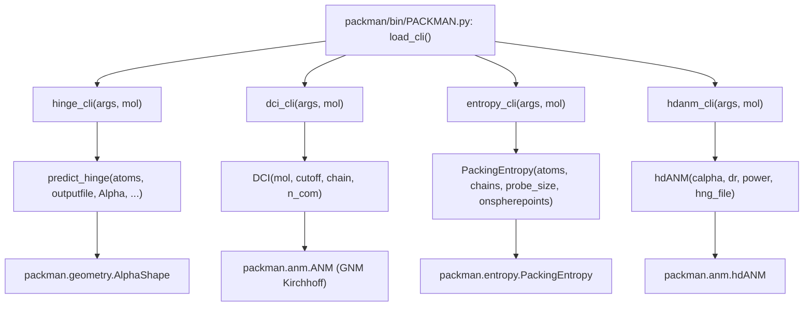
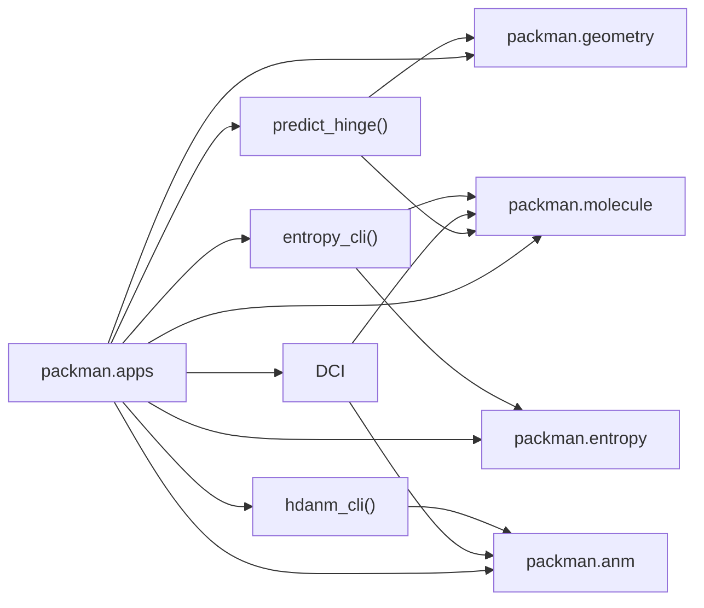

# Analysis Applications

<details>
<summary>Relevant source files</summary>

The following files were used as context for generating this wiki page:

- [packman/apps/__init__.py](packman/apps/__init__.py)
- [packman/apps/calculate_entropy.py](packman/apps/calculate_entropy.py)
- [packman/apps/dci.py](packman/apps/dci.py)
- [packman/apps/hdanm.py](packman/apps/hdanm.py)
- [packman/apps/predict_hinge.py](packman/apps/predict_hinge.py)
- [packman/bin/PACKMAN.py](packman/bin/PACKMAN.py)
- [packman/bin/__init__.py](packman/bin/__init__.py)
- [packman/entropy/__init__.py](packman/entropy/__init__.py)
- [packman/molecule/__init__.py](packman/molecule/__init__.py)
- [packman/tests/dci/test_dci.py](packman/tests/dci/test_dci.py)

</details>


This page covers the `packman.apps` module: its structure, the four analysis applications it contains, and the shared code pattern used across all of them. For detailed documentation of each individual application, see the child pages: [Hinge Prediction](#4.1), [Dynamic Community Identification (DCI)](#4.2), and [Packing Entropy](#4.3). For the network models that underpin some of these apps, see [Network Models](#5).

---

## Purpose and Scope

`packman.apps` is a collection of bioinformatics analysis pipelines built on top of the `packman.molecule` data model. Each application accepts a `Protein` object (or atoms derived from it) and produces analysis results—either as in-memory objects, written files, or both.

The module does not define new data types; it consumes types defined in `packman.molecule` and `packman.entropy` and delegates geometry work to `packman.geometry` and network models to `packman.anm`.

Sources: [packman/apps/__init__.py:1-18]()

---

## Module Contents

The four applications exported from `packman.apps` are:

| Export | Type | Source File | Role |
|---|---|---|---|
| `predict_hinge` | function | `predict_hinge.py` | Core hinge prediction logic |
| `hinge_cli` | function | `predict_hinge.py` | CLI wrapper for hinge prediction |
| `DCI` | class | `dci.py` | Dynamic Community Identification |
| `dci_cli` | function | `dci.py` | CLI wrapper for DCI |
| `entropy_cli` | function | `calculate_entropy.py` | CLI wrapper for packing entropy |
| `hdanm_cli` | function | `hdanm.py` | CLI wrapper for hdANM |

Note that `PackingEntropy` (the core entropy class) lives in `packman.entropy`, not in `packman.apps`. The `entropy_cli` function in `packman.apps` is only a thin dispatch wrapper. Similarly, `hdANM` (the core class) lives in `packman.anm`; `hdanm_cli` wraps it.

Sources: [packman/apps/__init__.py:1-18](), [packman/apps/calculate_entropy.py:1-62](), [packman/apps/hdanm.py:1-64]()

---

## Shared Structural Pattern

Every application follows a two-layer pattern:

**Core layer** — contains the scientific logic. It is callable directly from Python.

**CLI layer** — a `_cli(args, mol)` function that extracts parameters from an `argparse.Namespace` object and calls the core layer. This function is wired into the CLI dispatcher in `packman/bin/PACKMAN.py`.

**Module-level dispatch diagram:**



Sources: [packman/bin/PACKMAN.py:95-131](), [packman/apps/__init__.py:16-18]()

---

## Application Summary

### 1. Hinge Prediction

- **Core:** `predict_hinge(atoms, outputfile, Alpha, method, filename, MinimumHingeLength, nclusters)`
- **CLI wrapper:** `hinge_cli(args, mol)`
- **Input:** A flat list of backbone `Atom` objects from a `Chain`.
- **Method:** Constructs an alpha shape via `AlphaShape`, computes graph eccentricity on the resulting `networkx` graph, clusters eccentricity values with `KMeans`, and identifies contiguous low-eccentricity residue runs as hinges.
- **Output:** Writes a text report to `outputfile`. Attaches `Hinge` objects to the originating `Chain` via `Chain.set_hinges()`. Returns the alpha shape.
- **Key parameter:** `Alpha` — controls the coarseness of the alpha shape. Recommended: `2.8` (closed form), `4.5` (open form).

Sources: [packman/apps/predict_hinge.py:34-65](), [packman/apps/predict_hinge.py:326-366]()

---

### 2. Dynamic Community Identification (DCI)

- **Core:** `DCI` class
- **CLI wrapper:** `dci_cli(args, mol)`
- **Input:** A `Protein` object. Optionally scoped to a single chain.
- **Method:**
  1. Builds a GNM Kirchhoff matrix from Cα coordinates with a distance `cutoff`.
  2. Performs eigendecomposition.
  3. Computes the cross-correlation matrix `C`.
  4. Applies Ward hierarchical clustering on `1 - C`.
  5. Scores cluster counts using the Calinski–Harabasz (CH) criterion to select the optimal number of communities.
- **Output:** Writes PyMOL selection commands to a file via `calcualte_pymol_commands()`. Optionally generates a CH score plot via `calculate_CH_plot()`.
- **Key parameter:** `n_com` — if supplied, skips automatic scoring and uses exactly that many communities.

Sources: [packman/apps/dci.py:28-79](), [packman/apps/dci.py:316-323]()

---

### 3. Packing Entropy

- **Core:** `PackingEntropy` (lives in `packman.entropy`)
- **CLI wrapper:** `entropy_cli(args, mol)` in `packman/apps/calculate_entropy.py`
- **Input:** Atoms from a `Model`, optionally filtered to specific chain IDs.
- **Method:** Voronoi tessellation with configurable probe size and sphere point sampling. Computes per-residue packing fraction and entropy, stored on each `Residue` object.
- **Output (CLI):** Tab-separated table of `Frame`, `Chain`, `ResidueID`, `ResidueName`, `PackingEntropy` written to `args.outputfile`. Also writes total entropy and normalized entropy (`total / (3N-6)`).
- **Key parameters:** `probe_size` (default `1.4` Å, radius of a water molecule), `onspherepoints` (default `30`).

Sources: [packman/apps/calculate_entropy.py:24-62](), [packman/entropy/__init__.py:1-9]()

---

### 4. hdANM CLI

- **Core:** `hdANM` (lives in `packman.anm`)
- **CLI wrapper:** `hdanm_cli(args, mol)` in `packman/apps/hdanm.py`
- **Input:** Cα atoms from a `Model` or specific chain, plus a `.hng` file specifying domain assignments.
- **Method:** Builds the domain-based Hessian with `hdANM.calculate_hessian(mass_type=...)`, then performs eigendecomposition.
- **Output:** `eigenvalues.csv`, `eigenvectors.csv`, and one PDB movie file per requested mode. Optionally packages all output into a `.tar.gz` archive via `--make_tar`.
- **Key parameters:** `dr` (distance cutoff, default `15` Å), `power` (default `0`), `mass` (`unit` or `residue`).

Sources: [packman/apps/hdanm.py:25-64]()

---

## Dependency Graph

The diagram below maps each application to the modules it depends on.

**App module dependencies:**



Sources: [packman/apps/predict_hinge.py:29-32](), [packman/apps/dci.py:25-27](), [packman/apps/calculate_entropy.py:15-17](), [packman/apps/hdanm.py:23-24]()

---

## CLI Wiring

`packman/bin/PACKMAN.py` defines `load_cli()`, which:

1. Parses the subcommand (`hinge`, `hdanm`, `entropy`, `dci`) via `argparse`.
2. Loads the structure file into a `Protein` object via `molecule.load_structure()`.
3. Dispatches to the appropriate `_cli` function imported from `packman.apps`.

The four `_cli` imports at the top of `PACKMAN.py` are:

```
from ..apps import hinge_cli, hdanm_cli, entropy_cli, dci_cli
```

Sources: [packman/bin/PACKMAN.py:14-14](), [packman/bin/PACKMAN.py:95-131]()

For full CLI argument reference, see [Command-Line Interface](#7). For GUI usage, see [Graphical User Interface (GUI)](#8).

---