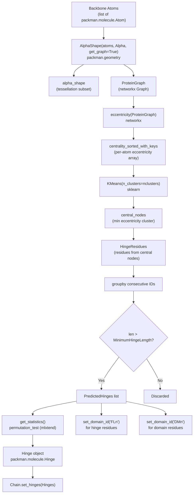
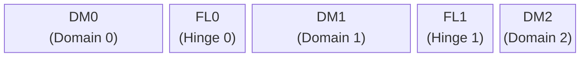
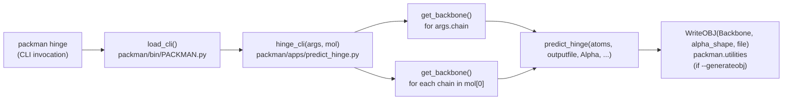
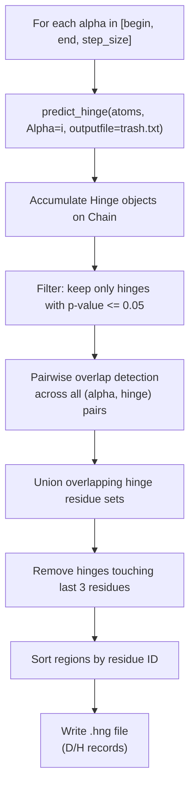
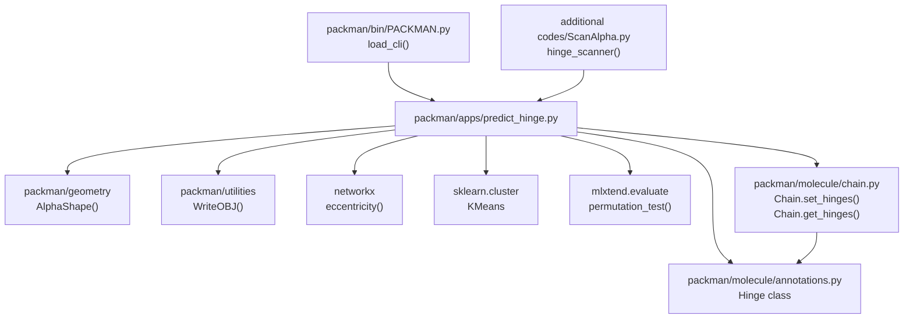

# Hinge Prediction

<details>
<summary>Relevant source files</summary>

The following files were used as context for generating this wiki page:

- [.github/workflows/python-package.yml](.github/workflows/python-package.yml)
- [README.md](README.md)
- [additional codes/ScanAlpha.py](additional codes/ScanAlpha.py)
- [docs/_static/gallary/logo.ico](docs/_static/gallary/logo.ico)
- [docs/source/index.rst](docs/source/index.rst)
- [docs/source/tutorials/compliance.rst](docs/source/tutorials/compliance.rst)
- [docs/source/tutorials/hinge_predict.rst](docs/source/tutorials/hinge_predict.rst)
- [packman/apps/__init__.py](packman/apps/__init__.py)
- [packman/apps/predict_hinge.py](packman/apps/predict_hinge.py)
- [packman/bin/PACKMAN.py](packman/bin/PACKMAN.py)
- [packman/molecule/__init__.py](packman/molecule/__init__.py)
- [packman/molecule/annotations.py](packman/molecule/annotations.py)
- [packman/molecule/atom.py](packman/molecule/atom.py)
- [packman/molecule/bond.py](packman/molecule/bond.py)

</details>


This page documents the hinge prediction application in PACKMAN: the `predict_hinge()` function, its underlying algorithm, the `Hinge` annotation object, the `hinge_cli()` wrapper, and the `ScanAlpha.py` batch utility. For background on how hinge predictions integrate with the broader molecular data model (e.g., how `Hinge` objects are stored on a `Chain`), see the Molecular Data Model page ([3]()) and the Atom/Bond/Annotations page ([3.4]()). For the geometry primitives (`AlphaShape`) that this algorithm depends on, see page [6](). For CLI invocation syntax, see page [7]().

---

## Overview

Hinge prediction in PACKMAN identifies flexible linker regions (hinges) between rigid domains of a protein, using only the static 3D coordinates of backbone atoms. The method models protein packing via **alpha shapes** (a subset of Delaunay tessellations), extracts a graph-theoretic measure (eccentricity) from the resulting contact graph, and clusters eccentricity values to classify residues as hinge or domain.

The key entry point is `predict_hinge()` in [packman/apps/predict_hinge.py]().

**Recommended alpha values:**

| Protein Conformation | Recommended Alpha |
|---|---|
| Closed form | 2.8 |
| Open form | 4.5 |

Sources: [packman/bin/PACKMAN.py:42-43](), [docs/source/tutorials/hinge_predict.rst:1-83]()

---

## Algorithm

**Algorithm: Alpha-Shape Hinge Detection**



Sources: [packman/apps/predict_hinge.py:273-323]()

### Step-by-step description

1. **Alpha shape construction**: `AlphaShape(atoms, Alpha, get_graph=True)` builds the alpha-shape tessellation and a NetworkX graph where nodes are atoms and edges represent adjacency in the shape.
2. **Eccentricity computation**: `networkx.eccentricity(ProteinGraph)` assigns each node (atom) the maximum shortest-path distance to any other node.
3. **K-Means clustering**: Eccentricity values are clustered into `nclusters` groups. The cluster with the lowest centroid value identifies the most "central" (i.e., most constrained, least exposed) atoms — these are the hinge candidates.
4. **Residue grouping**: Atoms in the minimum-eccentricity cluster are mapped to their parent `Residue` objects, sorted by residue ID, and consecutive IDs are grouped using `itertools.groupby`.
5. **Length filtering**: Groups shorter than `MinimumHingeLength` are discarded.
6. **Statistics and p-value**: For each surviving group, B-factors of hinge vs. non-hinge atoms are compared using a permutation test (`mlxtend.evaluate.permutation_test`, 10,000 rounds).
7. **Hinge annotation**: `Hinge` objects are created and attached to the `Chain` via `Chain.set_hinges()`. Hinge residues are labeled `FL0`, `FL1`, … and domain residues are labeled `DM0`, `DM1`, … via `set_domain_id()`.

Sources: [packman/apps/predict_hinge.py:273-323]()

---

## `predict_hinge()` Function

**File**: [packman/apps/predict_hinge.py:34-324]()

### Signature

```python
predict_hinge(atoms, outputfile, Alpha=float('Inf'), method='alpha_shape',
              filename='Output.pdb', MinimumHingeLength=5, nclusters=4)
```

### Parameters

| Parameter | Type | Default | Description |
|---|---|---|---|
| `atoms` | `list[Atom]` | — | Backbone atoms of the protein chain(s) |
| `outputfile` | file | — | Writable file object; receives the text report |
| `Alpha` | `float` | `Inf` | Alpha shape parameter; controls the granularity of the alpha shape |
| `method` | `str` | `'alpha_shape'` | Currently only `'alpha_shape'` is implemented |
| `filename` | `str` | `'Output.pdb'` | Recorded in the output file header for traceability |
| `MinimumHingeLength` | `int` | `5` | Minimum number of consecutive residues to qualify as a hinge |
| `nclusters` | `int` | `4` | Number of KMeans clusters for eccentricity partitioning |

### Return value

Returns `alpha_shape` — the alpha-shape object (subset of Delaunay tessellations) produced by `AlphaShape()`.

### Side effects

- Writes a text report to `outputfile` containing hinge regions, B-factor statistics, p-values, and PyMOL visualization commands.
- Attaches `Hinge` objects to the parent `Chain` via `Chain.set_hinges()`.
- Calls `set_domain_id()` on every residue in the chain (`'FL<n>'` for hinges, `'DM<n>'` for domains).

Sources: [packman/apps/predict_hinge.py:34-65](), [packman/apps/predict_hinge.py:273-323]()

---

## Output: Text Report Format

`predict_hinge()` writes structured text to `outputfile`. The format is:

```
Filename= 1exr.pdb  | Chain(s)= A | AlphaValue= 2.8 | MinimumHingeLength= 5 | EccentricityClusters= 4
Hindge Residues(Predicted):

Hinge #1
Residues: GLY-45 to ALA-60

STATISTICS
        N     Min   Max   Mean  Mode  Median  STDDev
Total   ...
Hinge   ...
NonHinge...

p-value: 0.0023

Pymol Terminal Commands for Visualizing:
color blue, resi 45:60

import plane
plane.make_plane_points(name='HingePlane1', ...)
set cgo_transparency, 0.35, HingePlane1
#--------------------------------------------------#
```

The report includes:
- **Header**: parameters used for the run
- **Per-hinge block**: residue range, B-factor statistics (N, Min, Max, Mean, Mode, Median, StdDev) for total/hinge/non-hinge atoms, p-value, and PyMOL commands
- **Footnotes** (added by `hinge_cli()`): legend for statistics columns and plane visualization instructions

Sources: [packman/apps/predict_hinge.py:92-104](), [packman/apps/predict_hinge.py:297-310](), [packman/apps/predict_hinge.py:336-344]()

---

## `Hinge` Annotation Object

**File**: [packman/molecule/annotations.py:32-96]()

After `predict_hinge()` runs, `Hinge` objects are stored on the `Chain`. Each hinge covers a contiguous sequence of residues.

### Constructor

```python
Hinge(hid, alpha_value, elements, stats, p)
```

| Attribute | Type | Description |
|---|---|---|
| `hid` | `int` | Zero-based hinge index within the chain |
| `alpha_value` | `float` | The Alpha parameter used when this hinge was found |
| `elements` | `list[Residue]` | The `Residue` objects comprising this hinge |
| `stats` | `list` | B-factor statistics rows (header + total/hinge/non-hinge) |
| `p` | `float` | p-value from permutation test |

### Accessor methods

| Method | Returns |
|---|---|
| `get_id()` | `int` — hinge index |
| `get_alpha_value()` | `float` — alpha parameter |
| `get_elements()` | `list[Residue]` — residue objects |
| `get_stats()` | nested list — B-factor statistics |
| `get_pvalue()` | `float` — permutation test p-value |

Sources: [packman/molecule/annotations.py:32-96]()

---

## Domain ID Annotation

After hinge prediction, every residue in the chain receives a domain ID string via `set_domain_id()`:

| Domain ID pattern | Meaning |
|---|---|
| `FL0`, `FL1`, … | Flexible Linker (hinge) — followed by hinge index |
| `DM0`, `DM1`, … | Domain — followed by domain index |

Domain IDs propagate through the hierarchy: `Atom.get_domain_id()` delegates to `Residue.get_domain_id()`.

**Domain layout diagram (example)**



Sources: [packman/apps/predict_hinge.py:299-321](), [packman/molecule/atom.py:146-157]()

---

## `hinge_cli()` Wrapper

**File**: [packman/apps/predict_hinge.py:326-366]()

`hinge_cli()` is the bridge between the argparse CLI layer and `predict_hinge()`. It is called from `packman/bin/PACKMAN.py` when the user runs `python -m packman hinge`.



### Behavior

- If `--chain` is given: processes only that chain and optionally produces a `.obj` file via `WriteOBJ()`.
- If `--chain` is omitted: iterates over all chains in model `0`; chains without backbone atoms are skipped with a warning.
- Appends footnotes to the output file after all chains are processed.
- Flushes both `outputfile` and `logfile` before returning.

### CLI Arguments for `hinge` subcommand

| Argument | Type | Default | Description |
|---|---|---|---|
| `alpha` | positional `float` | — | Alpha shape parameter (2.8 closed, 4.5 open) |
| `filename` | positional `str` | — | Path to PDB/CIF file |
| `--pdbid` | `str` | None | Download PDB from RCSB and save as `filename` |
| `--e_clusters` | `int` | `4` | Number of eccentricity clusters (`nclusters`) |
| `--minhnglen` | `int` | `5` | Minimum hinge length (`MinimumHingeLength`) |
| `--chain` | `str` | None | Specific chain ID; all chains if omitted |
| `--generateobj` | file | None | Write `.obj` file (requires `--chain`) |
| `--outputfile` | file | stdout | Destination for the text report |
| `--logfile` | file | stderr | Destination for log messages |

Sources: [packman/bin/PACKMAN.py:40-48](), [packman/apps/predict_hinge.py:326-366]()

---

## API Usage

### Basic single-chain prediction

```python
from packman import molecule
from packman.apps import predict_hinge

mol = molecule.load_structure('1exr.cif')

# Extract backbone atoms for chain A
backbone = [j for i in mol[0]['A'].get_backbone() for j in i if j is not None]

# Run hinge prediction
predict_hinge(backbone, Alpha=2.8, outputfile=open('output.txt', 'w'))

# Access the resulting Hinge objects
hinges = mol[0]['A'].get_hinges()
for h in hinges:
    print(h.get_id(), h.get_alpha_value(), h.get_pvalue())
    for residue in h.get_elements():
        print(residue.get_id(), residue.get_name())
```

### Scanning multiple alpha values

```python
import numpy
from packman.apps import predict_hinge

for alpha in numpy.arange(0.0, 10.0, 0.5):
    alpha = numpy.around(alpha, decimals=1)
    try:
        predict_hinge(backbone, Alpha=alpha, outputfile=open(f'{alpha}.txt', 'w'))
    except Exception:
        continue

# All Hinge objects from all alpha runs are accumulated on the chain
all_hinges = mol[0]['A'].get_hinges()
```

Sources: [docs/source/tutorials/hinge_predict.rst:35-83]()

---

## `ScanAlpha.py` Batch Utility

**File**: [additional codes/ScanAlpha.py]()

`ScanAlpha.py` automates the multi-alpha scan and consensus hinge detection workflow. It is not part of the installed package but is provided as a standalone script in the `additional codes/` directory.

```
python3 ScanAlpha.py <filename> [--chain CHAIN] [--begin 0] [--end 10] [--step_size 0.5] [--outfilename output.hng]
```

### Arguments

| Argument | Default | Description |
|---|---|---|
| `filename` | — | PDB or CIF file path |
| `--chain` | None (all chains) | Chain ID to process |
| `--begin` | `0` | Starting alpha value |
| `--end` | `10` | Ending alpha value |
| `--step_size` | `0.5` | Alpha increment |
| `--outfilename` | `<pdbname>.hng` | Output file path |

### Consensus algorithm



Sources: [additional codes/ScanAlpha.py:30-104]()

### `.hng` File Format

The `.hng` output file is tab-separated. Each line describes one segment:

```
pdbname_A    D1    1:100
pdbname_A    H1    101:120
pdbname_A    D2    121:200
pdbname_A    H2    201:215
pdbname_A    D3    216:Inf
```

| Column | Description |
|---|---|
| `pdbname_chain` | Base filename (no extension) + `_` + chain ID |
| `D<n>` or `H<n>` | `D` = rigid Domain, `H` = Hinge (flexible linker) |
| `start:end` | Residue ID range (inclusive); `Inf` for the final domain |

This format is consumed by `hdANM` as its `.hng` input file. See page [5.2]() for details.

Sources: [additional codes/ScanAlpha.py:84-103](), [additional codes/ScanAlpha.py:107-143]()

---

## Module Relationships



Sources: [packman/apps/predict_hinge.py:19-32](), [packman/apps/__init__.py:16](), [packman/molecule/__init__.py:43]()

---