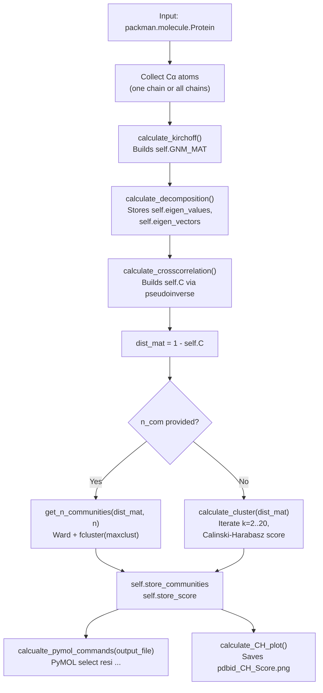
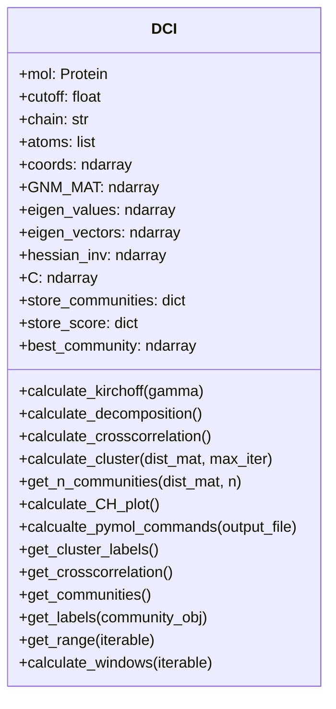
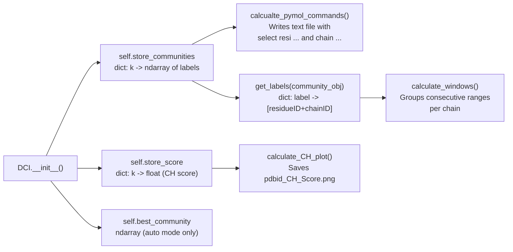

# Dynamic Community Identification (DCI)

<details>
<summary>Relevant source files</summary>

The following files were used as context for generating this wiki page:

- [docs/source/tutorials/dci_cli.rst](docs/source/tutorials/dci_cli.rst)
- [docs/source/tutorials/entropy_api.rst](docs/source/tutorials/entropy_api.rst)
- [docs/source/tutorials/entropy_cli.rst](docs/source/tutorials/entropy_cli.rst)
- [packman/apps/__init__.py](packman/apps/__init__.py)
- [packman/apps/dci.py](packman/apps/dci.py)
- [packman/apps/predict_hinge.py](packman/apps/predict_hinge.py)
- [packman/bin/PACKMAN.py](packman/bin/PACKMAN.py)
- [packman/molecule/__init__.py](packman/molecule/__init__.py)
- [packman/tests/dci/test_dci.py](packman/tests/dci/test_dci.py)

</details>


This page documents the `DCI` class and `dci_cli` function in `packman/apps/dci.py`. DCI partitions a protein structure into dynamic communities — groups of residues that move in a correlated manner — using GNM-based cross-correlation and hierarchical clustering. For the underlying GNM theory, see [5.3](#5.3). For CLI argument reference, see [7](#7).

---

## Overview

DCI takes a loaded `Protein` structure, builds a Gaussian Network Model Kirchhoff matrix, computes residue-pair cross-correlations, and clusters the residues using Ward hierarchical clustering. The optimal community count is selected by the Calinski–Harabasz (CH) score, or the user can fix it explicitly.

**Publication:** Kumar, A., Khade, P. M., Dorman, K. S., & Jernigan, R. L. (2022). *Bioinformatics*, 38(10). https://doi.org/10.1093/bioinformatics/btac159

**Web server:** https://dci.bb.iastate.edu/

---

## Computational Pipeline

**DCI computation flow**



Sources: [packman/apps/dci.py:43-78]()

---

## The `DCI` Class

**Location:** [packman/apps/dci.py:28-313]()

### Constructor

```python
DCI(mol, cutoff=7.0, chain=None, n_com=None)
```

| Parameter | Type | Default | Description |
|---|---|---|---|
| `mol` | `packman.molecule.Protein` | — | Loaded protein structure |
| `cutoff` | `float` | `7.0` | Distance cutoff (Å) for GNM contact definition |
| `chain` | `str` | `None` | Chain ID to analyse; `None` uses all chains |
| `n_com` | `int` | `None` | Fixed community count; `None` triggers automatic CH-score search |

**Validation:** `n_com` must be ≥ 2 and ≤ number of Cα atoms. `cutoff` must be positive. [packman/apps/dci.py:54-59]()

The constructor runs the full pipeline automatically. After construction, results are accessible through the `get_*` and `calculate_*` methods.

---

### Internal State After Construction

| Attribute | Type | Set by |
|---|---|---|
| `self.atoms` | `list[Atom]` | `__init__` — Cα atoms |
| `self.coords` | `numpy.ndarray` | `__init__` — Cα coordinates |
| `self.GNM_MAT` | `numpy.ndarray` | `calculate_kirchoff` |
| `self.eigen_values` | `numpy.ndarray` | `calculate_decomposition` |
| `self.eigen_vectors` | `numpy.ndarray` | `calculate_decomposition` |
| `self.hessian_inv` | `numpy.ndarray` | `calculate_crosscorrelation` |
| `self.C` | `numpy.ndarray` | `calculate_crosscorrelation` — normalized cross-corr |
| `self.store_communities` | `dict[int, ndarray]` | `calculate_cluster` / `get_n_communities` |
| `self.store_score` | `dict[int, float]` | `calculate_cluster` / `get_n_communities` |
| `self.best_community` | `numpy.ndarray` | `calculate_cluster` (auto mode only) |

---

## Method Reference

**DCI class: methods and their relationships**



Sources: [packman/apps/dci.py:80-313]()

### Calculation Methods

#### `calculate_kirchoff(gamma=1.0)`
[packman/apps/dci.py:159-180]()

Builds the GNM Kirchhoff matrix `self.GNM_MAT` (shape `n × n`). For each pair `(i, j)` of Cα atoms:
- If `distance(i, j) ≤ cutoff`: `GNM_MAT[i,j] = GNM_MAT[j,i] = -gamma`
- Diagonal: `GNM_MAT[i,i] += gamma` per contact

#### `calculate_decomposition()`
[packman/apps/dci.py:182-191]()

Performs symmetric eigendecomposition via `numpy.linalg.eigh(self.GNM_MAT)`. Stores results in `self.eigen_values` and `self.eigen_vectors`.

#### `calculate_crosscorrelation()`
[packman/apps/dci.py:193-207]()

Computes the normalized cross-correlation matrix `self.C`:

1. Pseudoinverse using non-trivial modes (skipping the zero eigenvalue at index 0):  
   `hessian_inv = V[1:].T · diag(1/λ[1:]) · V[1:]`
2. Normalize:  
   `C[i,j] = hessian_inv[i,j] / sqrt(hessian_inv[i,i] · hessian_inv[j,j])`

Values range from −1 (anti-correlated) to +1 (fully correlated).

#### `calculate_cluster(dist_mat, max_iter=21)`
[packman/apps/dci.py:228-255]()

Automatic community detection:
1. Transforms `dist_mat` to Euclidean: `sqrt(2 * dist_mat)`
2. Computes Ward linkage via `scipy.cluster.hierarchy.ward`
3. Iterates community counts from 2 to `max_iter - 1` (default: 2 to 20)
4. Scores each partition with `sklearn.metrics.calinski_harabasz_score`
5. Stores all partitions in `self.store_communities` and scores in `self.store_score`
6. Sets `self.best_community` to the highest-scoring partition

#### `get_n_communities(dist_mat, n)`
[packman/apps/dci.py:117-132]()

User-specified clustering: applies Ward linkage and cuts at exactly `n` clusters via `fcluster(Z, n, criterion='maxclust')`. Sets `self.store_score[n] = 'user-key'`.

### Output Methods

#### `calculate_CH_plot()`
[packman/apps/dci.py:258-275]()

Saves a PNG plot of CH score vs. community count to `{pdbid}_CH_Score.png` in the working directory. Requires `matplotlib`.

#### `calcualte_pymol_commands(output_file)`
[packman/apps/dci.py:277-313]()

Writes a text file with PyMOL-compatible `select resi ...` statements for every community partition stored in `self.store_communities`. Each block is prefixed with community count and CH score. Consecutive residue ranges are compacted (e.g., 10+11+12 → range).

### Accessor Methods

| Method | Returns |
|---|---|
| `get_cluster_labels()` | `self.best_community` — label array for auto-detected best partition |
| `get_crosscorrelation()` | `self.C` — normalized cross-correlation matrix |
| `get_communities()` | `self.store_communities` — dict of all partitions |
| `get_labels(community_obj)` | `dict[label, list[str]]` — residue IDs grouped by cluster label |

---

## CLI Wrapper: `dci_cli`

[packman/apps/dci.py:316-323]()

`dci_cli(args, mol)` is called by the CLI dispatcher in [packman/bin/PACKMAN.py:128-129](). It reads `args.chain`, `args.cutoff`, and `args.n_com`, constructs a `DCI` object, and writes PyMOL commands to `args.outputfile`.

**CLI argument table:**

| Argument | Flag | Type | Default | Description |
|---|---|---|---|---|
| `filename` | positional | `str` | — | Path to PDB or CIF file |
| `--pdbid` | `-pdbid` | `str` | `None` | Download structure by PDB ID before loading |
| `--chain` | `-chain` | `str` | `None` | Single chain to analyse |
| `--cutoff` | `-cutoff` | `float` | `7.0` | GNM distance cutoff in Å |
| `--n_com` | `-n_com` | `int` | `None` | Fixed number of communities |

Sources: [packman/bin/PACKMAN.py:74-79](), [packman/apps/dci.py:316-323]()

**Example CLI invocations:**

```bash
# Auto-detect communities in all chains
python -m packman dci 1prw.pdb

# Fix 5 communities in chain A
python -m packman dci 1prw.pdb --chain A --n_com 5

# Download and analyse
python -m packman dci 1prw.pdb -pdbid 1prw --chain A --cutoff 7.0
```

---

## API Usage

```python
from packman import molecule
from packman.apps import DCI

mol = molecule.load_structure('1prw.cif', ftype='cif')

# Auto community detection (CH score optimization)
dci = DCI(mol, cutoff=7.0, chain='A')

# Best community labels
labels = dci.get_cluster_labels()

# CH score plot
dci.calculate_CH_plot()

# PyMOL commands
with open('communities.txt', 'w') as f:
    dci.calcualte_pymol_commands(f)

# Fixed number of communities
dci2 = DCI(mol, cutoff=7.0, chain='A', n_com=5)
```

Sources: [packman/tests/dci/test_dci.py:1-18](), [packman/apps/dci.py:43-79]()

---

## Distance Metric Detail

The clustering step uses a distance derived from the cross-correlation matrix `self.C`. There are two variants used in the code:

| Mode | Formula applied to `dist_mat = 1 - C` | Used in |
|---|---|---|
| `n_com` (fixed) | `numpy.triu(dist_mat)` | `get_n_communities` |
| Auto (CH search) | `numpy.sqrt(2 * dist_mat)` | `calculate_cluster` |

The `sqrt(2 * (1 - C))` form converts the correlation-based dissimilarity to a proper Euclidean distance (analogous to converting Pearson correlation to Euclidean distance on unit-normalized vectors).

Sources: [packman/apps/dci.py:127-129](), [packman/apps/dci.py:240-243]()

---

## Output Structure

**DCI data and output flow**



Sources: [packman/apps/dci.py:258-313]()

---

## Dependencies

| Library | Usage |
|---|---|
| `numpy` | Matrix construction, eigendecomposition, array operations |
| `scipy.cluster.hierarchy.ward` | Ward hierarchical clustering |
| `scipy.cluster.hierarchy.fcluster` | Flat cluster extraction |
| `sklearn.metrics.calinski_harabasz_score` | CH score for cluster quality |
| `matplotlib.pyplot` | CH score plot (imported lazily in `calculate_CH_plot`) |
| `packman.molecule.Protein` | Input structure type validation |

Sources: [packman/apps/dci.py:19-27]()

---

## Testing

The test suite for DCI is in [packman/tests/dci/test_dci.py:1-22](). It loads `packman/tests/data/4hla.cif`, constructs a `DCI` object with default parameters, calls `calcualte_pymol_commands`, and cleans up the output file. Run with `pytest packman/tests/dci/`.

---