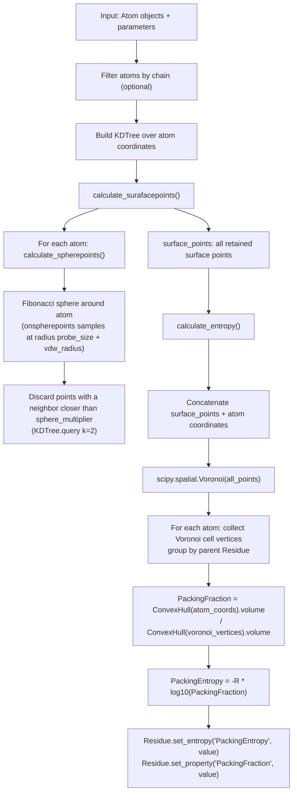
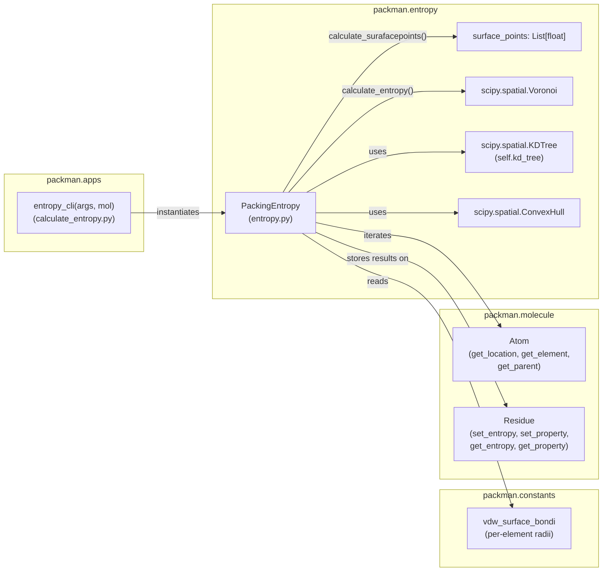
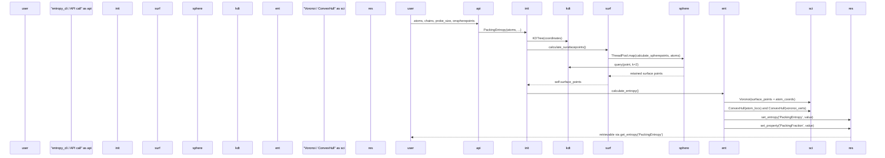

# Packing Entropy

<details>
<summary>Relevant source files</summary>

The following files were used as context for generating this wiki page:

- [docs/source/tutorials/dci_cli.rst](docs/source/tutorials/dci_cli.rst)
- [docs/source/tutorials/entropy_api.rst](docs/source/tutorials/entropy_api.rst)
- [docs/source/tutorials/entropy_cli.rst](docs/source/tutorials/entropy_cli.rst)
- [packman/apps/calculate_entropy.py](packman/apps/calculate_entropy.py)
- [packman/apps/hdanm.py](packman/apps/hdanm.py)
- [packman/bin/__init__.py](packman/bin/__init__.py)
- [packman/entropy/__init__.py](packman/entropy/__init__.py)
- [packman/entropy/entropy.py](packman/entropy/entropy.py)
- [packman/geometry/__init__.py](packman/geometry/__init__.py)
- [packman/geometry/geometry.py](packman/geometry/geometry.py)
- [packman/tests/geometry/test_geometry.py](packman/tests/geometry/test_geometry.py)

</details>


This page documents the `PackingEntropy` class, its underlying Voronoi tessellation algorithm, the `entropy_cli` wrapper, and both API usage patterns. It covers the `packman.entropy` submodule and the `packman.apps.calculate_entropy` module.

For CLI argument reference, see [Command-Line Interface](#7). For the GUI panel, see [Graphical User Interface](#8). For the molecular data model that stores per-residue entropy values, see [Residue and HetMol](#3.3).

---

## Overview

Packing Entropy quantifies how tightly packed each residue is within a protein structure. The metric is derived purely from the 3D geometry of the structure — no simulation or trajectory is required.

The implementation is in [packman/entropy/entropy.py]() and is exposed as `packman.entropy.PackingEntropy`. The CLI wrapper is in [packman/apps/calculate_entropy.py]().

> **Citation:** Pranav M. Khade and Robert L. Jernigan. *Entropies Derived from the Packing Geometries within a Single Protein Structure.* ACS Omega 2022 7 (24), 20719-20730. DOI: 10.1021/acsomega.2c00999

---

## Algorithm

The computation proceeds in two phases: surface point generation and Voronoi-based entropy assignment.

**Computation Pipeline**



Sources: [packman/entropy/entropy.py:101-165]()

### Phase 1 — Surface Point Generation

The method `calculate_spherepoints` generates a point cloud around each atom using a Fibonacci (golden angle) spiral on a sphere. The sphere radius is:

```
sphere_multiplier = (probe_size + vdw_surface_bondi[atom.get_element()]) * 2
```

where `vdw_surface_bondi` is a per-element van der Waals radius lookup from `packman.constants`. Points are retained only if their second-nearest neighbor is farther away than `sphere_multiplier`, which filters out points that fall inside other atoms. The retained points form the approximate solvent-accessible surface.

`calculate_surafacepoints` parallelises this over all atoms using `multiprocessing.dummy.Pool` (thread pool).

Sources: [packman/entropy/entropy.py:101-133]()

### Phase 2 — Voronoi Tessellation and Entropy

`calculate_entropy` merges surface points with atom coordinates and passes the combined point cloud to `scipy.spatial.Voronoi`. The surface points act as "phantom" atoms that cap the Voronoi cells of boundary residues, preventing infinite cells.

For each residue:

| Quantity | Formula |
|---|---|
| **Packing Fraction** | `ConvexHull(atom_locs).volume / ConvexHull(voronoi_vertices).volume` |
| **Packing Entropy** | `-R × log₁₀(PackingFraction)` |

`R` is the universal gas constant imported from `scipy.constants`. A perfectly packed residue (packing fraction → 1) has entropy → 0. A loosely packed residue (packing fraction → 0) has a large positive entropy.

Both values are stored on the `Residue` object:
- Entropy via `Residue.set_entropy('PackingEntropy', value)`
- Fraction via `Residue.set_property('PackingFraction', value)`

Sources: [packman/entropy/entropy.py:135-165]()

---

## Class Reference: `PackingEntropy`

Located at [packman/entropy/entropy.py:31-165]()

### Constructor Parameters

| Parameter | Type | Default | Description |
|---|---|---|---|
| `atoms` | `[Atom]` | required | Atoms to include in the calculation |
| `chains` | `str` / `[str]` / `None` | `None` | Restrict to these chain IDs. `None` includes all chains. |
| `probe_size` | `float` | `1.4` | Radius of the surface probe (Å). Recommended: 1.4 (water molecule radius). |
| `onspherepoints` | `int` | `30` | Number of Fibonacci sphere points generated per atom. |

### Methods

| Method | Returns | Description |
|---|---|---|
| `get_total_packing_fraction()` | `float` | Sum of `PackingFraction` across all residues |
| `get_total_entropy()` | `float` | Sum of `PackingEntropy` across all residues |
| `get_total_chain_entropy(chain)` | `float` | Sum of `PackingEntropy` for a specific chain |
| `get_surafacepoints()` | `[[float]]` | The computed surface point coordinates |
| `calculate_spherepoints(atom)` | `[[float]]` | Point cloud around a single atom |
| `calculate_surafacepoints()` | `None` | Recomputes and stores `self.surface_points` |
| `calculate_entropy()` | `None` | Runs Voronoi tessellation and stores entropy on residues |

Sources: [packman/entropy/entropy.py:68-165]()

---

## Code Entity Map



Sources: [packman/entropy/entropy.py:1-30](), [packman/apps/calculate_entropy.py:1-62]()

---

## API Usage

There are two patterns for invoking the calculation.

### Pattern 1 — Via `molecule` Objects

The `Model`, `Chain`, and `Residue` objects each expose a `calculate_entropy` method that delegates to `PackingEntropy` internally. This is the simpler pattern.

```python
from packman import molecule

molecule.download_structure('1LF7')
mol = molecule.load_structure('1LF7.cif')

# Calculate for the full model (all chains)
mol[0].calculate_entropy('PackingEntropy', chains=None, probe_size=1.4, onspherepoints=30)

# Or restrict to specific chains
mol[0]['A'].calculate_entropy('PackingEntropy', chains=None, probe_size=1.4, onspherepoints=30)
```

Retrieve results at any level of the hierarchy:

```python
# Model-level total
mol[0].get_entropy('PackingEntropy')

# Chain-level total
mol[0]['A'].get_entropy('PackingEntropy')

# Per-residue
mol[0].get_residues()[0].get_entropy('PackingEntropy')
```

Sources: [docs/source/tutorials/entropy_api.rst:19-75]()

### Pattern 2 — Via `PackingEntropy` Directly

This pattern gives access to the full `PackingEntropy` object, including `get_total_packing_fraction`, `get_total_chain_entropy`, and the ability to pass a manually filtered atom list.

```python
from packman import molecule
from packman.entropy import PackingEntropy

molecule.download_structure('1LF7')
mol = molecule.load_structure('1LF7.cif')

result = PackingEntropy(mol[0].get_atoms(), chains='A', probe_size=1.4, onspherepoints=30)

# Access aggregate values
result.get_total_entropy()
result.get_total_packing_fraction()
result.get_total_chain_entropy('A')

# Per-residue values are also stored on Residue objects
for residue in mol[0].get_residues():
    print(residue.get_entropy('PackingEntropy'))
```

Sources: [docs/source/tutorials/entropy_api.rst:77-122](), [packman/entropy/entropy.py:42-66]()

### Choosing Between the Two Patterns

| Scenario | Recommended Pattern |
|---|---|
| Standard per-chain or full-model calculation | Pattern 1 (via `molecule` objects) |
| Custom atom filtering (exclude specific residues) | Pattern 2 (via `PackingEntropy` directly) |
| Need access to `get_total_packing_fraction` or `get_surafacepoints` | Pattern 2 |
| Multi-chain exclusion (compute A+B without C) | Pattern 2 with `chains=['A','B']` on full `mol[0].get_atoms()` |

---

## CLI Wrapper: `entropy_cli`

Located at [packman/apps/calculate_entropy.py:24-62]()

`entropy_cli(args, mol)` is called by the `packman entropy` subcommand. It:

1. Parses `args.chains` as a comma-separated string into a list.
2. Instantiates `PackingEntropy` for each model frame in `mol`.
3. Writes a tab-separated output file with the columns below.
4. Appends a total entropy row and a normalized entropy row (`total / (3N - 6)`).

### Output Format

```
Frame   Chain   ResidueID   ResidueName   PackingEntropy
1       A       10          ALA           0.432
...
Total (Frame 1)                           84.7
Total Normalized Entropy (3N-6) (Frame 1) 0.0023
```

Sources: [packman/apps/calculate_entropy.py:24-62]()

### CLI Arguments

| Argument | Default | Description |
|---|---|---|
| `FILENAME` | required | Path to the PDB/CIF file |
| `-type` | required | Entropy type; only `PackingEntropy` is valid |
| `-pdbid` | `None` | Download PDB by ID and save to `FILENAME` |
| `--chains` | `None` | Comma-separated chain IDs (e.g. `A,B`) |
| `--probe_size` | `1.4` | Surface probe radius in Å |
| `--onspherepoints` | `30` | Fibonacci sphere point count per atom |

Example invocations:

```bash
# Calculate for all chains
packman entropy 1prw.pdb -type PackingEntropy

# Calculate for chains A and B only
packman entropy 1prw.pdb -type PackingEntropy --chains A,B

# Download structure and calculate
packman entropy 1prw.pdb -type PackingEntropy -pdbid 1PRW
```

Sources: [docs/source/tutorials/entropy_cli.rst:23-57]()

---

## Data Flow Summary



Sources: [packman/entropy/entropy.py:42-165](), [packman/apps/calculate_entropy.py:24-62]()

---

## Parameter Guidance

| Parameter | Effect of increasing | Effect of decreasing |
|---|---|---|
| `probe_size` | Larger surface sphere radius; captures more solvent-accessible area | Smaller probe; less surface coverage |
| `onspherepoints` | Denser point cloud per atom; more accurate surface but slower | Faster but coarser surface approximation |

The default `probe_size=1.4` Å corresponds to the van der Waals radius of a water molecule. Values below `1.0` are not recommended per the source documentation. The default `onspherepoints=30` is a balance between accuracy and computation time.

Sources: [packman/entropy/entropy.py:37-41](), [docs/source/tutorials/entropy_cli.rst:44-50]()

---