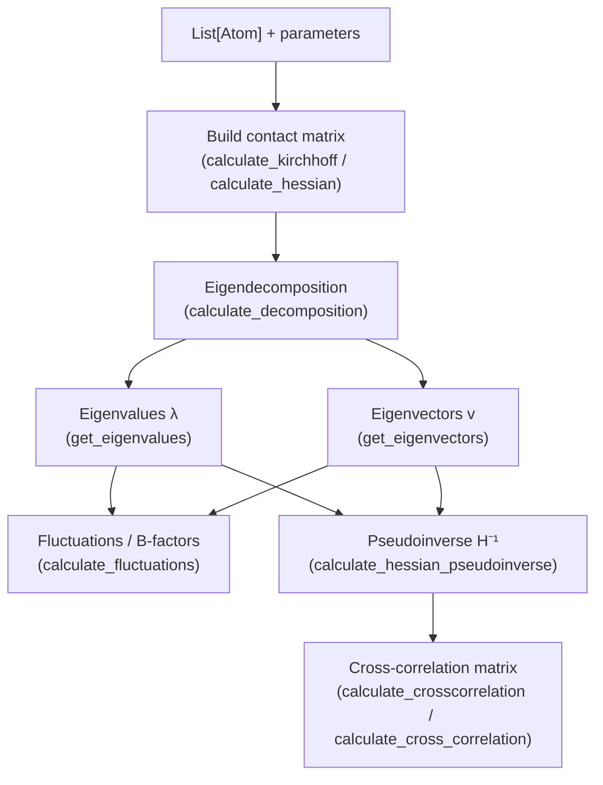
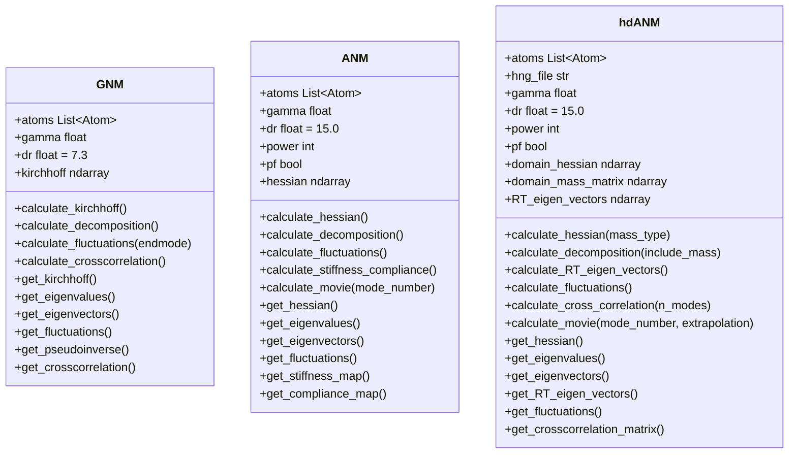
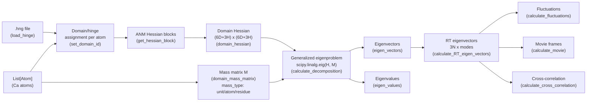

# Network Models

<details>
<summary>Relevant source files</summary>

The following files were used as context for generating this wiki page:

- [packman/anm/__init__.py](packman/anm/__init__.py)
- [packman/anm/anm.py](packman/anm/anm.py)
- [packman/anm/hd_anm.py](packman/anm/hd_anm.py)
- [packman/gnm/__init__.py](packman/gnm/__init__.py)
- [packman/gnm/gnm.py](packman/gnm/gnm.py)

</details>


This page covers the three elastic network model implementations in PACKMAN: `ANM`, `hdANM`, and `GNM`. It explains their shared mathematical foundation, how they differ architecturally, and when to choose each one.

For detailed API reference for each model, see the child pages:
- Anisotropic Network Model: [ANM](#5.1)
- Hinge-Domain ANM: [hdANM](#5.2)
- Gaussian Network Model: [GNM](#5.3)

The `GNM` class also serves as the backbone of the `DCI` application; for that usage, see [Dynamic Community Identification](#4.2).

---

## Module Layout

The network models live in two subpackages:

| Subpackage | File | Exported Class |
|---|---|---|
| `packman.anm` | `packman/anm/anm.py` | `ANM` |
| `packman.anm` | `packman/anm/hd_anm.py` | `hdANM` |
| `packman.gnm` | `packman/gnm/gnm.py` | `GNM` |

Both subpackages are exposed at the top-level `packman` namespace via their `__init__.py` files ([packman/anm/__init__.py:1-7](), [packman/gnm/__init__.py:1-11]()).

---

## Shared Mathematical Foundation

All three models treat a protein as a network of nodes (atoms or residues) connected by springs. The workflow is identical in structure:

1. **Build a contact/force matrix** from the 3D coordinates and a distance cutoff `dr`.
2. **Decompose** the matrix into eigenvalues and eigenvectors (normal modes).
3. **Derive physical quantities** — fluctuations, cross-correlations, compliance — from the eigenvectors and eigenvalues.

**Contact matrix dimensions:**

| Model | Matrix name | Dimension | Spring weighting |
|---|---|---|---|
| GNM | Kirchhoff | N × N | Scalar (isotropic) |
| ANM | Hessian | 3N × 3N | Tensor (anisotropic) |
| hdANM | Domain Hessian | (6D+3H) × (6D+3H) | Tensor, mass-weighted |

Where N = number of atoms/residues, D = number of rigid domains, H = number of hinge atoms.

**Rigid-body modes:** For a free protein in solution, the six lowest-frequency modes (three translations + three rotations) have zero eigenvalue and are excluded from all physical calculations. All three models skip these in fluctuation and pseudoinverse computations.

**Eigendecomposition methods used:**

| Class | Method called | SciPy/NumPy function |
|---|---|---|
| `GNM` | `calculate_decomposition()` | `numpy.linalg.eigh` |
| `ANM` | `calculate_decomposition()` | `numpy.linalg.eigh` |
| `hdANM` | `calculate_decomposition(include_mass=True)` | `scipy.linalg.eig` (generalized) |

`hdANM` solves a generalized eigenvalue problem `H·v = λ·M·v` with a mass matrix `M`, while `ANM` and `GNM` solve standard symmetric eigenvalue problems ([packman/anm/hd_anm.py:216-238](), [packman/anm/anm.py:203-210](), [packman/gnm/gnm.py:153-160]()).

---

**Diagram: Shared Workflow Across All Three Models**



Sources: [packman/anm/anm.py:168-229](), [packman/gnm/gnm.py:127-200](), [packman/anm/hd_anm.py:100-508]()

---

## Model Comparison

**Diagram: Class Structure and Key Methods**



Sources: [packman/gnm/gnm.py:32-201](), [packman/anm/anm.py:38-312](), [packman/anm/hd_anm.py:60-509]()

---

### Key Differences

| Feature | GNM | ANM | hdANM |
|---|---|---|---|
| Matrix type | Kirchhoff (scalar contacts) | Hessian (directional forces) | Domain-compressed Hessian |
| Default cutoff `dr` | 7.3 Å | 15.0 Å | 15.0 Å |
| Dimensionality | N × N | 3N × 3N | (6D+3H) × (6D+3H) |
| Mass weighting | No | No | Yes (`unit`/`atom`/`residue`) |
| Requires `.hng` file | No | No | Yes |
| Fluctuations | Scalar per residue | Vector magnitude per atom | Via RT eigenvectors |
| Movie generation | No | Linear only | Linear and curvilinear |
| Stiffness/compliance | No | Yes | No |
| Cross-correlation | Yes | Indirectly via H⁻¹ | Yes |

---

## Constructor Parameters

All three constructors accept `atoms` as a `List[Atom]` (from `packman.molecule`). The remaining parameters control the spring model:

| Parameter | Type | ANM default | hdANM default | GNM default | Description |
|---|---|---|---|---|---|
| `gamma` | float | 1.0 | 1.0 | 1.0 | Spring constant |
| `dr` | float | 15.0 | 15.0 | 7.3 | Distance cutoff (Å) |
| `power` | int | 0 | 0 | 0 | Exponent for distance weighting |
| `pf` | bool | False | False | — | Parameter-free mode |
| `hng_file` | str | — | required | — | Path to `.hng` hinge/domain file |

Sources: [packman/anm/anm.py:52-68](), [packman/anm/hd_anm.py:79-97](), [packman/gnm/gnm.py:45-54]()

---

## hdANM: Domain-Compressed Representation

`hdANM` is a structural extension of `ANM`. Instead of tracking 3 degrees of freedom per atom, it tracks:
- **6 degrees of freedom per rigid domain** (3 translational + 3 rotational)
- **3 degrees of freedom per hinge atom** (same as ANM)

The resulting compressed Hessian has this block structure:

```
H_new = | HDD  HDH |
        | HHD  HHH |
```

Where HDD (domain-domain), HHD/HDH (hinge-domain coupling), and HHH (hinge-hinge) blocks are assembled from standard ANM Hessian blocks via `get_hessian_block()` ([packman/anm/hd_anm.py:176-212]()).

The domain/hinge membership for each atom is read from the `.hng` file using `load_hinge()` from `packman.utilities`, then stored on each residue via `set_domain_id()` ([packman/anm/hd_anm.py:263-268]()).

After decomposition, `calculate_RT_eigen_vectors()` "explodes" the compressed (6D+3H)-dimensional eigenvectors back to full 3N-dimensional displacement vectors, which are then used for fluctuations and movie generation ([packman/anm/hd_anm.py:411-444]()).

**Diagram: hdANM Data Flow**



Sources: [packman/anm/hd_anm.py:241-509]()

---

## When to Use Each Model

| Use case | Recommended model |
|---|---|
| Fast per-residue flexibility / B-factor prediction | `GNM` |
| Residue-residue cross-correlations for community detection (`DCI`) | `GNM` |
| Directional mode shapes and animations | `ANM` |
| Stiffness and compliance analysis | `ANM` |
| Proteins with known hinge regions and rigid domains | `hdANM` |
| Mass-weighted normal modes for hinge motion | `hdANM` |
| Curvilinear (physically realistic) domain motion animation | `hdANM` |

---

## Typical Usage Pattern

All three models follow the same imperative "calculate then get" pattern:

```
# Step 1: construct with atoms and parameters
model = ANM(atoms, gamma=1.0, dr=15.0)

# Step 2: build matrix
model.calculate_hessian()          # or calculate_kirchhoff() for GNM

# Step 3: decompose
model.calculate_decomposition()

# Step 4: derive quantities
model.calculate_fluctuations()

# Step 5: retrieve results
fluct = model.get_fluctuations()
evals = model.get_eigenvalues()
evecs = model.get_eigenvectors()
```

For `hdANM`, an extra step is needed after decomposition to recover full-resolution vectors:

```
model.calculate_hessian(mass_type='residue')
model.calculate_decomposition(include_mass=True)
model.calculate_RT_eigen_vectors()
model.calculate_fluctuations()
```

Sources: [packman/anm/anm.py:168-229](), [packman/gnm/gnm.py:127-186](), [packman/anm/hd_anm.py:216-471]()

---