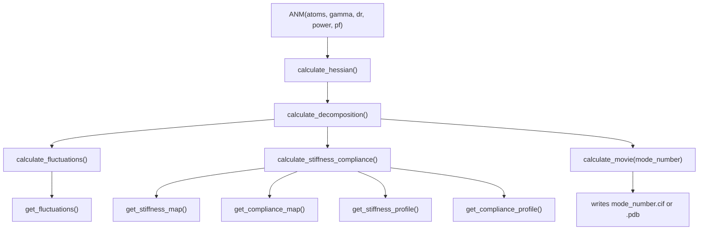
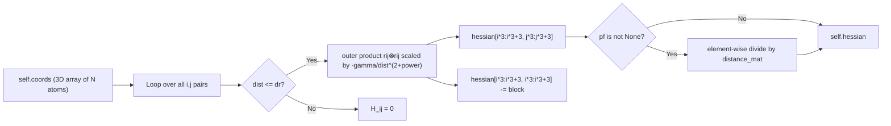
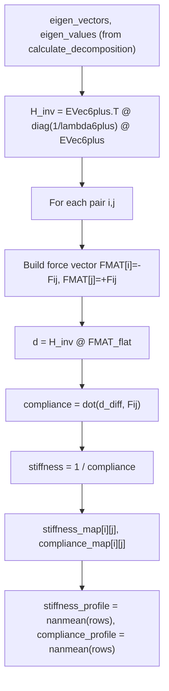
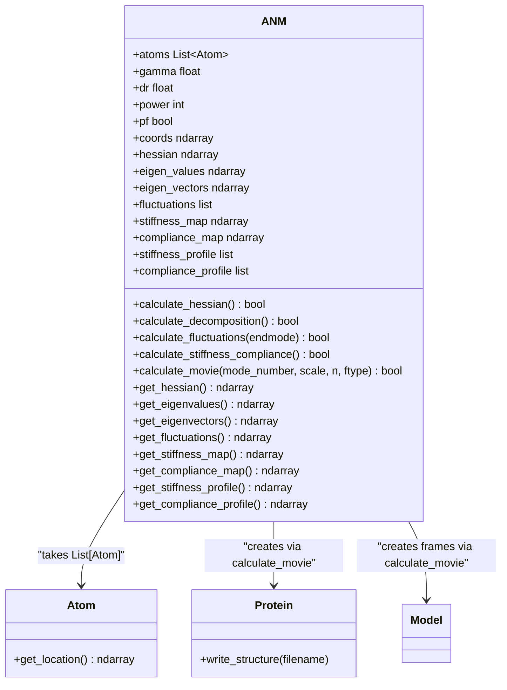

# Anisotropic Network Model (ANM)

<details>
<summary>Relevant source files</summary>

The following files were used as context for generating this wiki page:

- [docs/_static/gallary/logo.ico](docs/_static/gallary/logo.ico)
- [docs/source/tutorials/compliance.rst](docs/source/tutorials/compliance.rst)
- [docs/source/tutorials/hinge_predict.rst](docs/source/tutorials/hinge_predict.rst)
- [packman/anm/__init__.py](packman/anm/__init__.py)
- [packman/anm/anm.py](packman/anm/anm.py)
- [packman/anm/hd_anm.py](packman/anm/hd_anm.py)
- [packman/tests/anm/test_anm.py](packman/tests/anm/test_anm.py)
- [packman/tests/data/4hla.hng](packman/tests/data/4hla.hng)
- [packman/tests/entropy/test_entropy.py](packman/tests/entropy/test_entropy.py)
- [packman/tests/gnm/test_gnm.py](packman/tests/gnm/test_gnm.py)
- [packman/tests/molecule/test_molecule.py](packman/tests/molecule/test_molecule.py)
- [packman/tests/utilities/__init__.py](packman/tests/utilities/__init__.py)
- [packman/tests/utilities/test_utilities.py](packman/tests/utilities/test_utilities.py)

</details>


This page covers the `ANM` class in `packman/anm/anm.py`: its constructor parameters, the sequence of calculation steps (Hessian → decomposition → fluctuations / stiffness-compliance / movie), and the get/calculate API pattern. For the hinge-domain extension that wraps and restructures the ANM Hessian into domain/hinge blocks, see [hdANM](#5.2). For the scalar (isotropic) counterpart, see [GNM](#5.3).

---

## Overview

The `ANM` class implements the Anisotropic Network Model, a coarse-grained elastic network model in which residues (represented by Cα atoms or any `Atom` objects) are connected by harmonic springs within a distance cutoff. The resulting Hessian matrix is diagonalized to yield normal modes, which are used to derive:

- Theoretical B-factors (fluctuations)
- Stiffness and compliance maps and per-residue profiles
- Multi-frame structural movies of individual modes

The class follows a consistent two-step API: every `calculate_*` method populates an internal attribute, and the corresponding `get_*` method returns it.

Sources: [packman/anm/anm.py:1-35](), [packman/anm/__init__.py:1-7]()

---

## Module Location

```
packman/
└── anm/
    ├── __init__.py     # exports ANM and hdANM
    └── anm.py          # ANM class definition
```

The `packman.anm` subpackage exports two classes:

| Symbol | File | Description |
|--------|------|-------------|
| `ANM` | `packman/anm/anm.py` | Standard anisotropic network model |
| `hdANM` | `packman/anm/hd_anm.py` | Hinge-domain ANM (extends ANM concepts) |

Sources: [packman/anm/__init__.py:1-7]()

---

## Constructor

```
ANM(atoms, gamma=1.0, dr=15.0, power=0, pf=False)
```

| Parameter | Type | Default | Description |
|-----------|------|---------|-------------|
| `atoms` | `List[Atom]` | required | Ordered list of `packman.molecule.Atom` objects |
| `gamma` | `float` | `1.0` | Uniform spring constant (must be > 0) |
| `dr` | `float` | `15.0` | Distance cutoff in Å (must be > 0) |
| `power` | `int` | `0` | Exponent added to distance in spring weighting; used only in parameter-free mode |
| `pf` | `bool` | `False` | Enables parameter-free mode; requires `power > 0` |

On construction the class stores atom coordinates as a `numpy.ndarray` (`self.coords`) and initializes all result attributes (`hessian`, `fluctuations`, `stiffness_map`, etc.) to `None`.

Sources: [packman/anm/anm.py:52-74]()

---

## Calculation Workflow

**Typical ANM (fluctuations) workflow diagram**



All `calculate_*` methods return `True` on success. Results are stored in instance attributes and retrieved via the corresponding `get_*` methods.

Sources: [packman/anm/anm.py:167-311]()

---

## Hessian Matrix

**Method:** `calculate_hessian()` → populates `self.hessian`

**Retrieve with:** `get_hessian()` → `numpy.ndarray` of shape `(3N, 3N)`

The Hessian is a `3N × 3N` symmetric matrix (N = number of atoms). Each off-diagonal `3×3` block `H_ij` for atoms `i` and `j` within the cutoff is:

```
H_ij = −γ / |r_ij|^(2+power)  ×  (r_j − r_i)⊗(r_j − r_i)
```

The diagonal block `H_ii` is the negative sum of all off-diagonal blocks in that row (ensures translational invariance). Pairs outside the cutoff (`|r_ij| > dr`) contribute zero.

When `pf=True`, the matrix is further element-wise divided by a distance matrix (parameter-free weighting), enabling distance-dependent spring constants.

**Hessian construction diagram**



Sources: [packman/anm/anm.py:168-201]()

---

## Eigendecomposition

**Method:** `calculate_decomposition()` → populates `self.eigen_values`, `self.eigen_vectors`

**Retrieve with:** `get_eigenvalues()`, `get_eigenvectors()` → `numpy.ndarray`

Uses `numpy.linalg.eigh` (real symmetric eigensolver) on the Hessian:

```python
self.eigen_values, self.eigen_vectors = numpy.linalg.eigh(self.hessian)
```

The result is sorted ascending. For a system of N atoms, there are `3N` eigenvalues. The **first 6 are near-zero** (rigid-body translational and rotational modes) and are excluded from all downstream analyses.

Sources: [packman/anm/anm.py:203-210]()

---

## Fluctuations (Theoretical B-factors)

**Method:** `calculate_fluctuations(endmode=None)` → populates `self.fluctuations`

**Retrieve with:** `get_fluctuations()` → list of N floats

For each non-rigid mode `k` (modes 6 through 3N−1), the contribution to residue `i`'s mean-square displacement is:

```
Δᵢₖ = (uₓ² + u_y² + u_z²)_ik / λ_k
```

The total fluctuation for residue `i` is the sum over all non-rigid modes. These are the theoretical B-factors analogous to crystallographic B-factors.

Sources: [packman/anm/anm.py:212-229]()

---

## Stiffness and Compliance Analysis

**Method:** `calculate_stiffness_compliance()` → populates four attributes

**Retrieve with:**

| Method | Returns | Shape |
|--------|---------|-------|
| `get_stiffness_map()` | `numpy.ndarray` | `N × N` |
| `get_compliance_map()` | `numpy.ndarray` | `N × N` |
| `get_stiffness_profile()` | list of floats | `N` |
| `get_compliance_profile()` | list of floats | `N` |

**Algorithm:**

1. Compute the pseudoinverse of the Hessian using the non-rigid eigenvectors and eigenvalues:
   ```
   H⁺ = EVec[6:].T × diag(1/λ[6:]) × EVec[6:]
   ```
2. For each ordered pair `(i, j)`, construct a unit force vector `F_ij` directed from atom `i` to atom `j`.
3. Solve for the displacement vector `d = H⁺ · F_flat`.
4. Compliance = projection of the differential displacement onto the force direction.
5. Stiffness = 1 / compliance.

Per-residue profiles are the row-wise `nanmean` of the respective maps.

> **Citation:** Scaramozzino et al., *Structural Compliance – A New Metric for Protein Flexibility*, Proteins, 2020. DOI: 10.1002/prot.25968

**Stiffness/compliance data flow diagram**



Sources: [packman/anm/anm.py:232-274](), [docs/source/tutorials/compliance.rst:1-118]()

---

## Movie Generation

**Method:** `calculate_movie(mode_number, scale=1.5, n=20, ftype='cif')` → writes a multi-model structure file

| Parameter | Type | Default | Description |
|-----------|------|---------|-------------|
| `mode_number` | `int` | required | Index into eigenvector array (first non-rigid = 6) |
| `scale` | `float` | `1.5` | Amplitude multiplier |
| `n` | `int` | `20` | Number of frames (ideally a multiple of 4, minimum 8) |
| `ftype` | `str` | `'cif'` | Output format: `'cif'` or `'pdb'` |

The method generates `n+1` frames by advancing a sine-wave phase over a full period. For each frame `j`:

```
x_new = x0 + scale × sin(j/n × 2π) × eigenvector[mode_number]
```

Each frame is a `Model` object containing displaced `Atom` instances. All frames are assembled into a `Protein` object and written to `{mode_number}.{ftype}`.

Sources: [packman/anm/anm.py:276-311]()

---

## Full API Reference

**ANM class diagram**



Sources: [packman/anm/anm.py:38-311]()

---

## Usage Example

The following pattern comes from the compliance tutorial and the test suite:

```python
from packman import molecule
from packman.anm import ANM

# Load structure
mol = molecule.load_structure('1LF7.cif')

# Select C-alpha atoms from model 0
c_alpha = [i for i in mol[0].get_calpha() if i is not None]

# Build model
anm_model = ANM(c_alpha, gamma=1.0, dr=15.0)

# Step 1: build Hessian
anm_model.calculate_hessian()

# Step 2: decompose
anm_model.calculate_decomposition()

# Step 3a: compute fluctuations
anm_model.calculate_fluctuations()
fluctuations = anm_model.get_fluctuations()

# Step 3b: compute stiffness/compliance
anm_model.calculate_stiffness_compliance()
stiffness_map     = anm_model.get_stiffness_map()
compliance_map    = anm_model.get_compliance_map()
stiffness_profile = anm_model.get_stiffness_profile()

# Step 3c: generate movie for mode 6 (first non-rigid mode)
anm_model.calculate_movie(6, scale=1.5, n=20, ftype='cif')
# writes: 6.cif
```

For parameter-free mode (distance-dependent spring constants):

```python
anm_pf = ANM(c_alpha, pf=True, dr=float('inf'), power=3)
```

Sources: [docs/source/tutorials/compliance.rst:37-75](), [packman/tests/anm/test_anm.py:41-60]()

---

## Parameter Notes

| Parameter | Effect |
|-----------|--------|
| `gamma` | Uniform spring constant. Larger values stiffen all springs equally; does not affect relative mode shapes, only eigenvalue magnitudes. |
| `dr` | Distance cutoff in Å. Increasing this value adds longer-range interactions; `float('inf')` creates a fully connected network. |
| `power` | Used only when `pf=True`. Exponent applied to inter-atom distance in the denominator, making close atoms stiffer. Typical values: 2–3. |
| `pf` | When `True`, applies distance-dependent weighting; requires `power > 0`. |

**Validation on construction:** If `pf=True` and `power <= 0`, the constructor raises `Exception`. If `gamma <= 0` or `dr <= 0`, the constructor raises `Exception`.

Sources: [packman/anm/anm.py:52-67]()

---

## Tests

The test suite for `ANM` is in [packman/tests/anm/test_anm.py:41-63](). The `test_ANM_Compliance` test:

1. Loads `packman/tests/data/4hla.cif`
2. Extracts all Cα atoms from model 0
3. Runs the full pipeline: `calculate_hessian` → `calculate_decomposition` → `calculate_stiffness_compliance` → `calculate_fluctuations`
4. Validates eigenvalues against a pre-computed reference array using `numpy.allclose`
5. Asserts all four outputs (`stiffness_map`, `compliance_map`, `stiffness_profile`, `compliance_profile`) are non-None

Sources: [packman/tests/anm/test_anm.py:41-63]()

---