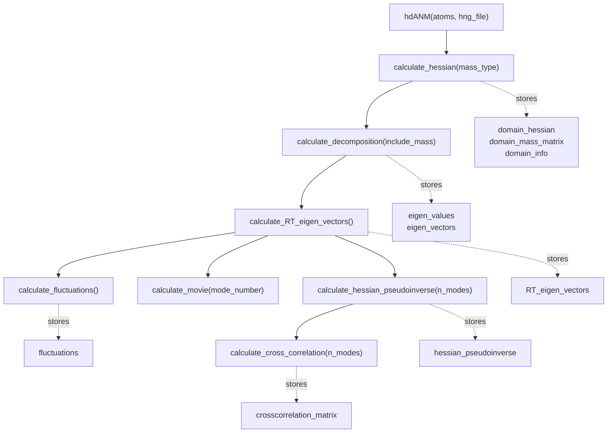
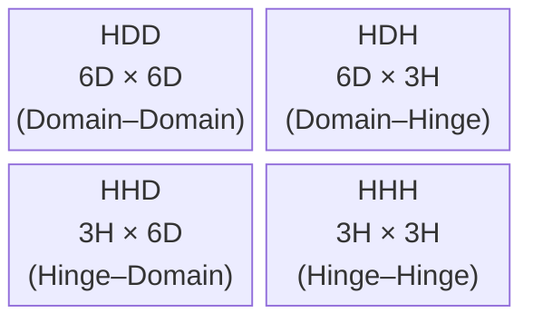
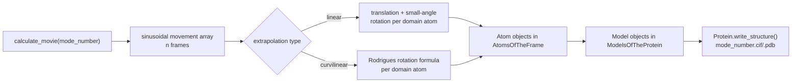
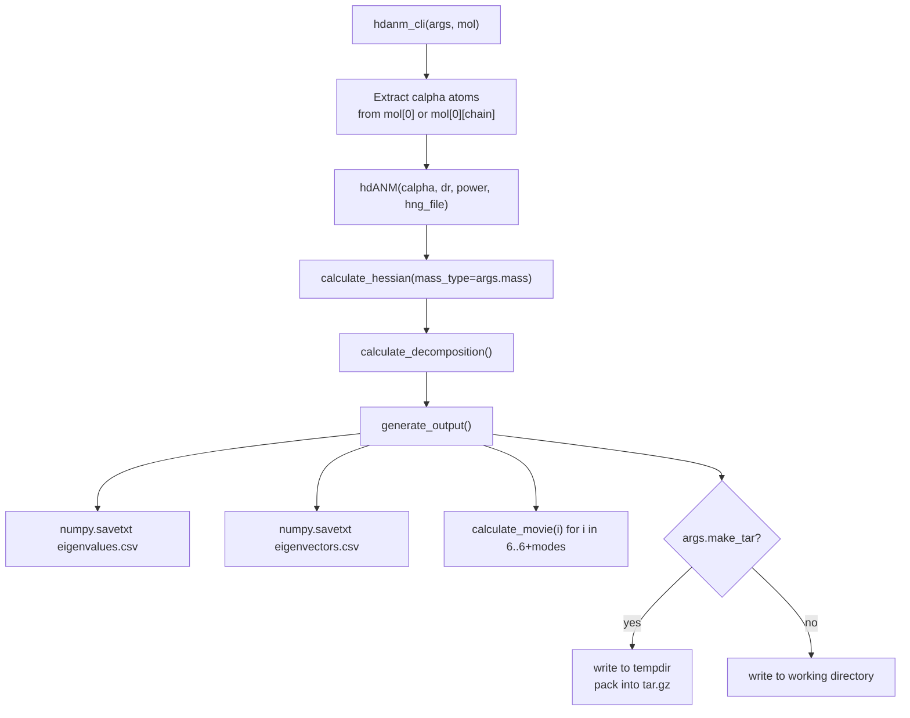
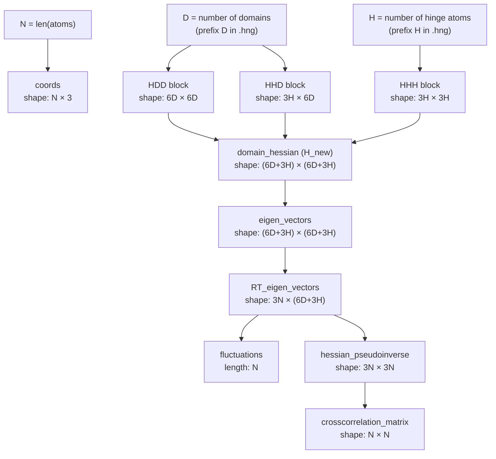

# Hinge-Domain ANM (hdANM)

<details>
<summary>Relevant source files</summary>

The following files were used as context for generating this wiki page:

- [additional codes/stability_tests.py](additional codes/stability_tests.py)
- [docs/source/tutorials/gui.rst](docs/source/tutorials/gui.rst)
- [docs/source/tutorials/hdANM.rst](docs/source/tutorials/hdANM.rst)
- [docs/source/tutorials/hdANM_cli.rst](docs/source/tutorials/hdANM_cli.rst)
- [docs/source/tutorials/hinge_predict_cli.rst](docs/source/tutorials/hinge_predict_cli.rst)
- [docs/source/tutorials/installation.rst](docs/source/tutorials/installation.rst)
- [docs/source/tutorials/main.rst](docs/source/tutorials/main.rst)
- [packman/anm/__init__.py](packman/anm/__init__.py)
- [packman/anm/anm.py](packman/anm/anm.py)
- [packman/anm/hd_anm.py](packman/anm/hd_anm.py)
- [packman/apps/calculate_entropy.py](packman/apps/calculate_entropy.py)
- [packman/apps/hdanm.py](packman/apps/hdanm.py)
- [packman/bin/__init__.py](packman/bin/__init__.py)
- [packman/entropy/__init__.py](packman/entropy/__init__.py)
- [packman/tests/__init__.py](packman/tests/__init__.py)
- [packman/tests/anm/__init__.py](packman/tests/anm/__init__.py)
- [packman/tests/data/1prw.hng](packman/tests/data/1prw.hng)
- [packman/tests/gnm/__init__.py](packman/tests/gnm/__init__.py)

</details>


This page documents the `hdANM` class in `packman/anm/hd_anm.py`, its domain-based Hessian construction, mass matrix assembly, eigendecomposition, RT eigenvector transformation, and the `hdanm_cli` wrapper. For the standard all-atom ANM without domain partitioning, see [ANM (5.1)](#5.1). For hinge prediction that produces the required `.hng` input, see [Hinge Prediction (4.1)](#4.1).

---

## Overview

hdANM (Hinge-Domain ANM) is an extension of ANM that explicitly accounts for rigid-domain structure. Protein regions are partitioned into **domains** (rigid bodies, 6 DOF each) and **hinges** (flexible atoms, 3 DOF each). This reduces the Hessian dimensionality from `3N × 3N` to `(6D + 3H) × (6D + 3H)`, where D = number of domains and H = number of hinge atoms. The result is a model that captures large-scale domain motions constrained by hinge flexibility.

**Citation:** Khade et al., *Biophysical Journal*, 2021. https://doi.org/10.1016/j.bpj.2021.10.017

---

## The .hng File Format

The `.hng` (hinge) file is the required input that defines how residues are classified as domains or hinges. It is tab-delimited, one segment per line.

**Columns:**

| Column | Content | Example |
|--------|---------|---------|
| 1 | `Filename_ChainID` | `1exr.pdb_A` |
| 2 | Segment ID (prefix `D` = domain, `H` = hinge) | `D1`, `H1`, `D2` |
| 3 | Residue range `start:end` (inclusive) | `1:70` |

**Example** (from `packman/tests/data/1prw.hng`):

```
1exr.pdb_A    D1    1:70
1exr.pdb_A    H1    71:90
1exr.pdb_A    D2    91:149
```

This defines two domains (`D1`, `D2`) separated by one hinge (`H1`). The hinge file can be generated by the PACKMAN hinge prediction algorithm or written manually.

Sources: [packman/anm/hd_anm.py:11-24](), [packman/tests/data/1prw.hng:1-3](), [docs/source/tutorials/hdANM.rst:47-55]()

---

## Class Constructor

The `hdANM` class is located in [packman/anm/hd_anm.py:60-95]() and exported from `packman/anm/__init__.py`.

```
hdANM(atoms, hng_file, gamma=1.0, dr=15.0, power=0, pf=False)
```

| Parameter | Type | Default | Description |
|-----------|------|---------|-------------|
| `atoms` | `List[Atom]` | required | Atom objects (typically C-alpha atoms) |
| `hng_file` | `str` | required | Path to the `.hng` file |
| `gamma` | `float` | `1.0` | Spring constant |
| `dr` | `float` | `15.0` | Distance cutoff in Å |
| `power` | `float` | `0` | Distance power (for non-parametric mode) |
| `pf` | `bool` | `False` | Parameter-free mode flag |

The constructor loads the `.hng` file via `load_hinge(hng_file)` from `packman.utilities`, storing the domain/hinge range map as `self.HNGinfo`. Atom coordinates are stored as a numpy array in `self.coords`.

Sources: [packman/anm/hd_anm.py:79-95](), [packman/anm/__init__.py:1-7]()

---

## Computation Workflow

**Workflow Diagram: hdANM Step Sequence**



Sources: [packman/anm/hd_anm.py:216-509]()

---

## Hessian Construction

`calculate_hessian(mass_type='unit')` builds the reduced-dimension Hessian and mass matrix. It is implemented in [packman/anm/hd_anm.py:241-408]().

### Step 1: Assign Domain IDs

Each atom's parent residue is assigned a domain ID (`D1`, `H1`, etc.) by matching its residue number against the `HNGinfo` ranges. This calls `residue.set_domain_id()`.

### Step 2: Build Sub-matrices

The domain Hessian has a block structure assembled from four sub-matrices. `get_hessian_block(i, j)` computes the standard ANM 3×3 interaction block between atom indices `i` and `j` ([packman/anm/hd_anm.py:176-211]()).

**Block Structure Diagram: Domain Hessian H_new**



| Block | Dimensions | Construction |
|-------|-----------|--------------|
| `HDD` | `6D × 6D` | Domain-domain interactions; each atom pair contributes a 3×3 block extended with cross-product terms for torque components |
| `HDH` | `6D × 3H` | Domain-hinge interactions; transpose of `HHD` |
| `HHD` | `3H × 6D` | Hinge-domain interactions; 3×3 block extended with rotational terms |
| `HHH` | `3H × 3H` | Hinge-hinge interactions; direct sum of 3×3 ANM blocks |

Each domain has **6 degrees of freedom**: 3 translational (`F_Delta`) and 3 rotational (`Torque_Phi`). The center of mass (COM) of each domain is computed as the arithmetic mean of its atom coordinates ([packman/anm/hd_anm.py:297]()).

### Step 3: Assemble H_new

`H_new` is assembled as:

```
H_new[0:6D, 0:6D]   = HDD
H_new[0:6D, 6D:]    = HDH
H_new[6D:,  0:6D]   = HHD
H_new[6D:,  6D:]    = HHH
```

[packman/anm/hd_anm.py:344-350]()

Sources: [packman/anm/hd_anm.py:241-408]()

---

## Mass Matrix

`calculate_hessian()` also builds the mass matrix `M` with the same block structure. Three mass assignment modes are supported via the `mass_type` parameter:

| `mass_type` | Hinge atom mass | Domain translational mass | Domain rotational mass |
|-------------|----------------|--------------------------|------------------------|
| `'unit'` | Identity (1 per DOF) | `len(atoms_in_domain)` × I₃ | Sum of unit inertia tensors |
| `'atom'` | `atomic_weight[element]` | Sum of atomic weights | Weighted inertia tensors |
| `'residue'` | `amino_acid_molecular_weight[residue_name]` | Sum of residue molecular weights | Weighted inertia tensors |

The rotational block `M[3:,3:]` for each domain is the **inertia tensor** computed from atom positions relative to the domain COM. Constants are sourced from `packman.constants.atomic_weight` and `packman.constants.amino_acid_molecular_weight`.

Sources: [packman/anm/hd_anm.py:352-408]()

---

## Eigendecomposition

`calculate_decomposition(include_mass=True)` is implemented in [packman/anm/hd_anm.py:216-238]().

- **With mass** (`include_mass=True`): Uses `scipy.linalg.eig(domain_hessian, domain_mass_matrix)` — a **generalized eigenvalue problem**. Eigenvalues are sorted by ascending real part.
- **Without mass** (`include_mass=False`): Uses `numpy.linalg.eigh(domain_hessian)` — standard symmetric eigendecomposition.

The resulting `eigen_values` and `eigen_vectors` are stored on the instance. The first 6 eigenvalues correspond to rigid-body modes and are excluded from physical analysis.

Sources: [packman/anm/hd_anm.py:216-238]()

---

## RT (Reverse Transformed) Eigenvectors

`calculate_RT_eigen_vectors()` is implemented in [packman/anm/hd_anm.py:411-443]().

The hdANM eigenvectors have dimension `(6D+3H) × (6D+3H)`. For visualization and fluctuation analysis, they must be mapped back to `3N × (6D+3H)` space (one 3-vector per atom). This expansion is called the **Reverse Transform** (previously called "exploded vectors" before version 1.3.3).

**Transformation Rules:**

- **Domain atom** (prefix `D`): The domain's 6-vector `[Δx, Δy, Δz, φx, φy, φz]` is converted to a per-atom 3-vector using the rotation-translation formula:
  - `new_x = Δx + φy·(z - COM_z) - φz·(y - COM_y)`
  - `new_y = Δy + φz·(x - COM_x) - φx·(z - COM_z)` *(sign conventions per code)*
  - `new_z = Δz + φx·(y - COM_y) - φy·(x - COM_x)`
- **Hinge atom** (prefix `H`): The atom's 3-vector is taken directly from the eigenvector's hinge section.

Result is stored in `self.RT_eigen_vectors` as a `(3N) × (6D+3H)` matrix.

Sources: [packman/anm/hd_anm.py:411-443]()

---

## Fluctuations (Theoretical B-factors)

`calculate_fluctuations()` is implemented in [packman/anm/hd_anm.py:446-471]().

Uses RT eigenvectors. For each non-rigid mode `k` (starting at index 6):

```
fluctuation[atom_i] = Σ_k  (rx_k² + ry_k² + rz_k²) / λ_k
```

where `rx_k`, `ry_k`, `rz_k` are the RT eigenvector components for atom `i` in mode `k`, and `λ_k` is the corresponding eigenvalue.

Result stored in `self.fluctuations` as a list of length `N`.

Sources: [packman/anm/hd_anm.py:446-471]()

---

## Hessian Pseudoinverse and Cross-Correlation Matrix

### Pseudoinverse

`calculate_hessian_pseudoinverse(n_modes='all')` ([packman/anm/hd_anm.py:473-489]()) computes:

```
H⁺ = V[6:n]ᵀ · diag(1/λ[6:n]) · V[6:n]
```

where `V` is the `RT_eigen_vectors` matrix transposed (rows = modes). Rigid modes (indices 0–5) are excluded. The result is stored as `self.hessian_pseudoinverse` with shape `(3N, 3N)`.

The `get_hessian_pseudoinverse(n_modes)` getter will auto-compute if not already present.

### Cross-Correlation Matrix

`calculate_cross_correlation(n_modes='all')` ([packman/anm/hd_anm.py:491-508]()) computes the normalized dynamic cross-correlation:

```
C[i,j] = Tr(H⁺[i,j]) / sqrt( Tr(H⁺[i,i]) · Tr(H⁺[j,j]) )
```

Result stored as `self.crosscorrelation_matrix` with shape `(N, N)`.

Sources: [packman/anm/hd_anm.py:473-508]()

---

## Movie Generation

`calculate_movie(mode_number, scale=1.5, n=20, extrapolation='curvilinear', ftype='cif', ca_to_aa=False)` is implemented in [packman/anm/hd_anm.py:510-]().

Generates a multi-model structure file representing the oscillatory motion of a given mode.

| Parameter | Type | Default | Description |
|-----------|------|---------|-------------|
| `mode_number` | `int` | required | Index into `eigen_vectors`; mode 6 is first non-rigid |
| `scale` | `float` | `1.5` | Amplitude multiplier |
| `n` | `int` | `20` | Number of frames; should be ≥ 8 and ideally a multiple of 4 |
| `extrapolation` | `str` | `'curvilinear'` | `'linear'` or `'curvilinear'` |
| `ftype` | `str` | `'cif'` | Output file format: `'cif'` or `'pdb'` |
| `ca_to_aa` | `bool` | `False` | Propagate Cα motion to all atoms of the residue |

**Frame positions** use a sinusoidal sweep: `sin(k · 2π/n)` for frame `k`.

**Extrapolation methods:**

- `'linear'`: Each atom displaced linearly along its eigenvector direction. Domain atoms use the translation + small-angle rotation approximation.
- `'curvilinear'`: Domain atoms use the Rodrigues rotation formula for physically correct large-angle rigid-body rotation. This avoids structural distortions at larger amplitudes.

Output is written as `{mode_number}.cif` or `{mode_number}.pdb` in the working directory, as a multi-model `Protein` object using `prot.write_structure()`.

**Movie Generation Flow:**



Sources: [packman/anm/hd_anm.py:510-]()

---

## Get Methods Summary

| Method | Returns | Prerequisite calls |
|--------|---------|-------------------|
| `get_hessian()` | `domain_hessian` (ndarray) | `calculate_hessian()` |
| `get_eigenvalues()` | `eigen_values` (ndarray) | `calculate_hessian()`, `calculate_decomposition()` |
| `get_eigenvectors()` | `eigen_vectors` (ndarray) | `calculate_hessian()`, `calculate_decomposition()` |
| `get_RT_eigen_vectors()` | `RT_eigen_vectors` (ndarray, 3N × modes) | `calculate_decomposition()`, `calculate_RT_eigen_vectors()` |
| `get_fluctuations()` | `fluctuations` (list, length N) | `calculate_fluctuations()` |
| `get_hessian_pseudoinverse(n_modes)` | `hessian_pseudoinverse` (ndarray, 3N × 3N) | auto-computes if absent |
| `get_crosscorrelation_matrix(n_modes)` | `crosscorrelation_matrix` (ndarray, N × N) | auto-computes if absent |

Sources: [packman/anm/hd_anm.py:99-174]()

---

## hdanm_cli Wrapper

`hdanm_cli(args, mol)` in `packman/apps/hdanm.py` is the CLI entry point for hdANM analysis.

**Execution flow:**



**CLI Arguments** (from `packman hdanm`):

| Argument | Type | Default | Description |
|----------|------|---------|-------------|
| `FILENAME` | positional | required | Path to PDB/CIF structure file |
| `HNG` | positional | required | Path to `.hng` file |
| `--chain` | `str` | None | Restrict to a single chain |
| `--dr` | `float` | — | Distance cutoff |
| `--power` | `float` | — | Distance power |
| `--mass` | `str` | — | `'unit'`, `'atom'`, or `'residue'` |
| `--scale` | `float` | — | Movie amplitude scale |
| `--frames` | `int` | — | Number of frames per movie |
| `--modes` | `int` | — | Number of non-rigid modes to generate movies for |
| `--make_tar` | flag | False | Bundle outputs into a `.tar.gz` |

Output files written: `eigenvalues.csv`, `eigenvectors.csv`, and one structure file per mode (e.g., `6.cif`, `7.cif`, …).

Sources: [packman/apps/hdanm.py:1-63](), [docs/source/tutorials/hdANM_cli.rst:23-46]()

---

## Dimensional Reference

The following diagram maps the key mathematical objects to their Python representations and sizes.

**Code Entity Diagram: hdANM Matrix Dimensions**



Sources: [packman/anm/hd_anm.py:241-508]()

---

## API Usage Example

The following sequence replicates the steps shown in [docs/source/tutorials/hdANM.rst:20-132]():

1. Load structure and extract Cα atoms:
   - `molecule.load_structure('1exr.cif')` → `mol`
   - `calpha = [i for i in mol[0]['A'].get_calpha() if i is not None]`

2. Instantiate:
   - `Model = hdANM(calpha, dr=15, power=0, hng_file='1exr.pdb.hng')`

3. Build Hessian with residue masses:
   - `Model.calculate_hessian(mass_type='residue')`

4. Decompose:
   - `Model.calculate_decomposition()`

5. Generate movie for mode 6 (first non-rigid):
   - `Model.calculate_movie(6, scale=2, n=10)` → writes `6.cif`

6. Get cross-correlation using first 10 non-rigid modes:
   - `Model.get_crosscorrelation_matrix(n_modes=10)` → `(N × N)` ndarray

Sources: [docs/source/tutorials/hdANM.rst:20-132](), [packman/anm/hd_anm.py:60-508]()

---