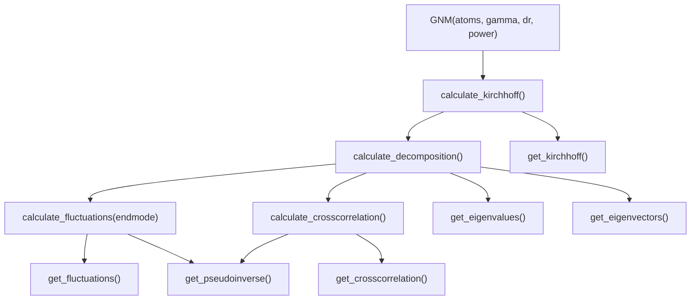
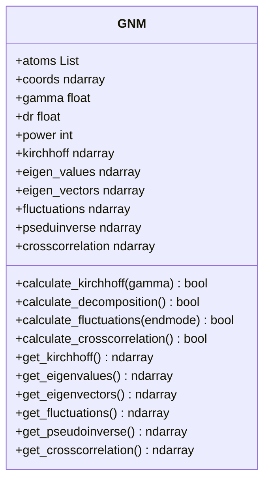

# Gaussian Network Model (GNM)

<details>
<summary>Relevant source files</summary>

The following files were used as context for generating this wiki page:

- [docs/_static/gallary/bond_rotate.png](docs/_static/gallary/bond_rotate.png)
- [docs/source/tutorials/GNM.rst](docs/source/tutorials/GNM.rst)
- [docs/source/tutorials/alpha_shape.rst](docs/source/tutorials/alpha_shape.rst)
- [docs/source/tutorials/bond_rotate.rst](docs/source/tutorials/bond_rotate.rst)
- [docs/source/tutorials/molecule.rst](docs/source/tutorials/molecule.rst)
- [packman/gnm/__init__.py](packman/gnm/__init__.py)
- [packman/gnm/gnm.py](packman/gnm/gnm.py)
- [packman/tests/anm/test_anm.py](packman/tests/anm/test_anm.py)
- [packman/tests/data/4hla.hng](packman/tests/data/4hla.hng)
- [packman/tests/entropy/test_entropy.py](packman/tests/entropy/test_entropy.py)
- [packman/tests/gnm/test_gnm.py](packman/tests/gnm/test_gnm.py)
- [packman/tests/molecule/test_molecule.py](packman/tests/molecule/test_molecule.py)
- [packman/tests/utilities/__init__.py](packman/tests/utilities/__init__.py)
- [packman/tests/utilities/test_utilities.py](packman/tests/utilities/test_utilities.py)

</details>


This page documents the `GNM` class in the `packman.gnm` subpackage: its constructor parameters, the Kirchhoff matrix construction, eigendecomposition, fluctuation calculation, pseudoinverse, and cross-correlation matrix. This page covers the GNM as a standalone model. For usage of GNM results inside the Dynamic Community Identification workflow, see [DCI](#4.2). For the anisotropic counterpart (ANM and hdANM), see [ANM](#5.1) and [hdANM](#5.2).

---

## Overview

The Gaussian Network Model represents a protein as a network of residues connected by Hookean springs. Residues whose Cα atoms are within a cutoff distance `dr` are connected. The topology is encoded in an N×N **Kirchhoff matrix** (Γ). Eigendecomposition of Γ gives normal modes whose inverse eigenvalues weight residue mobility. GNM is isotropic: it models only the *magnitude* of fluctuations, not their direction.

**Module location**: `packman/gnm/gnm.py`, exposed via `packman/gnm/__init__.py`.

```python
from packman.gnm import GNM
```

Sources: [packman/gnm/__init__.py:1-11](), [packman/gnm/gnm.py:1-30]()

---

## Class: `GNM`

### Constructor

```python
GNM(atoms, gamma=1.0, dr=7.3, power=0)
```

| Parameter | Type | Default | Description |
|-----------|------|---------|-------------|
| `atoms` | `List[Atom]` | required | Cα atoms (or any point set) to model |
| `gamma` | `float` | `1.0` | Uniform spring constant |
| `dr` | `float` | `7.3` | Distance cutoff in Å (see Yang et al. 2009) |
| `power` | `int` | `0` | Distance power exponent (non-parametric mode) |

Validation: both `gamma` and `dr` must be positive; an `Exception` is raised otherwise.

3D coordinates are extracted immediately from `atoms` via `get_location()` and stored as a NumPy array in `self.coords`.

Sources: [packman/gnm/gnm.py:45-58]()

---

## Computation Workflow

The `GNM` class follows a sequential calculate-then-get pattern. All results start as `None` and are populated by their respective `calculate_*` methods.

**Computation flow diagram**



Sources: [packman/gnm/gnm.py:60-200](), [packman/tests/gnm/test_gnm.py:15-35]()

---

## Kirchhoff Matrix

**Method**: `calculate_kirchhoff(gamma=1.0) → bool`

Builds the N×N Kirchhoff (Laplacian) matrix Γ. For each pair of residues (i, j):

- If Euclidean distance ≤ `dr`:
  - `Γ[i, j] = Γ[j, i] = −γ`
  - `Γ[i, i] += γ`  
  - `Γ[j, j] += γ`

The diagonal entry for residue i equals the number of contacts it makes (its coordination number), scaled by γ. The resulting matrix is symmetric, positive semi-definite, and singular (it has exactly one zero eigenvalue corresponding to rigid-body translation).

Retrieved via `get_kirchhoff() → numpy.ndarray` (shape N×N).

Sources: [packman/gnm/gnm.py:128-151]()

---

## Eigendecomposition

**Method**: `calculate_decomposition() → bool`

Decomposes the Kirchhoff matrix using `numpy.linalg.eigh` (symmetric eigensolver):

```
Γ = U Λ Uᵀ
```

- Eigenvalues stored in `self.eigen_values` (ascending order; λ₀ ≈ 0)
- Eigenvectors stored in `self.eigen_vectors` (columns are eigenvectors)

Retrieved via:
- `get_eigenvalues() → numpy.ndarray`
- `get_eigenvectors() → numpy.ndarray`

The first eigenvalue is effectively zero (numerical precision ~10⁻¹⁵). All subsequent eigenvalues λ₁ ≤ λ₂ ≤ … ≤ λₙ₋₁ are positive.

**Expected eigenvalue spectrum** (example from test data `4hla.cif`, chain A, 99 Cα atoms):

| Mode index | Eigenvalue |
|-----------|-----------|
| 0 | ~1.13 × 10⁻¹⁵ (zero) |
| 1 | 0.2494 |
| 2 | 0.2841 |
| 3 | 0.4324 |
| … | … |
| 98 | 15.54 |

Sources: [packman/gnm/gnm.py:153-160](), [packman/tests/gnm/test_gnm.py:16-27]()

---

## Fluctuations (Theoretical B-factors)

**Method**: `calculate_fluctuations(endmode=None) → bool`

Computes the pseudoinverse of Γ by summing spectral contributions from modes 1 through `stop_at` (skipping mode 0):

```
Γ⁺ = Σᵢ₌₁ᴺ⁻¹  (1/λᵢ) · uᵢ uᵢᵀ
```

The diagonal of Γ⁺ gives the mean-square fluctuation of each residue, proportional to its theoretical B-factor:

```
⟨Δrᵢ²⟩ = (3 k_B T / γ) · Γ⁺[i, i]
```

The `endmode` parameter limits the sum to the first `endmode` modes, allowing mode-subset analysis.

| Result | Accessor |
|--------|----------|
| Pseudoinverse matrix (N×N) | `get_pseudoinverse()` |
| Per-residue fluctuations (length N) | `get_fluctuations()` |

Sources: [packman/gnm/gnm.py:162-186]()

---

## Cross-Correlation Matrix

**Method**: `calculate_crosscorrelation() → bool`

Recomputes the pseudoinverse via matrix multiplication (slightly different numerical path from `calculate_fluctuations`), then normalizes to produce the N×N cross-correlation matrix:

```
C[i, j] = Γ⁺[i, j] / sqrt(Γ⁺[i, i] · Γ⁺[j, j])
```

Values range from −1 to +1:
- `+1`: perfectly correlated motion (same direction)
- `0`: uncorrelated
- `−1`: perfectly anti-correlated motion (opposite directions)

The pseudoinverse here is computed as:

```
Γ⁺ = U₁:ₙ · diag(1/λ₁, …, 1/λₙ₋₁) · U₁:ₙᵀ
```

where `U₁:ₙ` are the non-trivial eigenvectors (rows 1..N−1 of `EVec = eigen_vectors.T`).

Retrieved via `get_crosscorrelation() → numpy.ndarray` (shape N×N).

> **Note**: Both `calculate_fluctuations` and `calculate_crosscorrelation` write to `self.pseduinverse`. The last one called wins. Call `get_pseudoinverse()` only after the method whose pseudoinverse you want.

Sources: [packman/gnm/gnm.py:188-200]()

---

## API Reference Summary

**Methods and their relationships to stored state:**



Sources: [packman/gnm/gnm.py:32-200]()

---

## Complete Usage Example

```python
from packman import molecule
from packman.gnm import GNM

# Step 1: Load structure and extract Cα atoms
mol = molecule.load_structure('1prw.cif')
calpha = [i for i in mol[0]['A'].get_calpha() if i is not None]

# Step 2: Construct the model
model = GNM(calpha, gamma=1.0, dr=7.3, power=0)

# Step 3: Build Kirchhoff matrix
model.calculate_kirchhoff()
kirchhoff = model.get_kirchhoff()  # shape (N, N)

# Step 4: Eigendecomposition
model.calculate_decomposition()
eigenvalues  = model.get_eigenvalues()   # shape (N,)
eigenvectors = model.get_eigenvectors()  # shape (N, N)

# Step 5a: Fluctuations (theoretical B-factors)
model.calculate_fluctuations()
fluctuations = model.get_fluctuations()  # shape (N,)
pseudoinv    = model.get_pseudoinverse() # shape (N, N)

# Step 5b: Cross-correlation matrix (also recomputes pseudoinverse)
model.calculate_crosscorrelation()
crosscorr = model.get_crosscorrelation() # shape (N, N)
```

Sources: [docs/source/tutorials/GNM.rst:1-97](), [packman/tests/gnm/test_gnm.py:9-38]()

---

## Parameter Notes

| Parameter | Recommended value | Reference |
|-----------|------------------|-----------|
| `dr` | 7.3 Å | Yang et al., *PNAS* 106, 2009 |
| `gamma` | 1.0 (relative units) | Tirion, *Phys. Rev. Lett.* 77, 1996 |
| `power` | 0 (standard GNM) | — |

The default cutoff `dr=7.3` is the value established by Yang et al. (2009) as the range that maximizes cooperativity in elastic network models. Using a smaller cutoff captures fewer contacts and produces sparser matrices; a larger cutoff captures more contacts and can reduce mode resolution for flexible regions.

Sources: [packman/gnm/gnm.py:42-43](), [docs/source/tutorials/GNM.rst:10-13]()

---

## Testing

The test suite in `packman/tests/gnm/test_gnm.py` validates:

1. `calculate_kirchhoff()` returns `True`
2. `calculate_decomposition()` returns `True`
3. Eigenvalues match expected numerical values within tolerance `rtol=1e-7, atol=1e-7` (99-element spectrum for chain A of `4hla.cif`)
4. `calculate_crosscorrelation()` and `calculate_fluctuations()` execute without error
5. `get_crosscorrelation()`, `get_fluctuations`, and `get_pseudoinverse` all return non-`None`

Test data used: `packman/tests/data/4hla.cif`, chain A, 99 Cα atoms, `gamma=1`, `dr=7.3`, `power=1`.

Sources: [packman/tests/gnm/test_gnm.py:1-38]()

---