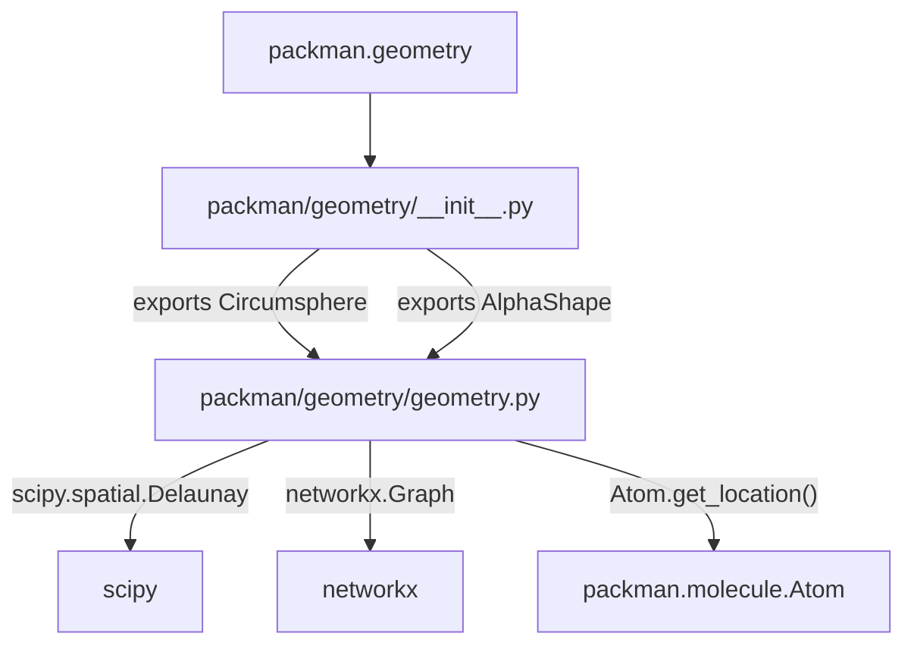
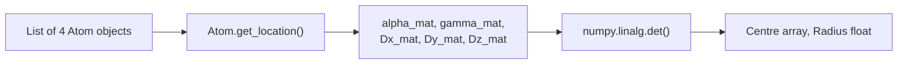
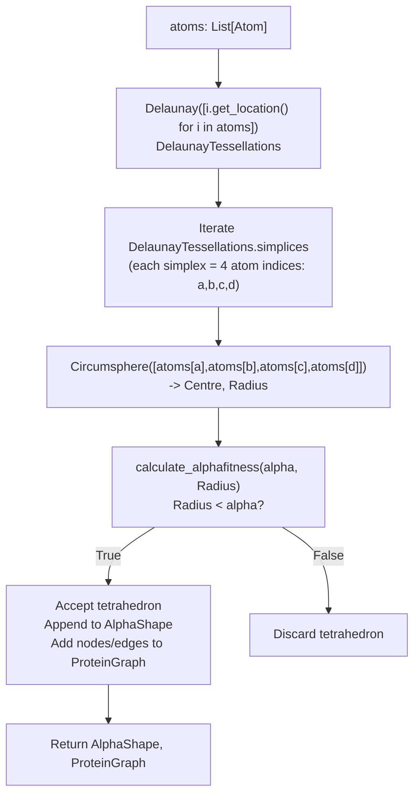
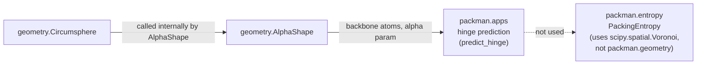

# Geometry Module

<details>
<summary>Relevant source files</summary>

The following files were used as context for generating this wiki page:

- [docs/_static/gallary/bond_rotate.png](docs/_static/gallary/bond_rotate.png)
- [docs/source/tutorials/GNM.rst](docs/source/tutorials/GNM.rst)
- [docs/source/tutorials/alpha_shape.rst](docs/source/tutorials/alpha_shape.rst)
- [docs/source/tutorials/bond_rotate.rst](docs/source/tutorials/bond_rotate.rst)
- [docs/source/tutorials/molecule.rst](docs/source/tutorials/molecule.rst)
- [packman/entropy/entropy.py](packman/entropy/entropy.py)
- [packman/geometry/__init__.py](packman/geometry/__init__.py)
- [packman/geometry/geometry.py](packman/geometry/geometry.py)
- [packman/tests/geometry/test_geometry.py](packman/tests/geometry/test_geometry.py)

</details>


The `packman.geometry` module provides low-level geometric primitives used internally by higher-level analyses in PACKMAN. It contains two public functions: `AlphaShape` and `Circumsphere`. These functions operate directly on `packman.molecule.Atom` objects and form the computational backbone of hinge prediction (see [Hinge Prediction](#4.1)). The Packing Entropy module (see [Packing Entropy](#4.3)) uses Voronoi tessellations from `scipy` independently and does not call into `packman.geometry`.

---

## Module Layout

**Diagram: packman.geometry module structure**



Sources: [packman/geometry/__init__.py:1-10](), [packman/geometry/geometry.py:1-30]()

---

## Public API

Both functions are exported at the `packman.geometry` level.

```python
from packman.geometry import AlphaShape, Circumsphere
```

| Function | Signature | Returns |
|---|---|---|
| `Circumsphere` | `(Tetrahedron: List[Atom]) -> (Centre, Radius)` | NumPy array of 3D center, float radius |
| `AlphaShape` | `(atoms, alpha, get_graph=True)` | Tessellations list, optionally also a `networkx.Graph` |

Sources: [packman/geometry/__init__.py:9-10](), [packman/geometry/geometry.py:31-115]()

---

## `Circumsphere`

[packman/geometry/geometry.py:31-57]()

Given exactly **four** points (a tetrahedron), `Circumsphere` computes the unique sphere that passes through all four points.

**Input:** A list of four `packman.molecule.Atom` objects, or four `[X, Y, Z]` coordinate lists. Coordinates are retrieved via `Atom.get_location()`.

**Output:** A tuple `(Centre, Radius)` where:
- `Centre` — a NumPy array `[x, y, z]` of the sphere center.
- `Radius` — a Python `float` giving the circumradius.

**Method:** Uses determinant-based linear algebra. Five matrices (`alpha_mat`, `gamma_mat`, `Dx_mat`, `Dy_mat`, `Dz_mat`) are assembled from atom coordinates, and `numpy.linalg.det` is applied to each. The center components are `Dx/(2*alpha)`, `Dy/(2*alpha)`, `Dz/(2*alpha)` and the radius is `sqrt(Dx² + Dy² + Dz² − 4·alpha·gamma) / (2·|alpha|)`.

**Diagram: Circumsphere data flow**



Sources: [packman/geometry/geometry.py:31-57]()

---

## `AlphaShape`

[packman/geometry/geometry.py:60-115]()

Computes the **alpha shape** of a set of atoms: a subset of the full Delaunay tessellation retaining only those tetrahedra whose circumsphere radius is less than the cutoff `alpha`.

### Parameters

| Parameter | Type | Default | Description |
|---|---|---|---|
| `atoms` | Iterable of `Atom` | — | Atoms to tessellate |
| `alpha` | `float` | — | Radius cutoff (Å). Use `float('Inf')` for the full Delaunay tessellation |
| `get_graph` | `bool` | `True` | Whether to return the `networkx.Graph` in addition to tessellations |

### Return Values

- **`AlphaShape` (list):** Each element is a list of four `Atom` objects forming one accepted tetrahedron.
- **`ProteinGraph` (`networkx.Graph`):** Nodes are atom indices (integer positions in `atoms`); edges connect every pair of atoms that share an accepted tetrahedron. Only returned when `get_graph=True`.

### Internal helper: `calculate_alphafitness`

[packman/geometry/geometry.py:80-96]()

A nested function that applies the alpha test: returns `True` if `circumradius < alpha`, `False` otherwise.

### Algorithm

**Diagram: AlphaShape computation pipeline**



Sources: [packman/geometry/geometry.py:98-115]()

### Alpha parameter semantics

| `alpha` value | Effect |
|---|---|
| Small (e.g. 2–4 Å) | Only tight, densely packed clusters retained |
| Large | More tetrahedra retained |
| `float('Inf')` | All Delaunay tetrahedra retained; equivalent to full Delaunay tessellation |

> **Tip from the source:** If you need tessellations at multiple alpha cutoffs, compute once with `alpha=float('Inf')` to get all simplices, then filter by circumradius yourself using `Circumsphere`. This avoids repeated Delaunay computation.

Sources: [packman/geometry/geometry.py:63-70]()

---

## Usage in PACKMAN

**Diagram: Where geometry functions are consumed**



- **Hinge prediction** (`packman.apps`) calls `AlphaShape` with backbone atoms and a user-supplied `alpha` value. The resulting `ProteinGraph` is used to identify disconnected regions at given alpha values, which correspond to hinge locations. See [Hinge Prediction](#4.1) for full details.
- **Packing Entropy** (`packman.entropy.PackingEntropy`) does **not** use `packman.geometry`. It uses `scipy.spatial.Voronoi` and `scipy.spatial.ConvexHull` directly. See [Packing Entropy](#4.3).

Sources: [packman/geometry/geometry.py:60-115](), [packman/entropy/entropy.py:19-20](), [packman/entropy/entropy.py:135-164]()

---

## API Usage Example

The following illustrates the typical API pattern documented in the alpha shape tutorial:

```
# Step 1: load structure
from packman.molecule import load_structure, download_structure
from packman.geometry import AlphaShape, Circumsphere

download_structure('1exr')
mol = load_structure('1exr.cif')

# Step 2: collect atoms
atoms = [i for i in mol[0].get_atoms()]

# Step 3: full Delaunay tessellation
tessellations, graph = AlphaShape(atoms, float('Inf'))

# Step 4: inspect circumsphere of first simplex
centre, radius = Circumsphere(tessellations[0])

# Step 5: alpha-filtered shape
tessellations_3, graph_3 = AlphaShape(atoms, 3)
```

Sources: [docs/source/tutorials/alpha_shape.rst:1-55]()

---

## Testing

The geometry module tests live at [packman/tests/geometry/test_geometry.py:1-30]() and use structure `4hla.cif` as test data.

| Test method | What it checks |
|---|---|
| `test_Circumsphere` | All three center coordinates and the radius are Python `float` instances |
| `test_AlphaShape` | Elements of the returned tessellation list are `packman.molecule.Atom` instances |

Sources: [packman/tests/geometry/test_geometry.py:9-28]()

---

## Dependencies

| Dependency | Used for |
|---|---|
| `scipy.spatial.Delaunay` | Full Delaunay tessellation of atom coordinates |
| `networkx.Graph` | Representing the atom connectivity graph output |
| `numpy.linalg.det` | Determinant computation inside `Circumsphere` |
| `packman.molecule.Atom` | Input type; `.get_location()` extracts coordinates |

Sources: [packman/geometry/geometry.py:21-29]()

---