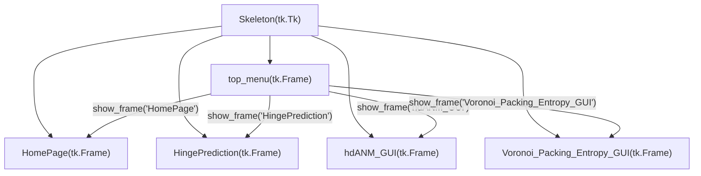
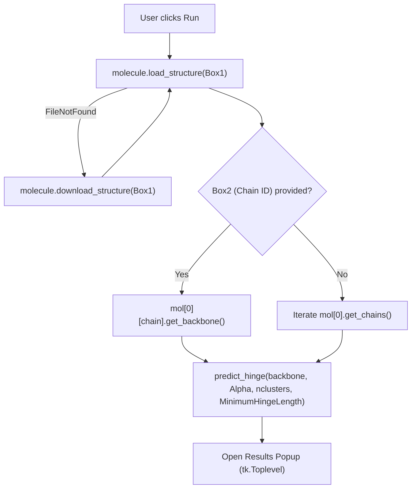
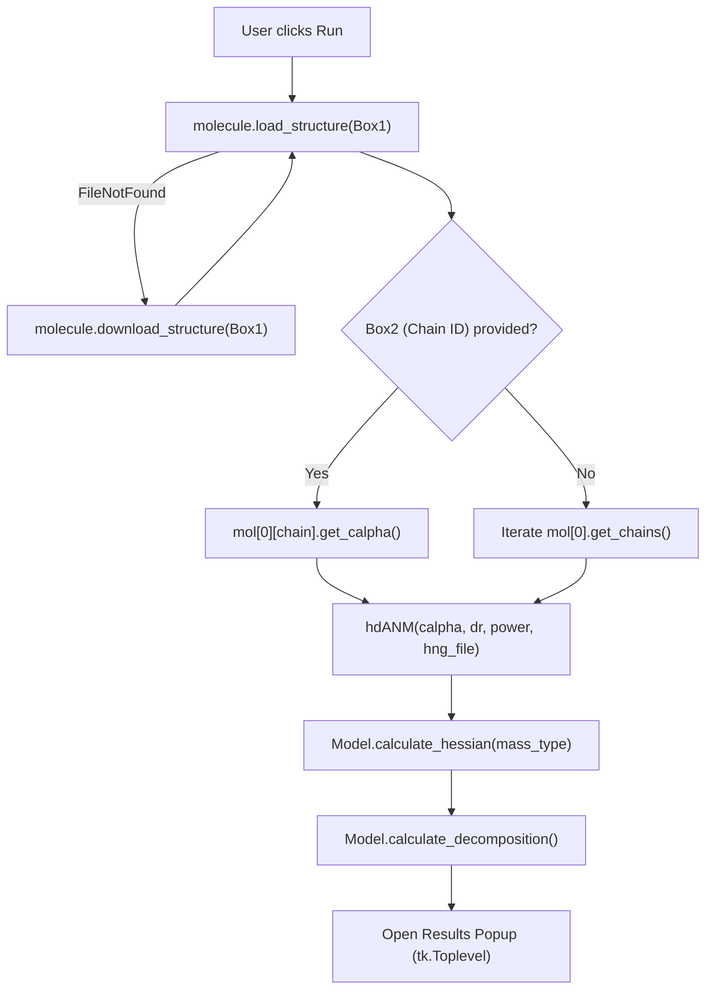
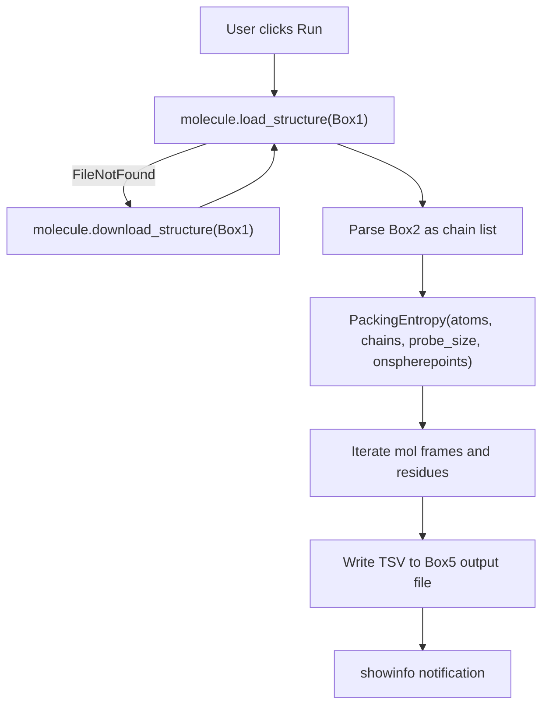

# Graphical User Interface (GUI)

<details>
<summary>Relevant source files</summary>

The following files were used as context for generating this wiki page:

- [docs/source/tutorials/gui.rst](docs/source/tutorials/gui.rst)
- [docs/source/tutorials/hdANM.rst](docs/source/tutorials/hdANM.rst)
- [docs/source/tutorials/hdANM_cli.rst](docs/source/tutorials/hdANM_cli.rst)
- [docs/source/tutorials/hinge_predict_cli.rst](docs/source/tutorials/hinge_predict_cli.rst)
- [docs/source/tutorials/installation.rst](docs/source/tutorials/installation.rst)
- [docs/source/tutorials/main.rst](docs/source/tutorials/main.rst)
- [packman/__init__.py](packman/__init__.py)
- [packman/bin/GUI.py](packman/bin/GUI.py)
- [setup.py](setup.py)

</details>


This page documents the PACKMAN GUI: how to launch it, the structure of its panels, the input fields each panel exposes, and how results are displayed and saved. The GUI covers three analytical workflows — hinge prediction, hdANM, and Voronoi packing entropy — all within a single `tkinter` window.

For the equivalent CLI commands, see [Command-Line Interface](#7). For the Python API behind each panel, see [Analysis Applications](#4) and [Network Models](#5).

---

## Launching the GUI

```bash
python -m packman gui
# OR
python3 -m packman gui
```

The entry point is the `load_gui()` function in [packman/bin/GUI.py:112-114](), which instantiates the `Skeleton` class and starts the `tkinter` main loop.

> **Prerequisites:**
> - `tkinter` must be available. On some Linux systems it is not installed by default: `sudo apt-get install python3-tk`.
> - Output files are written to the **current working directory** at the time the GUI is launched.

Sources: [packman/bin/GUI.py:1-114](), [docs/source/tutorials/gui.rst:1-15]()

---

## Window Architecture

The `Skeleton` class is the top-level `tk.Tk` window. It owns all panel frames and a persistent top navigation bar (`top_menu`). Only one content panel is visible at a time; switching is handled by `Skeleton.show_frame()`.

**Application window layout (code entities)**



Sources: [packman/bin/GUI.py:53-114]()

**Class-to-panel mapping**

| Class | Navigation Label | Purpose |
|---|---|---|
| `HomePage` | Home | Welcome text and external links |
| `HingePrediction` | Hinge Prediction | Run `predict_hinge()`, export `.hng` |
| `hdANM_GUI` | hdANM | Run `hdANM`, save matrices/movies |
| `Voronoi_Packing_Entropy_GUI` | Packing Entropy (Voronoi) | Run `PackingEntropy`, save TSV output |

Sources: [packman/bin/GUI.py:65-70](), [packman/bin/GUI.py:97-114]()

---

## Home Panel (`HomePage`)

Displays a static description of PACKMAN and a read-only text block containing links to:

1. ReadTheDocs tutorials
2. GitHub repository
3. Online Hinge Prediction server
4. Online hdANM server
5. Online Voronoi Entropy server

No interactive inputs or computations occur on this panel.

Sources: [packman/bin/GUI.py:122-145]()

---

## Hinge Prediction Panel (`HingePrediction`)

Calls `predict_hinge()` from `packman.apps` on backbone atoms of the loaded structure.

### Input Fields

| Widget | Label | Default | Type |
|---|---|---|---|
| `Box1` | Filename / PDB ID | _(empty)_ | `str` — local path or 4-char PDB ID |
| `Box2` | Chain ID | _(empty)_ | `str` — leave blank to run all chains |
| `Box3` | Alpha Value | `2.8` | `float` |
| `Box4` | Number of Eccentricity Clusters | `4` | `int` |
| `Box5` | Minimum Hinge Length | `5` | `int` |
| `Browse1` | Browse button | — | Opens file dialog (`.cif`, `.pdb`) |
| `Button1` | Run | — | Triggers `run_PACKMAN()` |

Sources: [packman/bin/GUI.py:153-201]()

### Execution Flow



Sources: [packman/bin/GUI.py:215-262]()

### Results Popup

A scrollable `tk.Toplevel` window (`pop_up1`) displays a table with one row per detected hinge:

| Column | Content |
|---|---|
| Hinge ID | Sequential integer |
| PDB ID / Filename | `Box1` value |
| Chain ID | Chain the hinge belongs to |
| Residue IDs | `start:end` range |
| p-value | `hinge.get_pvalue()` |
| Select | `tk.Checkbutton` (BooleanVar) |
| Details | Opens a secondary popup via `show_details(hinge.get_stats())` |

After reviewing results, the user can select hinges and save a `.hng` file via the **Save HNG file** button, which calls the nested `write_hng_file()` function. The output filename defaults to `<Box1 value>.hng`.

Sources: [packman/bin/GUI.py:264-387]()

---

## hdANM Panel (`hdANM_GUI`)

Calls the `hdANM` class from `packman.anm`.

### Input Fields

| Widget | Label | Default | Type |
|---|---|---|---|
| `Box1` | Filename / PDB ID | _(empty)_ | `str` |
| `Box2` | Chain ID | _(empty)_ | `str` — blank = all chains |
| `Box3` | Cutoff Value | `15` | `float` (Å) |
| `Box4` | Power of Distance | `0` | `int` |
| `Box5` | Input (.hng) Filename | `output.hng` | `str` |
| `dropdown1` | Mass of the residue | `Molecular Weight` | One of: `Molecular Weight`, `Unit`, `Atomics Mass` |
| `Browse1` | Browse (structure) | — | Opens file dialog (`.cif`, `.pdb`) |
| `Browse2` | Browse (.hng) | — | Opens file dialog (`.hng`) |
| `Button1` | Run | — | Triggers `run_hdANM()` |

Sources: [packman/bin/GUI.py:395-458]()

### Mass Type Mapping

The dropdown selection maps to `hdANM.calculate_hessian(mass_type=...)`:

| Dropdown Value | `mass_type` Argument |
|---|---|
| `Molecular Weight` | `'residue'` |
| `Unit` | `'unit'` |
| `Atomics Mass` | `'atom'` |

Sources: [packman/bin/GUI.py:525-530]()

### Execution Flow



Sources: [packman/bin/GUI.py:478-602]()

### Results Popup

The results popup (`pop_up1` titled `hdANM Results`) has two sections:

**Section 1 — Save Output Matrices**

| Dropdown Choice | Action |
|---|---|
| `hdANM Eigen Vectors` | Saves `Model.get_eigenvectors()` to `hdANM Eigen Vectors.csv` |
| `hdANM Eigen Values` | Saves `Model.get_eigenvalues()` to `hdANM Eigen Values.csv` |

**Section 2 — Generate Movies**

| Widget | Label | Default | Type |
|---|---|---|---|
| `user_projection_choise` | Projection Method | `Curvilinear` | `Curvilinear` or `Linear` |
| `n_mode` | Mode Number | `6` | `int` (non-rigid modes start at index 6) |
| `n_frames` | Number of Frames | `10` | `int` |
| `n_scale` | Movie Scale | `10` | `float` |
| `ca_to_aa` | Project C-Alpha to all atoms | unchecked | `bool` |

Clicking **Save Movie** calls `Model.calculate_movie(n_mode, n=n_frames, scale=n_scale, extrapolation=projection, ca_to_aa=...)`. Output is written as `<n_mode>.pdb` or `<n_mode>.cif` in the working directory.

Sources: [packman/bin/GUI.py:535-601]()

---

## Voronoi Packing Entropy Panel (`Voronoi_Packing_Entropy_GUI`)

Calls the `PackingEntropy` class from `packman.entropy`.

### Input Fields

| Widget | Label | Default | Type |
|---|---|---|---|
| `Box1` | Filename / PDB ID | _(empty)_ | `str` |
| `Box2` | Chain IDs (comma-separated) | _(empty)_ | `str` — blank = all chains |
| `Box3` | Probe size | `1.4` | `float` (Å) |
| `Box4` | On Sphere Points | `30` | `int` |
| `Box5` | Output Filename | `voronoi_packing_entropy_output.txt` | `str` |
| `Browse1` | Browse | — | Opens file dialog (`.cif`, `.pdb`) |
| `Button1` | Run | — | Triggers `run_Entropy()` |

Sources: [packman/bin/GUI.py:610-658]()

### Execution Flow



Sources: [packman/bin/GUI.py:673-734]()

### Output File Format

The output is a tab-separated file written to the path specified in `Box5`. Each row is one residue per frame:

```
Frame   Chain   ResidueID   ResidueName   PackingEntropy
```

After all per-residue rows, two summary lines are appended per frame:
- `Total (Frame N)` — `result.get_total_entropy()`
- `Total Normalized Entropy (3N-6) (Frame N)` — total divided by `3N - 6`

Sources: [packman/bin/GUI.py:712-729]()

---

## Chain ID Behavior (All Panels)

All three analysis panels share the same convention for the Chain ID field:

- **Provided**: Runs the analysis only on the specified chain.
- **Left blank**: Runs the analysis on all chains in the structure.
- For the entropy panel, the chain list is comma-separated and controls which chains are included in the `PackingEntropy` calculation (affects neighbor context, not just output filtering). See [Packing Entropy](#4.3) for the distinction.

Sources: [packman/bin/GUI.py:246-262](), [packman/bin/GUI.py:505-520](), [packman/bin/GUI.py:704-710]()

---

## File Auto-Download

All panels that accept a structure file attempt `molecule.download_structure()` if `molecule.load_structure()` raises an exception. The logic tries to infer the file type from the extension:

```
molecule.download_structure(Box1.split('.')[0], ftype=Box1.split('.')[1])
```

If that fails, it falls back to `molecule.download_structure(Box1)`. A notification dialog is shown before the download attempt, and an error dialog is shown if the download fails.

Sources: [packman/bin/GUI.py:219-236](), [packman/bin/GUI.py:479-496](), [packman/bin/GUI.py:677-694]()

---

## Platform Notes

| Item | Detail |
|---|---|
| Window icon | Loaded from `packman/bin/logo.ico`; silently skipped on non-Windows platforms |
| `tkinter` availability | Built into Python on Windows and macOS; may require `python3-tk` on Linux |
| Window size | Fixed at 800×600 px (`Skeleton.__init__`) |
| Output location | All files written to the **current working directory** |

Sources: [packman/bin/GUI.py:72-88](), [setup.py:38-39](), [docs/source/tutorials/gui.rst:12-15]()

---