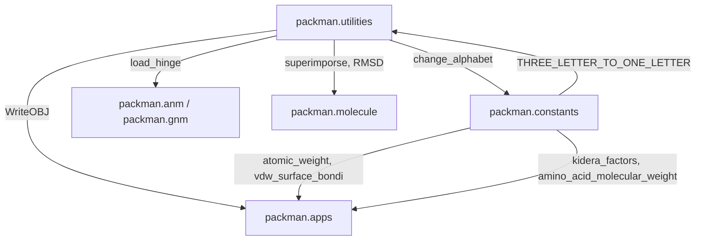
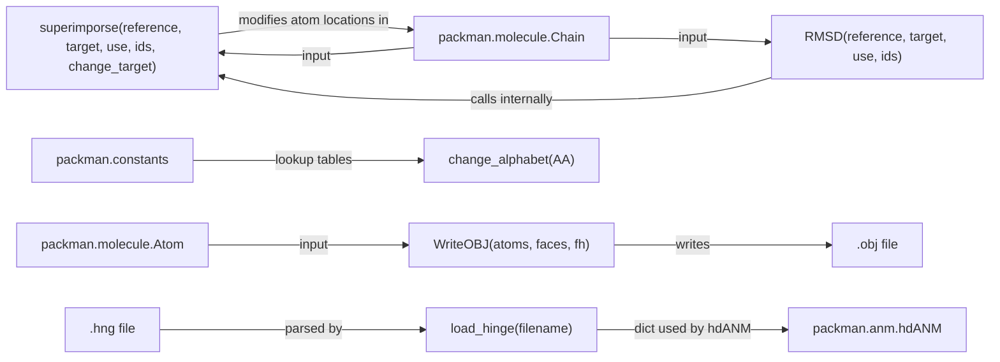
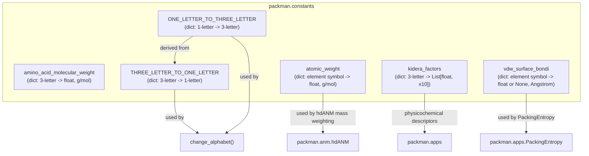

# Utilities and Constants

<details>
<summary>Relevant source files</summary>

The following files were used as context for generating this wiki page:

- [packman/constants/Constants.py](packman/constants/Constants.py)
- [packman/constants/__init__.py](packman/constants/__init__.py)
- [packman/utilities/__init__.py](packman/utilities/__init__.py)
- [packman/utilities/utilities.py](packman/utilities/utilities.py)

</details>


This page documents two supporting modules in PACKMAN: `packman.utilities` and `packman.constants`. These modules do not implement any analysis algorithms themselves — they provide shared helper functions and reference data consumed by the rest of the package. For the analysis algorithms that use these helpers (e.g., hinge prediction, hdANM, packing entropy), see pages [4](#4) and [5](#5).

---

## Overview

**Diagram: Module Roles**



Sources: [packman/utilities/__init__.py:1-3](), [packman/constants/__init__.py:1-6]()

---

## packman.utilities

All functions are defined in [packman/utilities/utilities.py:1-230]() and re-exported via [packman/utilities/__init__.py:1-3]() using a wildcard import, so every function is accessible directly as `packman.utilities.<function>`.

**Diagram: Utility Functions and Their Relationships**



Sources: [packman/utilities/utilities.py:14-230]()

---

### `superimporse`

[packman/utilities/utilities.py:14-90]()

Performs structural superimposition of a `target` chain onto a `reference` chain using the Kabsch algorithm (SVD-based rotation matrix).

| Parameter | Type | Default | Description |
|---|---|---|---|
| `reference` | `Chain` | required | Chain whose coordinates remain unchanged |
| `target` | `Chain` | required | Chain whose coordinates are transformed |
| `use` | `str` | `'calpha'` | Atom set for alignment: `'calpha'` or `'backbone'` |
| `ids` | `List[int]` | `[]` | Restrict alignment to specific residue IDs |
| `change_target` | `bool` | `True` | If `True`, applies the transform to all atoms in `target` |

**Returns:** `(R, t)` — rotation matrix (`numpy.matrix`) and translation vector (`numpy.ndarray`).

**Alignment logic:** The function intersects the residue IDs present in both chains (optionally filtered by `ids`) and uses only the common residues for computing the rotation. This handles chains with unequal lengths or different residue counts gracefully, but chains with mismatched numbering schemes must be renumbered before use.

**Special case:** A reflection correction is applied when `numpy.linalg.det(R) < 0`, per standard Kabsch algorithm practice ([packman/utilities/utilities.py:76-78]()).

> **Note:** The function name is spelled `superimporse` (not `superimpose`) — use this exact spelling when calling it.

---

### `RMSD`

[packman/utilities/utilities.py:92-136]()

Computes the Root Mean Square Deviation between two chains after optimal superimposition.

| Parameter | Type | Default | Description |
|---|---|---|---|
| `reference` | `Chain` | required | Reference chain |
| `target` | `Chain` | required | Target chain |
| `use` | `str` | `'calpha'` | `'calpha'` or `'backbone'` |
| `ids` | `List[int]` | `[]` | Restrict to specific residue IDs |

**Returns:** `float` — mean absolute deviation across aligned atom pairs.

Internally calls `superimporse(..., change_target=False)` to compute the optimal rotation/translation without modifying `target`'s stored coordinates, then applies the transform only to the local coordinate copies used for distance calculation.

---

### `load_hinge`

[packman/utilities/utilities.py:138-167]()

Parses a `.hng` file into a dictionary used by `hdANM` and related methods.

**`.hng` file format** (TAB-delimited columns):

```
<Filename_ChainID>    <Domain/HingeID>    <Start:End>
```

**Example:**

```
1EXR_A    D1    1:70
1EXR_A    H1    70:90
1EXR_A    D2    90:148
```

**Returns:** `Dict[str, List[float]]` — keys are composite identifiers like `"1EXR_A_D1"`, values are `[start, end]` residue index pairs.

For full documentation of the `.hng` format and how it is consumed by `hdANM`, see page [5.2](#5.2).

---

### `WriteOBJ`

[packman/utilities/utilities.py:175-205]()

Writes a Wavefront `.obj` file representing alpha shape tessellations for 3D visualization.

| Parameter | Type | Description |
|---|---|---|
| `atoms` | `List[Atom]` | Atoms to write as vertex (`v`) records |
| `faces` | `List[Atom]` | Selected tessellation faces (4-atom tuples) |
| `fh` | file handle | Output `.obj` file handle, opened in binary mode |

The function generates vertex records, a line (`l`) record connecting all atoms, and quad face (`f`) records. Atom IDs are remapped to sequential 1-based integers as required by the `.obj` format. Operates on one chain at a time.

Used by the hinge prediction application when producing alpha shape output. See page [4.1](#4.1) for context.

---

### `change_alphabet`

[packman/utilities/utilities.py:207-230]()

Converts an amino acid code between three-letter and one-letter representations.

| Input | Output |
|---|---|
| Three-letter code (e.g., `'ALA'`) | One-letter code (`'A'`) |
| One-letter code (e.g., `'A'`) | Three-letter code (`'ALA'`) |

Falls back to `'X'` (for unrecognized three-letter inputs) or `'UNK'` (for unrecognized one-letter inputs), logging a warning. Internally delegates to `Constants.THREE_LETTER_TO_ONE_LETTER` and `Constants.ONE_LETTER_TO_THREE_LETTER`.

---

## packman.constants

All data is defined in [packman/constants/Constants.py:1-298]() and selectively exported by [packman/constants/__init__.py:1-6](). Constants are plain Python `dict` objects — there is no `Constants` class; the module-level names are imported directly.

**Diagram: Constants Data Map**



Sources: [packman/constants/Constants.py:1-298](), [packman/constants/__init__.py:1-6]()

---

### `amino_acid_molecular_weight`

[packman/constants/Constants.py:4-25]()

Molecular weights for the 20 standard amino acids.

| Key (3-letter) | Example value (g/mol) |
|---|---|
| `'ALA'` | `89.1` |
| `'TRP'` | `204.2` |
| `'GLY'` | `75.1` |
| … | … |

Contains all 20 standard amino acids.

---

### `atomic_weight`

[packman/constants/Constants.py:28-113]()

Standard atomic weights for elements H through U (92 entries). Used by `hdANM` when computing mass-weighted Hessians with `mass='atom'` mode. Values are `float` in g/mol.

Elements range from common biological atoms (`H`, `C`, `N`, `O`, `S`) through the full periodic table up to uranium.

---

### `kidera_factors`

[packman/constants/Constants.py:116-141]()

Ten physicochemical descriptors per amino acid, as defined by Kidera et al. Each entry is a list of 10 floats.

| Key | Description |
|---|---|
| Standard 20 amino acids | Full 10-factor vectors |
| `'ASX'` | Ambiguous Asp/Asn |
| `'GLX'` | Ambiguous Glu/Gln |
| `'XAA'` | Unknown (all zeros) |
| `'XLE'` | Ambiguous Leu/Ile |

---

### `vdw_surface_bondi`

[packman/constants/Constants.py:145-264]()

Van der Waals radii in Ångströms from: *A. Bondi, J. Phys. Chem. 1964, 68(3), 441–451*.

| Element | Radius (Å) |
|---|---|
| `'H'` | `1.2` |
| `'C'` | `1.7` |
| `'N'` | `1.55` |
| `'O'` | `1.52` |
| `'S'` | `1.8` |

Many heavy and transition metals have `None` values (no Bondi radius defined). Used by `PackingEntropy` when computing per-residue surface points. See page [4.3](#4.3).

---

### `THREE_LETTER_TO_ONE_LETTER` and `ONE_LETTER_TO_THREE_LETTER`

[packman/constants/Constants.py:267-298]()

Bidirectional amino acid code conversion dictionaries.

`THREE_LETTER_TO_ONE_LETTER` is defined explicitly; `ONE_LETTER_TO_THREE_LETTER` is derived from it by inverting the mapping:

```python
ONE_LETTER_TO_THREE_LETTER = {
    THREE_LETTER_TO_ONE_LETTER[three_letter]: three_letter
    for three_letter in THREE_LETTER_TO_ONE_LETTER
}
```

Both include non-standard codes (`PYL`→`O`, `SEC`→`U`, `ASX`→`B`, `GLX`→`Z`, `XAA`→`x`, `XLE`→`J`, `UNK`→`X`).

---

## Import Paths

| Symbol | Import path |
|---|---|
| `superimporse` | `from packman.utilities import superimporse` |
| `RMSD` | `from packman.utilities import RMSD` |
| `load_hinge` | `from packman.utilities import load_hinge` |
| `WriteOBJ` | `from packman.utilities import WriteOBJ` |
| `change_alphabet` | `from packman.utilities import change_alphabet` |
| `amino_acid_molecular_weight` | `from packman.constants import amino_acid_molecular_weight` |
| `atomic_weight` | `from packman.constants import atomic_weight` |
| `kidera_factors` | `from packman.constants import kidera_factors` |
| `vdw_surface_bondi` | `from packman.constants import vdw_surface_bondi` |
| `THREE_LETTER_TO_ONE_LETTER` | `from packman.constants import THREE_LETTER_TO_ONE_LETTER` |
| `ONE_LETTER_TO_THREE_LETTER` | `from packman.constants import ONE_LETTER_TO_THREE_LETTER` |

Sources: [packman/utilities/__init__.py:1-3](), [packman/constants/__init__.py:1-6]()

---