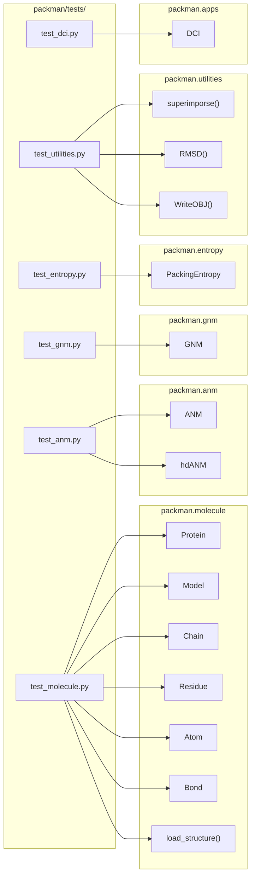
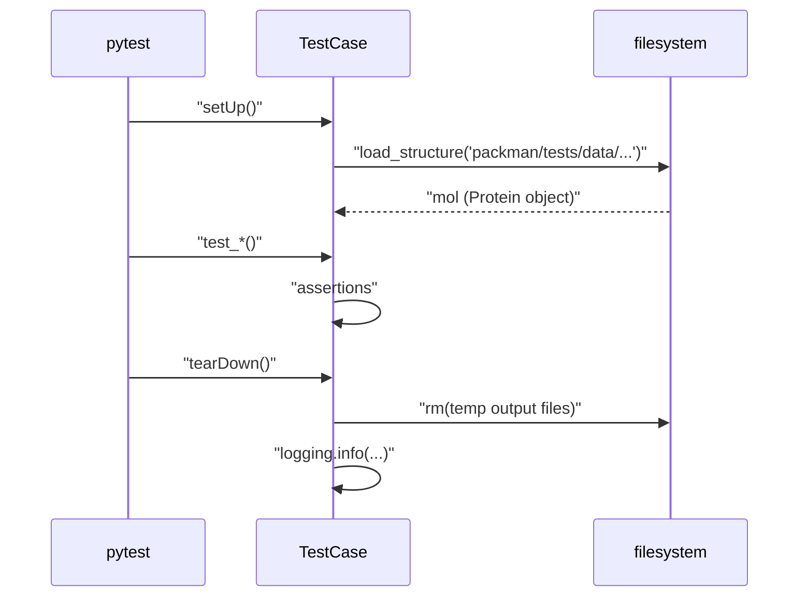

# Testing

<details>
<summary>Relevant source files</summary>

The following files were used as context for generating this wiki page:

- [additional codes/stability_tests.py](additional codes/stability_tests.py)
- [packman/apps/dci.py](packman/apps/dci.py)
- [packman/tests/__init__.py](packman/tests/__init__.py)
- [packman/tests/anm/__init__.py](packman/tests/anm/__init__.py)
- [packman/tests/anm/test_anm.py](packman/tests/anm/test_anm.py)
- [packman/tests/data/1prw.hng](packman/tests/data/1prw.hng)
- [packman/tests/data/4hla.hng](packman/tests/data/4hla.hng)
- [packman/tests/dci/test_dci.py](packman/tests/dci/test_dci.py)
- [packman/tests/entropy/__init__.py](packman/tests/entropy/__init__.py)
- [packman/tests/entropy/test_entropy.py](packman/tests/entropy/test_entropy.py)
- [packman/tests/gnm/__init__.py](packman/tests/gnm/__init__.py)
- [packman/tests/gnm/test_gnm.py](packman/tests/gnm/test_gnm.py)
- [packman/tests/molecule/test_molecule.py](packman/tests/molecule/test_molecule.py)
- [packman/tests/utilities/__init__.py](packman/tests/utilities/__init__.py)
- [packman/tests/utilities/test_utilities.py](packman/tests/utilities/test_utilities.py)

</details>


This page describes the test suite for the PACKMAN package: its structure, what each test module verifies, the test data files used, and how to execute the tests. For documentation on the modules being tested, see the relevant subsections of this wiki (e.g., [Molecular Data Model](#3), [Network Models](#5), [Analysis Applications](#4), [Utilities and Constants](#9)).

---

## Test Suite Overview

The test suite lives under `packman/tests/`. Each major subpackage has a dedicated subdirectory containing an `__init__.py` and a `test_*.py` file. All test classes extend `unittest.TestCase` and are compatible with `pytest`.

**Test suite directory layout:**

```
packman/tests/
├── __init__.py
├── data/
│   ├── 1prw.pdb
│   ├── 1prw.hng
│   ├── 4hla.cif
│   └── 4hla.hng
├── molecule/
│   ├── __init__.py
│   └── test_molecule.py
├── anm/
│   ├── __init__.py
│   └── test_anm.py
├── gnm/
│   ├── __init__.py
│   └── test_gnm.py
├── entropy/
│   ├── __init__.py
│   └── test_entropy.py
├── utilities/
│   ├── __init__.py
│   └── test_utilities.py
└── dci/
    └── test_dci.py
```

Sources: [packman/tests/__init__.py:1-1](), [packman/tests/utilities/__init__.py:1-1](), [packman/tests/gnm/__init__.py:1-1](), [packman/tests/entropy/__init__.py:1-1](), [packman/tests/anm/__init__.py:1-1]()

---

## Test Data Files

All test modules load structures from `packman/tests/data/`. Two structure formats and two hinge annotation files are provided.

| File | Format | Used By |
|---|---|---|
| `4hla.cif` | mmCIF | `test_molecule`, `test_anm`, `test_gnm`, `test_entropy`, `test_utilities`, `test_dci` |
| `1prw.pdb` | PDB | `test_molecule` |
| `4hla.hng` | PACKMAN hinge | `test_anm` (hdANM) |
| `1prw.hng` | PACKMAN hinge | (available, referenced by other tooling) |

The `.hng` files encode domain/hinge assignments for hdANM. Each line specifies a structure identifier, a segment label (`D` for domain, `H` for hinge), and a residue range:

```
4hla_A    D1    1:20
4hla_A    H1    21:34
4hla_A    D2    35:56
...
```

Sources: [packman/tests/data/4hla.hng:1-8](), [packman/tests/data/1prw.hng:1-3]()

---

## Module Map

The following diagram shows each test module, its `TestCase` class, and which PACKMAN class or function it exercises.



Sources: [packman/tests/molecule/test_molecule.py:1-6](), [packman/tests/anm/test_anm.py:1-8](), [packman/tests/gnm/test_gnm.py:1-8](), [packman/tests/entropy/test_entropy.py:1-6](), [packman/tests/utilities/test_utilities.py:1-6](), [packman/tests/dci/test_dci.py:1-6]()

---

## Test Module Details

### `test_molecule.py` — `Test_Molecule`

**Class:** `Test_Molecule` in [packman/tests/molecule/test_molecule.py:8-98]()

`setUp` loads `4hla.cif` via `molecule.load_structure`.

| Test method | What it checks |
|---|---|
| `test_load_pdb` | `load_structure` returns a truthy value for `1prw.pdb` |
| `test_load_cif` | `load_structure` returns a truthy value for `4hla.cif` |
| `test_Protein` | `mol` is a `Protein`; `write_structure` works for `.cif` and `.pdb`; raises on bad `ftype`; `get_sequence` is non-empty |
| `test_Model` | `mol[0]` is a `Model`; chain count = 2; residue count = 198; atom count = 1516; calpha count = 198; backbone atom count = 792 |
| `test_Chain` | `mol[0]['A']` is a `Chain`; parent is `Model`; residues/atoms/calpha/backbone non-empty |
| `test_Residue` | First residue is a `Residue`; parent is `Chain`; `get_calpha`, `get_tip`, `get_centerofgravity` non-None |
| `test_Atom` | First atom is `Atom`; parent is `Residue`; `get_location` returns `numpy.ndarray` |
| `test_Bond` | Bond count = 1542; `get_id` is `int`; both ends are `Atom` instances |

Sources: [packman/tests/molecule/test_molecule.py:8-98]()

---

### `test_anm.py` — `Test_ANM`

**Class:** `Test_ANM` in [packman/tests/anm/test_anm.py:10-63]()

`setUp` loads `4hla.cif` and collects all Cα atoms across the model.

| Test method | What it checks |
|---|---|
| `test_hdANM` | `hdANM` Hessian and decomposition succeed; eigenvalues match a pinned reference array (`expected_hdanm_ev`) via `numpy.allclose`; movie generation for mode 6 produces `.cif` and `.pdb` output; `get_hessian_pseudoinverse` and `get_RT_eigen_vectors` are non-None |
| `test_ANM_Compliance` | `ANM` Hessian, decomposition, stiffness/compliance, and fluctuation calculations succeed; eigenvalues match a pinned reference array (`expected_ev`) via `numpy.allclose`; stiffness/compliance maps and profiles are non-None |

The `hdANM` test uses `packman/tests/data/4hla.hng` to define domain boundaries and is constructed with `dr=15, power=0`.

Sources: [packman/tests/anm/test_anm.py:10-63]()

---

### `test_gnm.py` — `Test_GNM`

**Class:** `Test_GNM` in [packman/tests/gnm/test_gnm.py:9-38]()

`setUp` loads `4hla.cif` and collects chain A Cα atoms.

| Test method | What it checks |
|---|---|
| `test_GNM` | `calculate_kirchhoff` and `calculate_decomposition` return `True`; eigenvalues match a 99-element pinned reference array (`expected_gnm_ev`) via `numpy.allclose`; `calculate_crosscorrelation` and `calculate_fluctuations` return `True`; cross-correlation, fluctuations, and pseudoinverse are non-None |

The GNM is constructed with `gamma=1, dr=7.3, power=1`.

Sources: [packman/tests/gnm/test_gnm.py:9-38]()

---

### `test_entropy.py` — `Test_Entropy`

**Class:** `Test_Entropy` in [packman/tests/entropy/test_entropy.py:8-30]()

`setUp` loads `4hla.cif`.

| Test method | What it checks |
|---|---|
| `test_PackingEntropy` | `PackingEntropy` instance is created; `get_surafacepoints` is non-None; `get_total_chain_entropy('A')` and `get_total_entropy` are non-None; total entropy is within 1.0 unit of pinned value `3087.1469554213118`; entropy values stored at model, chain, and residue level are `float`; chain A and chain B entropies differ |

Sources: [packman/tests/entropy/test_entropy.py:8-30]()

---

### `test_utilities.py` — `Test_Utilities`

**Class:** `Test_Utilities` in [packman/tests/utilities/test_utilities.py:8-43]()

`setUp` loads `4hla.cif`.

| Test method | What it checks |
|---|---|
| `test_superimpose` | `superimporse` on chains A and B (calpha then backbone) returns rotation and translation matrices matching pinned values via `numpy.allclose` |
| `test_RMSD` | `RMSD` for calpha is within 0.001 of `0.10400695339185048`; for backbone, within 0.001 of `0.11195505579911495` |
| `test_WriteOBJ` | `WriteOBJ` with an `AlphaShape` (alpha=inf) returns `True` and creates a `.obj` file |

Sources: [packman/tests/utilities/test_utilities.py:8-43]()

---

### `test_dci.py` — `Test_DCI`

**Class:** `Test_DCI` in [packman/tests/dci/test_dci.py:8-19]()

`setUp` loads `4hla.cif`.

| Test method | What it checks |
|---|---|
| `test_DCI` | `DCI(mol)` constructs without error; `calcualte_pymol_commands` writes a `DCI_pymol_output.txt` file without raising |

`tearDown` removes the output file and logs completion.

Sources: [packman/tests/dci/test_dci.py:8-19]()

---

## setUp / tearDown Pattern

Every `TestCase` class in the suite follows the same pattern:



Sources: [packman/tests/molecule/test_molecule.py:10-12](), [packman/tests/anm/test_anm.py:12-14](), [packman/tests/gnm/test_gnm.py:11-13](), [packman/tests/entropy/test_entropy.py:10-11](), [packman/tests/utilities/test_utilities.py:11-12](), [packman/tests/dci/test_dci.py:10-11]()

---

## Numerical Regression Strategy

The ANM, hdANM, and GNM tests use **pinned eigenvalue arrays** as regression anchors. The logic is expressed explicitly in the GNM test:

> "Are the eigenvalues almost same? everything else tends to be equal if so."
> — [packman/tests/gnm/test_gnm.py:26-27]()

Each test computes eigenvalues and compares them against a hard-coded `numpy.array` using `numpy.allclose` with tolerances `rtol=1e-7, atol=1e-7`. If the eigenvalues are stable, the downstream calculations (fluctuations, cross-correlation, stiffness maps) are assumed correct.

The entropy test uses a scalar threshold: total entropy must be within `1.0` of `3087.1469554213118`.

| Module | Regression type | Tolerance |
|---|---|---|
| `test_anm` (ANM) | 594-element eigenvalue array | `rtol=1e-7, atol=1e-7` |
| `test_anm` (hdANM) | 126-element complex eigenvalue array | `rtol=1e-7, atol=1e-7` |
| `test_gnm` (GNM) | 99-element eigenvalue array | `rtol=1e-7, atol=1e-7` |
| `test_entropy` | Total entropy scalar | absolute difference < 1.0 |
| `test_utilities` | Rotation/translation matrices + RMSD scalars | `rtol=1e-14` / absolute < 0.001 |

Sources: [packman/tests/anm/test_anm.py:48-53](), [packman/tests/anm/test_anm.py:20-25](), [packman/tests/gnm/test_gnm.py:23-27](), [packman/tests/entropy/test_entropy.py:22-23](), [packman/tests/utilities/test_utilities.py:21-32]()

---

## Running the Tests

The tests are written with `unittest.TestCase` and are discoverable by `pytest`.

**Run all tests from the repository root:**

```bash
pytest packman/tests/
```

**Run a single module:**

```bash
pytest packman/tests/molecule/test_molecule.py
pytest packman/tests/anm/test_anm.py
pytest packman/tests/gnm/test_gnm.py
pytest packman/tests/entropy/test_entropy.py
pytest packman/tests/utilities/test_utilities.py
pytest packman/tests/dci/test_dci.py
```

**Run with verbose output:**

```bash
pytest packman/tests/ -v
```

> **Note:** Tests must be run from the repository root because the data file paths are relative (e.g., `'packman/tests/data/4hla.cif'`). Running from a subdirectory will cause `FileNotFoundError`.

Sources: [packman/tests/molecule/test_molecule.py:11](), [packman/tests/anm/test_anm.py:13](), [packman/tests/gnm/test_gnm.py:12]()

---