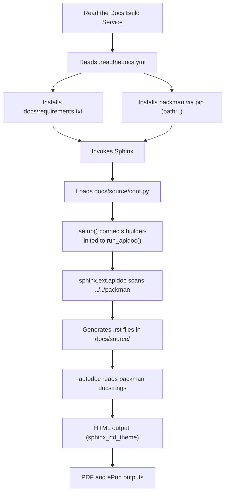
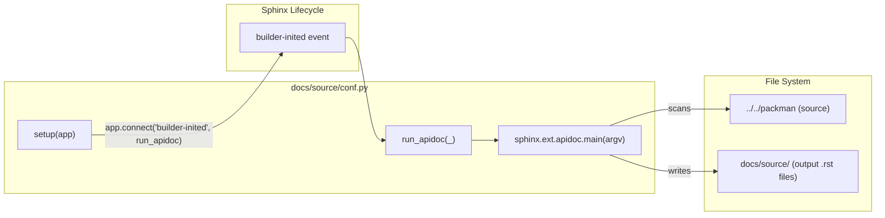

# Documentation Build

<details>
<summary>Relevant source files</summary>

The following files were used as context for generating this wiki page:

- [.readthedocs.yml](.readthedocs.yml)
- [docs/requirements.txt](docs/requirements.txt)
- [docs/source/conf.py](docs/source/conf.py)

</details>


This page covers the configuration and process for building the PACKMAN API reference documentation using Sphinx and Read the Docs. It explains the relevant config files, Sphinx extensions, the automatic API doc generation hook, and how to build documentation locally.

For information about the Python API itself, see the [Package Architecture](#2) page. For information about the CLI or GUI interfaces, see [User Interfaces](#1.2).

---

## Overview

PACKMAN's documentation is built with [Sphinx](https://www.sphinx-doc.org/) and hosted automatically via [Read the Docs](https://readthedocs.org/). The configuration spans three files:

| File | Role |
|---|---|
| `.readthedocs.yml` | Instructs Read the Docs on OS, Python version, and how to invoke Sphinx |
| `docs/source/conf.py` | Sphinx project settings, extensions, theme, and the `apidoc` auto-generation hook |
| `docs/requirements.txt` | Python packages required to build the docs |

---

## Build Pipeline

**Diagram: Documentation Build Pipeline**



Sources: [.readthedocs.yml:1-30](), [docs/source/conf.py:1-84]()

---

## Read the Docs Configuration (`.readthedocs.yml`)

The file [.readthedocs.yml:1-30]() uses the Read the Docs v2 configuration format. Key settings:

| Key | Value | Meaning |
|---|---|---|
| `version` | `2` | Config file format version |
| `build.os` | `ubuntu-22.04` | Builder OS image |
| `build.tools.python` | `3.12` | Python interpreter version |
| `python.install[0].requirements` | `docs/requirements.txt` | Installs doc dependencies first |
| `python.install[1].method` | `pip` with `path: .` | Installs the `packman` package itself |
| `sphinx.configuration` | `docs/source/conf.py` | Points to the Sphinx config |
| `formats` | `all` | Builds HTML, PDF, and ePub |

The two-step install — first `docs/requirements.txt`, then the package at `.` — ensures Sphinx and its extensions are available before `packman` is imported inside `conf.py`.

Sources: [.readthedocs.yml:1-30]()

---

## Sphinx Configuration (`docs/source/conf.py`)

### Project Metadata

[docs/source/conf.py:16-28]() imports `packman` directly and reads `packman.__version__` to set the `release` variable. This ensures the displayed version in the docs always matches the installed package version.

```
project   = 'py-PACKMAN'
copyright = '2020, Pranav Khade(https://github.com/Pranavkhade)'
author    = 'Pranav Khade(https://github.com/Pranavkhade)'
release   = packman.__version__
```

### Sphinx Extensions

Configured at [docs/source/conf.py:36]():

| Extension | Purpose |
|---|---|
| `sphinx.ext.napoleon` | Parses Google-style and NumPy-style docstrings |
| `sphinx.ext.todo` | Supports `.. todo::` directives in docstrings |
| `sphinx.ext.autodoc` | Pulls docstrings from Python source modules |
| `sphinx_rtd_theme` | Registers the Read the Docs HTML theme |

### HTML Theme

`html_theme` is set to `'sphinx_rtd_theme'` [docs/source/conf.py:52](), with the option `collapse_navigation: False` [docs/source/conf.py:62]() so the full navigation tree is always expanded.

A custom favicon is set to `'../_static/gallary/logo.gif'` [docs/source/conf.py:64]().

---

## API Doc Auto-Generation Hook

The most significant piece of `conf.py` is the automatic invocation of `sphinx.ext.apidoc` via a Sphinx event hook.

**Diagram: `run_apidoc` and `setup` Code Entities**



Sources: [docs/source/conf.py:66-84]()

### `run_apidoc` Arguments

The `argv` list passed to `apidoc.main()` at [docs/source/conf.py:72-79]() controls how source files are scanned:

| Flag | Meaning |
|---|---|
| `-f` | Force overwrite of existing generated `.rst` files |
| `-T` | Do not generate a table of contents file |
| `-e` | Put each module on its own page |
| `-M` | Put module documentation before submodule documentation |
| `-o source` | Output directory for generated `.rst` files |
| `../../packman` | Root of the `packman` package to document |

`ignore_paths` is defined as an empty list `[]` at [docs/source/conf.py:70](), meaning all submodules of `packman` are included.

### `setup` Function

The `setup(app)` function at [docs/source/conf.py:83-84]() is a standard Sphinx hook. It connects `run_apidoc` to the `builder-inited` event, causing API docs to be regenerated from source every time a build starts.

---

## Documentation Dependencies (`docs/requirements.txt`)

[docs/requirements.txt:1-13]() lists all packages installed before the Sphinx build begins:

| Package | Role |
|---|---|
| `numpy`, `scipy`, `networkx`, `mlxtend`, `scikit-learn` | Runtime dependencies of `packman` required for import during autodoc |
| `Sphinx` | Core documentation builder |
| `sphinx-rtd-theme` | Read the Docs HTML theme |
| `sphinxcontrib-applehelp` | Apple Help output support |
| `sphinxcontrib-devhelp` | DevHelp output support |
| `sphinxcontrib-htmlhelp` | HTML Help output support |
| `sphinxcontrib-jsmath` | Math rendering in HTML |
| `sphinxcontrib-napoleon` | Google/NumPy docstring support (also bundled in sphinx.ext.napoleon) |
| `sphinxcontrib-qthelp` | Qt Help output support |
| `sphinxcontrib-serializinghtml` | JSON/pickle HTML serialization |

The `packman` runtime dependencies (`numpy`, `scipy`, etc.) must be present because `conf.py` does `import packman` at the top level [docs/source/conf.py:16](), which triggers imports of those packages.

Sources: [docs/requirements.txt:1-13](), [docs/source/conf.py:16]()

---

## Building Documentation Locally

To reproduce the Read the Docs build locally:

1. **Install dependencies**

   ```bash
   pip install -r docs/requirements.txt
   pip install -e .
   ```

2. **Run Sphinx from the `docs/` directory**

   ```bash
   cd docs
   sphinx-build -b html source build/html
   ```

   This triggers the `builder-inited` event, which calls `run_apidoc` to generate `.rst` files from the `packman` source tree before building the HTML output.

3. **Output locations**

   | Format | Output path |
   |---|---|
   | HTML | `docs/build/html/` |
   | PDF (via Read the Docs) | Generated by the RTD service |
   | ePub (via Read the Docs) | Generated by the RTD service |

The `source` directory referenced in the `sphinx-build` command corresponds to `docs/source/`, which contains `conf.py` and the generated `.rst` files written by `apidoc.main()`.

Sources: [.readthedocs.yml:16-24](), [docs/source/conf.py:66-84]()