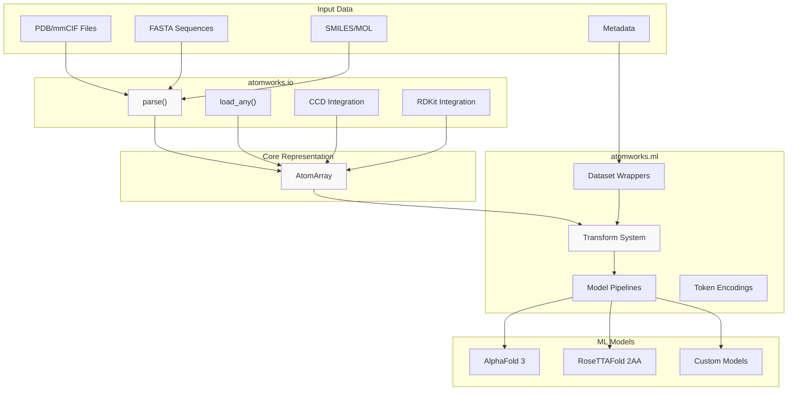
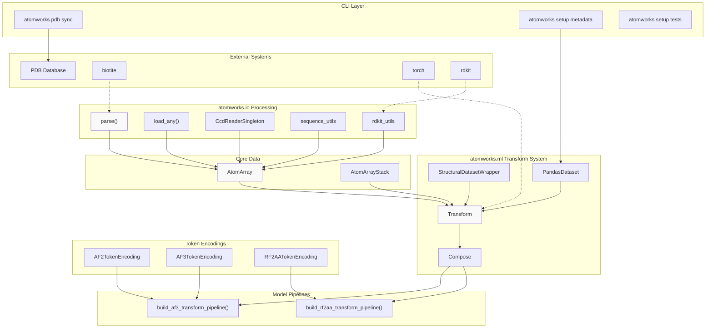
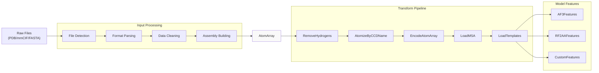

# Overview

Relevant source files

The following files were used as context for generating this wiki page:

- [.github/workflows/release_and_docs.yaml](.github/workflows/release_and_docs.yaml)
- [.releaserc.js](.releaserc.js)
- [README.md](README.md)
- [docs/_static/atomworks_datapipelines.svg](docs/_static/atomworks_datapipelines.svg)
- [docs/_static/atomworks_logo_color.svg](docs/_static/atomworks_logo_color.svg)
- [docs/_static/atomworks_logo_dark.svg](docs/_static/atomworks_logo_dark.svg)
- [docs/_static/atomworks_logo_light.svg](docs/_static/atomworks_logo_light.svg)
- [docs/_static/atomworks_overview.png](docs/_static/atomworks_overview.png)
- [docs/_static/default_thumbnail.png](docs/_static/default_thumbnail.png)
- [docs/_static/favicon-16x16.png](docs/_static/favicon-16x16.png)
- [docs/_static/favicon-32x32.png](docs/_static/favicon-32x32.png)
- [docs/conf.py](docs/conf.py)
- [docs/index.rst](docs/index.rst)

This document provides a high-level introduction to AtomWorks, a Python platform for biomolecular deep learning that accelerates research velocity through unified data processing and modular ML pipelines. AtomWorks consists of two symbiotic libraries that work together to streamline the entire workflow from raw biological data to trained models.

For detailed installation instructions, see [Installation and Getting Started](#1.2). For information about extending AtomWorks with custom functionality, see [Extending AtomWorks](#6.2).

## What is AtomWorks?

AtomWorks is an open-source platform designed to maximize research velocity for biomolecular modeling tasks. Similar to how PyTorch's data utilities enable rapid prototyping in vision and language domains, AtomWorks aims to accelerate development and experimentation within biomolecular modeling by providing:

- **Universal data processing** for biological file formats (PDB, mmCIF, FASTA, SMILES, etc.)
- **Modular ML pipelines** with pre-built, composable transforms
- **Unified data representation** using biotite's `AtomArray` as the backbone
- **Production-ready tooling** for training on large datasets like the PDB

The platform is built atop [biotite](https://www.biotite-python.org/) and integrates seamlessly with PyTorch, RDKit, and other scientific Python libraries.

## Core Components

AtomWorks consists of two main libraries that work together:

**Sources:** [README.md:15-22](), [README.md:26-53]()

### atomworks.io - Universal Data Processing

The `atomworks.io` library provides universal Python toolkit for parsing, cleaning, manipulating, and converting biological data. Key capabilities include:

- **Universal parsing** via the `parse()` function that handles multiple file formats automatically
- **Chemical component integration** through CCD (Chemical Component Dictionary) lookup
- **Cross-format conversion** between PDB, mmCIF, FASTA, SMILES, MOL, and other formats
- **Data cleaning and validation** with proper handling of occupancies, ligands, and missing atoms
- **RDKit integration** for small molecule processing

The library transforms all input data into a consistent `AtomArray` representation for downstream analysis.

**Sources:** [README.md:26-36]()

### atomworks.ml - Modular ML Pipelines

The `atomworks.ml` library provides advanced dataset featurization and sampling for deep learning workflows. Core features include:

- **Transform system** with pre-built, composable transforms for common tasks
- **Model-specific pipelines** for AlphaFold 3, RoseTTAFold 2AA, and custom models  
- **Dataset management** with filtering, sampling, and batching utilities
- **Token encoding systems** for converting molecular data to ML-compatible formats
- **MSA and template processing** for evolutionary and structural features

The transform system maintains a common vocabulary where each transform operates on and outputs updated `AtomArray` objects, enabling seamless composition of processing steps.

**Sources:** [README.md:40-53]()

## System Architecture

The following diagram shows how the major system components interact, using specific code entities from the codebase:

**Sources:** [README.md:88-104](), [README.md:124-291]()

## Data Flow Pipeline

AtomWorks implements a consistent data flow from raw biological files to ML-ready features:

**Sources:** [README.md:165-277]()

## Key Design Principles

AtomWorks follows several core design principles that enable its modularity and extensibility:

### Unified Data Representation
All structural data flows through biotite's `AtomArray` objects, providing a consistent interface regardless of input format. This eliminates the need for format-specific processing logic in downstream components.

### Composable Transforms
The transform system allows building complex processing pipelines by chaining simple, focused transforms. Each transform receives and returns `AtomArray` objects, making the system highly modular.

### Declarative Configuration
ML pipelines can be configured declaratively using Hydra YAML files, enabling reproducible experiments and easy parameter sweeps without code changes.

### Production Scale
The system is designed to handle large datasets like the full PDB, with efficient data loading, caching, and distributed processing capabilities.

**Sources:** [README.md:51-52](), [README.md:165-277]()

## Integration with External Tools

AtomWorks integrates seamlessly with the broader scientific Python ecosystem:

| Tool | Integration Point | Purpose |
|------|------------------|---------|
| biotite | Core data structures | Structural representation and file I/O |
| PyTorch | ML transforms | Tensor operations and model training |
| RDKit | Chemical processing | Small molecule handling and descriptors |
| Hydra | Configuration | Declarative pipeline configuration |
| NumPy | Numerical operations | Array processing and mathematical operations |

**Sources:** [README.md:22](), [README.md:165-277]()

This overview provides the foundation for understanding AtomWorks' architecture and capabilities. For detailed information about specific components, refer to the dedicated sections on [atomworks.io](#2), [atomworks.ml](#3), and [Model-Specific Pipelines](#3.3).

---