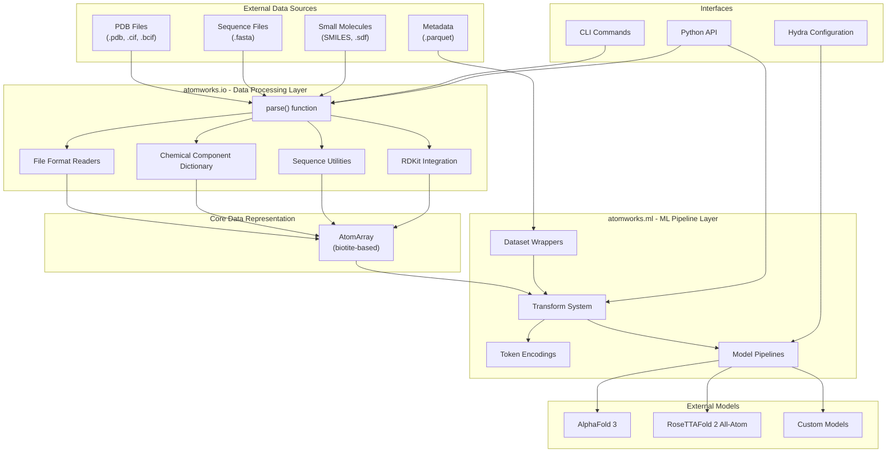
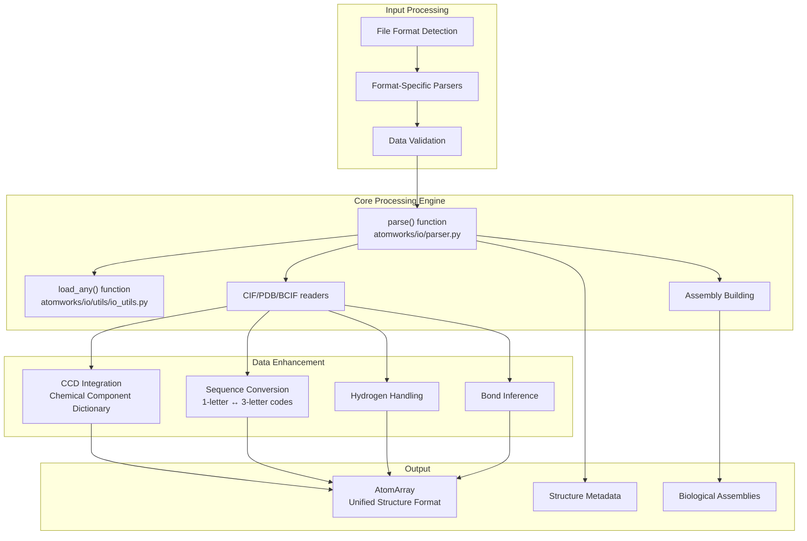
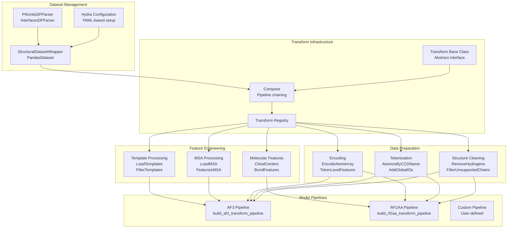
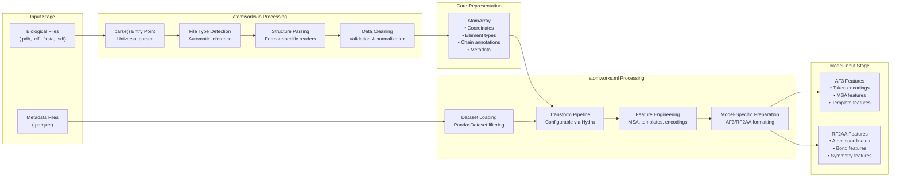
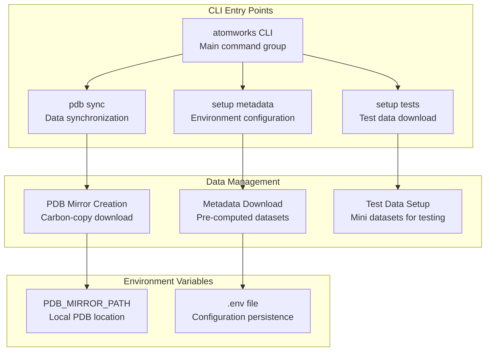
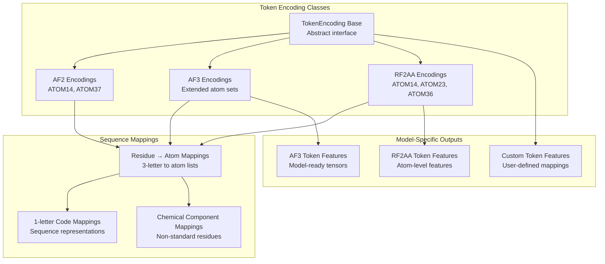

# System Architecture

Relevant source files

The following files were used as context for generating this wiki page:

- [.github/workflows/release_and_docs.yaml](.github/workflows/release_and_docs.yaml)
- [.releaserc.js](.releaserc.js)
- [README.md](README.md)
- [docs/_static/atomworks_datapipelines.svg](docs/_static/atomworks_datapipelines.svg)
- [docs/_static/atomworks_logo_color.svg](docs/_static/atomworks_logo_color.svg)
- [docs/_static/atomworks_logo_dark.svg](docs/_static/atomworks_logo_dark.svg)
- [docs/_static/atomworks_logo_light.svg](docs/_static/atomworks_logo_light.svg)
- [docs/_static/atomworks_overview.png](docs/_static/atomworks_overview.png)
- [docs/_static/default_thumbnail.png](docs/_static/default_thumbnail.png)
- [docs/_static/favicon-16x16.png](docs/_static/favicon-16x16.png)
- [docs/_static/favicon-32x32.png](docs/_static/favicon-32x32.png)
- [docs/conf.py](docs/conf.py)
- [docs/index.rst](docs/index.rst)

## Purpose and Scope

This document explains the high-level architecture of AtomWorks, focusing on the relationship between its two primary components: `atomworks.io` and `atomworks.ml`. It covers the overall system design, data flow patterns, and how the components interact to support biomolecular deep learning workflows.

For detailed information about specific components:
- Data processing functionality: see [Core Parser System](#2.1) and [Data Processing Pipeline](#2.2)
- Machine learning pipeline details: see [Transform Pipeline](#3.1) and [Model-Specific Pipelines](#3.3)
- Installation and setup: see [Installation and Getting Started](#1.2)

## System Overview

AtomWorks implements a two-layer architecture designed to separate data processing concerns from machine learning workflow concerns. The system is built around a unified `AtomArray` representation from the biotite library, which serves as the common data format throughout the platform.

### Overall Architecture

Sources: [README.md:15-22](), [README.md:26-37](), [README.md:40-52]()

## Component Architecture

### atomworks.io - Data Processing Layer

The `atomworks.io` component provides universal data processing capabilities for biological structures and sequences. It handles format conversion, data cleaning, and standardization around the `AtomArray` representation.

Sources: [README.md:90-123]()

### atomworks.ml - Machine Learning Pipeline Layer

The `atomworks.ml` component provides modular transformation pipelines for converting `AtomArray` structures into ML-ready features. It supports model-specific preprocessing for various foundation models.

Sources: [README.md:44-51](), [README.md:182-262]()

## Data Flow Architecture

The following diagram illustrates how data flows through the AtomWorks system from input files to ML model inputs:

### End-to-End Data Flow

Sources: [README.md:94-114](), [README.md:165-262]()

## Configuration and Interface Architecture

AtomWorks provides multiple interfaces for different use cases, with configuration management through Hydra:

### Interface Overview

| Interface Type | Primary Use Case | Key Components |
|---|---|---|
| **Python API** | Programmatic access, custom workflows | `parse()`, `load_any()`, Transform classes |
| **CLI Commands** | Data management, environment setup | `atomworks pdb sync`, `atomworks setup` |
| **Hydra Configuration** | ML pipeline configuration | YAML-based dataset and transform configs |

### CLI Command Architecture

Sources: [README.md:128-148](), [README.md:150-163](), [README.md:277-290]()

## Token Encoding System

AtomWorks implements a sophisticated token encoding system to bridge molecular representations with ML model requirements:

### Token Encoding Architecture

Sources: [README.md:169-181]()

## Infrastructure Components

The AtomWorks system includes several infrastructure components for development, testing, and deployment:

### Development Infrastructure

| Component | Purpose | Key Technologies |
|---|---|---|
| **CI/CD Pipeline** | Automated testing and deployment | GitHub Actions, semantic-release |
| **Documentation System** | API docs and user guides | Sphinx, versioned docs |
| **Package Distribution** | PyPI releases | Python packaging, version management |
| **Code Quality** | Linting and testing | Ruff, pytest |

### External Dependencies

AtomWorks builds upon several key external libraries:

- **biotite**: Core structural biology operations and `AtomArray` representation
- **torch**: Machine learning framework for transforms and models  
- **rdkit**: Chemical informatics and small molecule handling
- **numpy**: Numerical operations and array manipulations
- **hydra**: Configuration management for ML pipelines

Sources: [README.md:1-6](), [.github/workflows/release_and_docs.yaml:1-159](), [docs/conf.py:1-98]()

---