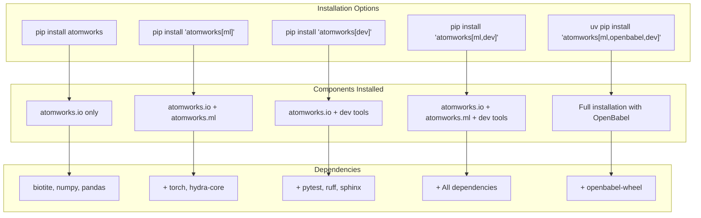
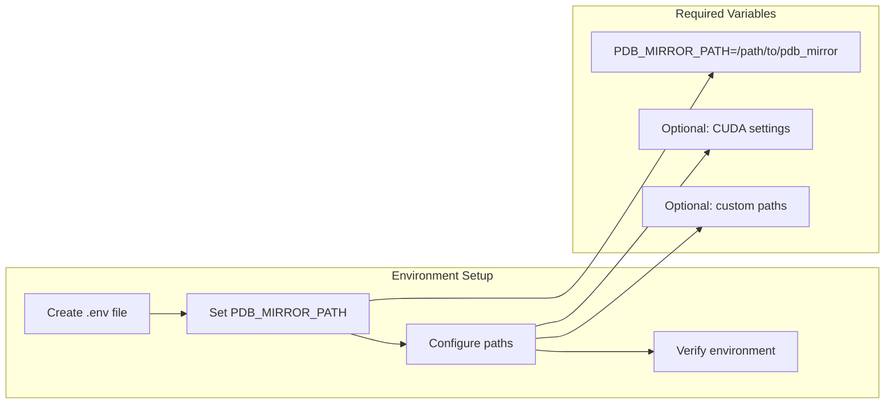
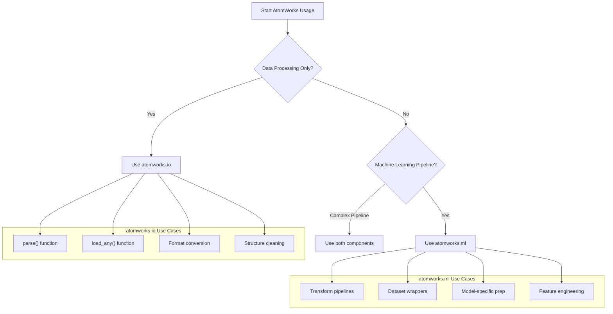
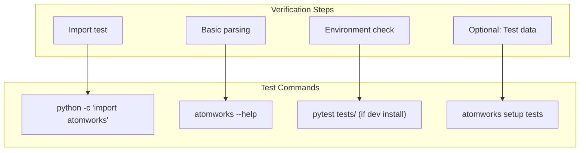

# Installation and Getting Started

<details>
<summary>Relevant source files</summary>

The following files were used as context for generating this wiki page:

- [.github/workflows/release_and_docs.yaml](.github/workflows/release_and_docs.yaml)
- [.releaserc.js](.releaserc.js)
- [README.md](README.md)
- [docs/_static/atomworks_datapipelines.svg](docs/_static/atomworks_datapipelines.svg)
- [docs/_static/atomworks_logo_color.svg](docs/_static/atomworks_logo_color.svg)
- [docs/_static/atomworks_logo_dark.svg](docs/_static/atomworks_logo_dark.svg)
- [docs/_static/atomworks_logo_light.svg](docs/_static/atomworks_logo_light.svg)
- [docs/_static/atomworks_overview.png](docs/_static/atomworks_overview.png)
- [docs/_static/default_thumbnail.png](docs/_static/default_thumbnail.png)
- [docs/_static/favicon-16x16.png](docs/_static/favicon-16x16.png)
- [docs/_static/favicon-32x32.png](docs/_static/favicon-32x32.png)
- [docs/conf.py](docs/conf.py)
- [docs/index.rst](docs/index.rst)

</details>


This document provides comprehensive guidance for installing AtomWorks and configuring your environment for basic usage. It covers installation options, dependency management, environment setup, and initial usage patterns for both `atomworks.io` and `atomworks.ml` components.

For advanced configuration and development workflows, see [Project Configuration and Development](#5). For detailed API usage, see [atomworks.io - Data Processing](#2) and [atomworks.ml - Machine Learning](#3).

## Installation Options

AtomWorks provides multiple installation configurations to support different use cases and dependency requirements.

### Package Installation Matrix



**Sources:** [README.md:55-71]()

### Standard Installation

For most users, install AtomWorks with ML capabilities:

```bash
pip install "atomworks[ml]"
```

This provides access to both `atomworks.io` and `atomworks.ml` components with all required dependencies including `torch` and `hydra-core`.

### Minimal Installation

For users only requiring data processing capabilities:

```bash
pip install atomworks
```

This installs only `atomworks.io` with core dependencies: `biotite`, `numpy`, and `pandas`.

### Development Installation

For contributors or users requiring development tools:

```bash
pip install "atomworks[ml,dev]"
```

This includes testing frameworks (`pytest`), linting tools (`ruff`), and documentation generation (`sphinx`).

### Alternative Package Managers

For `uv` users, install with enhanced chemical support:

```bash
uv pip install "atomworks[ml,openbabel,dev]"
```

**Sources:** [README.md:64-68]()

## Environment Configuration

### Environment Variables Setup

AtomWorks requires specific environment variables for full functionality, particularly when working with PDB data or ML pipelines.



Create a `.env` file in your home directory:

```bash
export PDB_MIRROR_PATH=/path/to/pdb_mirror
```

**Sources:** [README.md:142-148]()

### PDB Mirror Setup

For training workflows, establish a local PDB mirror:

```bash
# Full PDB mirror (~100 GB)
atomworks pdb sync /path/to/pdb_mirror

# Set environment variable
export PDB_MIRROR_PATH=/path/to/pdb_mirror
```

**Sources:** [README.md:128-140]()

## Basic Usage Patterns

### Component Selection Workflow



**Sources:** [README.md:76-87]()

### Core Parsing Workflow

The primary entry point for data processing uses the `parse()` function:

```python
from atomworks.io.parser import parse

result = parse(filename="3nez.cif.gz")

asym_unit: AtomArrayStack = result["asym_unit"]
assemblies: dict[str, AtomArrayStack] = result["assemblies"]

for chain_id, info in result["chain_info"].items():
    print(chain_id, info["sequence"])
```

**Key Components:**
- `parse()` function returns structured dictionary
- `asym_unit`: Core `AtomArrayStack` structure
- `assemblies`: Built biological assemblies
- `chain_info`: Sequence and metadata for each chain
- `ligand_info`: Ligand annotations
- `metadata`: Experimental information

**Sources:** [README.md:90-114]()

### Simple Loading Workflow

For direct file loading without full parsing:

```python
from atomworks.io.utils.io_utils import load_any

atom_array: AtomArray = load_any("3nez.cif.gz", model=1)
```

**Sources:** [README.md:116-122]()

## Verification and Testing

### Installation Verification



Verify your installation:

```python
# Test basic imports
import atomworks
import atomworks.io
import atomworks.ml  # Only if installed with [ml]

# Test version
print(atomworks.__version__)
```

### Test Data Setup

Download test data for experimentation:

```bash
atomworks setup tests  # Downloads ~500 MB test pack
```

This creates:
- `tests/data/pdb`: Mini PDB mirror
- `tests/data/ccd`: Custom CCD data
- `tests/data/shared`: MSA and template data
- `tests/data/ml/`: ML training datasets

**Sources:** [README.md:277-283]()

### Running Tests

For development installations, verify functionality:

```bash
pytest tests/ml/test_data_loading_pipelines.py
```

**Sources:** [README.md:285-290]()

## Next Steps

After successful installation:

1. **For data processing workflows**: Explore [Core Parser System](#2.1) and [Data Processing Pipeline](#2.2)
2. **For machine learning applications**: Review [Transform Pipeline](#3.1) and [Model-Specific Pipelines](#3.3)
3. **For CLI usage**: See [Command Line Interface](#4)
4. **For development**: Consult [Code Quality and Testing](#5.2)

**Sources:** [README.md:55-298](), [docs/conf.py:1-98](), [.github/workflows/release_and_docs.yaml:1-159]()

---