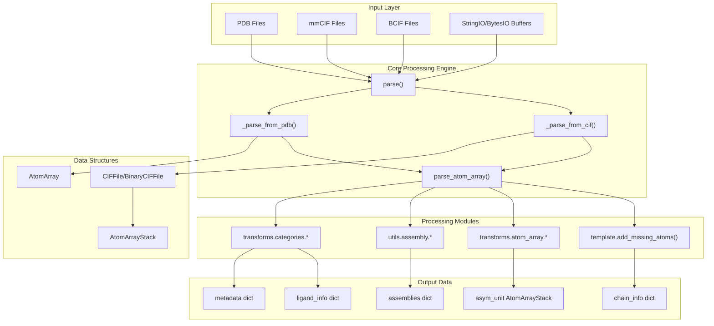
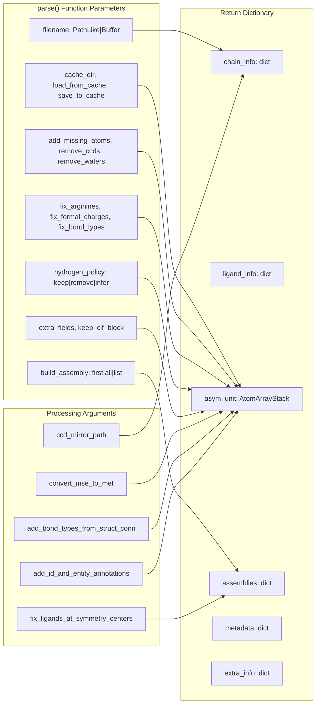
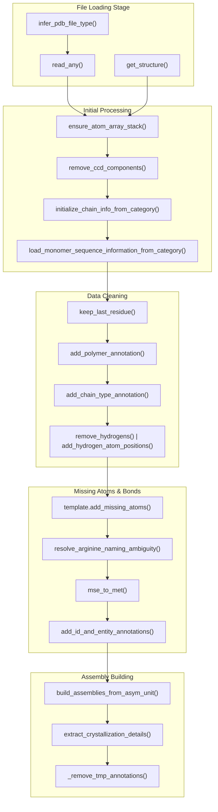
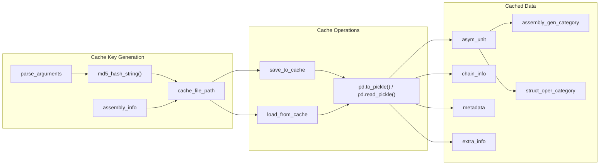

# atomworks.io - Data Processing

<details>
<summary>Relevant source files</summary>

The following files were used as context for generating this wiki page:

- [.github/workflows/lint_and_test.yaml](.github/workflows/lint_and_test.yaml)
- [.gitignore](.gitignore)
- [pyproject.toml](pyproject.toml)
- [src/atomworks/io/parser.py](src/atomworks/io/parser.py)
- [src/atomworks/io/tools/rdkit.py](src/atomworks/io/tools/rdkit.py)
- [src/atomworks/io/utils/ccd.py](src/atomworks/io/utils/ccd.py)
- [src/atomworks/io/utils/io_utils.py](src/atomworks/io/utils/io_utils.py)
- [src/atomworks/io/utils/sequence.py](src/atomworks/io/utils/sequence.py)
- [src/atomworks/ml/encoding_definitions.py](src/atomworks/ml/encoding_definitions.py)
- [src/atomworks/ml/transforms/af3_reference_molecule.py](src/atomworks/ml/transforms/af3_reference_molecule.py)
- [src/atomworks/ml/transforms/featurize_unresolved_residues.py](src/atomworks/ml/transforms/featurize_unresolved_residues.py)
- [src/atomworks/ml/transforms/filters.py](src/atomworks/ml/transforms/filters.py)
- [src/atomworks/ml/transforms/msa/_msa_constants.py](src/atomworks/ml/transforms/msa/_msa_constants.py)
- [tests/io/components/test_remove_hydrogens.py](tests/io/components/test_remove_hydrogens.py)
- [tests/io/utils/test_sequence_maps.py](tests/io/utils/test_sequence_maps.py)
- [tests/io/utils/test_sequence_utils.py](tests/io/utils/test_sequence_utils.py)
- [tests/ml/pipelines/test_pipeline_regression.py](tests/ml/pipelines/test_pipeline_regression.py)
- [tests/ml/transforms/test_token_utils.py](tests/ml/transforms/test_token_utils.py)

</details>


This document covers the `atomworks.io` library, which provides comprehensive data processing capabilities for biomolecular structure files. The library serves as the foundation for converting, cleaning, and standardizing structural data from formats like PDB, mmCIF, and BCIF into biotite-compatible `AtomArray` and `AtomArrayStack` representations.

For machine learning workflows built on top of this processed data, see [atomworks.ml - Machine Learning](#3). For command-line data synchronization tools, see [Command Line Interface](#4).

## Core System Architecture

The `atomworks.io` system is built around a central `parse` function that orchestrates the entire data processing pipeline. The architecture follows a layered approach where raw structural files are progressively cleaned, validated, and augmented before being assembled into standardized data structures.



**Core Parser Architecture**

Sources: [src/atomworks/io/parser.py:73-319](), [src/atomworks/io/parser.py:591-674](), [src/atomworks/io/parser.py:677-733]()

## Main Parse Function Interface

The `parse` function serves as the primary entry point for all data processing operations. It accepts various file formats and provides extensive configuration options for data cleaning and processing.



**Parse Function Interface and Configuration**

Sources: [src/atomworks/io/parser.py:47-60](), [src/atomworks/io/parser.py:73-167]()

## Data Processing Pipeline

The processing pipeline consists of several distinct stages that transform raw structural data into clean, standardized representations. Each stage performs specific validation, cleaning, and augmentation operations.



**Data Processing Pipeline Flow**

Sources: [src/atomworks/io/parser.py:417-588](), [src/atomworks/io/transforms/atom_array.py](), [src/atomworks/io/template.py]()

## Output Data Structures

The `parse` function returns a comprehensive dictionary containing multiple data structures that provide different views and representations of the processed molecular structure.

| Key | Type | Description |
|-----|------|-------------|
| `chain_info` | `dict` | Chain-level metadata including sequences, types, and entity information |
| `ligand_info` | `dict` | Information about ligands of interest and binding sites |
| `asym_unit` | `AtomArrayStack` | Asymmetric unit representation with all models |
| `assemblies` | `dict[str, AtomArrayStack]` | Biological assemblies keyed by assembly ID |
| `metadata` | `dict` | Structure metadata (resolution, deposition date, method, etc.) |
| `extra_info` | `dict` | Additional information for caching and cross-compatibility |

### Chain Information Structure

The `chain_info` dictionary provides detailed information about each molecular chain:

```python
{
    "A": {
        "chain_type": ChainType.POLYPEPTIDE_L,
        "res_name": ["MET", "ALA", "GLY", ...],
        "res_id": [1, 2, 3, ...],
        "is_polymer": True,
        "entity_id": "1",
        "ec_number": None,
        "msa_path": Path("sequence.a3m")  # Optional
    }
}
```

### Assembly Generation

Biological assemblies are generated using crystallographic symmetry operations defined in the `pdbx_struct_assembly_gen` and `pdbx_struct_oper_list` categories. The system supports building specific assemblies or all available assemblies.

Sources: [src/atomworks/io/parser.py:156-167](), [src/atomworks/io/transforms/categories.py:28-31](), [src/atomworks/io/utils/assembly.py]()

## Caching System

The parser includes a sophisticated caching mechanism that can save and load pre-processed structures to improve performance on repeated operations.



**Caching System Architecture**

The cache stores all parsing results except assemblies, which are rebuilt on-demand using stored assembly generation and operation categories. This approach balances storage efficiency with reconstruction speed.

Sources: [src/atomworks/io/parser.py:200-257](), [src/atomworks/io/parser.py:300-318](), [src/atomworks/io/common.py:md5_hash_string]()

## Data Validation and Quality Control

The system includes extensive validation and quality control mechanisms to ensure data integrity and consistency across different input formats and sources.

### Supported File Formats

- **mmCIF/PDBx**: Primary format with full metadata support
- **BCIF**: Binary CIF format for efficient storage and transfer  
- **PDB**: Legacy format with automatic chain separation for mixed polymer/non-polymer residues

### Validation Features

- CCD code availability checking via `check_ccd_codes_are_available()`
- Argument validation for processing parameters
- Automatic detection and correction of common structural issues
- Symmetry center clash detection and resolution
- Bond type validation and correction

### Quality Assurance

- Regression testing against stored reference structures
- Consistency validation between different parsing paths
- Comprehensive test coverage for edge cases and complex structures

Sources: [src/atomworks/io/utils/ccd.py](), [tests/io/components/test_regression.py:16-42](), [tests/io/utils/test_io.py:400-421]()

## Integration Points

The `atomworks.io` system integrates with several external libraries and internal components:

### External Dependencies
- **biotite**: Core structural biology data structures (`AtomArray`, `AtomArrayStack`, `BondList`)
- **pandas**: Data manipulation and metadata handling
- **numpy**: Numerical operations and array processing

### Internal Integration  
- **atomworks.ml**: Provides cleaned data for machine learning pipelines
- **atomworks.cli**: Uses parsing functions for data synchronization operations
- **CCD Mirror**: Local chemical component dictionary for validation and templates

The parser system serves as the foundational layer that enables all downstream analysis and modeling workflows within the AtomWorks framework.

Sources: [src/atomworks/io/parser.py:12-19](), [src/atomworks/io/constants.py](), [src/atomworks/io/utils/io_utils.py]()

---