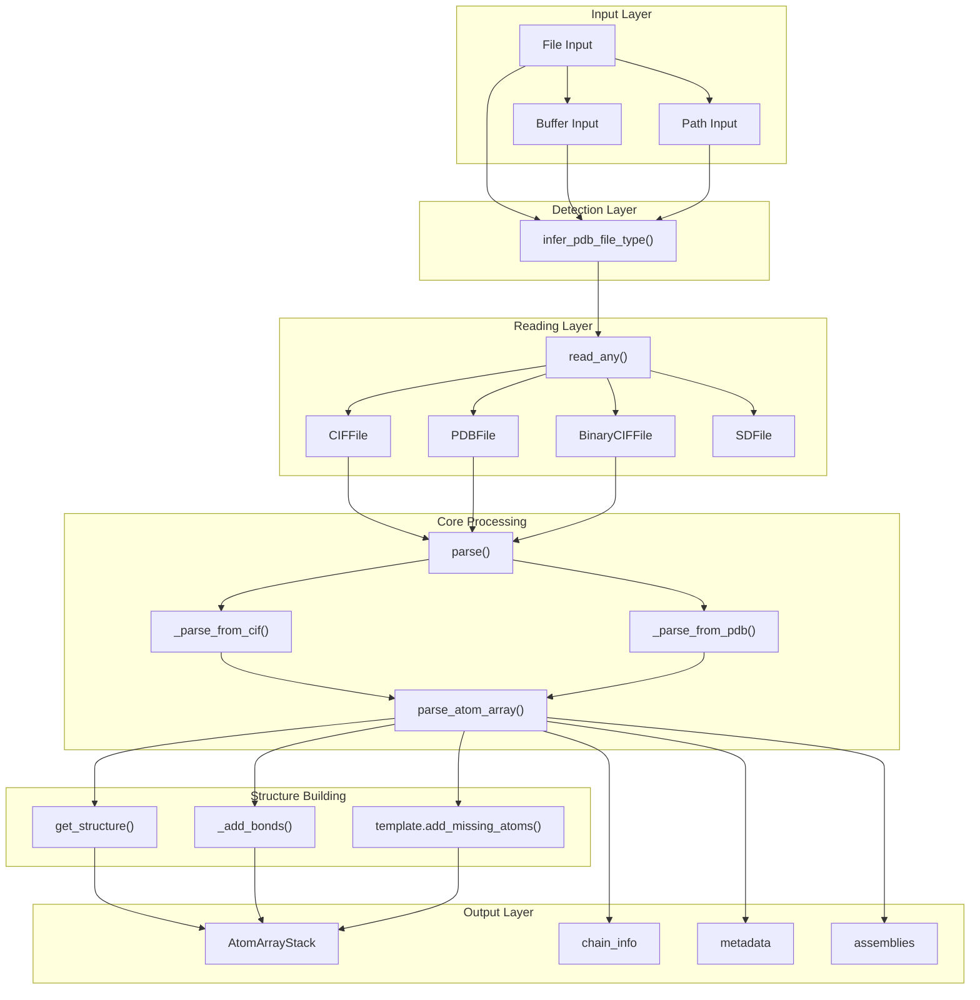
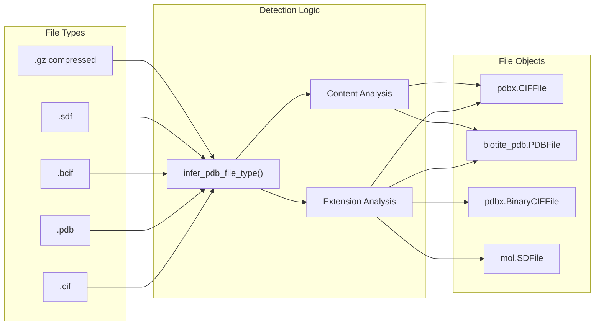
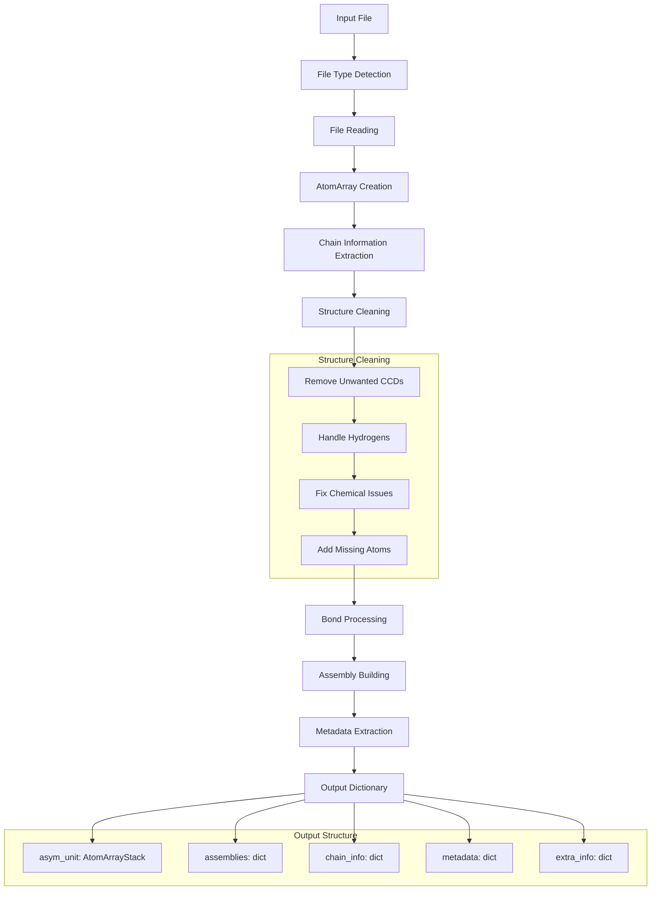
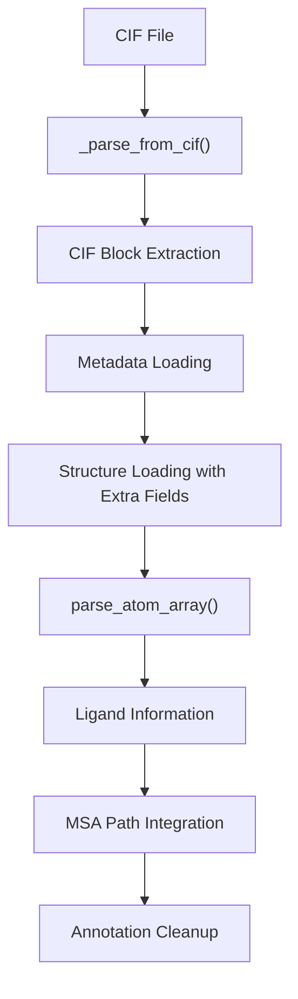
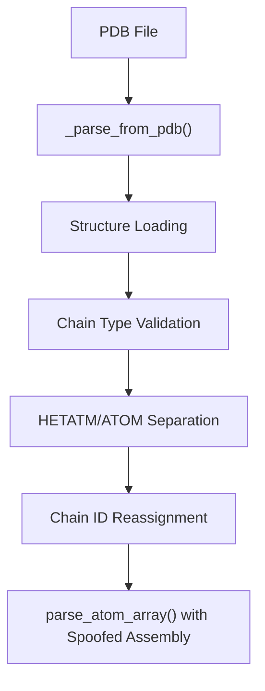
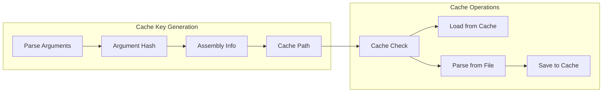
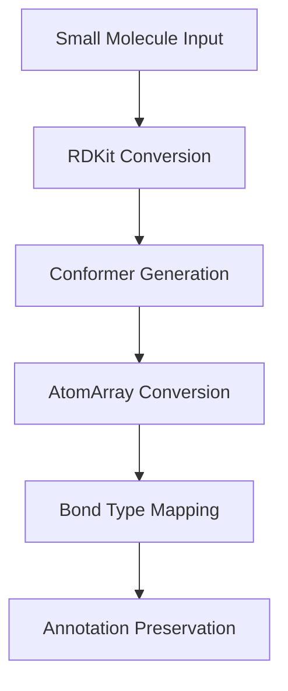
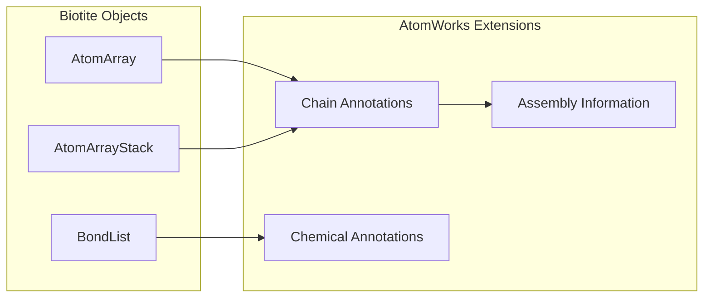

# Core Parser System

Relevant source files

The following files were used as context for generating this wiki page:

- [src/atomworks/io/parser.py](src/atomworks/io/parser.py)
- [src/atomworks/io/tools/rdkit.py](src/atomworks/io/tools/rdkit.py)
- [src/atomworks/io/utils/io_utils.py](src/atomworks/io/utils/io_utils.py)
- [src/atomworks/ml/transforms/af3_reference_molecule.py](src/atomworks/ml/transforms/af3_reference_molecule.py)
- [src/atomworks/ml/transforms/featurize_unresolved_residues.py](src/atomworks/ml/transforms/featurize_unresolved_residues.py)
- [src/atomworks/ml/transforms/filters.py](src/atomworks/ml/transforms/filters.py)
- [tests/io/components/test_remove_hydrogens.py](tests/io/components/test_remove_hydrogens.py)
- [tests/ml/pipelines/test_pipeline_regression.py](tests/ml/pipelines/test_pipeline_regression.py)
- [tests/ml/transforms/test_token_utils.py](tests/ml/transforms/test_token_utils.py)

## Purpose and Scope

The Core Parser System provides the main entry point for converting biological structure files into AtomWorks' unified data representation. This system handles multiple file formats (CIF, PDB, BCIF, SDF) and converts them into Biotite AtomArray objects with standardized annotations and metadata. 

For information about the subsequent ML pipeline processing of parsed structures, see [Transform Pipeline](#3.1). For details about Chemical Component Dictionary integration during parsing, see [Chemical Component Dictionary](#2.3).

## System Architecture

The parser system follows a layered architecture with format detection, file reading, and structured processing phases:

**Sources:** [src/atomworks/io/parser.py:1-766](), [src/atomworks/io/utils/io_utils.py:1-779]()

## File Format Support and Detection

The parser automatically detects and handles multiple file formats through a unified interface:

**Sources:** [src/atomworks/io/utils/io_utils.py:283-317](), [src/atomworks/io/utils/io_utils.py:320-367]()

## Core Parser Function Interface

The main `parse` function serves as the primary entry point with comprehensive configuration options:

| Parameter Category | Key Parameters | Description |
|-------------------|----------------|-------------|
| **Input** | `filename`, `file_type` | File path/buffer and optional format specification |
| **Caching** | `cache_dir`, `save_to_cache`, `load_from_cache` | Caching system for processed structures |
| **Structure Processing** | `add_missing_atoms`, `remove_ccds`, `remove_waters` | Core structure cleaning options |
| **Chemical Handling** | `fix_arginines`, `fix_formal_charges`, `convert_mse_to_met` | Chemical standardization |
| **Hydrogen Policy** | `hydrogen_policy` | Control hydrogen handling: "keep", "remove", "infer" |
| **Assembly Building** | `build_assembly` | Assembly construction: "first", "all", or specific IDs |

**Sources:** [src/atomworks/io/parser.py:73-96](), [src/atomworks/io/parser.py:47-59]()

## Data Processing Pipeline

The parser processes structures through a well-defined sequence of transforms and validations:

**Sources:** [src/atomworks/io/parser.py:321-588](), [src/atomworks/io/parser.py:591-674]()

## Format-Specific Processing

### CIF File Processing

CIF files receive the most comprehensive processing with full metadata extraction:

**Sources:** [src/atomworks/io/parser.py:591-674]()

### PDB File Processing

PDB files require special handling for chain separation and missing metadata:

**Sources:** [src/atomworks/io/parser.py:677-732]()

## Caching System

The parser includes a sophisticated caching mechanism for improved performance:

The cache stores all parsing results except assemblies, which are rebuilt on-demand to handle different assembly requirements.

**Sources:** [src/atomworks/io/parser.py:200-257](), [src/atomworks/io/parser.py:300-318]()

## Integration with External Tools

### RDKit Integration

The parser integrates with RDKit for small molecule processing:

**Sources:** [src/atomworks/io/tools/rdkit.py:483-622]()

### Biotite Integration

All structures are converted to Biotite's AtomArray format for standardized processing:

**Sources:** [src/atomworks/io/utils/io_utils.py:180-281]()

## Error Handling and Validation

The parser includes comprehensive error handling for common structural biology data issues:

- **Invalid file formats**: Automatic fallback and retry mechanisms
- **Missing atoms**: Template-based atom addition from CCD
- **Chemical inconsistencies**: Valence and charge correction
- **Bond perception errors**: Robust bond inference with fallbacks
- **Assembly building failures**: Graceful degradation to asymmetric unit

**Sources:** [src/atomworks/io/parser.py:181-194](), [src/atomworks/io/parser.py:367-377]()

---