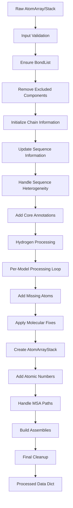
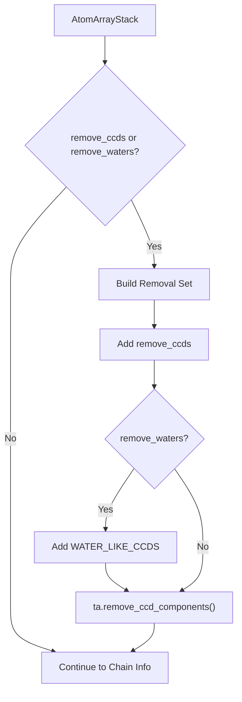
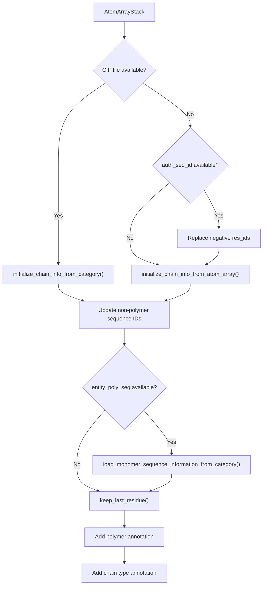
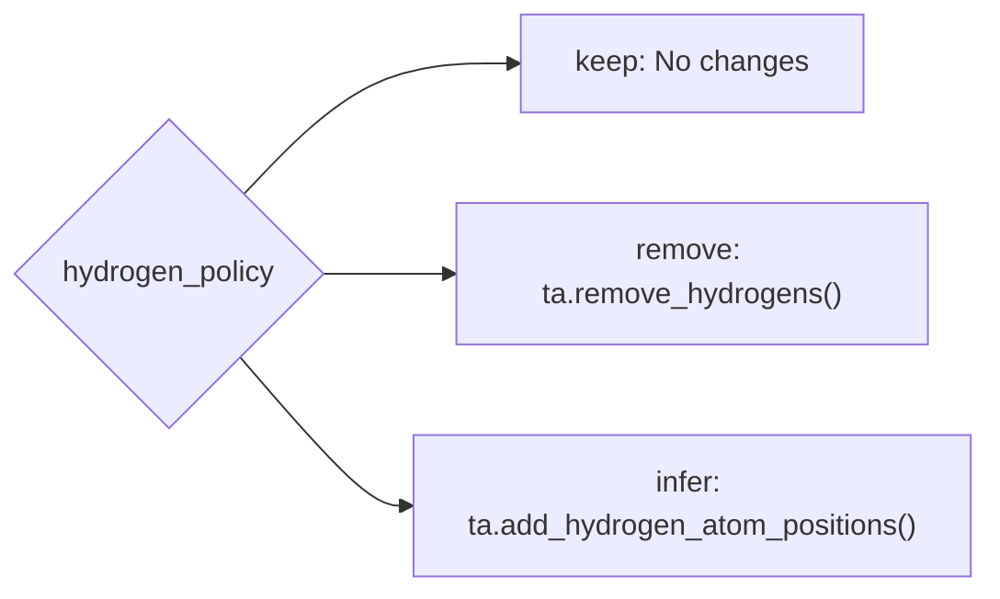
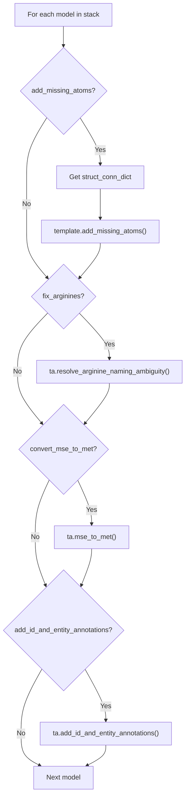
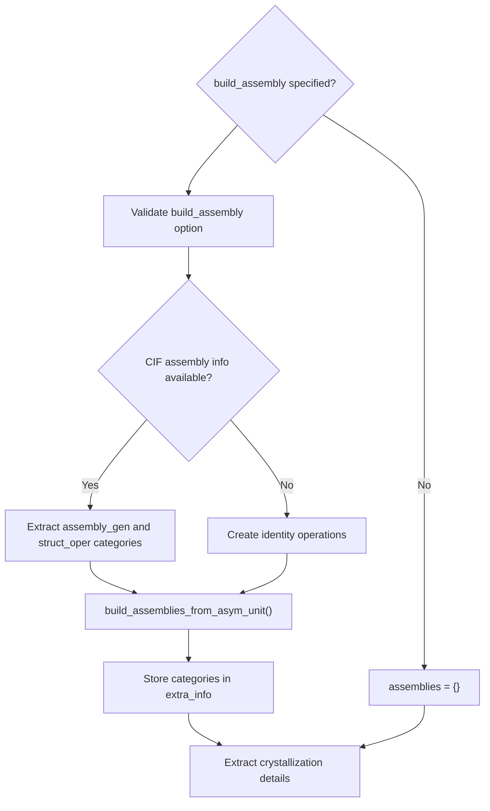
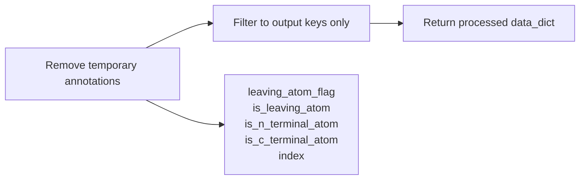

# Data Processing Pipeline

Relevant source files

The following files were used as context for generating this wiki page:

- [src/atomworks/io/parser.py](src/atomworks/io/parser.py)
- [src/atomworks/io/tools/rdkit.py](src/atomworks/io/tools/rdkit.py)
- [src/atomworks/io/utils/io_utils.py](src/atomworks/io/utils/io_utils.py)
- [src/atomworks/ml/transforms/af3_reference_molecule.py](src/atomworks/ml/transforms/af3_reference_molecule.py)
- [src/atomworks/ml/transforms/featurize_unresolved_residues.py](src/atomworks/ml/transforms/featurize_unresolved_residues.py)
- [src/atomworks/ml/transforms/filters.py](src/atomworks/ml/transforms/filters.py)
- [tests/io/components/test_remove_hydrogens.py](tests/io/components/test_remove_hydrogens.py)
- [tests/ml/pipelines/test_pipeline_regression.py](tests/ml/pipelines/test_pipeline_regression.py)
- [tests/ml/transforms/test_token_utils.py](tests/ml/transforms/test_token_utils.py)

This document explains the internal processing steps that occur within atomworks.io when parsing and cleaning biomolecular structures. It covers the data transformations, cleaning operations, annotation additions, assembly building, and validation procedures that convert raw structural files into standardized AtomArray representations.

For information about the parser entry point and file format handling, see [Core Parser System](#2.1). For testing and validation procedures, see [Testing and Validation](#2.3).

## Pipeline Overview

The data processing pipeline transforms raw structural data through a series of cleaning, annotation, and augmentation steps to produce standardized molecular representations.

**Data Processing Pipeline Flow**

Sources: [src/atomworks/io/parser.py:340-589]()

## Core Processing Function

The main processing logic is implemented in the `parse_atom_array` function, which handles AtomArray and AtomArrayStack objects directly, independent of file format.

**Key Processing Parameters**

| Parameter | Type | Purpose |
|-----------|------|---------|
| `add_missing_atoms` | bool | Add unresolved atoms from templates |
| `remove_ccds` | list[str] | CCD codes to exclude from structure |
| `remove_waters` | bool | Remove water molecules |
| `fix_ligands_at_symmetry_centers` | bool | Patch symmetry center clashes |
| `hydrogen_policy` | str | How to handle hydrogens ("keep", "remove", "infer") |
| `build_assembly` | str/list | Which assemblies to construct |

Sources: [src/atomworks/io/parser.py:321-355]()

## Input Validation and Initialization

The pipeline begins with input validation and data structure initialization to ensure consistent processing.

**Input Validation Steps**

```mermaid
flowchart LR
    START["AtomArray/Stack Input"] --> CHECK_BONDS["Check BondList Exists"]
    CHECK_BONDS --> CREATE_BONDS["Create Empty BondList if None"]
    CREATE_BONDS --> VALIDATE_CCD["Validate CCD Mirror Path"]
    VALIDATE_CCD --> CHECK_CODES["Check CCD Codes Available"]
    CHECK_CODES --> INIT_DICT["Initialize data_dict"]
    INIT_DICT --> ADD_METADATA["Add Default Metadata"]
    ADD_METADATA --> CHECK_ENTITY["Check label_entity_id"]
    CHECK_ENTITY --> ADD_OCCUPANCY["Add Default Occupancy"]
    ADD_OCCUPANCY --> ENSURE_STACK["Ensure AtomArrayStack"]
```

The validation process ensures required annotations exist and creates default values where necessary:

- BondList creation: [src/atomworks/io/parser.py:360-361]()
- Entity ID annotation: [src/atomworks/io/parser.py:404-410]()
- Occupancy annotation: [src/atomworks/io/parser.py:412-414]()
- AtomArrayStack conversion: [src/atomworks/io/parser.py:417]()

Sources: [src/atomworks/io/parser.py:360-417]()

## Component Removal and Filtering

The pipeline removes unwanted components like crystallization aids, waters, and user-specified residues.

**Component Removal Process**

The removal process handles several categories of components:
- Crystallization aids (defined in `CRYSTALLIZATION_AIDS`)
- Water-like molecules (defined in `WATER_LIKE_CCDS`)  
- User-specified CCD codes

Sources: [src/atomworks/io/parser.py:419-428](), [src/atomworks/io/constants.py]()

## Chain Information and Sequence Processing

Chain information initialization creates metadata about each chain's type, sequence, and properties.

**Chain Information Processing Flow**

Key chain processing functions:
- `initialize_chain_info_from_category`: [src/atomworks/io/transforms/categories.py:29]()
- `initialize_chain_info_from_atom_array`: [src/atomworks/io/utils/non_rcsb.py:40]()
- `load_monomer_sequence_information_from_category`: [src/atomworks/io/transforms/categories.py:30]()

Sources: [src/atomworks/io/parser.py:430-463]()

## Hydrogen Processing and Per-Model Transformations

The pipeline applies hydrogen policies and processes each model individually for structure-specific operations.

**Hydrogen Policy Application**

**Per-Model Processing Loop**

The missing atoms addition is the most complex step, involving:
- Template-based atom completion: [src/atomworks/io/template.py:495-504]()
- Bond type inference from struct_conn: [src/atomworks/io/parser.py:490-494]()
- Formal charge and bond type fixing: [src/atomworks/io/parser.py:502-503]()

Sources: [src/atomworks/io/parser.py:465-521]()

## Assembly Building and Final Processing

Assembly building creates biological assemblies from asymmetric units using crystallographic operations.

**Assembly Building Process**

Assembly building involves:
- Transformation matrix application: [src/atomworks/io/utils/assembly.py:32]()
- Symmetry center clash fixing: [src/atomworks/io/parser.py:559]()
- Instance ID annotation addition for multi-copy assemblies

Sources: [src/atomworks/io/parser.py:539-566]()

## Data Structure Cleanup and Output

The final processing step removes temporary annotations and prepares the output data dictionary.

**Final Cleanup Operations**

**Output Data Dictionary Structure**

| Key | Type | Description |
|-----|------|-------------|
| `chain_info` | dict | Chain metadata and sequences |
| `ligand_info` | dict | Ligand of interest information |
| `asym_unit` | AtomArrayStack | Asymmetric unit structure |
| `assemblies` | dict | Biological assemblies by ID |
| `metadata` | dict | Structure metadata |
| `extra_info` | dict | Assembly generation data for caching |

The cleanup process ensures memory efficiency by removing processing-specific annotations that are no longer needed: [src/atomworks/io/parser.py:742-765]()

Sources: [src/atomworks/io/parser.py:577-587](), [src/atomworks/io/parser.py:742-765]()

## AtomArray Manipulation Utilities

The pipeline extensively uses transformation utilities from `atomworks.io.transforms.atom_array` module for AtomArray manipulation.

**Key Transformation Functions**

| Function | Purpose | Location |
|----------|---------|----------|
| `ensure_atom_array_stack` | Convert AtomArray to AtomArrayStack | [src/atomworks/io/transforms/atom_array.py]() |
| `remove_ccd_components` | Remove specified residue types | [src/atomworks/io/transforms/atom_array.py]() |
| `add_polymer_annotation` | Mark polymer vs non-polymer atoms | [src/atomworks/io/transforms/atom_array.py]() |
| `add_chain_type_annotation` | Add ChainType enum annotations | [src/atomworks/io/transforms/atom_array.py]() |
| `remove_hydrogens` | Remove hydrogen atoms | [src/atomworks/io/transforms/atom_array.py]() |
| `add_hydrogen_atom_positions` | Infer hydrogen positions | [src/atomworks/io/transforms/atom_array.py]() |

These utilities provide the atomic-level operations that implement the higher-level pipeline logic.

Sources: [src/atomworks/io/transforms/atom_array.py](), [src/atomworks/io/parser.py:417-524]()

---