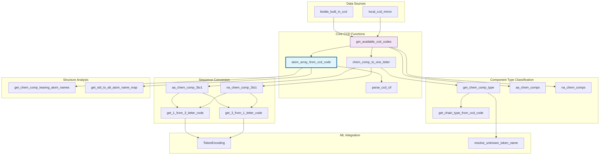
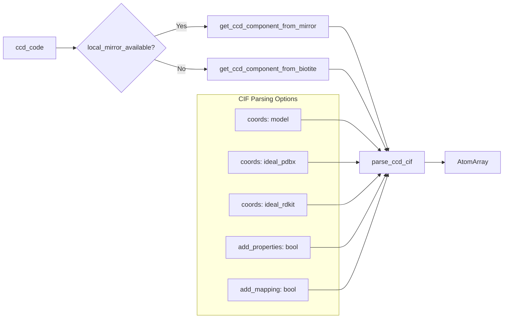
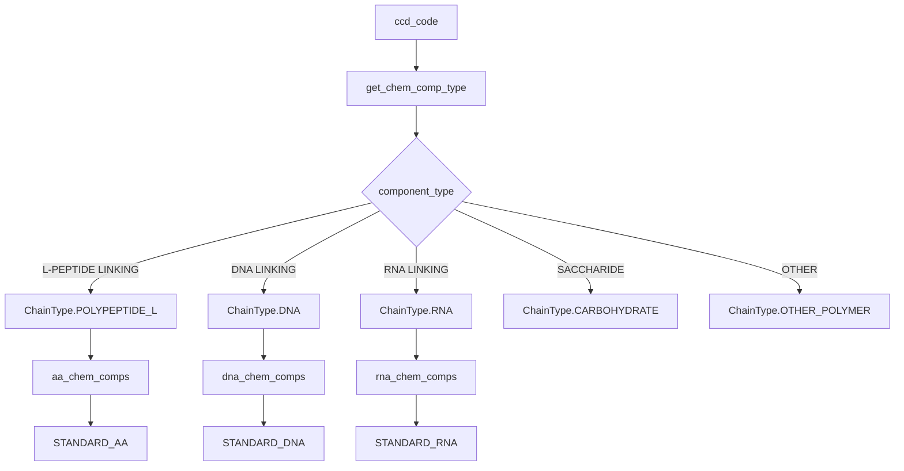
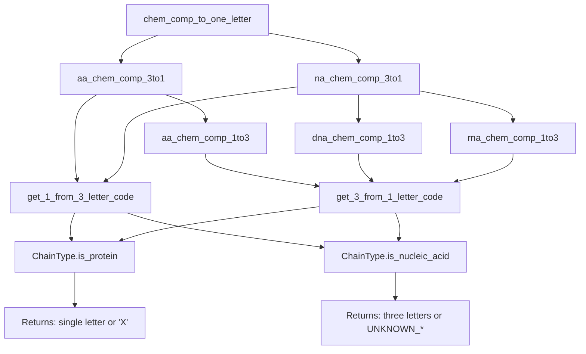
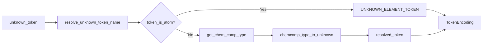

# Chemical Component Dictionary

<details>
<summary>Relevant source files</summary>

The following files were used as context for generating this wiki page:

- [.github/workflows/lint_and_test.yaml](.github/workflows/lint_and_test.yaml)
- [.gitignore](.gitignore)
- [pyproject.toml](pyproject.toml)
- [src/atomworks/io/utils/ccd.py](src/atomworks/io/utils/ccd.py)
- [src/atomworks/io/utils/sequence.py](src/atomworks/io/utils/sequence.py)
- [src/atomworks/ml/encoding_definitions.py](src/atomworks/ml/encoding_definitions.py)
- [src/atomworks/ml/transforms/msa/_msa_constants.py](src/atomworks/ml/transforms/msa/_msa_constants.py)
- [tests/io/utils/test_sequence_maps.py](tests/io/utils/test_sequence_maps.py)
- [tests/io/utils/test_sequence_utils.py](tests/io/utils/test_sequence_utils.py)

</details>


The Chemical Component Dictionary (CCD) system provides access to standardized chemical component information for biomolecular structures. It serves as the foundation for residue identification, sequence conversion, and molecular structure parsing throughout AtomWorks. For information about the broader data processing pipeline, see [Data Processing Pipeline](#2.2). For sequence processing specifically, see [Sequence Utilities](#2.4).

## System Overview

The CCD system integrates multiple data sources and provides a unified interface for accessing chemical component information. It supports both biotite's built-in CCD and local mirror installations, enabling robust handling of standard and non-standard residues.

### CCD System Architecture



Sources: [src/atomworks/io/utils/ccd.py:1-615](), [src/atomworks/io/utils/sequence.py:1-185](), [src/atomworks/ml/encoding_definitions.py:1-700]()

## Core CCD Data Access

### Available CCD Codes

The system provides functions to check which CCD codes are available from different sources:

| Function | Purpose | Return Type |
|----------|---------|-------------|
| `get_available_ccd_codes_in_biotite()` | Codes in biotite's built-in CCD | `frozenset[str]` |
| `get_available_ccd_codes_in_mirror()` | Codes in local CCD mirror | `frozenset[str]` |
| `get_available_ccd_codes()` | Combined codes from all sources | `frozenset[str]` |

The main entry point `get_available_ccd_codes()` combines both sources, prioritizing local mirror data when available.

Sources: [src/atomworks/io/utils/ccd.py:78-126]()

### Chemical Component Retrieval

The primary function for obtaining chemical component structures is `atom_array_from_ccd_code()`, which returns a biotite `AtomArray` containing the complete atomic structure and metadata for a given CCD code.



Sources: [src/atomworks/io/utils/ccd.py:398-429](), [src/atomworks/io/utils/ccd.py:203-368]()

## Chemical Component Classification

### Component Type System

The CCD system classifies chemical components using standardized types from the RCSB PDB:



Sources: [src/atomworks/io/utils/ccd.py:546-597](), [src/atomworks/io/utils/ccd.py:32-54]()

### Chemical Component Sets

Pre-computed frozensets provide fast lookup for different component categories:

| Function | Coverage | Example Members |
|----------|----------|-----------------|
| `aa_chem_comps()` | Amino acid-like components | `{'ALA', 'ARG', 'ASN', ...}` |
| `na_chem_comps()` | Nucleic acid components | `{'DA', 'DC', 'DG', 'DT', 'A', 'C', 'G', 'U', ...}` |
| `dna_chem_comps()` | DNA-specific components | `{'DA', 'DC', 'DG', 'DT', ...}` |
| `rna_chem_comps()` | RNA-specific components | `{'A', 'C', 'G', 'U', ...}` |

Sources: [src/atomworks/io/utils/ccd.py:32-54]()

## Sequence Conversion Utilities

### One-Letter to Three-Letter Mapping

The CCD system enables bidirectional conversion between one-letter and three-letter residue codes:



The conversion functions handle different chain types and provide appropriate fallbacks for unknown residues.

Sources: [src/atomworks/io/utils/sequence.py:37-154]()

## Structure Analysis Features

### Leaving Group Detection

The CCD system can identify leaving groups within chemical components based on bond connectivity and PDB annotations:

| Function | Purpose | Return Type |
|----------|---------|-------------|
| `get_chem_comp_leaving_atom_names()` | Maps atoms to their leaving groups | `dict[str, tuple[str, ...]]` |
| `_find_connected_components_after_removal()` | Analyzes bond graph connectivity | `list[list[int]]` |

Example output for alanine:
```python
{'N': ('H2',), 'C': ('OXT', 'HXT'), 'OXT': ('HXT',)}
```

Sources: [src/atomworks/io/utils/ccd.py:467-544]()

### Alternative Atom Names

The system provides mappings between standard and alternative atom naming conventions:

```python
get_std_to_alt_atom_name_map(ccd_code: str) -> dict[str, str]
```

Sources: [src/atomworks/io/utils/ccd.py:611-615]()

## Integration with ML Encodings

### Token Resolution

The CCD system integrates with the ML encoding framework to resolve unknown tokens:



This enables automatic handling of non-standard residues in ML pipelines by mapping them to appropriate unknown tokens based on their chemical component type.

Sources: [src/atomworks/ml/encoding_definitions.py:111-156]()

### Sequence Validation

The sequence utility functions work with CCD data to validate and convert molecular sequences for ML applications:

| Function | ML Usage | Chain Types |
|----------|----------|-------------|
| `is_standard_aa()` | Filter standard amino acids | Protein chains |
| `is_purine()` / `is_pyrimidine()` | Classify nucleotides | DNA/RNA chains |
| `is_unknown_nucleotide()` | Handle unknown nucleotides | DNA/RNA chains |

Sources: [src/atomworks/io/utils/sequence.py:157-185](), [tests/io/utils/test_sequence_utils.py:1-304]()

## Configuration and Data Sources

### Environment Variables

| Variable | Purpose | Default |
|----------|---------|---------|
| `CCD_MIRROR_PATH` | Path to local CCD mirror | Biotite built-in CCD |

### CCD Mirror Structure

Local CCD mirrors follow this directory structure:
```
ccd_mirror/
├── A/
│   ├── ALA/
│   │   └── ALA.cif
│   └── ARG/
│       └── ARG.cif
└── G/
    └── GLY/
        └── GLY.cif
```

The system optimizes file system scanning for this layout pattern.

Sources: [src/atomworks/io/utils/ccd.py:78-108](), [src/atomworks/constants.py]()

---