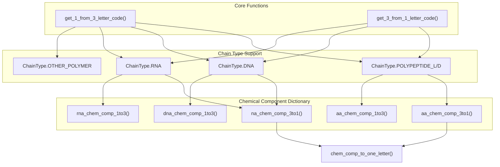
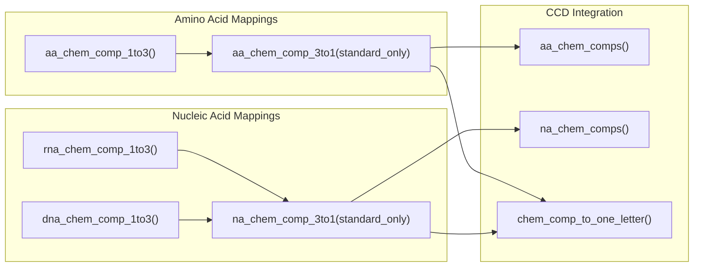
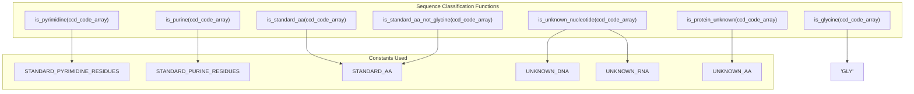
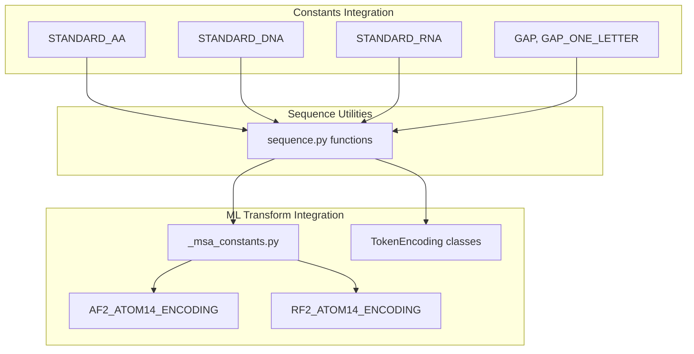

# Sequence Utilities

<details>
<summary>Relevant source files</summary>

The following files were used as context for generating this wiki page:

- [.github/workflows/lint_and_test.yaml](.github/workflows/lint_and_test.yaml)
- [.gitignore](.gitignore)
- [pyproject.toml](pyproject.toml)
- [src/atomworks/io/utils/ccd.py](src/atomworks/io/utils/ccd.py)
- [src/atomworks/io/utils/sequence.py](src/atomworks/io/utils/sequence.py)
- [src/atomworks/ml/encoding_definitions.py](src/atomworks/ml/encoding_definitions.py)
- [src/atomworks/ml/transforms/msa/_msa_constants.py](src/atomworks/ml/transforms/msa/_msa_constants.py)
- [tests/io/utils/test_sequence_maps.py](tests/io/utils/test_sequence_maps.py)
- [tests/io/utils/test_sequence_utils.py](tests/io/utils/test_sequence_utils.py)

</details>


The sequence utilities module provides functions for converting between 1-letter and 3-letter residue codes for proteins, DNA, and RNA sequences. This system integrates with the Chemical Component Dictionary (CCD) to handle both standard and non-standard residues, supporting chain type-aware conversions that are essential for ML pipeline tokenization and MSA processing.

For chemical component information and CCD integration, see [Chemical Component Dictionary](#2.3). For ML tokenization that uses these utilities, see [Token Encodings](#3.2).

## Core Conversion Functions

The primary interface consists of two bidirectional conversion functions that handle all supported biomolecular chain types.



The `get_1_from_3_letter_code()` function converts 3-letter residue names to 1-letter codes based on chain type, while `get_3_from_1_letter_code()` performs the reverse conversion. Both functions handle gap characters and unknown residues appropriately.

**Sources:** [src/atomworks/io/utils/sequence.py:80-154]()

## Chain Type Aware Mapping

The conversion system uses cached mapping dictionaries that are built from the CCD data and filtered based on chain type requirements.



| Function | Purpose | Chain Types | Caching |
|----------|---------|-------------|---------|
| `aa_chem_comp_3to1()` | Amino acid 3→1 mapping | Protein chains | `@functools.cache` |
| `na_chem_comp_3to1()` | Nucleic acid 3→1 mapping | DNA/RNA chains | `@functools.cache` |
| `aa_chem_comp_1to3()` | Amino acid 1→3 mapping | Protein chains | `@functools.cache` |
| `rna_chem_comp_1to3()` | RNA 1→3 mapping | RNA chains | `@functools.cache` |
| `dna_chem_comp_1to3()` | DNA 1→3 mapping | DNA chains | `@functools.cache` |

**Sources:** [src/atomworks/io/utils/sequence.py:37-78]()

## Sequence Analysis Functions

The module provides vectorized NumPy functions for analyzing sequence properties, commonly used in ML transforms and validation.



These functions operate on NumPy arrays and return boolean arrays, making them suitable for vectorized operations in ML pipelines.

**Sources:** [src/atomworks/io/utils/sequence.py:157-185](), [tests/io/utils/test_sequence_utils.py:14-304]()

## Gap and Unknown Handling

The system provides consistent handling of gaps and unknown residues across different chain types.

| Character Type | 1-Letter | 3-Letter | Usage |
|----------------|----------|----------|--------|
| Gap (default) | `-` | `<G>` | MSA alignments, sequence gaps |
| Unknown Protein | `X` | `UNK` | Non-standard amino acids |
| Unknown DNA | `N` | `DN` | Ambiguous DNA nucleotides |
| Unknown RNA | `N` | `N` | Ambiguous RNA nucleotides |

The conversion functions accept configurable gap characters through `gap_one_letter` and `gap_three_letter` parameters, allowing integration with different sequence formats.

**Sources:** [src/atomworks/io/utils/sequence.py:84-86](), [src/atomworks/io/utils/sequence.py:118-120]()

## Integration with ML Pipelines

The sequence utilities integrate with several ML pipeline components for tokenization and encoding.



The MSA constants module uses `get_3_from_1_letter_code()` to create lookup tables for converting MSA sequences to three-letter codes used in tokenization.

**Sources:** [src/atomworks/ml/transforms/msa/_msa_constants.py:124-154](), [src/atomworks/ml/encoding_definitions.py:254-448]()

## Usage Examples

The conversion functions handle standard and non-standard residues across all supported chain types:

```python
# Protein conversions
get_1_from_3_letter_code("ALA", ChainType.POLYPEPTIDE_L)  # Returns "A"
get_3_from_1_letter_code("A", ChainType.POLYPEPTIDE_L)    # Returns "ALA"

# DNA conversions  
get_1_from_3_letter_code("DA", ChainType.DNA)  # Returns "A"
get_3_from_1_letter_code("A", ChainType.DNA)   # Returns "DA"

# RNA conversions
get_1_from_3_letter_code("A", ChainType.RNA)   # Returns "A"  
get_3_from_1_letter_code("A", ChainType.RNA)   # Returns "A"

# Gap handling
get_1_from_3_letter_code("<G>", ChainType.POLYPEPTIDE_L)  # Returns "-"
get_3_from_1_letter_code("-", ChainType.POLYPEPTIDE_L)    # Returns "<G>"
```

The test suite validates conversions for all standard residue types and ensures proper handling of unknown residues and gaps.

**Sources:** [tests/io/utils/test_sequence_maps.py:101-171](), [tests/io/utils/test_sequence_maps.py:28-98]()

---