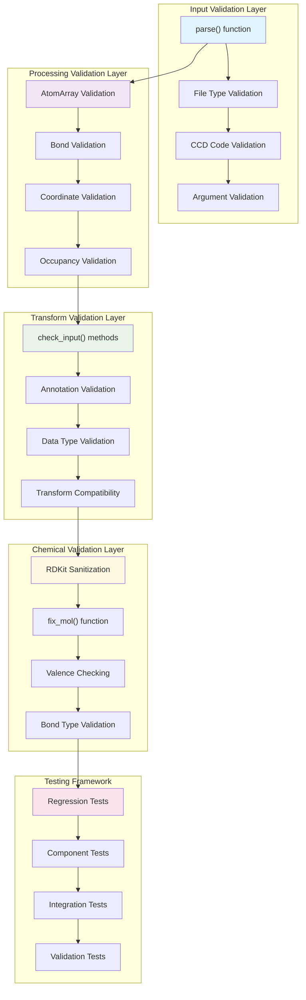
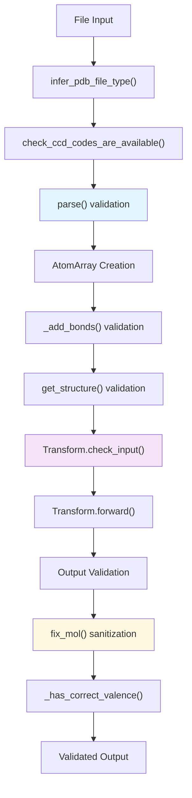
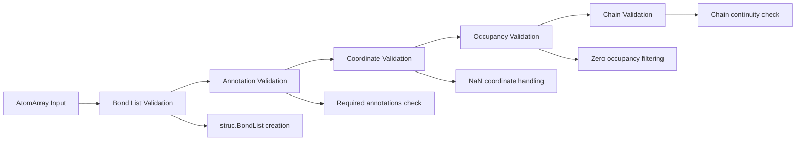
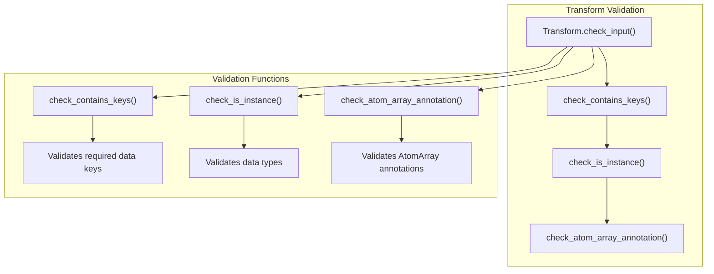
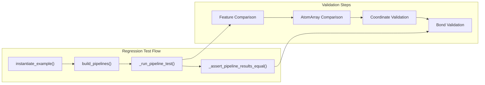
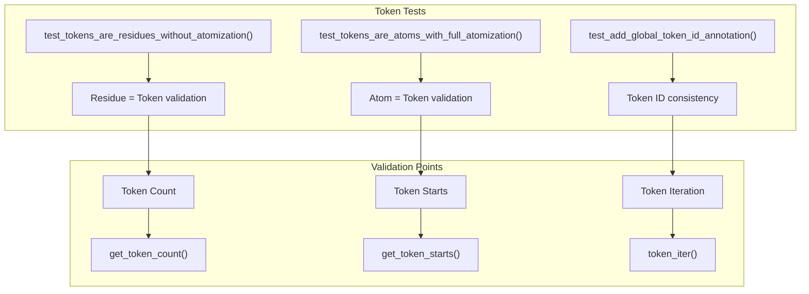
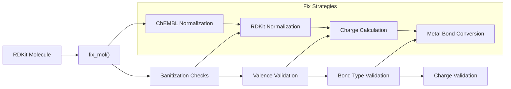

# Testing and Validation

Relevant source files

The following files were used as context for generating this wiki page:

- [src/atomworks/io/parser.py](src/atomworks/io/parser.py)
- [src/atomworks/io/tools/rdkit.py](src/atomworks/io/tools/rdkit.py)
- [src/atomworks/io/utils/io_utils.py](src/atomworks/io/utils/io_utils.py)
- [src/atomworks/ml/transforms/af3_reference_molecule.py](src/atomworks/ml/transforms/af3_reference_molecule.py)
- [src/atomworks/ml/transforms/featurize_unresolved_residues.py](src/atomworks/ml/transforms/featurize_unresolved_residues.py)
- [src/atomworks/ml/transforms/filters.py](src/atomworks/ml/transforms/filters.py)
- [tests/io/components/test_remove_hydrogens.py](tests/io/components/test_remove_hydrogens.py)
- [tests/ml/pipelines/test_pipeline_regression.py](tests/ml/pipelines/test_pipeline_regression.py)
- [tests/ml/transforms/test_token_utils.py](tests/ml/transforms/test_token_utils.py)

This document covers the testing and validation framework within the atomworks.io data processing system. It describes the validation strategies, error handling mechanisms, and testing approaches used to ensure data quality and system reliability throughout the parsing and transformation pipeline.

For information about the core parsing functionality, see [Core Parser System](#2.1). For details about data processing workflows, see [Data Processing Pipeline](#2.2).

## Validation Architecture

The atomworks.io system implements a multi-layered validation approach that operates at different stages of the data processing pipeline:

### Validation System Overview

**Sources:** [src/atomworks/io/parser.py:73-319](), [src/atomworks/ml/transforms/base.py](), [src/atomworks/io/tools/rdkit.py:266-347]()

### Validation Flow Architecture

**Sources:** [src/atomworks/io/parser.py:180-181](), [src/atomworks/io/utils/io_utils.py:84-177](), [src/atomworks/ml/transforms/base.py]()

## Input Validation

The system performs comprehensive input validation at the entry point of the parsing pipeline:

### File and Argument Validation

The `parse()` function implements several validation checks before processing begins:

| Validation Type | Function/Method | Purpose |
|----------------|----------------|---------|
| File Type Detection | `infer_pdb_file_type()` | Validates and infers file format |
| CCD Code Validation | `check_ccd_codes_are_available()` | Ensures CCD codes exist in dictionary |
| Cache Directory | Cache path validation | Verifies cache directory existence for load/save operations |
| Argument Consistency | Multiple checks | Validates argument combinations and dependencies |

**Key validation logic in `parse()`:**
- CCD mirror path existence checking [src/atomworks/io/parser.py:170-174]()
- Cache directory validation [src/atomworks/io/parser.py:183-187]()
- Formal charge validation dependencies [src/atomworks/io/parser.py:189-194]()

**Sources:** [src/atomworks/io/parser.py:169-194](), [src/atomworks/io/utils/io_utils.py:283-317]()

## Data Processing Validation

### AtomArray Structure Validation

The system validates AtomArray structures throughout the processing pipeline:

**Sources:** [src/atomworks/io/parser.py:360-362](), [src/atomworks/io/utils/io_utils.py:105-115]()

### Bond Validation System

The `_add_bonds()` function implements sophisticated bond validation:

- **Spurious Bond Detection**: Identifies incorrect inter-residue bonds due to uninformative sequence IDs [src/atomworks/io/utils/io_utils.py:134-141]()
- **Auth Seq ID Validation**: Ensures proper sequence ID annotations exist [src/atomworks/io/utils/io_utils.py:109-115]()
- **Bond Type Validation**: Validates bond types against allowed categories [src/atomworks/io/utils/io_utils.py:87-100]()

**Sources:** [src/atomworks/io/utils/io_utils.py:84-177]()

## Transform Validation

### Transform Input Validation Framework

All transforms implement a standardized validation framework through the `check_input()` method:

**Sources:** [src/atomworks/ml/transforms/_checks.py](), [src/atomworks/ml/transforms/featurize_unresolved_residues.py:134-137]()

### Annotation Validation Examples

Several transforms demonstrate comprehensive annotation validation:

- **MaskResiduesWithSpecificUnresolvedAtoms**: Validates `occupancy` and `chain_type` annotations [src/atomworks/ml/transforms/featurize_unresolved_residues.py:137]()
- **RemoveUnsupportedChainTypes**: Validates `chain_type` and `pn_unit_iid` annotations [src/atomworks/ml/transforms/filters.py:150]()
- **HandleUndesiredResTokens**: Validates multiple required annotations [src/atomworks/ml/transforms/filters.py:440]()

**Sources:** [src/atomworks/ml/transforms/featurize_unresolved_residues.py:134-137](), [src/atomworks/ml/transforms/filters.py:149-151]()

## Regression Testing

### Pipeline Regression Framework

The system implements comprehensive regression testing for ML pipelines:

**Test Structure:**
- **Example Data**: Uses cached PDB structures like "1wym" [tests/ml/pipelines/test_pipeline_regression.py:24]()
- **Pipeline Modes**: Tests both inference and training modes [tests/ml/pipelines/test_pipeline_regression.py:29-30]()
- **Feature Validation**: Compares all pipeline output features [tests/ml/pipelines/test_pipeline_regression.py:132-136]()
- **Reproducibility**: Uses fixed random seeds for deterministic testing [tests/ml/pipelines/test_pipeline_regression.py:97-98]()

**Sources:** [tests/ml/pipelines/test_pipeline_regression.py:73-235]()

### Assertion Framework

The regression tests use sophisticated assertion methods:

| Method | Purpose | Tolerance |
|--------|---------|-----------|
| `_assert_tensor_or_array_equal()` | Compares tensors/arrays with appropriate tolerance | 1e-4 for floats |
| `assert_same_atom_array()` | Compares AtomArray structures | Configurable annotations |
| `_assert_features_equal()` | Compares feature dictionaries | Type-specific tolerances |

**Sources:** [tests/ml/pipelines/test_pipeline_regression.py:164-183](), [src/atomworks/io/utils/testing.py]()

## Component Testing

### Token Utility Testing

Comprehensive testing of token-based operations:

**Sources:** [tests/ml/transforms/test_token_utils.py:27-138]()

### Hydrogen Handling Tests

Validates hydrogen removal and retention:

- **Removal Validation**: Ensures no hydrogen atoms remain after removal [tests/io/components/test_remove_hydrogens.py:24]()
- **Retention Validation**: Confirms hydrogens are preserved when requested [tests/io/components/test_remove_hydrogens.py:35]()
- **Consistency Testing**: Compares filtered results with direct removal [tests/io/components/test_remove_hydrogens.py:41-45]()

**Sources:** [tests/io/components/test_remove_hydrogens.py:11-46]()

## Chemical Structure Validation

### RDKit Sanitization Framework

The system implements comprehensive chemical validation through RDKit:

**Validation Methods:**
- **Valence Checking**: `_has_correct_valence()` validates atomic valences [src/atomworks/io/tools/rdkit.py:199-204]()
- **Sanitization**: `fix_mol()` attempts multiple fixing strategies [src/atomworks/io/tools/rdkit.py:266-347]()
- **Bond Validation**: Converts and validates bond types between RDKit and Biotite [src/atomworks/io/tools/rdkit.py:60-97]()

**Sources:** [src/atomworks/io/tools/rdkit.py:199-347]()

### Chemical Component Dictionary Validation

The system validates CCD codes and chemical components:

- **Availability Checking**: `check_ccd_codes_are_available()` validates CCD code existence
- **Known CCD Tracking**: Maintains set of available CCD codes [src/atomworks/ml/transforms/af3_reference_molecule.py:28]()
- **Fallback Handling**: Provides graceful degradation for unknown CCD codes [src/atomworks/ml/transforms/af3_reference_molecule.py:89-91]()

**Sources:** [src/atomworks/ml/transforms/af3_reference_molecule.py:28-91]()

---