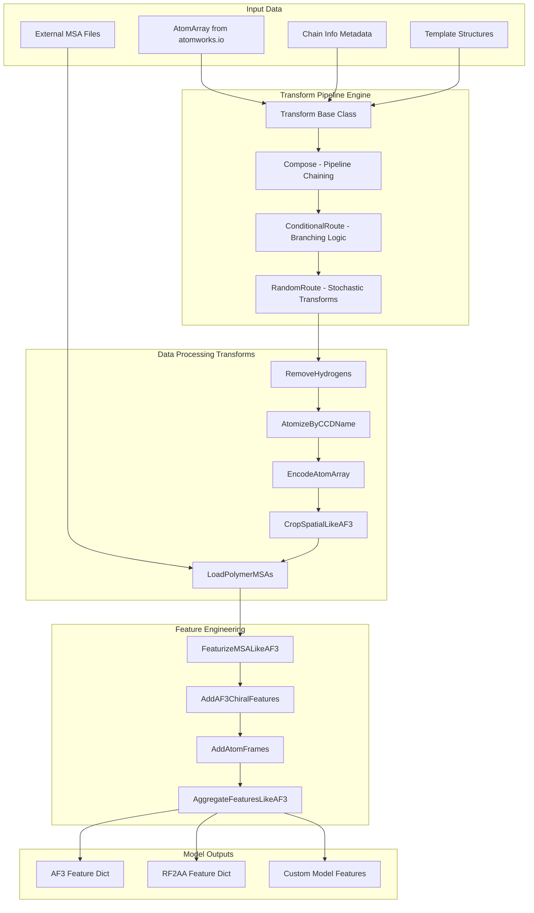
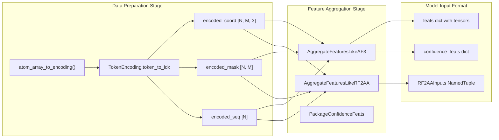
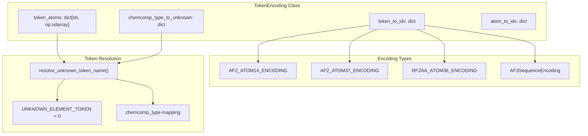
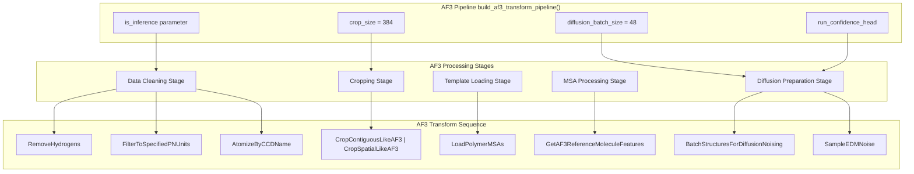
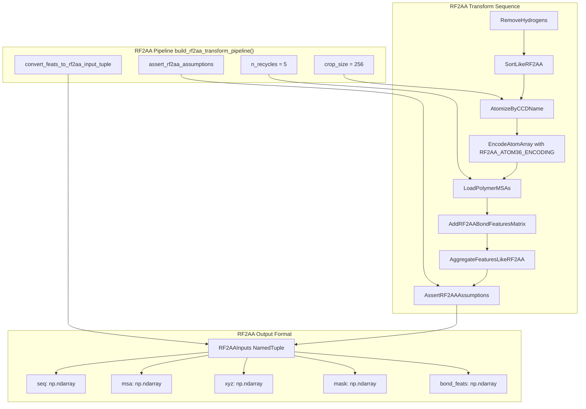
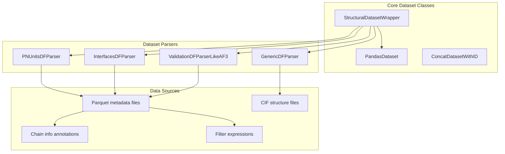
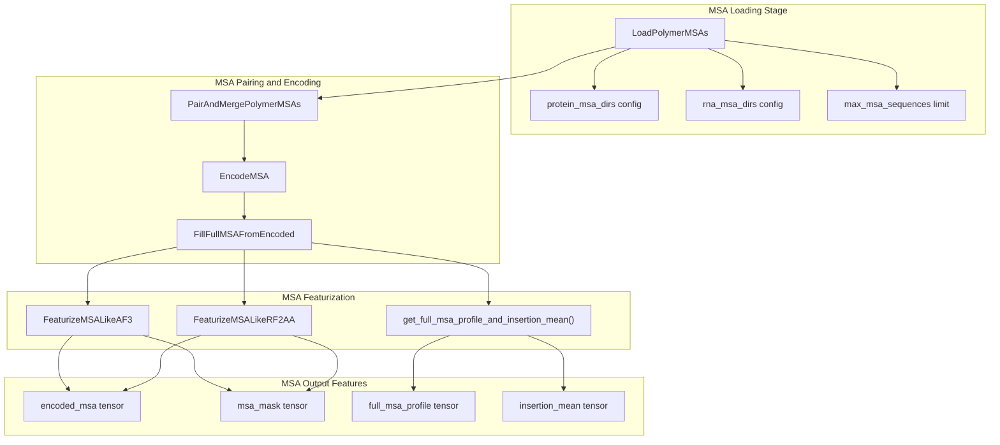
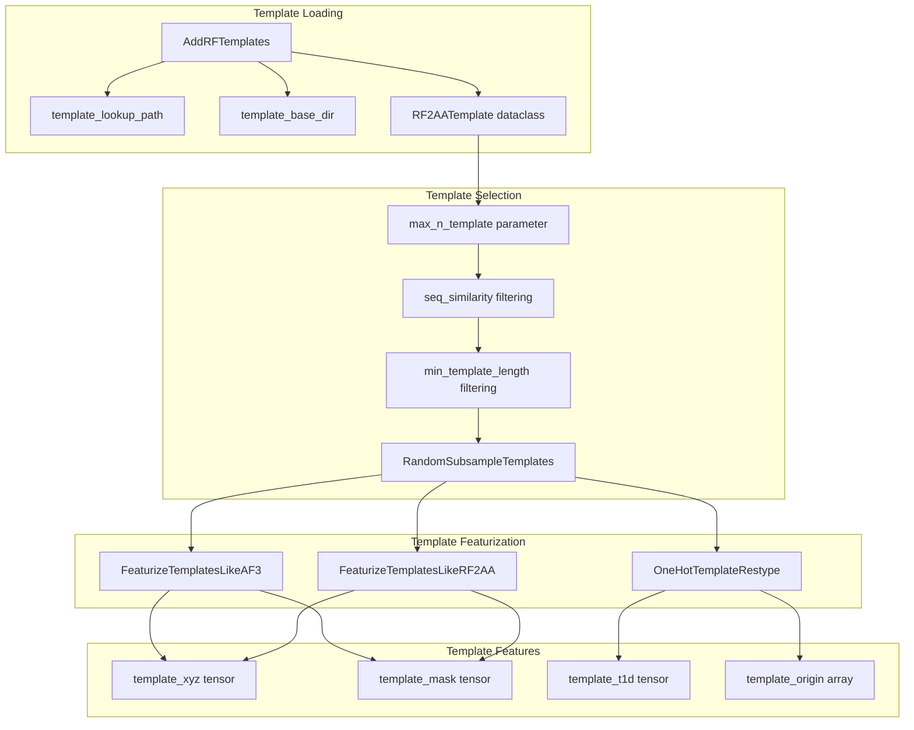

# atomworks.ml - Machine Learning

<details>
<summary>Relevant source files</summary>

The following files were used as context for generating this wiki page:

- [.github/workflows/lint_and_test.yaml](.github/workflows/lint_and_test.yaml)
- [.gitignore](.gitignore)
- [pyproject.toml](pyproject.toml)
- [src/atomworks/io/utils/ccd.py](src/atomworks/io/utils/ccd.py)
- [src/atomworks/io/utils/sequence.py](src/atomworks/io/utils/sequence.py)
- [src/atomworks/ml/encoding_definitions.py](src/atomworks/ml/encoding_definitions.py)
- [src/atomworks/ml/pipelines/af3.py](src/atomworks/ml/pipelines/af3.py)
- [src/atomworks/ml/pipelines/rf2aa.py](src/atomworks/ml/pipelines/rf2aa.py)
- [src/atomworks/ml/transforms/encoding.py](src/atomworks/ml/transforms/encoding.py)
- [src/atomworks/ml/transforms/msa/_msa_constants.py](src/atomworks/ml/transforms/msa/_msa_constants.py)
- [src/atomworks/ml/transforms/template.py](src/atomworks/ml/transforms/template.py)
- [tests/io/components/test_regression.py](tests/io/components/test_regression.py)
- [tests/io/tools/test_rdkit.py](tests/io/tools/test_rdkit.py)
- [tests/io/utils/test_sequence_maps.py](tests/io/utils/test_sequence_maps.py)
- [tests/io/utils/test_sequence_utils.py](tests/io/utils/test_sequence_utils.py)
- [tests/ml/conftest.py](tests/ml/conftest.py)
- [tests/ml/transforms/msa/test_featurize_msa.py](tests/ml/transforms/msa/test_featurize_msa.py)
- [tests/ml/utils/test_io.py](tests/ml/utils/test_io.py)

</details>


The `atomworks.ml` module provides machine learning capabilities for processing biomolecular structures and training foundation models. This system transforms biological data from `atomworks.io` into ML-compatible formats through modular transform pipelines, handles token encodings for different model architectures, and provides pre-built pipelines for specific foundation models like AlphaFold 3 and RoseTTAFold 2 All-Atom.

For information about data parsing and biological file format handling, see [atomworks.io - Data Processing](#2). For details about external tool integration and extending the system, see [External Tool Integration](#6.1) and [Extending AtomWorks](#6.2).

## System Architecture

The `atomworks.ml` system is built around a modular transform pipeline architecture that processes `AtomArray` objects from `atomworks.io` into tensor-based representations suitable for machine learning models.

### Core ML Pipeline Architecture



**Sources:** [src/atomworks/ml/transforms/base.py:1-50](), [src/atomworks/ml/pipelines/af3.py:84-133](), [src/atomworks/ml/pipelines/rf2aa.py:154-205]()

### Transform System Data Flow



**Sources:** [src/atomworks/ml/transforms/encoding.py:34-187](), [src/atomworks/ml/transforms/feature_aggregation/af3.py](), [src/atomworks/ml/pipelines/rf2aa.py:71-147]()

## Transform Pipeline System

The transform pipeline system provides a modular framework for data processing through the `Transform` base class and composition utilities. Each transform is a self-contained operation that can be chained together to create complex processing pipelines.

### Core Transform Classes

| Transform Class | Purpose | Key Methods |
|---|---|---|
| `Transform` | Abstract base class for all transforms | `forward()`, `check_input()` |
| `Compose` | Chains multiple transforms sequentially | `__call__()` |
| `ConditionalRoute` | Routes data based on conditions | `condition_func` parameter |
| `RandomRoute` | Stochastic routing between transforms | `probs` parameter |
| `Identity` | Pass-through transform | No-op operation |

### Key Data Processing Transforms

The system includes specialized transforms for different aspects of biomolecular data processing:

**Structural Transforms:**
- `RemoveHydrogens` - Removes hydrogen atoms from structures
- `AtomizeByCCDName` - Converts residues to individual atoms based on CCD codes
- `CropSpatialLikeAF3` - Spatial cropping around regions of interest
- `CropContiguousLikeAF3` - Contiguous sequence cropping

**Encoding Transforms:**
- `EncodeAtomArray` - Converts `AtomArray` to encoded tensors
- `EncodeAF3TokenLevelFeatures` - AF3-specific token encoding
- `EncodeMSA` - Multiple sequence alignment encoding

**Feature Engineering Transforms:**
- `AddAtomFrames` - Computes local coordinate frames
- `AddAF3ChiralFeatures` - Chirality information for AF3
- `AddRF2AABondFeaturesMatrix` - Bond connectivity features

**Sources:** [src/atomworks/ml/transforms/base.py:20-200](), [src/atomworks/ml/transforms/encoding.py:300-400](), [src/atomworks/ml/transforms/atom_array.py:1-50]()

## Token Encoding System

The token encoding system converts molecular structures into fixed-length representations suitable for transformer-based models. The system supports both residue-level and atom-level tokenization.

### TokenEncoding Architecture



### Standard Encodings

The system provides several pre-defined encodings for popular model architectures:

| Encoding | Atoms per Token | Use Case | Special Features |
|---|---|---|---|
| `AF2_ATOM14_ENCODING` | 14 | AlphaFold2 protein models | Standard amino acids only |
| `AF2_ATOM37_ENCODING` | 37 | AlphaFold2 with extended atoms | Includes OXT terminal atom |
| `RF2AA_ATOM36_ENCODING` | 36 | RoseTTAFold All-Atom | Multi-modal (protein/DNA/RNA/atoms) |
| `AF3SequenceEncoding` | Variable | AlphaFold3 sequence encoding | Hierarchical token structure |

### Token Type Handling

The encoding system distinguishes between different token types:

**Residue-level tokens:** Standard 3-letter CCD codes (e.g., "ALA", "GLY", "DA", "C")
**Atom-level tokens:** Atomic numbers as integers (e.g., 6 for Carbon, 7 for Nitrogen)
**Special tokens:** Masked tokens using angle bracket syntax (e.g., "<M>", "<G>")

**Sources:** [src/atomworks/ml/encoding_definitions.py:36-251](), [src/atomworks/ml/encoding_definitions.py:254-332](), [src/atomworks/ml/encoding_definitions.py:422-520]()

## Model-Specific Pipelines

The system provides pre-built pipelines optimized for specific foundation models, handling their unique data requirements and processing steps.

### AF3 Pipeline Architecture



### RF2AA Pipeline Architecture



### Pipeline Configuration

Both pipelines support extensive configuration through parameters:

**Common Parameters:**
- `protein_msa_dirs` / `rna_msa_dirs` - MSA directory configurations
- `crop_size` - Maximum tokens in cropped structures  
- `n_recycles` - Number of model recycles during training
- `template_lookup_path` / `template_base_dir` - Template structure paths

**AF3-Specific Parameters:**
- `diffusion_batch_size` - Batch size for diffusion noising
- `sigma_data` - Diffusion noise scaling parameter
- `conformer_generation_timeout` - Timeout for ligand conformer generation

**RF2AA-Specific Parameters:**
- `max_automorphs` / `max_isomorphs` - Symmetry resolution limits
- `black_hole_init` - Initialization strategy
- `unclamp_loss_probability` - Training loss unclamping

**Sources:** [src/atomworks/ml/pipelines/af3.py:84-403](), [src/atomworks/ml/pipelines/rf2aa.py:154-350]()

## Dataset Management

The dataset management system provides flexible data loading and preprocessing capabilities through wrapper classes and parsers.

### Dataset Wrapper Architecture



### Key Dataset Components

**PandasDataset:** Base dataset class that loads tabular metadata and applies filters
- `data`: DataFrame with example metadata
- `id_column`: Column name for unique example identifiers  
- `filters`: List of pandas query expressions for data filtering
- `columns_to_load`: Subset of columns to load (memory optimization)

**StructuralDatasetWrapper:** Combines tabular metadata with structural data loading
- `dataset`: Underlying `PandasDataset` instance
- `dataset_parser`: Parser for converting metadata to file paths
- `transform`: Transform pipeline to apply to loaded structures
- `cif_parser_args`: Arguments passed to CIF file parsing

**Dataset Parsers:** Convert metadata rows to structure file paths and parsing arguments
- `PNUnitsDFParser`: Extracts individual polymer-non-polymer units
- `InterfacesDFParser`: Handles protein-protein/protein-nucleic interfaces
- `ValidationDFParserLikeAF3`: Formats validation datasets for AF3-style evaluation

### Usage Example

The system supports complex dataset composition and filtering:

```python
# Create base dataset with filtering
pn_units_dataset = PandasDataset(
    data=metadata_df,
    id_column="example_id", 
    filters=[
        "deposition_date < '2022-01-01'",
        "resolution < 5.0",
        "num_polymer_pn_units <= 20"
    ]
)

# Wrap with structural processing
structural_dataset = StructuralDatasetWrapper(
    dataset=pn_units_dataset,
    dataset_parser=PNUnitsDFParser(),
    transform=build_af3_transform_pipeline(...),
    cif_parser_args={"cache_dir": None}
)
```

**Sources:** [src/atomworks/ml/datasets/datasets.py](), [src/atomworks/ml/datasets/parsers/](), [tests/ml/conftest.py:167-244]()

## MSA and Template Processing

The system provides comprehensive support for Multiple Sequence Alignments (MSAs) and template structure processing, essential for modern protein structure prediction models.

### MSA Processing Pipeline



### Template Structure Processing



### MSA Configuration

MSA directories are configured as lists of dictionaries specifying search paths:

```python
protein_msa_dirs = [
    {
        "dir": "/path/to/protein/msas",
        "extension": ".a3m.gz", 
        "directory_depth": 2
    }
]

rna_msa_dirs = [
    {
        "dir": "/path/to/rna/msas",
        "extension": ".afa",
        "directory_depth": 0  
    }
]
```

### Template Structure Format

The `RF2AATemplate` dataclass encapsulates template information:
- `xyz`: Template coordinates `[1, n_templates × n_atoms, 14, 3]`
- `mask`: Atom presence mask `[1, n_templates × n_atoms, 14]` 
- `qmap`: Query-template alignment mapping `[1, n_templates × n_atoms, 2]`
- `f0d`: Template metadata including sequence similarity `[1, n_templates, 8]`
- `seq`: Template sequence tokens `[1, n_templates × n_atoms]`
- `ids`: Template PDB and chain identifiers

**Sources:** [src/atomworks/ml/transforms/msa/msa.py:1-100](), [src/atomworks/ml/transforms/template.py:42-213](), [tests/ml/transforms/msa/test_featurize_msa.py:46-120]()

---