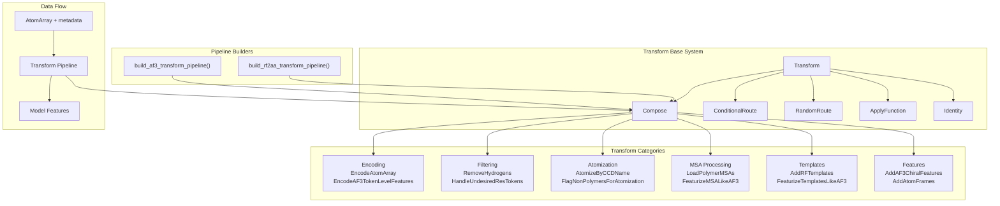
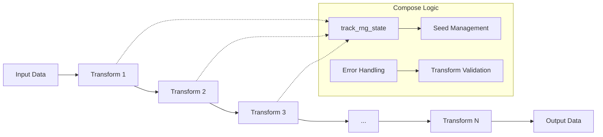
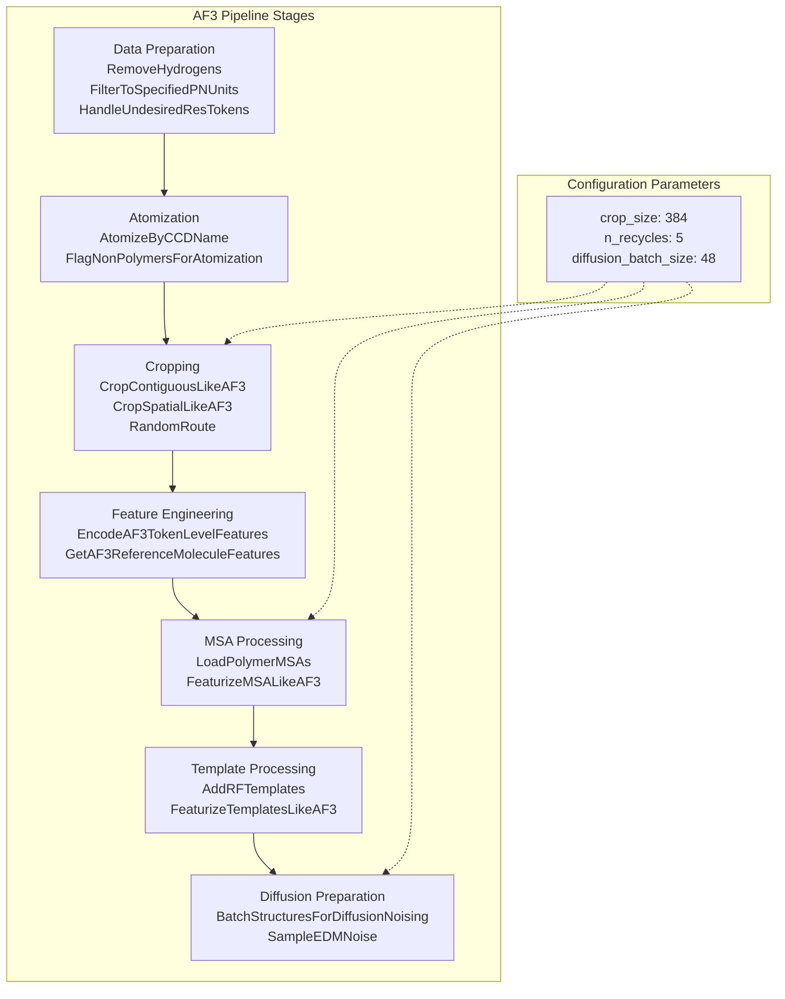

# Transform Pipeline

<details>
<summary>Relevant source files</summary>

The following files were used as context for generating this wiki page:

- [src/atomworks/ml/pipelines/af3.py](src/atomworks/ml/pipelines/af3.py)
- [src/atomworks/ml/pipelines/rf2aa.py](src/atomworks/ml/pipelines/rf2aa.py)
- [src/atomworks/ml/transforms/encoding.py](src/atomworks/ml/transforms/encoding.py)
- [src/atomworks/ml/transforms/template.py](src/atomworks/ml/transforms/template.py)
- [tests/io/components/test_regression.py](tests/io/components/test_regression.py)
- [tests/io/tools/test_rdkit.py](tests/io/tools/test_rdkit.py)
- [tests/ml/conftest.py](tests/ml/conftest.py)
- [tests/ml/transforms/msa/test_featurize_msa.py](tests/ml/transforms/msa/test_featurize_msa.py)
- [tests/ml/utils/test_io.py](tests/ml/utils/test_io.py)

</details>


The Transform Pipeline is the core data processing system in atomworks.ml that converts molecular structures into machine learning-ready features through modular, composable transformations. This system provides a unified framework for preprocessing AtomArray objects into model-specific input formats for deep learning models like AlphaFold 3 and RoseTTAFold 2 All-Atom.

For information about the underlying data representation, see [Core Parser System](#2.1). For details about specific model pipelines, see [Model-Specific Pipelines](#3.3).

## System Architecture

The transform pipeline follows a functional composition pattern where individual transforms are chained together to create complete preprocessing workflows. Each transform operates on a data dictionary containing an `AtomArray` and associated metadata, progressively adding features and annotations.

### Core Transform Architecture



Sources: [src/atomworks/ml/transforms/base.py:26-35](), [src/atomworks/ml/pipelines/af3.py:84-403](), [src/atomworks/ml/pipelines/rf2aa.py:154-475]()

## Core Transform System

### Transform Base Class

The `Transform` abstract base class defines the interface for all data transformations. Each transform implements a `forward()` method that takes and returns a data dictionary:

```python
def forward(self, data: dict[str, Any]) -> dict[str, Any]
```

Key base transforms include:
- `Transform` - Abstract base class requiring `forward()` implementation
- `Compose` - Chains multiple transforms sequentially  
- `ConditionalRoute` - Branches execution based on data conditions
- `RandomRoute` - Randomly selects between transform options
- `Identity` - Pass-through transform for conditional logic

Sources: [src/atomworks/ml/transforms/base.py:26-35]()

### Transform Composition

The `Compose` transform chains multiple transforms together, with optional RNG state tracking for reproducible random operations:

### Transform Composition Flow



Sources: [src/atomworks/ml/transforms/base.py:26-35]()

## Model-Specific Pipeline Builders

### AF3 Transform Pipeline

The `build_af3_transform_pipeline()` function creates a comprehensive preprocessing pipeline for AlphaFold 3 models. The pipeline includes data cleaning, tokenization, MSA processing, template handling, and diffusion preparation:



Key parameters include:
- `crop_size` - Maximum number of tokens after spatial/contiguous cropping
- `n_recycles` - Number of model recycles for MSA processing  
- `diffusion_batch_size` - Batch size for diffusion noise sampling
- `template_lookup_path` - Path to template database
- `protein_msa_dirs`/`rna_msa_dirs` - MSA search directories

Sources: [src/atomworks/ml/pipelines/af3.py:84-403]()

### RF2AA Transform Pipeline  

The `build_rf2aa_transform_pipeline()` function creates preprocessing for RoseTTAFold 2 All-Atom models, with additional symmetry handling and different feature aggregation:

```mermaid
graph TB
    subgraph "RF2AA Pipeline Stages"
        A["Structure Preparation<br/>RemoveHydrogens<br/>RemoveUnsupportedChainTypes<br/>AddProteinTerminiAnnotation"]
        
        B["Atomization & Sorting<br/>AtomizeByCCDName<br/>SortLikeRF2AA<br/>AddOpenBabelMoleculesForAtomizedMolecules"]
        
        C["Encoding<br/>EncodeAtomArray<br/>RF2AA_ATOM36_ENCODING"]
        
        D["MSA & Templates<br/>LoadPolymerMSAs<br/>FeaturizeMSALikeRF2AA<br/>FeaturizeTemplatesLikeRF2AA"]
        
        E["Bond Features<br/>AddRF2AABondFeaturesMatrix<br/>AddRF2AATraversalDistanceMatrix"]
        
        F["Symmetry<br/>CreateSymmetryCopyAxisLikeRF2AA<br/>max_automorphs/max_isomorphs"]
        
        G["Final Aggregation<br/>AggregateFeaturesLikeRF2AA<br/>RF2AAInputs conversion"]
    end
    
    A --> B
    B --> C  
    C --> D
    D --> E
    E --> F
    F --> G
```



RF2AA-specific features:
- `SortLikeRF2AA` - Orders polymer tokens before non-polymer tokens
- `CreateSymmetryCopyAxisLikeRF2AA` - Handles molecular symmetries  
- `AggregateFeaturesLikeRF2AA` - Packages features into `RF2AAInputs` format
- OpenBabel integration for chiral center detection

Sources: [src/atomworks/ml/pipelines/rf2aa.py:154-475]()

## Transform Categories

### Encoding Transforms

Encoding transforms convert AtomArray objects into numerical representations suitable for machine learning models:

- `EncodeAtomArray` - Converts coordinates and sequences to token-based encodings
- `EncodeAF3TokenLevelFeatures` - Generates AF3-specific token features  
- `AddTokenAnnotation` - Adds token-level annotations for debugging

The encoding process maps residues and atoms to fixed-size tensors based on `TokenEncoding` definitions.

Sources: [src/atomworks/ml/transforms/encoding.py:299-400]()

### Filtering Transforms

Filtering transforms clean and validate molecular structures:

- `RemoveHydrogens` - Removes hydrogen atoms for efficiency
- `HandleUndesiredResTokens` - Filters unwanted residue types
- `RemoveUnresolvedPNUnits` - Removes unresolved polymer units
- `FilterToSpecifiedPNUnits` - Keeps only specified structural units

Sources: [src/atomworks/ml/transforms/filters.py]()

### MSA Processing Transforms

MSA (Multiple Sequence Alignment) transforms handle evolutionary information:

- `LoadPolymerMSAs` - Loads MSA files from disk based on sequence hashes
- `PairAndMergePolymerMSAs` - Merges MSAs across multiple chains
- `FeaturizeMSALikeAF3`/`FeaturizeMSALikeRF2AA` - Creates model-specific MSA features
- `EncodeMSA` - Converts MSA sequences to token indices

Sources: [src/atomworks/ml/transforms/msa/msa.py]()

### Template Processing

Template transforms incorporate structural templates:

- `AddRFTemplates` - Loads structural templates from database
- `FeaturizeTemplatesLikeAF3` - Creates AF3-compatible template features
- `RandomSubsampleTemplates` - Randomly selects subset of templates

Sources: [src/atomworks/ml/transforms/template.py:305-460]()

## Configuration and Usage

### Conditional Execution

The pipeline supports conditional execution based on runtime parameters:

```python
ConditionalRoute(
    condition_func=lambda data: data.get("is_inference", False),
    transform_map={
        True: Identity(),          # Skip cropping during inference
        False: cropping_transform  # Apply cropping during training
    }
)
```

### Random Transforms

Random selection between transform options with specified probabilities:

```python
RandomRoute(
    transforms=[
        CropContiguousLikeAF3(crop_size=384),
        CropSpatialLikeAF3(crop_size=384)
    ],
    probs=[0.5, 0.5]  # Equal probability
)
```

### Pipeline Integration

Transform pipelines integrate with dataset wrappers for end-to-end processing:


Sources: [tests/ml/conftest.py:300-365](), [src/atomworks/ml/pipelines/af3.py:84-403](), [src/atomworks/ml/transforms/base.py:26-35]()

---