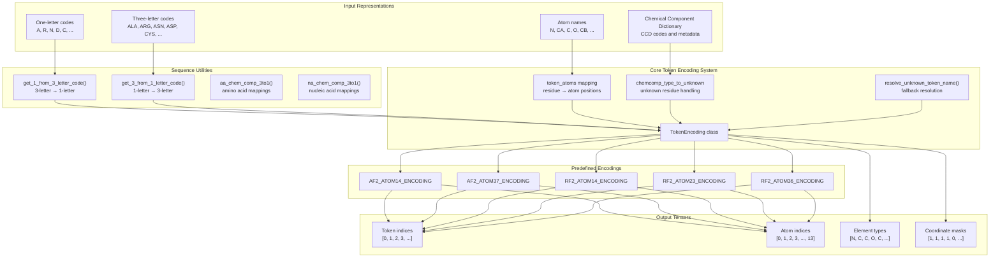
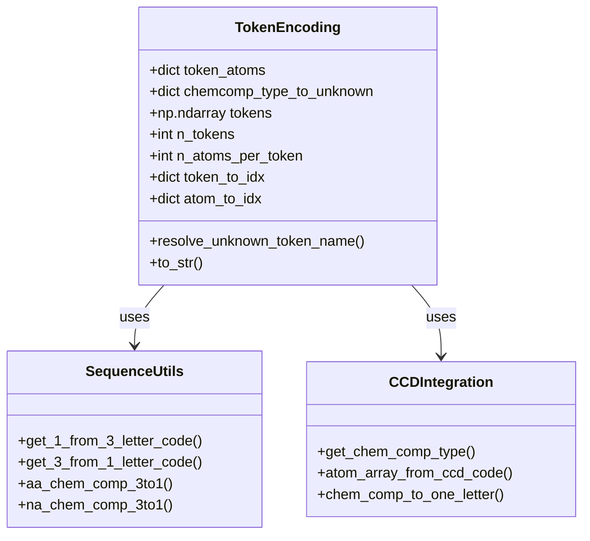
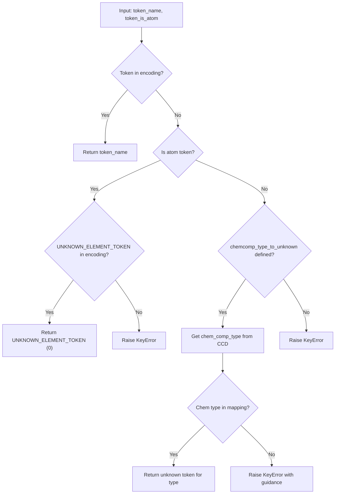
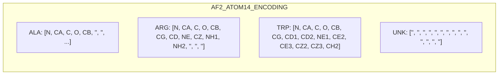
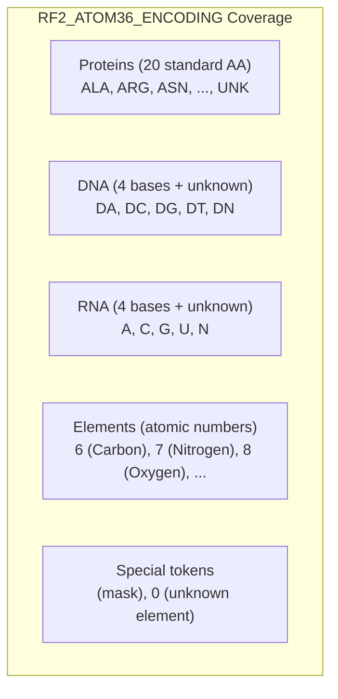
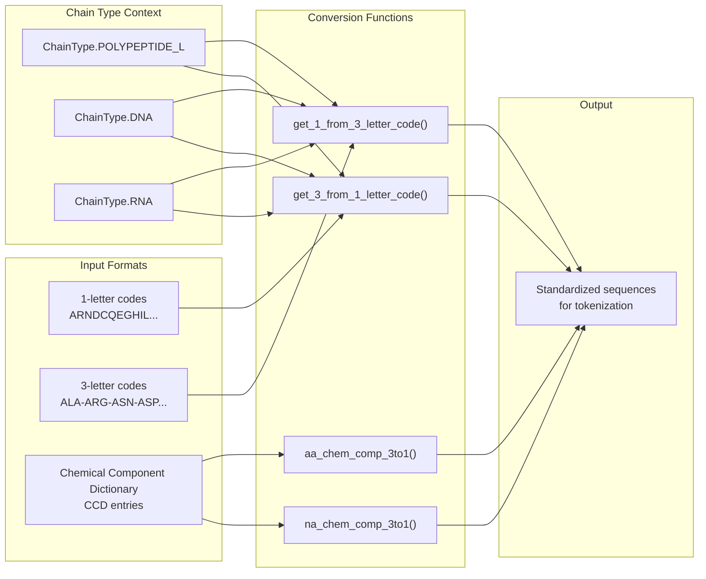
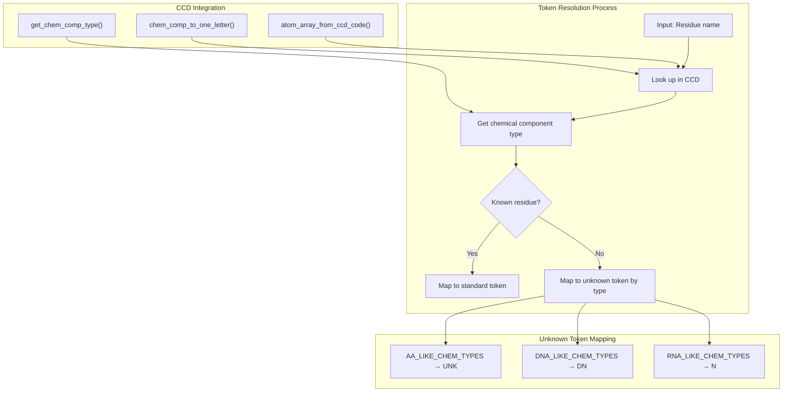
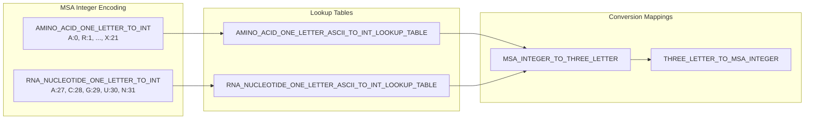
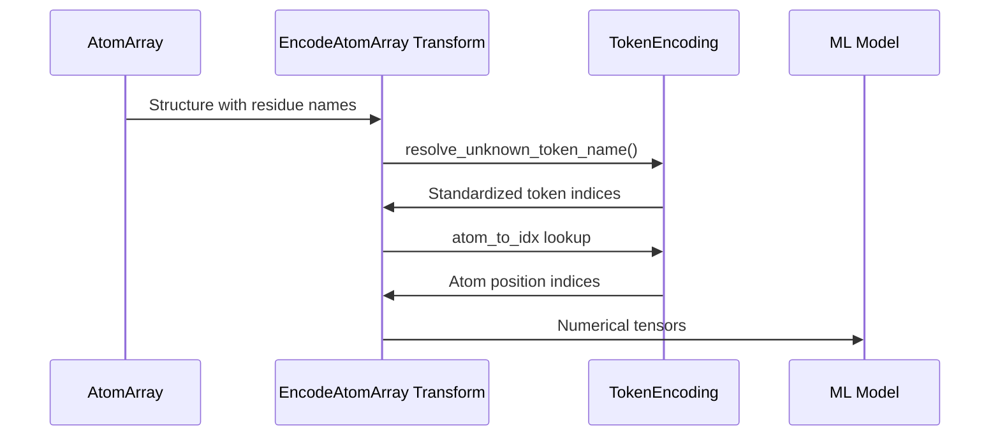

# Token Encodings

Relevant source files

The following files were used as context for generating this wiki page:

- [.github/workflows/lint_and_test.yaml](.github/workflows/lint_and_test.yaml)
- [.gitignore](.gitignore)
- [pyproject.toml](pyproject.toml)
- [src/atomworks/io/utils/ccd.py](src/atomworks/io/utils/ccd.py)
- [src/atomworks/io/utils/sequence.py](src/atomworks/io/utils/sequence.py)
- [src/atomworks/ml/encoding_definitions.py](src/atomworks/ml/encoding_definitions.py)
- [src/atomworks/ml/transforms/msa/_msa_constants.py](src/atomworks/ml/transforms/msa/_msa_constants.py)
- [tests/io/utils/test_sequence_maps.py](tests/io/utils/test_sequence_maps.py)
- [tests/io/utils/test_sequence_utils.py](tests/io/utils/test_sequence_utils.py)

This document covers the token encoding system in AtomWorks, which converts molecular sequences and structures into numerical representations suitable for machine learning models. The system provides standardized encodings for different foundation models like AlphaFold 2, AlphaFold 3, and RoseTTAFold 2 All-Atom.

For information about the broader ML transform pipeline that uses these encodings, see [Transform Pipeline](#3.1). For model-specific pipeline implementations, see [Model-Specific Pipelines](#3.3).

## System Overview

The token encoding system bridges the gap between biological sequence representations (1-letter codes, 3-letter codes, atom names) and the numerical tensors required by ML models. It handles both residue-level tokenization (e.g., "ALA" → integer) and atom-level tokenization within residues (e.g., "CA" atom within "ALA" → position index).

## Token Encoding Architecture

Sources: [src/atomworks/ml/encoding_definitions.py:36-251](), [src/atomworks/io/utils/sequence.py:80-154]()

## Core TokenEncoding Class

The `TokenEncoding` class is the foundation of the encoding system, providing a standardized interface for converting between biological sequences and numerical representations.

### Key Components

| Property | Type | Description |
|----------|------|-------------|
| `token_atoms` | `dict[str, np.ndarray]` | Maps residue names to ordered atom name arrays |
| `chemcomp_type_to_unknown` | `dict[str, str]` | Maps chemical component types to unknown tokens |
| `tokens` | `np.ndarray` | Array of all token names in the encoding |
| `n_tokens` | `int` | Total number of tokens in the encoding |
| `n_atoms_per_token` | `int` | Fixed number of atom positions per token |

Sources: [src/atomworks/ml/encoding_definitions.py:36-109](), [src/atomworks/ml/encoding_definitions.py:158-221]()

### Unknown Token Resolution

The encoding system handles unknown residues and atoms through a hierarchical fallback mechanism:

Sources: [src/atomworks/ml/encoding_definitions.py:111-156](), [src/atomworks/ml/encoding_definitions.py:222-223]()

## Predefined Model Encodings

The system provides several predefined encodings optimized for different ML models:

### AlphaFold 2 Encodings

| Encoding | Atoms per Token | Token Count | Purpose |
|----------|-----------------|-------------|---------|
| `AF2_ATOM14_ENCODING` | 14 | 21 | Standard AF2 protein encoding |
| `AF2_ATOM37_ENCODING` | 37 | 21 | Extended AF2 encoding with all atom types |

Sources: [src/atomworks/ml/encoding_definitions.py:254-286](), [src/atomworks/ml/encoding_definitions.py:288-332]()

### RoseTTAFold 2 All-Atom Encodings

RF2AA provides multiple encoding granularities for different use cases:

| Encoding | Atoms per Token | Supports | Purpose |
|----------|-----------------|----------|---------|
| `RF2_ATOM14_ENCODING` | 14 | Proteins only | Protein-focused encoding |
| `RF2_ATOM23_ENCODING` | 23 | Proteins + DNA/RNA | Multi-molecule support |
| `RF2_ATOM36_ENCODING` | 36 | All molecular types + elements | Universal encoding |

Sources: [src/atomworks/ml/encoding_definitions.py:422-448](), [src/atomworks/ml/encoding_definitions.py:455-488](), [src/atomworks/ml/encoding_definitions.py:490-560]()

## Sequence Conversion Pipeline

The system provides utilities for converting between different sequence representations:

Sources: [src/atomworks/io/utils/sequence.py:37-78](), [src/atomworks/io/utils/sequence.py:115-154]()

### Sequence Type Detection

The system automatically handles different molecular types through chemical component type detection:

| Chemical Component Type | Chain Type | 1-letter → 3-letter Example |
|------------------------|------------|------------------------------|
| `L-PEPTIDE LINKING` | `POLYPEPTIDE_L` | `A` → `ALA` |
| `DNA LINKING` | `DNA` | `A` → `DA` |
| `RNA LINKING` | `RNA` | `A` → `A` |

Sources: [src/atomworks/io/utils/sequence.py:106-112](), [src/atomworks/io/utils/ccd.py:560-596]()

## Integration with Chemical Component Dictionary

The encoding system leverages the Chemical Component Dictionary (CCD) for robust residue identification and unknown token handling:

Sources: [src/atomworks/io/utils/ccd.py:57-75](), [src/atomworks/io/utils/ccd.py:560-596](), [src/atomworks/ml/encoding_definitions.py:134-149]()

## MSA and Sequence Encoding

For Multiple Sequence Alignment (MSA) processing, the system provides specialized integer mappings:

| Sequence Type | Encoding Range | Unknown Token | Gap Token |
|---------------|----------------|---------------|-----------|
| Amino Acids | 0-26 | `X` (21) | `-` (20) |
| RNA Nucleotides | 27-41 | `N` (31) | `-` (20) |

Sources: [src/atomworks/ml/transforms/msa/_msa_constants.py:43-154]()

## Usage in Transform Pipelines

Token encodings integrate with the broader ML transform system through encoding transforms that convert AtomArray structures to numerical tensors:

The encoding system supports both residue-level and atom-level tokenization, enabling flexible model architectures from coarse-grained sequence models to fine-grained atomic structure models.

Sources: [src/atomworks/ml/encoding_definitions.py:36-251](), [src/atomworks/io/utils/sequence.py:1-185]()

---