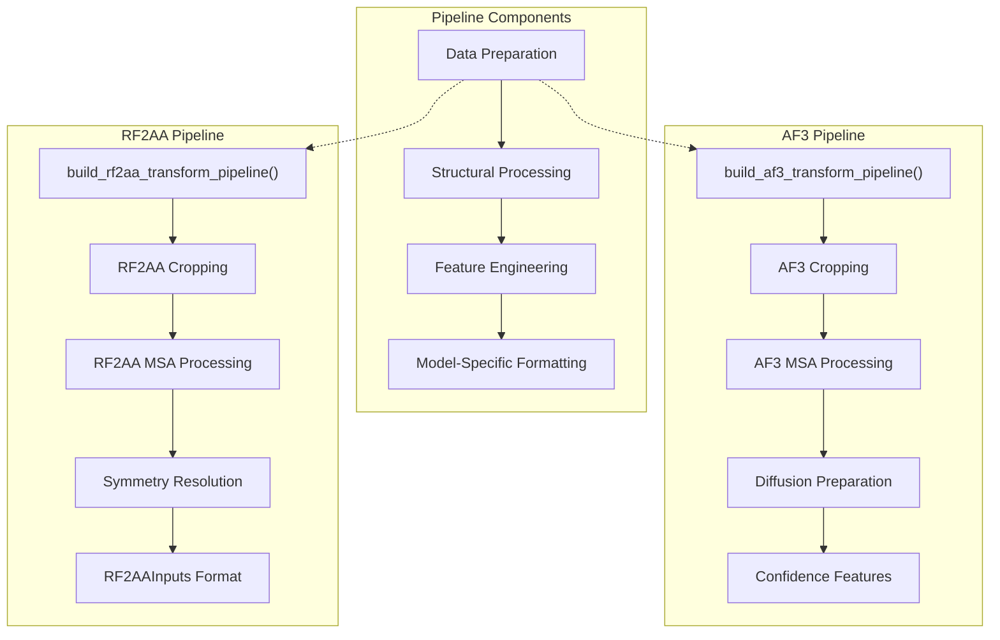
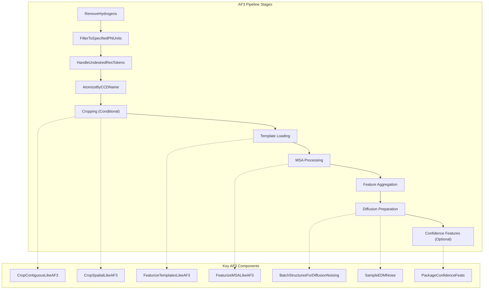
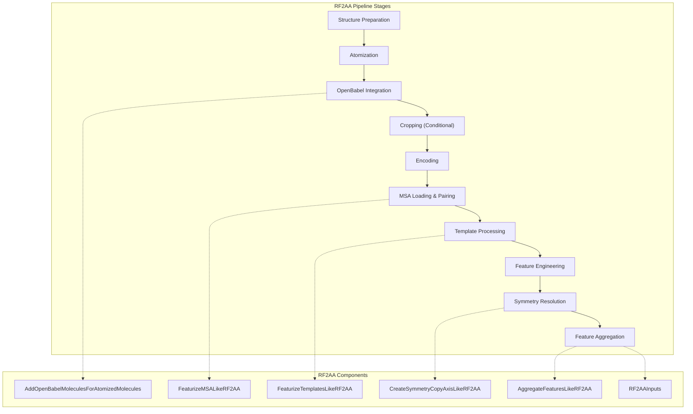
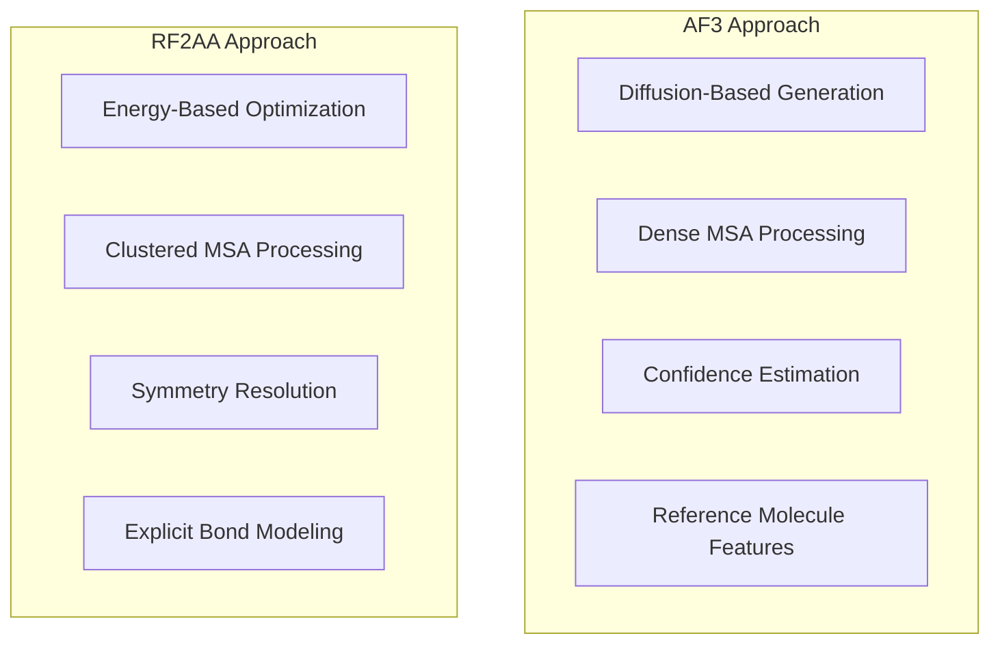

# Model-Specific Pipelines

<details>
<summary>Relevant source files</summary>

The following files were used as context for generating this wiki page:

- [src/atomworks/ml/pipelines/af3.py](src/atomworks/ml/pipelines/af3.py)
- [src/atomworks/ml/pipelines/rf2aa.py](src/atomworks/ml/pipelines/rf2aa.py)
- [src/atomworks/ml/transforms/encoding.py](src/atomworks/ml/transforms/encoding.py)
- [src/atomworks/ml/transforms/template.py](src/atomworks/ml/transforms/template.py)
- [tests/io/components/test_regression.py](tests/io/components/test_regression.py)
- [tests/io/tools/test_rdkit.py](tests/io/tools/test_rdkit.py)
- [tests/ml/conftest.py](tests/ml/conftest.py)
- [tests/ml/transforms/msa/test_featurize_msa.py](tests/ml/transforms/msa/test_featurize_msa.py)
- [tests/ml/utils/test_io.py](tests/ml/utils/test_io.py)

</details>


This page documents the model-specific transformation pipelines in AtomWorks that prepare molecular data for specific ML models. These pipelines build on the general transform system (see [Transform Pipeline](#3.1)) and token encoding schemes (see [Token Encodings](#3.2)) to create complete data processing workflows tailored for AlphaFold 3 (AF3) and RoseTTAFold 2 All-Atom (RF2AA) models.

Model-specific pipelines handle the complex orchestration of data preprocessing, feature engineering, and format conversion required by each model architecture. They encapsulate model-specific requirements such as cropping strategies, MSA processing, template handling, and output formatting.

## Pipeline Architecture Overview

The model-specific pipelines follow a common architectural pattern while implementing model-specific requirements:



**Pipeline Builder Functions**
- AF3: `build_af3_transform_pipeline`
- RF2AA: `build_rf2aa_transform_pipeline`

Sources: [src/atomworks/ml/pipelines/af3.py:84-133](), [src/atomworks/ml/pipelines/rf2aa.py:154-205]()

## AF3 Pipeline Implementation

The AF3 pipeline implements the data processing workflow for AlphaFold 3, emphasizing diffusion-based structure generation and confidence estimation.

### Core Pipeline Function

The `build_af3_transform_pipeline` function constructs the complete AF3 processing pipeline:



**Key Parameters:**
- `is_inference`: Controls training vs inference behavior
- `crop_size`: Token limit for spatial/contiguous cropping
- `diffusion_batch_size`: Batch size for diffusion noising
- `run_confidence_head`: Enable confidence feature generation

Sources: [src/atomworks/ml/pipelines/af3.py:84-403]()

### AF3-Specific Features

#### Diffusion Preparation
The AF3 pipeline includes specialized transforms for diffusion-based structure generation:

| Transform | Purpose |
|-----------|---------|
| `BatchStructuresForDiffusionNoising` | Prepares structures for noise sampling |
| `CenterRandomAugmentation` | Applies random centering augmentation |
| `SampleEDMNoise` | Samples noise using EDM (Elucidated Diffusion Models) |

#### Confidence Head Support
When `run_confidence_head=True`, the pipeline adds confidence-specific features:


Sources: [src/atomworks/ml/pipelines/af3.py:355-375]()

#### Cropping Strategy
AF3 implements conditional cropping with configurable probabilities:

- **Training**: Random selection between contiguous and spatial cropping
- **Inference**: No cropping applied (`Identity` transform)

Sources: [src/atomworks/ml/pipelines/af3.py:213-244]()

## RF2AA Pipeline Implementation  

The RF2AA pipeline processes data for RoseTTAFold 2 All-Atom, emphasizing symmetry resolution and clustered MSA processing.

### Core Pipeline Function

The `build_rf2aa_transform_pipeline` function creates the RF2AA processing workflow:



Sources: [src/atomworks/ml/pipelines/rf2aa.py:154-476]()

### RF2AA-Specific Features

#### Symmetry Resolution
RF2AA includes sophisticated symmetry handling for both polymers and small molecules:

| Parameter | Purpose |
|-----------|---------|
| `max_automorphs` | Limit automorphs for small molecule symmetry |
| `max_isomorphs` | Limit polymer isomorphisms |
| `CreateSymmetryCopyAxisLikeRF2AA` | Generate symmetry copies |

#### OpenBabel Integration
RF2AA uniquely integrates OpenBabel for enhanced small molecule processing:


#### MSA Clustering
RF2AA implements clustered MSA processing with masking:

- **Cluster Representatives**: Selected based on `n_msa_cluster_representatives`
- **Extra Rows**: Additional sequences for diversity
- **BERT-style Masking**: Applied to cluster representatives

Sources: [src/atomworks/ml/pipelines/rf2aa.py:421-429]()

#### Output Format
RF2AA produces structured outputs via the `RF2AAInputs` named tuple:

| Field | Type | Description |
|-------|------|-------------|
| `seq` | `np.ndarray` | Encoded sequence |
| `msa` | `np.ndarray` | MSA features |
| `xyz` | `np.ndarray` | Coordinate features |
| `mask` | `np.ndarray` | Validity masks |
| `bond_feats` | `np.ndarray` | Bond connectivity |
| `chirals` | `np.ndarray` | Chirality features |

Sources: [src/atomworks/ml/pipelines/rf2aa.py:71-98]()

## Key Pipeline Differences

The AF3 and RF2AA pipelines differ in several fundamental ways:

### Processing Philosophy



### Technical Differences

| Aspect | AF3 | RF2AA |
|--------|-----|-------|
| **MSA Processing** | `FeaturizeMSALikeAF3` (dense) | `FeaturizeMSALikeRF2AA` (clustered) |
| **Cropping** | Contiguous/Spatial with probabilities | Similar but different parameters |
| **Small Molecules** | Reference molecule approach | OpenBabel integration |
| **Output Format** | Dictionary with feature keys | `RF2AAInputs` structured format |
| **Symmetry** | Limited symmetry handling | Extensive automorph/isomorph resolution |

### Usage Patterns

Both pipelines are typically instantiated through dataset wrappers in test configurations:

**AF3 Usage:**
```python
# From test configurations
af3_dataset = StructuralDatasetWrapper(
    dataset_parser=PNUnitsDFParser(),
    transform=build_af3_transform_pipeline(
        protein_msa_dirs=PROTEIN_MSA_DIRS,
        is_inference=False,
        diffusion_batch_size=32
    )
)
```

**RF2AA Usage:**
```python
# From test configurations  
rf2aa_dataset = StructuralDatasetWrapper(
    dataset_parser=PNUnitsDFParser(),
    transform=build_rf2aa_transform_pipeline(
        protein_msa_dirs=PROTEIN_MSA_DIRS,
        convert_feats_to_rf2aa_input_tuple=True
    )
)
```

Sources: [tests/ml/conftest.py:300-365](), [tests/ml/conftest.py:224-292]()

## Pipeline Configuration

Both pipelines support extensive configuration through their builder functions, enabling adaptation to different training and inference scenarios. The configuration parameters control data processing behavior, computational trade-offs, and model-specific feature generation requirements.

For dataset integration and broader ML workflow context, see [Dataset Management](#3.4).

Sources: [src/atomworks/ml/pipelines/af3.py](), [src/atomworks/ml/pipelines/rf2aa.py](), [tests/ml/conftest.py]()

---