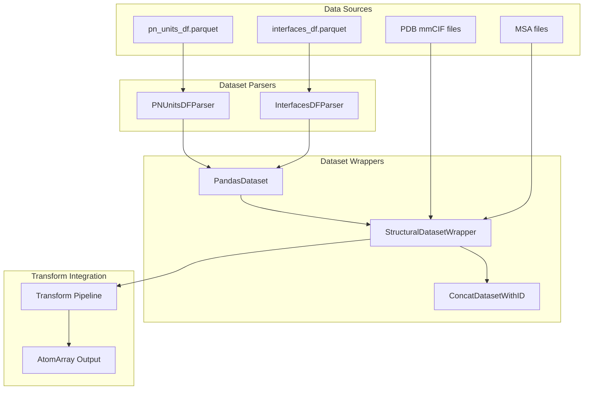
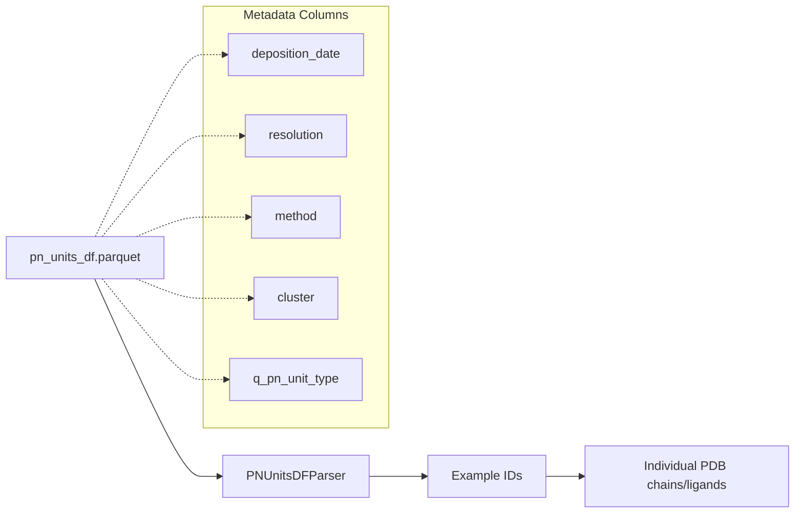
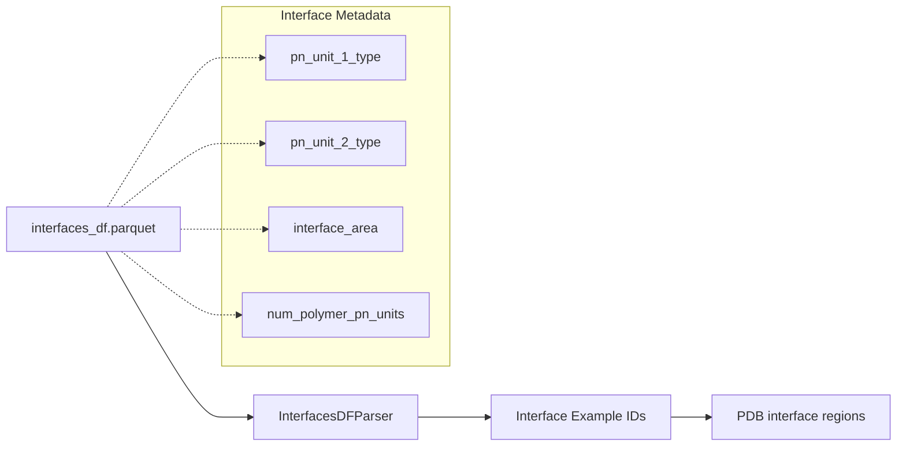
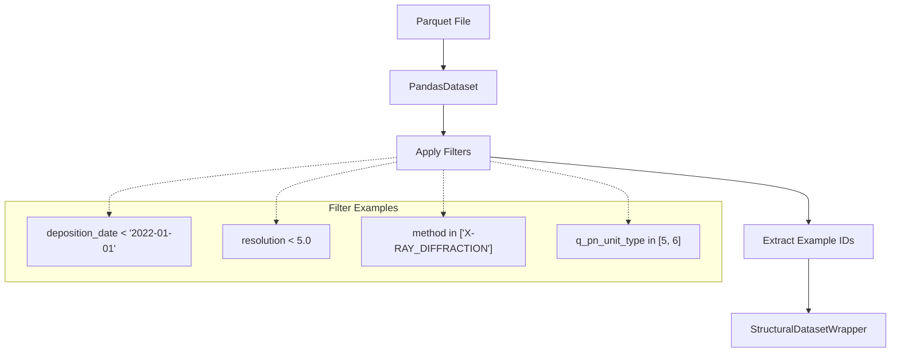
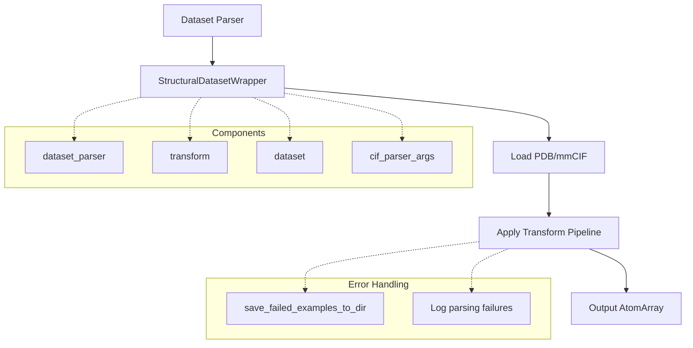
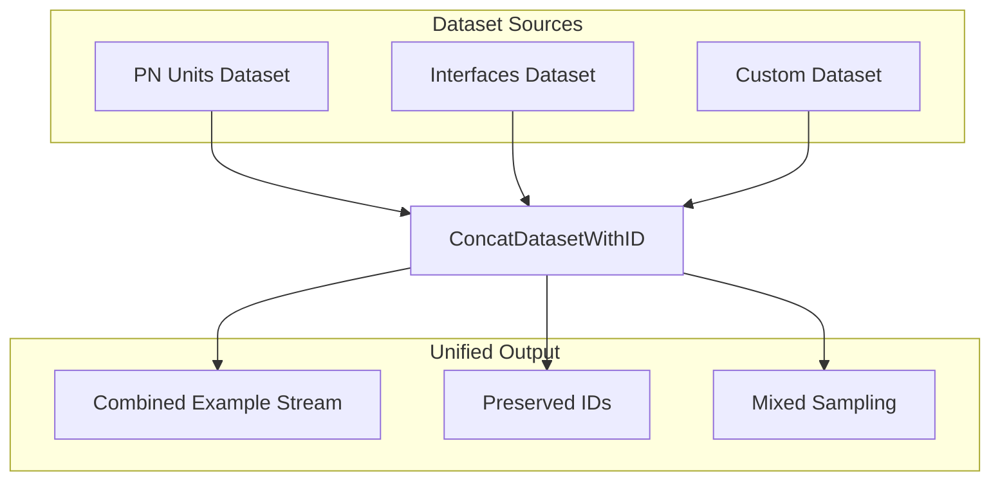
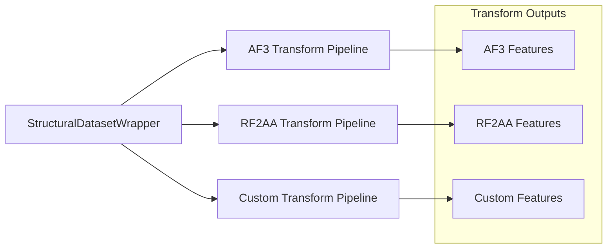
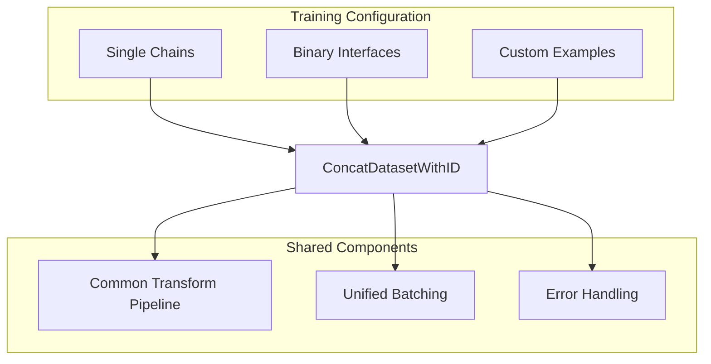

# Dataset Management

<details>
<summary>Relevant source files</summary>

The following files were used as context for generating this wiki page:

- [.github/workflows/release_and_docs.yaml](.github/workflows/release_and_docs.yaml)
- [.releaserc.js](.releaserc.js)
- [README.md](README.md)
- [docs/_static/atomworks_datapipelines.svg](docs/_static/atomworks_datapipelines.svg)
- [docs/_static/atomworks_logo_color.svg](docs/_static/atomworks_logo_color.svg)
- [docs/_static/atomworks_logo_dark.svg](docs/_static/atomworks_logo_dark.svg)
- [docs/_static/atomworks_logo_light.svg](docs/_static/atomworks_logo_light.svg)
- [docs/_static/atomworks_overview.png](docs/_static/atomworks_overview.png)
- [docs/_static/default_thumbnail.png](docs/_static/default_thumbnail.png)
- [docs/_static/favicon-16x16.png](docs/_static/favicon-16x16.png)
- [docs/_static/favicon-32x32.png](docs/_static/favicon-32x32.png)
- [docs/conf.py](docs/conf.py)
- [docs/index.rst](docs/index.rst)

</details>


This page documents the dataset management system in `atomworks.ml`, which provides infrastructure for loading, filtering, and wrapping biological datasets for machine learning workflows. The system handles both metadata-driven sampling from large databases like the PDB and direct data loading for training and inference.

For information about the transform pipelines that process dataset outputs, see [Transform Pipeline](#3.1). For model-specific pipeline configurations, see [Model-Specific Pipelines](#3.3).

## Core Architecture

The dataset management system consists of three main layers: dataset parsers that extract examples from data sources, dataset wrappers that apply transforms and handle batching, and configuration systems that coordinate the components.



**Dataset Management Architecture**

Sources: [README.md:182-262]()

## Dataset Parsers

Dataset parsers extract individual examples from structured data sources and convert them into loadable formats for ML workflows.

### PNUnitsDFParser

The `PNUnitsDFParser` processes metadata for individual polymer and non-polymer units (chains, ligands) from PDB structures. It reads from parquet files containing per-unit metadata and generates example IDs that can be loaded as individual structures.



**PNUnitsDFParser Data Flow**

The parser supports filtering based on metadata columns such as resolution, deposition date, experimental method, and chain type. Common filters include excluding NMR structures, setting resolution cutoffs, and selecting specific polymer types.

Sources: [README.md:186-221]()

### InterfacesDFParser

The `InterfacesDFParser` handles binary interface metadata, processing parquet files that contain information about protein-protein, protein-ligand, and other molecular interfaces within PDB structures.



**InterfacesDFParser Data Flow**

Interface examples include spatial cropping around interaction regions and support filtering based on interface properties, partner types, and structural quality metrics.

Sources: [README.md:223-261]()

## Dataset Wrappers

Dataset wrappers coordinate between parsers, transforms, and the broader ML pipeline, handling data loading, filtering, and preprocessing.

### PandasDataset

The `PandasDataset` class provides the foundation for metadata-driven dataset loading. It loads parquet files, applies user-defined filters, and generates example IDs for downstream processing.

| Configuration | Purpose | Example |
|---------------|---------|---------|
| `data` | Path to parquet file | `/path/to/metadata/pn_units_df.parquet` |
| `filters` | List of pandas query strings | `["resolution < 5.0", "method in ['X-RAY_DIFFRACTION']"]` |
| `id_column` | Column containing example IDs | `"example_id"` |
| `columns_to_load` | Subset of columns to load | `null` (load all) |



**PandasDataset Processing Flow**

Sources: [README.md:205-220](), [README.md:242-258]()

### StructuralDatasetWrapper

The `StructuralDatasetWrapper` coordinates between dataset parsers and transform pipelines, loading structural data based on example IDs and applying the configured transform pipeline.



**StructuralDatasetWrapper Architecture**

The wrapper handles file loading from PDB mirrors, applies data cleaning and featurization transforms, and manages error handling for failed examples.

Sources: [README.md:185-188](), [README.md:224-227]()

### ConcatDatasetWithID

The `ConcatDatasetWithID` class combines multiple dataset sources (e.g., single chains and interfaces) into a unified training dataset while preserving example identification.



**ConcatDatasetWithID Structure**

This enables training on diverse example types within a single pipeline, supporting mixed sampling strategies across different data modalities.

Sources: [README.md:183-184]()

## Configuration Patterns

Dataset management integrates with Hydra configuration to enable declarative pipeline definition through YAML files.

### Hydra Integration

```yaml
af3_pdb_dataset:
  _target_: atomworks.ml.datasets.datasets.ConcatDatasetWithID
  datasets:
    - _target_: atomworks.ml.datasets.datasets.StructuralDatasetWrapper
      dataset_parser:
        _target_: atomworks.ml.datasets.parsers.PNUnitsDFParser
      dataset:
        _target_: atomworks.ml.datasets.datasets.PandasDataset
        data: /path/to/metadata/pn_units_df.parquet
        filters:
          - "deposition_date < '2022-01-01'"
          - "resolution < 5.0"
```

### Transform Pipeline Integration

Dataset wrappers connect to transform pipelines through the `transform` parameter, enabling model-specific data processing:



**Transform Pipeline Integration**

Sources: [README.md:189-200](), [README.md:228-241]()

## Usage Examples

### Basic Single Dataset

```yaml
single_chain_dataset:
  _target_: atomworks.ml.datasets.datasets.StructuralDatasetWrapper
  dataset_parser:
    _target_: atomworks.ml.datasets.parsers.PNUnitsDFParser
  dataset:
    _target_: atomworks.ml.datasets.datasets.PandasDataset
    data: /path/to/pn_units_df.parquet
    filters:
      - "q_pn_unit_type in [5, 6]"  # Polypeptides only
  transform:
    _target_: atomworks.ml.pipelines.af3.build_af3_transform_pipeline
```

### Multi-Source Training Dataset

The system supports combining multiple data sources with different sampling strategies:



**Multi-Source Dataset Architecture**

This enables training on diverse molecular contexts while maintaining consistent preprocessing and batching across example types.

Sources: [README.md:165-275]()

## Error Handling and Debugging

The dataset system includes comprehensive error handling for production ML workflows:

| Feature | Purpose | Configuration |
|---------|---------|---------------|
| Failed example logging | Track parsing failures | `save_failed_examples_to_dir` |
| Parser arguments | Custom CIF parsing | `cif_parser_args` |
| Cache control | Manage temporary files | `cache_dir` |
| Column filtering | Reduce memory usage | `columns_to_load` |

Failed examples are logged with detailed error information to enable debugging and data quality analysis.

Sources: [README.md:221](), [README.md:260-261]()

---