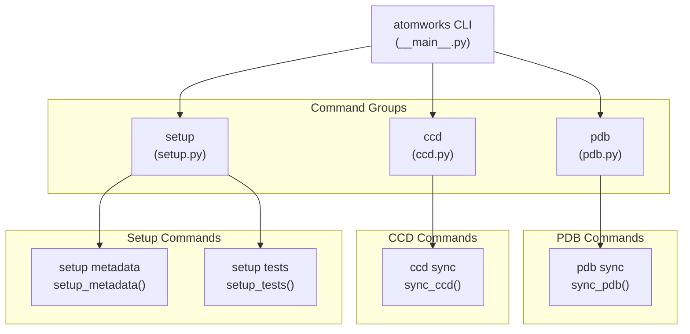
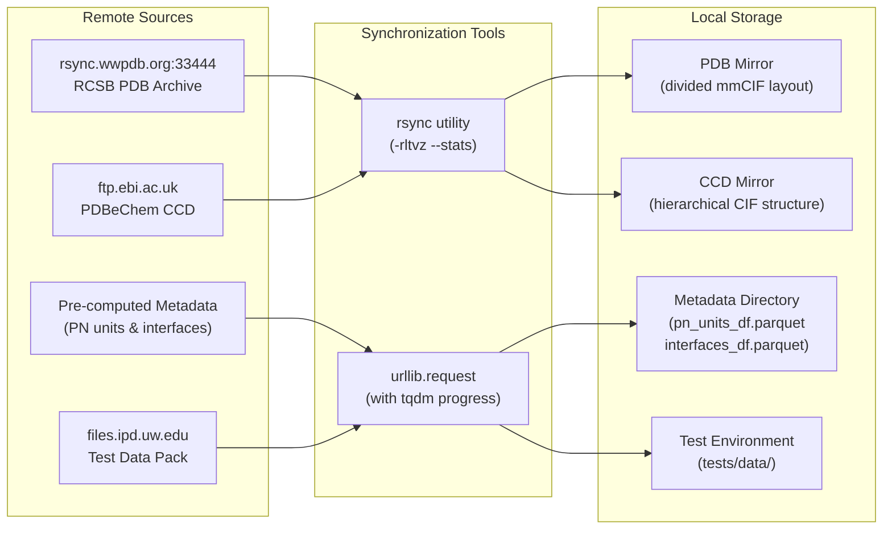
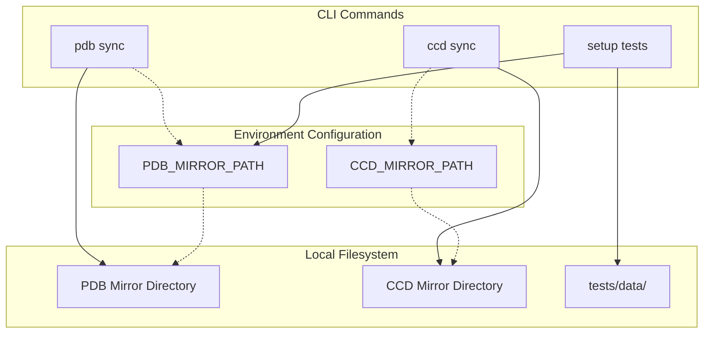
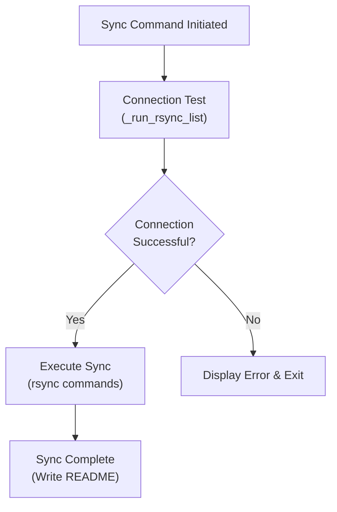
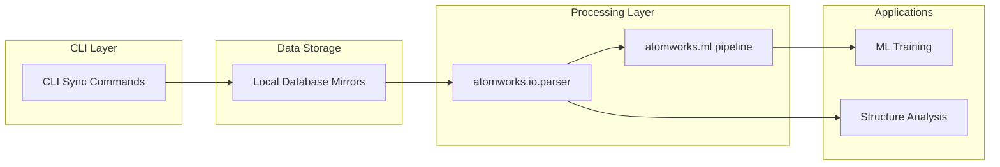

# Command Line Interface

Relevant source files

The following files were used as context for generating this wiki page:

- [.github/workflows/release_and_docs.yaml](.github/workflows/release_and_docs.yaml)
- [.releaserc.js](.releaserc.js)
- [README.md](README.md)
- [docs/_static/atomworks_datapipelines.svg](docs/_static/atomworks_datapipelines.svg)
- [docs/_static/atomworks_logo_color.svg](docs/_static/atomworks_logo_color.svg)
- [docs/_static/atomworks_logo_dark.svg](docs/_static/atomworks_logo_dark.svg)
- [docs/_static/atomworks_logo_light.svg](docs/_static/atomworks_logo_light.svg)
- [docs/_static/atomworks_overview.png](docs/_static/atomworks_overview.png)
- [docs/_static/default_thumbnail.png](docs/_static/default_thumbnail.png)
- [docs/_static/favicon-16x16.png](docs/_static/favicon-16x16.png)
- [docs/_static/favicon-32x32.png](docs/_static/favicon-32x32.png)
- [docs/conf.py](docs/conf.py)
- [docs/index.rst](docs/index.rst)

The AtomWorks CLI provides data management utilities for synchronizing biological databases and setting up development environments. The CLI enables users to maintain local mirrors of the RCSB PDB and PDBeChem CCD archives, as well as automate test environment preparation.

This page covers the overall CLI architecture and command structure. For detailed information about database synchronization, see [Data Synchronization](#4.1). For test environment setup procedures, see [Test Environment Setup](#4.2).

## CLI Architecture

The AtomWorks CLI is built using the `typer` framework and organized into three main command groups: `pdb`, `ccd`, and `setup`. Each group provides specialized functionality for different aspects of data management.

### Command Structure

**CLI Command Hierarchy**

The main CLI application is defined in [src/atomworks/cli/__init__.py:7]() as a `typer.Typer` instance. Sub-applications are registered using `app.add_typer()` calls at [src/atomworks/cli/__init__.py:15-17]().

Sources: [src/atomworks/cli/__init__.py:1-18](), [src/atomworks/cli/__main__.py:1-14]()

### Application Entry Point

The CLI is accessible through multiple entry points:

| Entry Method | Command |
|--------------|---------|
| Module execution | `python -m atomworks.cli` |
| Direct execution | `atomworks <command>` |
| Package entry point | Configured in `pyproject.toml` |

The entry point is implemented in [src/atomworks/cli/__main__.py:8-9]() with a simple `main()` function that calls the root `app()`.

Sources: [src/atomworks/cli/__main__.py:8-14]()

## Data Synchronization Overview

### Remote Data Sources

The CLI connects to external biological databases to maintain local mirrors:

**Data Source Configuration**

Remote endpoints are defined as constants in each module:
- PDB: `PDB_REMOTE` and `PDB_PORT` in [src/atomworks/cli/pdb.py:18-19]()
- CCD: `CCD_REMOTE` in [src/atomworks/cli/ccd.py:18]()
- Test pack: `TEST_PACK_URL` in [src/atomworks/cli/setup.py:18]()

Sources: [src/atomworks/cli/pdb.py:18-19](), [src/atomworks/cli/ccd.py:18](), [src/atomworks/cli/setup.py:18]()

### Synchronization Strategies

The CLI supports two synchronization modes for database mirrors:

| Mode | Description | Use Case |
|------|-------------|----------|
| Full sync | Complete mirror of entire database | Initial setup, comprehensive datasets |
| Selective sync | Specific entries only | Development, testing, targeted workflows |

Both PDB and CCD synchronization commands accept entry lists via command-line arguments (`--pdb-id`, `--ccd-code`) or input files (`--pdb-ids-file`, `--ccd-codes-file`).

## Environment Integration

### Environment Variables

The CLI integrates with environment-based configuration for database paths:

**Environment Variable Usage**

After successful synchronization, the CLI provides instructions for setting environment variables. For example, the PDB sync command outputs setup instructions at [src/atomworks/cli/pdb.py:225-228]().

Sources: [src/atomworks/cli/pdb.py:225-228](), [src/atomworks/cli/ccd.py:258-262](), [src/atomworks/cli/setup.py:87]()

## Error Handling and Validation

### Connection Testing

Both PDB and CCD synchronization commands perform connectivity tests before attempting data transfer:

**Connection Test Implementation**

The `_run_rsync_list()` function is implemented in both [src/atomworks/cli/pdb.py:40-52]() and [src/atomworks/cli/ccd.py:53-73]() to validate remote connectivity before attempting synchronization.

Sources: [src/atomworks/cli/pdb.py:40-52](), [src/atomworks/cli/pdb.py:192-199](), [src/atomworks/cli/ccd.py:53-73](), [src/atomworks/cli/ccd.py:229-236]()

### Input Validation

Entry ID validation ensures data integrity:

| Database | Validation Function | Pattern |
|----------|-------------------|---------|
| PDB | `_normalize_pdb_id()` | 4-character alphanumeric |
| CCD | `_normalize_ccd_code()` | 1-3 character uppercase |

Invalid entries are silently skipped during collection in `_collect_pdb_ids()` and `_collect_ccd_codes()` functions.

Sources: [src/atomworks/cli/pdb.py:22-27](), [src/atomworks/cli/ccd.py:21-34](), [src/atomworks/cli/pdb.py:117-139](), [src/atomworks/cli/ccd.py:149-180]()

## Integration with AtomWorks Ecosystem

The CLI serves as the entry point for data acquisition in the broader AtomWorks processing pipeline:

**Data Flow Integration**

The CLI-maintained mirrors provide the raw data consumed by the `atomworks.io.parser` system documented in [Core Parser System](#2.1). Environment variables set by CLI commands configure parser data source locations.

Sources: [src/atomworks/cli/pdb.py:225-228](), [src/atomworks/cli/ccd.py:258-262](), [src/atomworks/cli/setup.py:134]()

---