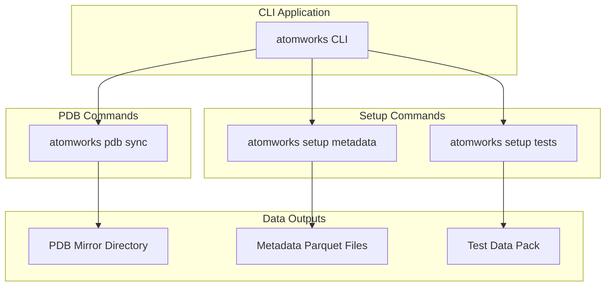
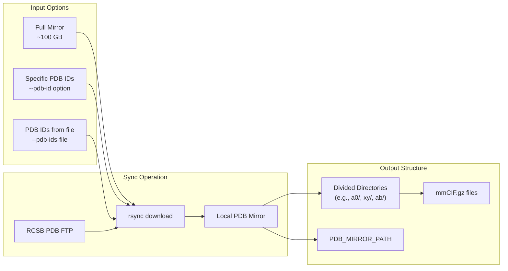
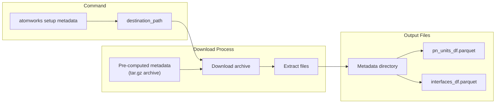

# Data Synchronization

<details>
<summary>Relevant source files</summary>

The following files were used as context for generating this wiki page:

- [.github/workflows/release_and_docs.yaml](.github/workflows/release_and_docs.yaml)
- [.releaserc.js](.releaserc.js)
- [README.md](README.md)
- [docs/_static/atomworks_datapipelines.svg](docs/_static/atomworks_datapipelines.svg)
- [docs/_static/atomworks_logo_color.svg](docs/_static/atomworks_logo_color.svg)
- [docs/_static/atomworks_logo_dark.svg](docs/_static/atomworks_logo_dark.svg)
- [docs/_static/atomworks_logo_light.svg](docs/_static/atomworks_logo_light.svg)
- [docs/_static/atomworks_overview.png](docs/_static/atomworks_overview.png)
- [docs/_static/default_thumbnail.png](docs/_static/default_thumbnail.png)
- [docs/_static/favicon-16x16.png](docs/_static/favicon-16x16.png)
- [docs/_static/favicon-32x32.png](docs/_static/favicon-32x32.png)
- [docs/conf.py](docs/conf.py)
- [docs/index.rst](docs/index.rst)

</details>


This document covers the AtomWorks CLI data synchronization system, which provides commands for maintaining local mirrors of biological data archives and downloading pre-computed metadata. The system enables users to synchronize PDB mmCIF files, obtain metadata for machine learning workflows, and set up test environments.

For information about test environment setup using synchronized data, see [Test Environment Setup](#4.2). For details about using synchronized data within the parsing system, see [Core Parser System](#2.1).

## Overview

The AtomWorks CLI provides three primary data synchronization commands:

- `atomworks pdb sync` - mirrors RCSB PDB mmCIF archive
- `atomworks setup metadata` - downloads pre-computed PDB metadata for ML workflows  
- `atomworks setup tests` - downloads test data and environments

The PDB synchronization uses rsync for bandwidth efficiency and resumable transfers. The metadata setup downloads pre-processed parquet files containing structural annotations and interface information.

### CLI Command Structure



Sources: [README.md:128-163]()

## PDB Archive Synchronization

The PDB synchronization system maintains a local mirror of the RCSB PDB mmCIF archive using the divided directory structure. The system downloads compressed mmCIF files and organizes them in the standard PDB directory hierarchy.

### PDB Sync Process



Sources: [README.md:128-148]()

### PDB Directory Structure

The PDB sync maintains the official divided directory structure where files are organized by the middle two characters of the PDB ID:

| PDB ID | Subdirectory | File Path |
|--------|--------------|-----------|
| `1a0i` | `a0/` | `a0/1a0i.cif.gz` |
| `2xyz` | `xy/` | `xy/2xyz.cif.gz` |
| `7abc` | `ab/` | `ab/7abc.cif.gz` |

This organization matches the standard PDB FTP archive structure and enables efficient access to individual entries.

Sources: [README.md:128-148]()

## PDB Metadata Setup

The metadata setup system downloads pre-computed PDB metadata files required for machine learning workflows. These files contain processed information about protein structures, interfaces, and sampling probabilities.

### Metadata Setup Process



Sources: [README.md:150-163]()

### Metadata File Contents

The metadata setup produces two primary parquet files:

| File | Content | Description |
|------|---------|-------------|
| `pn_units_df.parquet` | PN Unit metadata | Information about each polymer/non-polymer unit in the PDB |
| `interfaces_df.parquet` | Interface metadata | Binary interface information between PN units |

**PN Units**: The term "PN unit" is shorthand for "polymer XOR non-polymer unit" and behaves like PDB chains but treats covalently bonded ligands as single units.

**Interfaces**: Contains metadata for binary interfaces as (pn_unit_1, pn_unit_2) pairs with filtering and sampling information.

Sources: [README.md:158-161]()

## Usage Patterns

### Full Archive Synchronization

```bash
# Mirror complete PDB archive (~100 GB)
atomworks pdb sync /data/pdb-mirror

# Mirror complete CCD archive
atomworks ccd sync /data/ccd-mirror
```

### Selective Synchronization

```bash
# Sync specific PDB entries
atomworks pdb sync /data/pdb-mirror --pdb-id 1abc --pdb-id 2xyz

# Sync PDB entries from file
atomworks pdb sync /data/pdb-mirror --pdb-ids-file my_structures.txt

# Sync specific CCD entries
atomworks ccd sync /data/ccd-mirror --ccd-code ALA --ccd-code GLY
```

### Environment Configuration

After synchronization, the commands provide environment variable setup instructions:

```bash
export PDB_MIRROR_PATH=/data/pdb-mirror
export CCD_MIRROR_PATH=/data/ccd-mirror
```

These environment variables are used by the AtomWorks parsing system to locate local copies of structural data.

Sources: [src/atomworks/cli/pdb.py:225-228](), [src/atomworks/cli/ccd.py:259-262]()

---