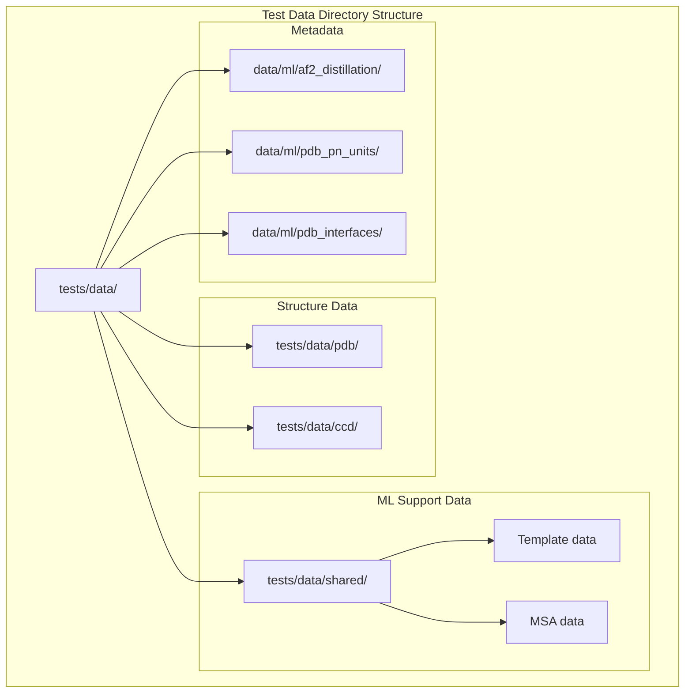
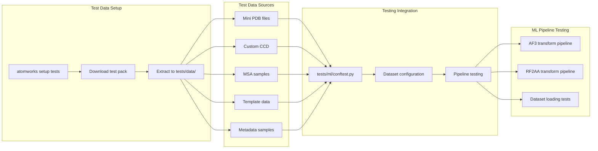
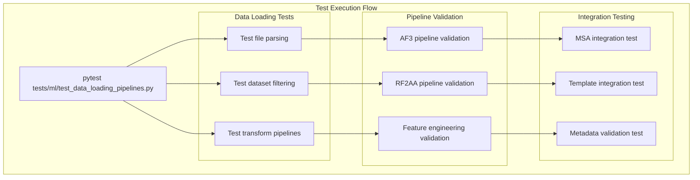
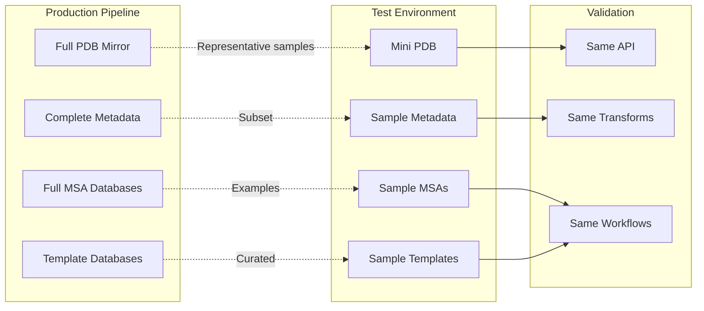

# Test Environment Setup

<details>
<summary>Relevant source files</summary>

The following files were used as context for generating this wiki page:

- [.github/workflows/release_and_docs.yaml](.github/workflows/release_and_docs.yaml)
- [.releaserc.js](.releaserc.js)
- [README.md](README.md)
- [docs/_static/atomworks_datapipelines.svg](docs/_static/atomworks_datapipelines.svg)
- [docs/_static/atomworks_logo_color.svg](docs/_static/atomworks_logo_color.svg)
- [docs/_static/atomworks_logo_dark.svg](docs/_static/atomworks_logo_dark.svg)
- [docs/_static/atomworks_logo_light.svg](docs/_static/atomworks_logo_light.svg)
- [docs/_static/atomworks_overview.png](docs/_static/atomworks_overview.png)
- [docs/_static/default_thumbnail.png](docs/_static/default_thumbnail.png)
- [docs/_static/favicon-16x16.png](docs/_static/favicon-16x16.png)
- [docs/_static/favicon-32x32.png](docs/_static/favicon-32x32.png)
- [docs/conf.py](docs/conf.py)
- [docs/index.rst](docs/index.rst)

</details>


This document covers setting up the test environment for AtomWorks development and evaluation. The test environment provides a minimal dataset with representative samples from the PDB, MSA data, templates, and metadata that enables testing and validation of ML pipelines without requiring full dataset downloads.

For information about setting up production PDB mirrors and metadata, see [Data Synchronization](#4.1). For overall project configuration and development setup, see [Project Configuration and Development](#5).

## Purpose and Scope

The test environment setup provides a streamlined way to:

- Download and configure test data (~500 MB) for development and validation
- Create a miniature version of the full PDB processing pipeline
- Test ML workflows including AF3 and RF2AA pipelines without full dataset requirements
- Validate data processing transforms and dataset loading functionality

## Test Data CLI Command

The primary interface for test environment setup is the `atomworks setup tests` command, which downloads and extracts a curated test dataset.

```bash
atomworks setup tests  # Downloads test pack to `tests/data` and unpacks it there (~500 MB)
```

This command creates a complete test environment with representative biological data samples that mirror the structure of production datasets.

Sources: [README.md:277-283]()

## Test Data Structure

The test setup creates a hierarchical directory structure that mirrors production data organization:



**Test Data Components:**

| Component | Location | Purpose |
|-----------|----------|---------|
| Mini PDB | `tests/data/pdb/` | Representative protein structure files |
| Custom CCD | `tests/data/ccd/` | Chemical Component Dictionary for ligands |
| MSA Data | `tests/data/shared/` | Multiple Sequence Alignments |
| Templates | `tests/data/shared/` | Template structures for modeling |
| AF2 Distillation | `data/ml/af2_distillation/` | AlphaFold2 distillation data |
| PN Units Metadata | `data/ml/pdb_pn_units/` | Polymer/non-polymer unit metadata |
| Interface Metadata | `data/ml/pdb_interfaces/` | Protein-protein interface data |

Sources: [README.md:280-283]()

## Test Environment Components

The test environment integrates with the core AtomWorks systems to provide a complete testing framework:



**Key Integration Points:**

- **Dataset Configuration**: Test datasets configured in `tests/ml/conftest.py` line 300
- **Transform Pipeline Testing**: Validates AF3 and RF2AA transform pipelines with test data
- **Data Loading Validation**: Tests PandasDataset and StructuralDatasetWrapper functionality
- **Environment Variables**: Test setup respects `PDB_MIRROR_PATH` and other configuration

Sources: [README.md:283]()

## Running Test Pipelines

Once the test environment is set up, you can run comprehensive pipeline tests:

```bash
# Set up environment (if not already configured)
export PDB_MIRROR_PATH=/path/to/test/pdb

# Run ML pipeline tests
pytest tests/ml/test_data_loading_pipelines.py
```

The test framework validates:

- Data parsing and loading from test PDB files
- Transform pipeline execution with representative data
- Dataset filtering and sampling functionality
- MSA and template integration
- Metadata handling and validation



Sources: [README.md:285-290]()

## Test vs Production Environment Mapping

The test environment provides a scaled-down version of the production data processing pipeline:

| Production Component | Test Equivalent | Scale Factor |
|---------------------|----------------|--------------|
| Full PDB mirror (~100 GB) | `tests/data/pdb/` | ~500 MB total |
| Complete metadata | Sample metadata files | Representative subset |
| Full MSA databases | `tests/data/shared/` MSAs | Selected examples |
| Template databases | `tests/data/shared/` templates | Curated samples |
| Production configs | Test configurations | Simplified parameters |



The test environment ensures that development and validation can proceed with the same APIs and workflows as production, while requiring significantly less storage and download time.

Sources: [README.md:277-283](), [README.md:128-164]()

---