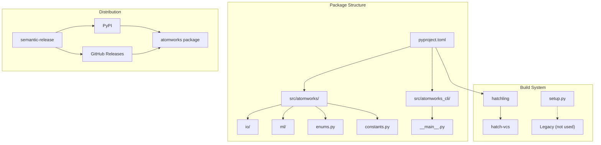
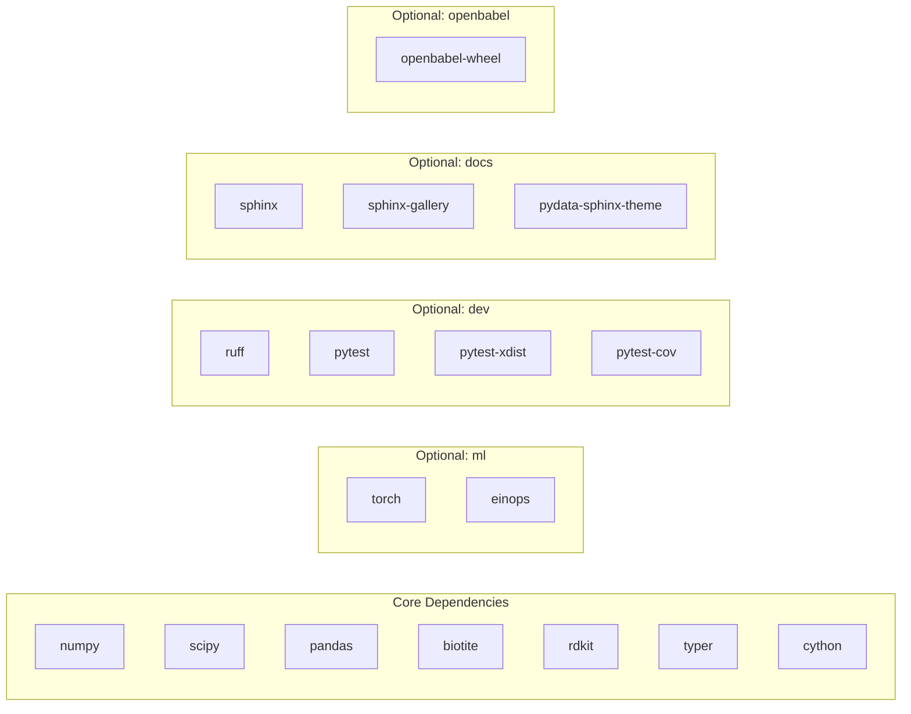
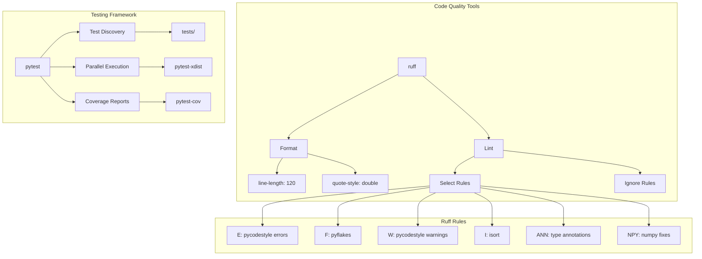
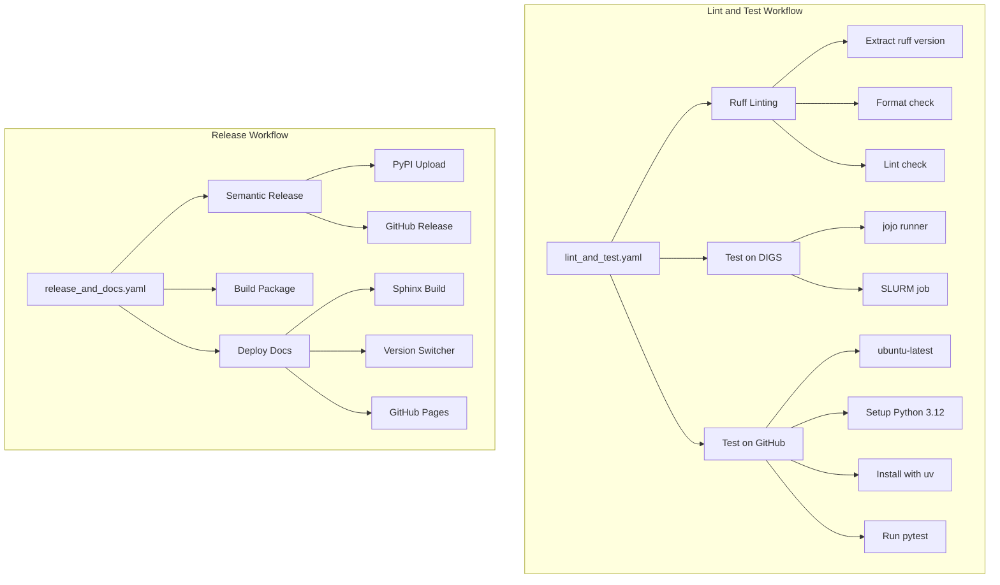
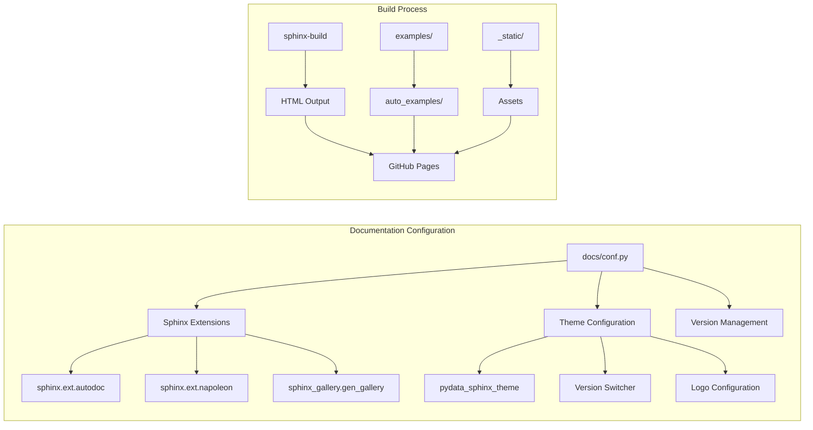
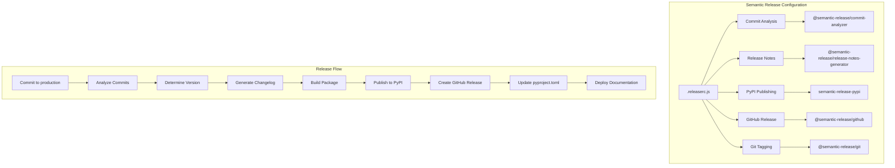
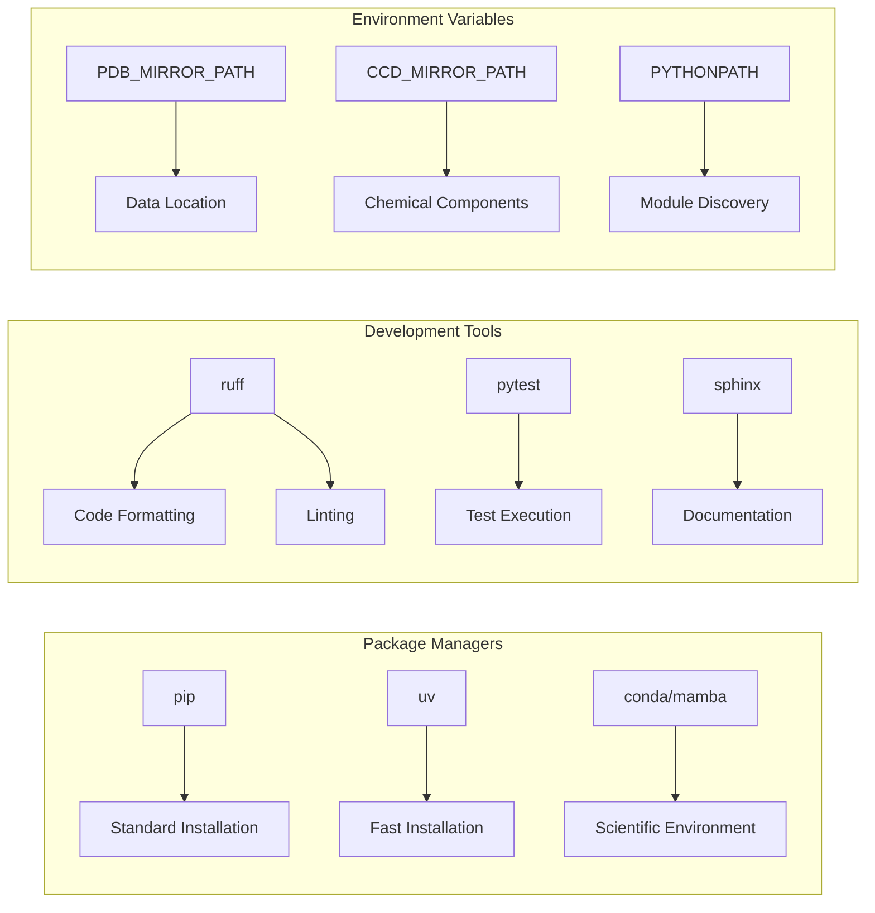

# Project Configuration and Development

Relevant source files

The following files were used as context for generating this wiki page:

- [.github/workflows/lint_and_test.yaml](.github/workflows/lint_and_test.yaml)
- [.github/workflows/release_and_docs.yaml](.github/workflows/release_and_docs.yaml)
- [.gitignore](.gitignore)
- [.releaserc.js](.releaserc.js)
- [README.md](README.md)
- [docs/_static/atomworks_datapipelines.svg](docs/_static/atomworks_datapipelines.svg)
- [docs/_static/atomworks_logo_color.svg](docs/_static/atomworks_logo_color.svg)
- [docs/_static/atomworks_logo_dark.svg](docs/_static/atomworks_logo_dark.svg)
- [docs/_static/atomworks_logo_light.svg](docs/_static/atomworks_logo_light.svg)
- [docs/_static/atomworks_overview.png](docs/_static/atomworks_overview.png)
- [docs/_static/default_thumbnail.png](docs/_static/default_thumbnail.png)
- [docs/_static/favicon-16x16.png](docs/_static/favicon-16x16.png)
- [docs/_static/favicon-32x32.png](docs/_static/favicon-32x32.png)
- [docs/conf.py](docs/conf.py)
- [docs/index.rst](docs/index.rst)
- [pyproject.toml](pyproject.toml)
- [src/atomworks/io/utils/ccd.py](src/atomworks/io/utils/ccd.py)
- [src/atomworks/io/utils/sequence.py](src/atomworks/io/utils/sequence.py)
- [src/atomworks/ml/encoding_definitions.py](src/atomworks/ml/encoding_definitions.py)
- [src/atomworks/ml/transforms/msa/_msa_constants.py](src/atomworks/ml/transforms/msa/_msa_constants.py)
- [tests/io/utils/test_sequence_maps.py](tests/io/utils/test_sequence_maps.py)
- [tests/io/utils/test_sequence_utils.py](tests/io/utils/test_sequence_utils.py)

This page covers the project configuration, development workflow, and infrastructure setup for AtomWorks. It includes package management, build system configuration, code quality tools, testing infrastructure, CI/CD pipelines, documentation generation, and release management.

For information about the core data processing functionality, see [Data Processing Pipeline](#2.2). For details about the ML pipeline transforms and datasets, see [Transform Pipeline](#3.1).

## Project Structure and Package Configuration

AtomWorks uses a modern Python packaging setup with `pyproject.toml` as the central configuration file. The project follows a standard source layout with packages in the `src/` directory.

**Package Configuration Details**

The main package configuration is defined in [pyproject.toml:1-91]():
- **Package metadata**: Name, version, description, authors, license
- **Python version requirement**: `>=3.12`
- **Entry points**: CLI command `atomworks` pointing to `atomworks_cli.__main__:main`
- **Build backend**: Uses `hatchling` with `hatch-vcs` for version management

Sources: `pyproject.toml`

## Dependencies and Optional Features

AtomWorks uses a tiered dependency system with core dependencies and optional feature groups to support different use cases.

**Installation Commands**

[pyproject.toml:57-68]() defines the installation patterns:
- Base: `pip install atomworks` (atomworks.io only)
- ML features: `pip install "atomworks[ml]"` (includes torch for atomworks.ml)
- Development: `pip install "atomworks[dev]"` (testing and linting tools)
- All features: `pip install "atomworks[ml,dev]"`

**Dependency Groups for uv**

[pyproject.toml:77-82]() also defines native uv compatibility via dependency groups, allowing usage with the modern `uv` package manager.

Sources: `pyproject.toml`

## Code Quality and Testing

AtomWorks uses Ruff for code formatting and linting, with pytest for testing. The configuration emphasizes code quality while remaining practical for scientific computing.

**Ruff Configuration**

[pyproject.toml:108-219]() contains comprehensive Ruff settings:
- **Line length**: 120 characters
- **Target version**: Python 3.12
- **Excluded directories**: Build artifacts, virtual environments, data directories
- **Format settings**: Double quotes, space indents, automatic line endings
- **Lint rules**: Comprehensive set including pycodestyle, pyflakes, isort, type annotations

**Test Configuration**

[pyproject.toml:222-254]() defines pytest configuration:
- **Test paths**: `tests` directory only
- **Import mode**: `importlib` for modern Python
- **Python path**: Includes `src/atomworks` and `tests`
- **Custom markers**: `requires_internet`, `requires_pymol_remote`, `requires_digs`, `slow`

**Coverage Settings**

Parallel test execution with coverage tracking, excluding version files and init files.

Sources: `pyproject.toml`

## CI/CD Pipeline

The project uses GitHub Actions for continuous integration and deployment with separate workflows for testing and releases.

**Testing Pipeline**

[.github/workflows/lint_and_test.yaml:1-132]() defines the testing workflow:
- **Triggers**: Push to main/production, PRs to main/dev/staging/production
- **Lint job**: Extracts Ruff version from pyproject.toml, runs format and lint checks
- **DIGS testing**: Runs on internal infrastructure with SLURM
- **GitHub testing**: Ubuntu runner with parallel test execution using pytest-xdist

**Release Pipeline**

[.github/workflows/release_and_docs.yaml:1-159]() handles releases and documentation:
- **Trigger**: Push to production branch
- **Package building**: Uses standard Python build tools
- **Semantic release**: Automated versioning and publishing to PyPI
- **Documentation**: Builds Sphinx docs and deploys versioned documentation

Sources: `.github/workflows/lint_and_test.yaml`, `.github/workflows/release_and_docs.yaml`

## Documentation System

AtomWorks uses Sphinx with a modern theme and automatic example generation for comprehensive documentation.

**Sphinx Configuration**

[docs/conf.py:1-98]() configures the documentation system:
- **Extensions**: autodoc for API docs, napoleon for Google-style docstrings, sphinx-gallery for examples
- **Theme**: pydata-sphinx-theme with custom logo and navigation
- **Version handling**: Extracts clean version from package, supports version switcher
- **Gallery**: Converts examples to documentation with matplotlib support

**Documentation Deployment**

The release workflow builds documentation and deploys it with versioning:
- **Version directories**: Each release gets its own directory
- **Latest symlink**: Points to the most recent stable version  
- **Switcher JSON**: Generated dynamically for version navigation
- **GitHub Pages**: Hosted documentation with version switching

Sources: `docs/conf.py`, `.github/workflows/release_and_docs.yaml`

## Release Management

AtomWorks uses semantic-release for automated version management and publishing, following conventional commit standards.

**Release Configuration**

[.releaserc.js:1-25]() defines the semantic release setup:
- **Branches**: Releases from `production` and `main` branches
- **Plugins**: Full pipeline from commit analysis to publication
- **PyPI integration**: Automated package publishing with token authentication
- **Git updates**: Automatic version bumping in pyproject.toml

**Version Management**

The system automatically:
- Analyzes conventional commits to determine version bump type
- Generates release notes from commit messages
- Updates package version in pyproject.toml
- Creates GitHub releases with generated changelogs
- Publishes to PyPI with built distributions

Sources: `.releaserc.js`, `.github/workflows/release_and_docs.yaml`

## Development Environment Setup

The project supports multiple development environments and package managers, with specific configurations for different deployment scenarios.

**Environment Setup Commands**

Based on [README.md:57-68](), the recommended installation patterns are:
- Development with uv: `uv pip install "atomworks[ml,openbabel,dev]"`
- Standard development: `pip install "atomworks[ml,dev]"`
- Production use: `pip install "atomworks[ml]"`

**Test Data Setup**

The CLI provides commands for setting up test environments:
- `atomworks setup tests` - Downloads test data pack (~500 MB)
- `atomworks setup metadata` - Downloads PDB metadata
- `atomworks pdb sync` - Mirrors PDB structure files

Sources: `README.md`, `pyproject.toml`, `.github/workflows/lint_and_test.yaml`

---