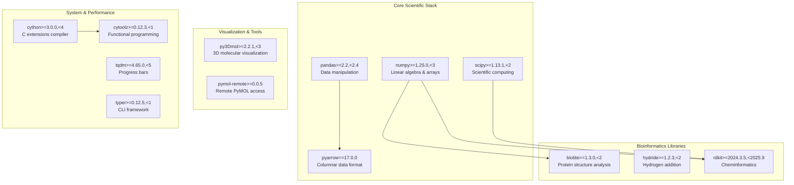
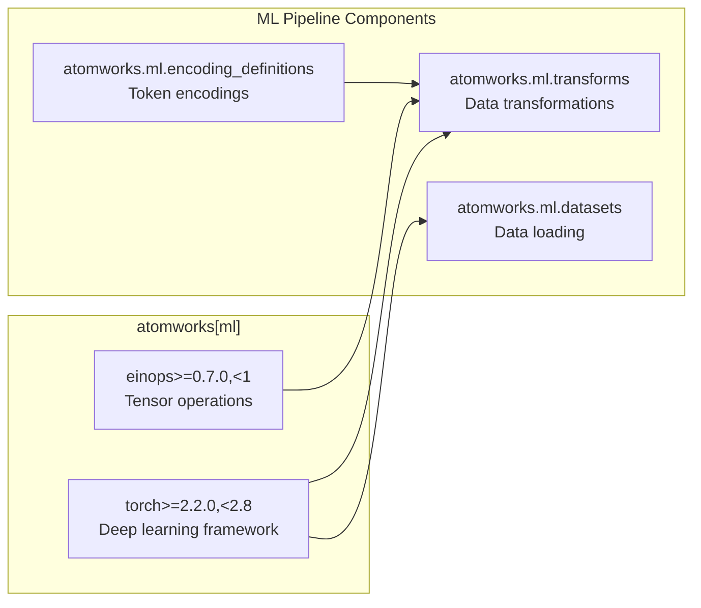
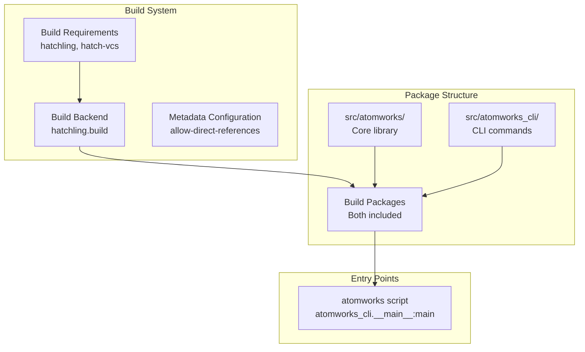
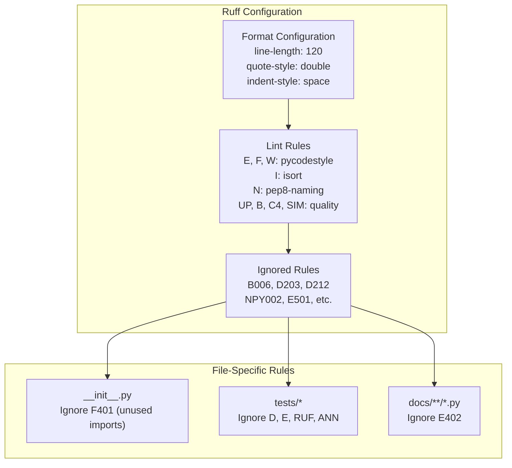
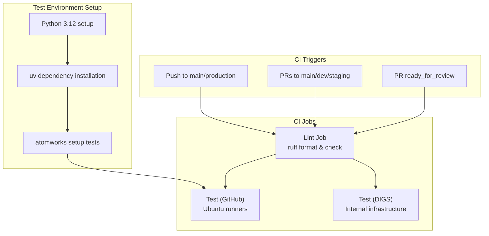

# Dependencies and Build System

<details>
<summary>Relevant source files</summary>

The following files were used as context for generating this wiki page:

- [.github/workflows/lint_and_test.yaml](.github/workflows/lint_and_test.yaml)
- [.gitignore](.gitignore)
- [pyproject.toml](pyproject.toml)
- [src/atomworks/io/utils/ccd.py](src/atomworks/io/utils/ccd.py)
- [src/atomworks/io/utils/sequence.py](src/atomworks/io/utils/sequence.py)
- [src/atomworks/ml/encoding_definitions.py](src/atomworks/ml/encoding_definitions.py)
- [src/atomworks/ml/transforms/msa/_msa_constants.py](src/atomworks/ml/transforms/msa/_msa_constants.py)
- [tests/io/utils/test_sequence_maps.py](tests/io/utils/test_sequence_maps.py)
- [tests/io/utils/test_sequence_utils.py](tests/io/utils/test_sequence_utils.py)

</details>


This document covers the project dependencies, build configuration, and development toolchain for AtomWorks. It explains the package structure, dependency management, optional features, and the build system used to create distributable packages.

For information about testing and code quality practices, see [Code Quality and Testing](#5.2). For details about the CI/CD pipeline implementation, see [CI/CD Pipeline](#5.3).

## Core Dependencies

AtomWorks is built on several foundational scientific computing and bioinformatics libraries. The core dependencies provide essential functionality for molecular data processing and analysis.

### Primary Dependencies

The project's core dependencies are defined in the `dependencies` section of [pyproject.toml:24-44]():



Sources: [pyproject.toml:24-44]()

### Key Dependency Relationships

The `biotite` library serves as the foundation for molecular structure handling throughout AtomWorks. It provides the `AtomArray` data structure that is central to the data processing pipeline, as seen in functions like `parse()` in the core parser system.

The `rdkit` library enables small molecule processing and cheminformatics functionality, particularly for handling SMILES strings and molecular descriptors. Integration points are visible in [src/atomworks/io/utils/sequence.py]() and related conversion utilities.

Sources: [src/atomworks/io/utils/ccd.py:8-13](), [src/atomworks/io/utils/sequence.py:11-32]()

## Optional Dependencies

AtomWorks provides several optional dependency groups to support different use cases without requiring all dependencies for basic functionality.

### Machine Learning Dependencies



The ML dependencies are defined in [pyproject.toml:47-51]() and enable the complete machine learning pipeline functionality documented in the `atomworks.ml` module.

Sources: [pyproject.toml:47-51](), [src/atomworks/ml/encoding_definitions.py:1-30]()

### Development Dependencies

The development dependency group includes tools for code quality, testing, and documentation:

| Category | Dependencies | Purpose |
|----------|-------------|---------|
| Code Quality | `ruff==0.8.3` | Linting and formatting |
| Testing | `pytest>=8.2.0`, `pytest-testmon`, `pytest-xdist`, `pytest-dotenv`, `pytest-cov`, `pytest-benchmark` | Test framework and plugins |
| Documentation | `sphinx>=8.0.0`, `sphinx-gallery`, `pydata-sphinx-theme`, `matplotlib` | Documentation generation |

Sources: [pyproject.toml:58-75]()

### Specialized Dependencies

- **OpenBabel**: `openbabel-wheel==3.1.1.22` for additional chemical file format support
- **Native uv Compatibility**: Dependency groups are duplicated in [pyproject.toml:77-82]() for compatibility with the `uv` package manager

Sources: [pyproject.toml:53-82]()

## Build System Configuration

AtomWorks uses a modern Python build system based on `hatchling` with version control integration.

### Build Backend Configuration



The build configuration is defined in [pyproject.toml:93-105]() and uses the source layout pattern where code is organized under a `src/` directory.

Sources: [pyproject.toml:93-105]()

### Package Metadata

The project metadata includes comprehensive classification and dependency information:

- **Target Python Version**: `>=3.12` as specified in [pyproject.toml:6]()
- **License**: BSD License as indicated in [pyproject.toml:21]()
- **Platform Support**: Linux, macOS, and Windows as listed in [pyproject.toml:15-17]()
- **CLI Entry Point**: The `atomworks` command is registered in [pyproject.toml:89-90]()

Sources: [pyproject.toml:1-23](), [pyproject.toml:89-90]()

## Development Tools Configuration

AtomWorks includes comprehensive configuration for development tools to maintain code quality and consistency.

### Code Formatting and Linting

The project uses `ruff` for both linting and formatting, configured in [pyproject.toml:108-219]():



Sources: [pyproject.toml:108-219]()

### Testing Configuration

The testing setup uses `pytest` with multiple plugins configured in [pyproject.toml:222-233]():

- **Test Discovery**: Tests are located in the `tests/` directory
- **Import Mode**: Uses `importlib` for better module isolation
- **Python Path**: Includes both `src/atomworks` and `tests` directories
- **Custom Markers**: Defines markers for internet-required tests, slow tests, and infrastructure-specific tests

Sources: [pyproject.toml:222-233]()

### Coverage Configuration

Code coverage is configured in [pyproject.toml:235-253]() with:
- **Parallel Execution**: Enabled for multi-process test runs
- **Source Tracking**: Monitors the `src/atomworks` directory
- **Exclusions**: Omits version files, tests, and `__init__.py` files from coverage

Sources: [pyproject.toml:235-253]()

## CI/CD Integration

The project's continuous integration system is implemented through GitHub Actions, with the main workflow defined in [.github/workflows/lint_and_test.yaml]().

### Workflow Structure



### Dependency Installation Strategy

The CI pipeline uses `uv` for fast dependency installation as shown in [.github/workflows/lint_and_test.yaml:96-103]():

```bash
uv pip install -e ".[ml,openbabel,dev]" --system
```

This installs AtomWorks in editable mode with all optional dependencies, ensuring comprehensive testing of the full feature set.

Sources: [.github/workflows/lint_and_test.yaml:96-103]()

### Test Execution

The pipeline runs different test configurations:
- **GitHub Runners**: Standard tests excluding slow benchmarks
- **DIGS Infrastructure**: Full test suite including infrastructure-specific tests
- **Parallel Execution**: Uses `pytest-xdist` for faster test execution when multiple CPUs are available

Sources: [.github/workflows/lint_and_test.yaml:109-124]()

## Package Distribution

AtomWorks is configured for distribution through standard Python packaging channels with metadata defined for PyPI compatibility.

### Project URLs and Metadata

The project defines several important URLs in [pyproject.toml:84-87]():
- **Homepage**: Points to the documentation site
- **Repository**: GitHub repository URL
- **Documentation**: Comprehensive documentation site

### Version Management

The project uses `hatch-vcs` for version management, allowing automatic version determination from Git tags and commit history.

Sources: [pyproject.toml:84-87](), [pyproject.toml:94]()

---