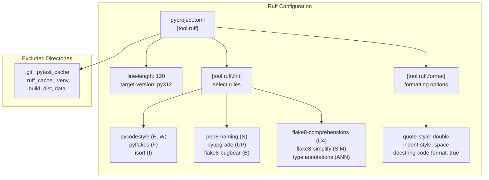
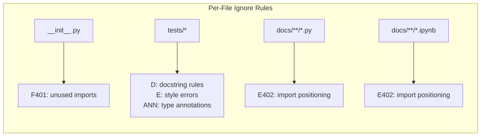
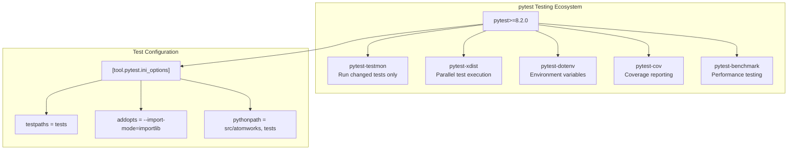
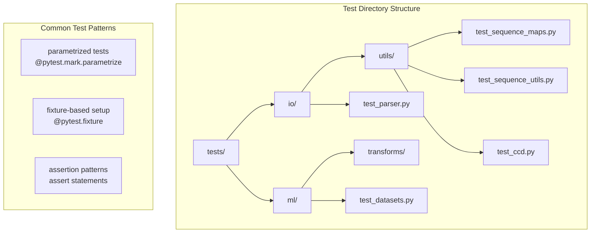
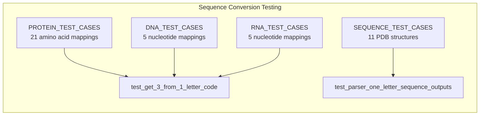
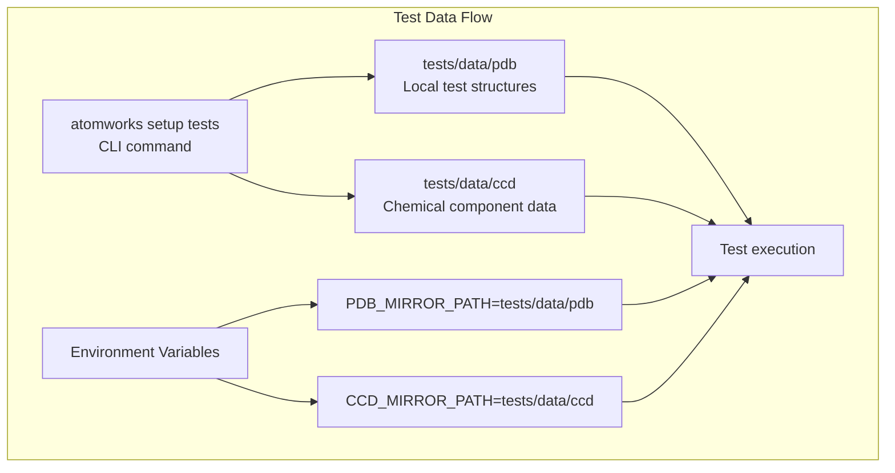
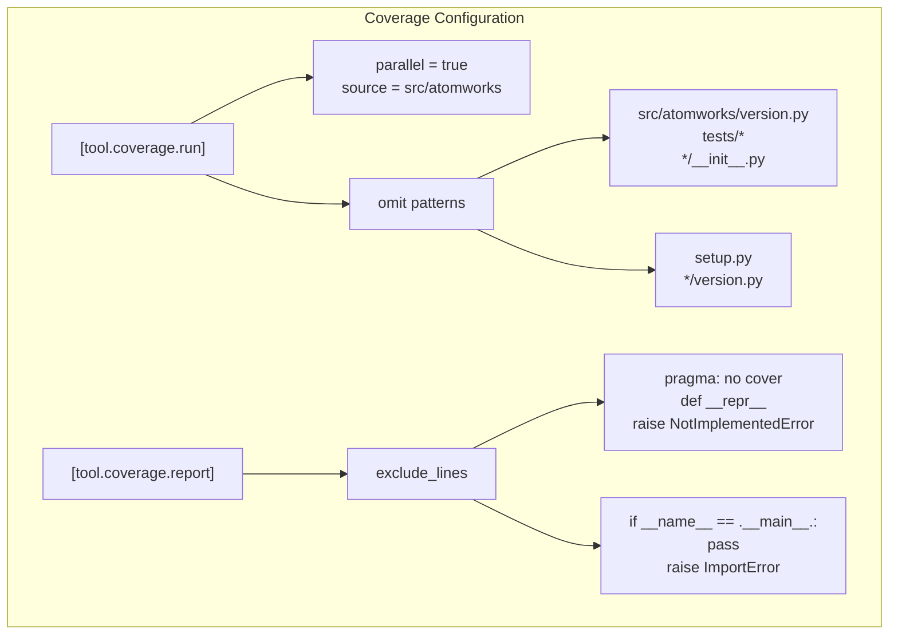
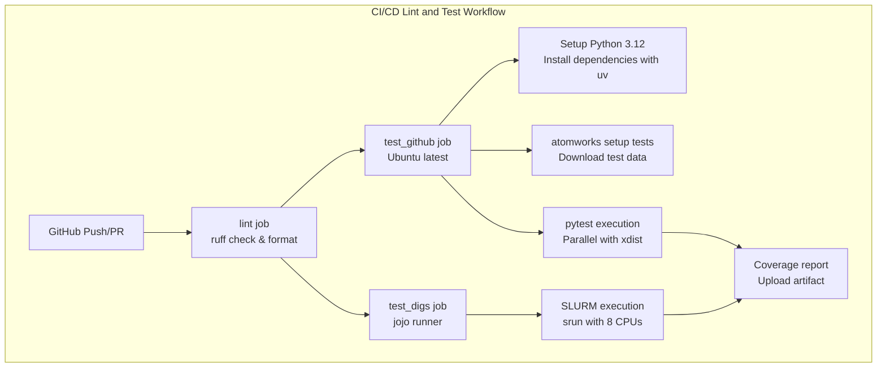
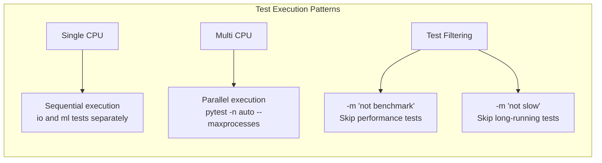
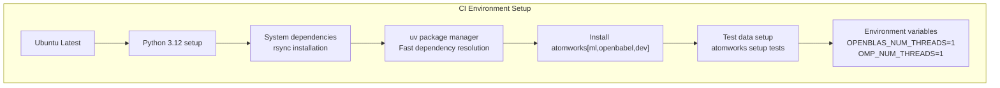

# Code Quality and Testing

Relevant source files

The following files were used as context for generating this wiki page:

- [.github/workflows/lint_and_test.yaml](.github/workflows/lint_and_test.yaml)
- [.gitignore](.gitignore)
- [pyproject.toml](pyproject.toml)
- [src/atomworks/io/utils/ccd.py](src/atomworks/io/utils/ccd.py)
- [src/atomworks/io/utils/sequence.py](src/atomworks/io/utils/sequence.py)
- [src/atomworks/ml/encoding_definitions.py](src/atomworks/ml/encoding_definitions.py)
- [src/atomworks/ml/transforms/msa/_msa_constants.py](src/atomworks/ml/transforms/msa/_msa_constants.py)
- [tests/io/utils/test_sequence_maps.py](tests/io/utils/test_sequence_maps.py)
- [tests/io/utils/test_sequence_utils.py](tests/io/utils/test_sequence_utils.py)

This document covers the code quality standards, testing practices, and automated validation workflows used in AtomWorks. It explains the linting, formatting, testing frameworks, and continuous integration processes that ensure code reliability and maintainability.

For information about the CI/CD pipeline deployment and release processes, see [CI/CD Pipeline](#5.3). For details about project dependencies and build configuration, see [Dependencies and Build System](#5.1).

## Code Quality Standards

AtomWorks maintains code quality through automated linting, formatting, and comprehensive testing. The project uses modern Python tooling configured through `pyproject.toml` to enforce consistent code style and catch potential issues.

### Ruff Configuration

The project uses `ruff` as the primary tool for both code linting and formatting, providing a fast, unified approach to code quality enforcement.

**Ruff Linting Rules**

The linting configuration enables a comprehensive set of rules for code quality:

| Rule Category | Code | Description |
|---------------|------|-------------|
| pycodestyle | E, W | Style guide enforcement |
| pyflakes | F | Logical errors and unused imports |
| isort | I | Import sorting and organization |
| pep8-naming | N | Naming convention enforcement |
| pyupgrade | UP | Modern Python syntax usage |
| flake8-bugbear | B | Bug-prone pattern detection |
| flake8-comprehensions | C4 | List/dict comprehension improvements |
| flake8-simplify | SIM | Code simplification suggestions |
| type annotations | ANN | Type hint enforcement |

**Sources:** [pyproject.toml:108-220]()

### Per-File Linting Exceptions

The configuration includes targeted exceptions for specific file types:

**Sources:** [pyproject.toml:204-208]()

## Testing Framework

AtomWorks uses `pytest` as the primary testing framework with several plugins to enhance testing capabilities and performance.

### Test Dependencies and Plugins

**Sources:** [pyproject.toml:58-68](), [pyproject.toml:222-233]()

### Test Markers and Categories

The project defines custom pytest markers to categorize and selectively run tests:

| Marker | Purpose |
|--------|---------|
| `requires_internet` | Tests needing internet connectivity |
| `requires_pymol_remote` | Tests requiring PyMOL remote connection |
| `requires_x3dna` | Tests requiring X3DNA software |
| `requires_digs` | Tests for IPD DIGS infrastructure |
| `slow` | Long-running tests |

**Sources:** [pyproject.toml:227-232]()

## Test Organization and Patterns

### Directory Structure

**Sources:** [tests/io/utils/test_sequence_maps.py:1-171](), [tests/io/utils/test_sequence_utils.py:1-304]()

### Parametrized Testing Examples

The codebase uses extensive parametrized testing for validation across multiple inputs:

**Sources:** [tests/io/utils/test_sequence_maps.py:14-171]()

### Test Data Management

**Sources:** [.github/workflows/lint_and_test.yaml:106-125]()

## Coverage Reporting

### Coverage Configuration

Coverage tracking focuses on the source code while excluding test files and generated content:

**Sources:** [pyproject.toml:235-253]()

## Continuous Integration Pipeline

### Lint and Test Workflow

The CI pipeline implements a two-stage approach with linting as a prerequisite for testing:

**Sources:** [.github/workflows/lint_and_test.yaml:1-132]()

### Test Execution Strategy

The CI system adapts test execution based on available resources, running tests sequentially on single-CPU systems and in parallel on multi-CPU systems.

**Sources:** [.github/workflows/lint_and_test.yaml:110-125]()

### Environment Setup

**Sources:** [.github/workflows/lint_and_test.yaml:74-108]()

---