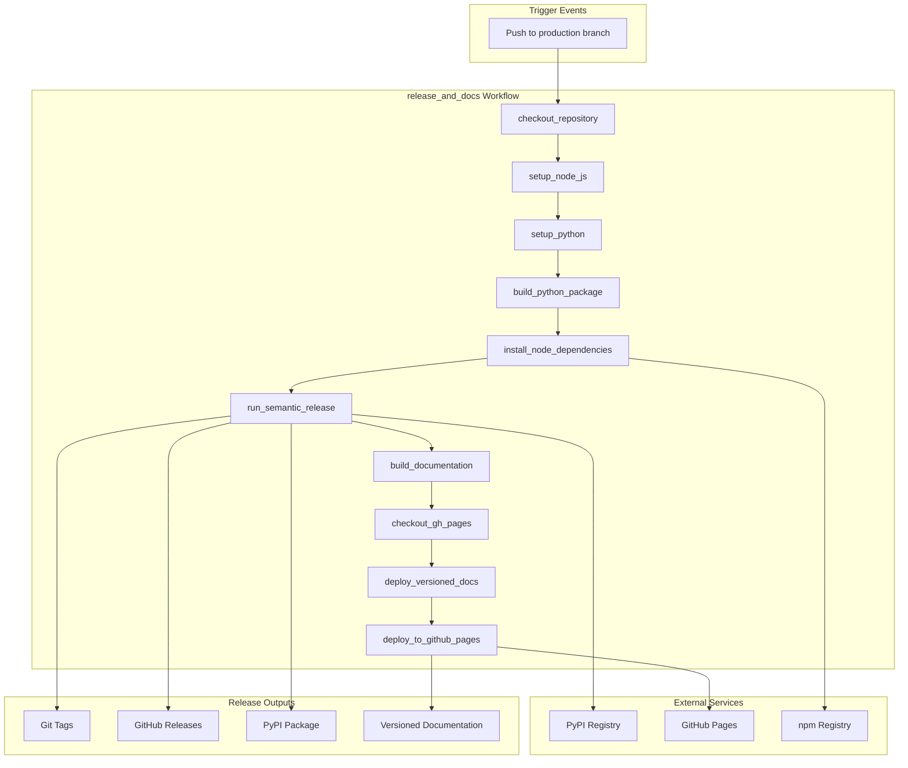
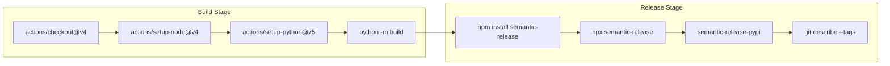
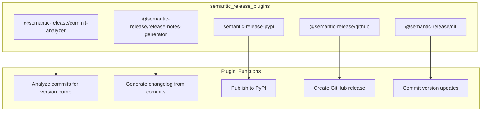
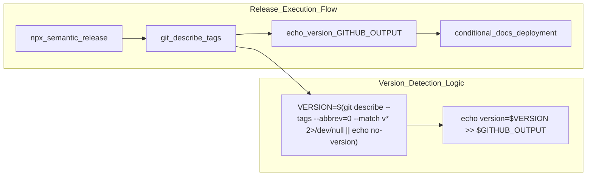
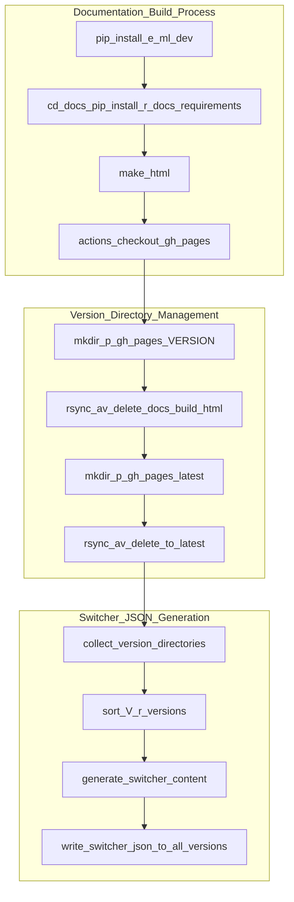
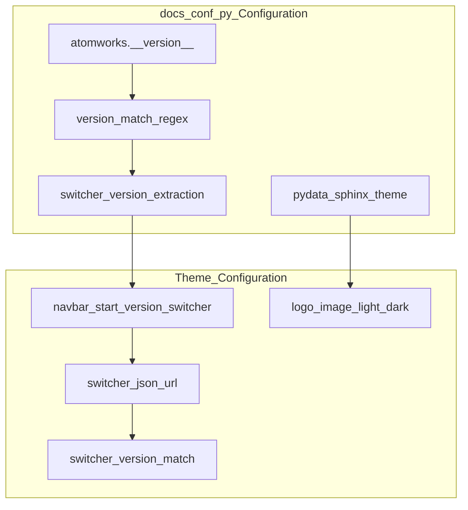
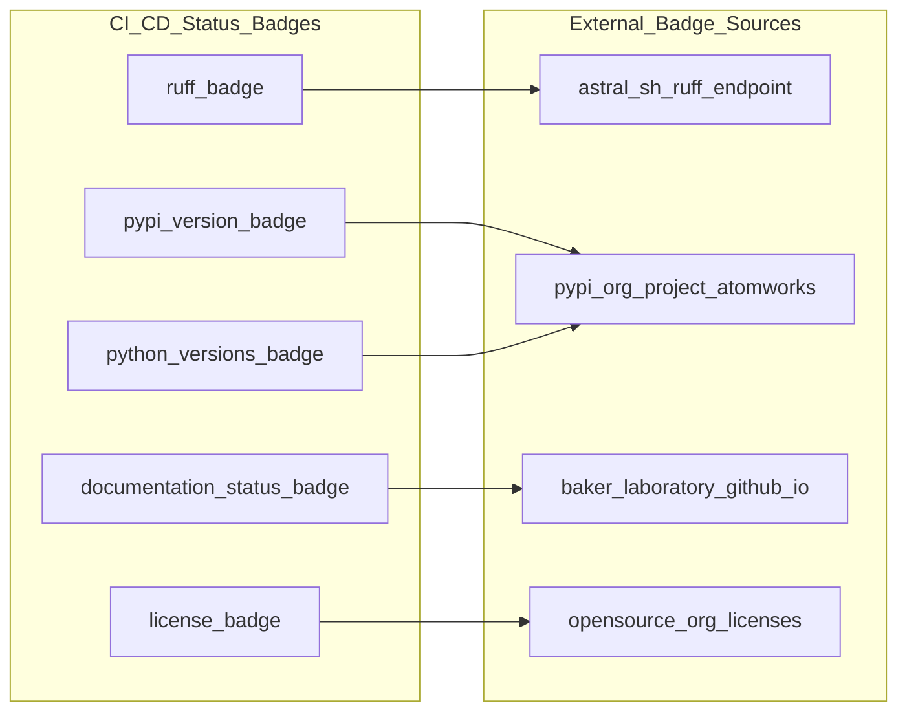

# CI/CD Pipeline

<details>
<summary>Relevant source files</summary>

The following files were used as context for generating this wiki page:

- [.github/workflows/release_and_docs.yaml](.github/workflows/release_and_docs.yaml)
- [.releaserc.js](.releaserc.js)
- [README.md](README.md)
- [docs/_static/atomworks_datapipelines.svg](docs/_static/atomworks_datapipelines.svg)
- [docs/_static/atomworks_logo_color.svg](docs/_static/atomworks_logo_color.svg)
- [docs/_static/atomworks_logo_dark.svg](docs/_static/atomworks_logo_dark.svg)
- [docs/_static/atomworks_logo_light.svg](docs/_static/atomworks_logo_light.svg)
- [docs/_static/atomworks_overview.png](docs/_static/atomworks_overview.png)
- [docs/_static/default_thumbnail.png](docs/_static/default_thumbnail.png)
- [docs/_static/favicon-16x16.png](docs/_static/favicon-16x16.png)
- [docs/_static/favicon-32x32.png](docs/_static/favicon-32x32.png)
- [docs/conf.py](docs/conf.py)
- [docs/index.rst](docs/index.rst)

</details>


This document covers the automated Continuous Integration and Continuous Deployment (CI/CD) pipeline that ensures code quality, runs comprehensive tests, and manages releases for the AtomWorks project. The pipeline includes automated linting, testing on multiple environments, semantic versioning, PyPI publishing, and versioned documentation deployment.

For information about project dependencies and build configuration, see [Dependencies and Build System](#5.1). For details about code quality tools and testing setup, see [Code Quality and Testing](#5.2).

## CI/CD Architecture Overview

The AtomWorks CI/CD pipeline is implemented through GitHub Actions workflows that automate releases and documentation deployment:



**Sources**: [.github/workflows/release_and_docs.yaml:1-159]()

## Release Workflow Components

The `release_and_docs` workflow in [.github/workflows/release_and_docs.yaml]() orchestrates the complete release pipeline:

### Build and Release Pipeline



The pipeline uses specific versions and configurations:

| Component | Version/Configuration |
|-----------|----------------------|
| Node.js | 20 |
| Python | 3.12 |
| Build tool | `python -m build` |
| Package format | Wheel and source distribution |

**Sources**: [.github/workflows/release_and_docs.yaml:19-60]()

### Semantic Release Configuration

The release process uses `semantic-release` with a modular plugin architecture defined in `.releaserc.js`:



**Sources**: [.releaserc.js:1-25]()

## Release and Documentation Deployment

The `release_and_docs` workflow handles automated releases when code is pushed to the `production` branch:

### Semantic Release Implementation

The complete release automation sequence follows this execution pattern:



The plugin configuration in `.releaserc.js` defines branch targeting and asset management:

```javascript
// Key configuration from .releaserc.js
branches: ['production', 'main']
pypiPublish: true
repoUrl: 'https://upload.pypi.org/legacy/'
distDir: 'dist/'
assets: ['pyproject.toml']
```

**Sources**: [.releaserc.js:2-23](), [.github/workflows/release_and_docs.yaml:51-61]()

### Documentation Deployment System

The documentation deployment creates versioned documentation sites with automated switcher generation:



The version detection logic ensures proper documentation organization:

```bash
# Version directory pattern matching from workflow
if [[ "$d" =~ ^v[0-9]+\.[0-9]+\.[0-9]+$ ]] || [[ "$d" == "latest" ]]; then
```

The `switcher.json` structure enables navigation between documentation versions:

```json
{
  "version": "latest", 
  "url": "https://baker-laboratory.github.io/atomworks-dev/latest/index.html",
  "name": "latest"
}
```

**Sources**: [.github/workflows/release_and_docs.yaml:63-148](), [docs/conf.py:72-76]()

## Documentation Configuration System

The documentation system uses Sphinx with automated version management integrated into the CI/CD pipeline:

### Sphinx Configuration Integration



Version extraction logic in `docs/conf.py`:

```python
# Version processing from atomworks.__version__
version_match = re.match(r"^v?(\d+\.\d+\.\d+)", str(raw_version))
switcher_version = version  # Use clean version for matching
```

The theme configuration enables dynamic version switching:

```python
"switcher": {
    "json_url": "https://baker-laboratory.github.io/atomworks-dev/latest/_static/switcher.json",
    "version_match": switcher_version,
}
```

**Sources**: [docs/conf.py:20-38](), [docs/conf.py:72-76]()

## Quality Assurance Integration

The CI/CD pipeline includes quality indicators displayed in the `README.md`:

### Badge Integration



**Sources**: [README.md:1-6]()

## Environment Variables and Secrets

The CI/CD pipeline uses GitHub Secrets for secure operations:

| Secret/Variable | Purpose | Workflow Usage |
|----------------|---------|----------------|
| `GITHUB_TOKEN` | GitHub API access | Release creation, Pages deployment |
| `PYPI_TOKEN` | PyPI publishing | `process.env.PYPI_TOKEN_PROD` in semantic-release |
| `PYPI_REPO_URL` | PyPI endpoint | `https://upload.pypi.org/legacy/` |

### Secret Configuration in Workflow

```yaml
# Environment variables in release_and_docs.yaml
env:
  GITHUB_TOKEN: ${{ secrets.GITHUB_TOKEN }}
  PYPI_TOKEN: ${{ secrets.PYPI_TOKEN_PROD }}
  PYPI_REPO_URL: https://upload.pypi.org/legacy/
```

The semantic release configuration accesses these through Node.js environment variables:

```javascript
// .releaserc.js secret access
pypiToken: process.env.PYPI_TOKEN_PROD
```

**Sources**: [.github/workflows/release_and_docs.yaml:53-57](), [.releaserc.js:13]()

## Workflow Triggers and Concurrency

### Trigger Configuration

The workflows are triggered by specific events to optimize resource usage:

```yaml
# lint_and_test triggers
on:
  push:
    branches: [main, dev, production]
    paths: ['src/**', 'tests/**', '.github/workflows/**']
  pull_request:
    branches: [main, dev, production]
  pull_request_target:
    types: [ready_for_review]
```

### Concurrency Management

```yaml
concurrency:
  group: ${{ github.workflow }}-${{ github.ref }}
  cancel-in-progress: true
```

This ensures that only one workflow runs per branch at a time, canceling previous runs when new commits are pushed.

**Sources**: [.github/workflows/lint_and_test.yaml:3-31](), [.github/workflows/release_and_docs.yaml:3-7]()

---