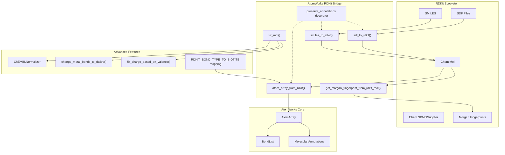
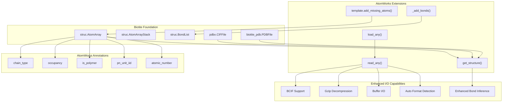
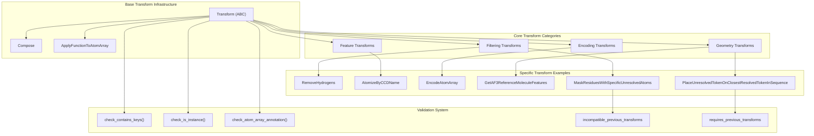
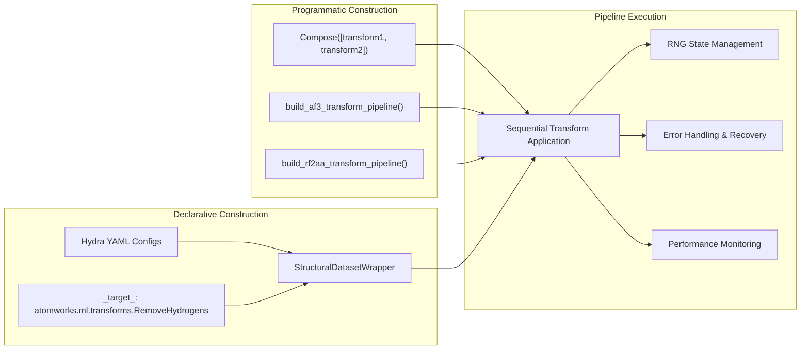
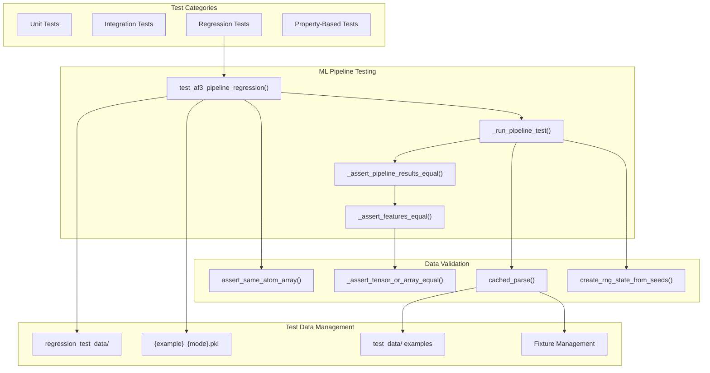

# Advanced Topics

<details>
<summary>Relevant source files</summary>

The following files were used as context for generating this wiki page:

- [src/atomworks/io/parser.py](src/atomworks/io/parser.py)
- [src/atomworks/io/tools/rdkit.py](src/atomworks/io/tools/rdkit.py)
- [src/atomworks/io/utils/io_utils.py](src/atomworks/io/utils/io_utils.py)
- [src/atomworks/ml/transforms/af3_reference_molecule.py](src/atomworks/ml/transforms/af3_reference_molecule.py)
- [src/atomworks/ml/transforms/featurize_unresolved_residues.py](src/atomworks/ml/transforms/featurize_unresolved_residues.py)
- [src/atomworks/ml/transforms/filters.py](src/atomworks/ml/transforms/filters.py)
- [tests/io/components/test_remove_hydrogens.py](tests/io/components/test_remove_hydrogens.py)
- [tests/ml/pipelines/test_pipeline_regression.py](tests/ml/pipelines/test_pipeline_regression.py)
- [tests/ml/transforms/test_token_utils.py](tests/ml/transforms/test_token_utils.py)

</details>


This document covers advanced usage patterns, external tool integration, and extensibility features in AtomWorks. It provides guidance for users who need to extend the system with custom functionality or integrate with external scientific computing tools.

For basic usage and getting started, see [Overview](#1). For details on the core data processing pipeline, see [atomworks.io - Data Processing](#2). For machine learning pipeline details, see [atomworks.ml - Machine Learning](#3).

## External Tool Integration

AtomWorks provides seamless integration with several external scientific computing libraries, enabling advanced molecular analysis and processing workflows.

### RDKit Integration

AtomWorks offers comprehensive integration with RDKit for small molecule processing and analysis. The integration supports bidirectional conversion between AtomArray objects and RDKit Mol objects.

## RDKit-AtomWorks Integration Architecture



The core conversion functions provide robust molecular data exchange:

- `atom_array_from_rdkit()` converts RDKit Mol objects to AtomArray format, preserving bond information and molecular annotations
- `smiles_to_rdkit()` generates RDKit molecules from SMILES strings with conformer generation
- `sdf_to_rdkit()` loads molecules from SDF files with sanitization options

Advanced molecular processing features include:

- `ChEMBLNormalizer` class for standardizing molecules using ChEMBL pipeline rules
- `fix_mol()` function for automated molecular sanitization and error recovery
- Metal coordination bond handling via `change_metal_bonds_to_dative()`
- Valence-based formal charge correction through `fix_charge_based_on_valence()`

Sources: [src/atomworks/io/tools/rdkit.py:1-766]()

### Biotite Integration

AtomWorks extends Biotite's structural biology capabilities while maintaining full compatibility with the Biotite ecosystem.

## Biotite-AtomWorks Integration Layers



Key enhancements to Biotite functionality:

- Enhanced structure loading via `get_structure()` with improved bond inference and altloc handling
- Universal file reader `read_any()` supporting CIF, BCIF, PDB, and compressed formats
- Automated missing atom placement through template-based reconstruction
- Extended annotation system for chain typing and molecular classification

Sources: [src/atomworks/io/utils/io_utils.py:1-774]()

### File Format Ecosystem

AtomWorks supports a comprehensive range of molecular file formats with automatic type detection and conversion capabilities.

| Format | Extension | Read Support | Write Support | Compression |
|--------|-----------|-------------|---------------|-------------|
| mmCIF | `.cif` | ✓ | ✓ | ✓ |
| Binary CIF | `.bcif` | ✓ | ✓ | ✓ |
| PDB | `.pdb` | ✓ | ✓ | ✓ |
| SDF | `.sdf` | ✓ | ✗ | ✗ |
| FASTA | `.fasta` | ✓ | ✗ | ✗ |
| MOL | `.mol` | ✓ | ✗ | ✗ |

The `infer_pdb_file_type()` function automatically detects file formats, while `parse()` provides a unified interface for all supported formats.

Sources: [src/atomworks/io/utils/io_utils.py:283-318]()

## Extending AtomWorks

AtomWorks is designed for extensibility through its modular transform system and pipeline architecture.

### Transform System Architecture

The transform system provides a standardized interface for data processing operations with built-in validation and composition capabilities.

## Transform System Class Hierarchy



### Custom Transform Development

Creating custom transforms involves implementing the `Transform` abstract base class with proper validation and forward processing logic.

Essential methods for custom transforms:
- `check_input()`: Validates input data structure and required annotations
- `forward()`: Implements the core transformation logic
- Class variables for dependency management: `requires_previous_transforms`, `incompatible_previous_transforms`

Example transform structure pattern:

```python
class CustomTransform(Transform):
    def __init__(self, param1: type, param2: type = default):
        self.param1 = param1
        self.param2 = param2
    
    def check_input(self, data: dict[str, Any]) -> None:
        check_contains_keys(data, ["atom_array"])
        check_is_instance(data, "atom_array", AtomArray)
        check_atom_array_annotation(data, ["required_annotation"])
    
    def forward(self, data: dict[str, Any]) -> dict[str, Any]:
        # Transform implementation
        return data
```

Sources: [src/atomworks/ml/transforms/base.py](), [src/atomworks/ml/transforms/featurize_unresolved_residues.py:100-144]()

### Pipeline Construction Patterns

AtomWorks supports both declarative and programmatic pipeline construction approaches.

## Pipeline Construction Strategies



The `Compose` class enables sequential transform chaining with optional RNG state tracking:

```python
pipeline = Compose([
    RemoveHydrogens(),
    AtomizeByCCDName(atomize_by_default=True),
    EncodeAtomArray(encoding=AF3_ATOM37_ENCODING)
], track_rng_state=True)
```

Pre-built pipeline functions like `build_af3_transform_pipeline()` provide model-specific processing workflows with comprehensive parameter configuration.

Sources: [src/atomworks/ml/pipelines/af3.py](), [tests/ml/pipelines/test_pipeline_regression.py:27-67]()

## Advanced Usage Patterns

### Caching and Performance Optimization

AtomWorks implements multi-level caching strategies for computational efficiency in large-scale processing workflows.

The `parse()` function supports persistent caching with content-based cache keys:

- Cache key generation via argument hashing: `string_to_md5_hash(args_string, truncate=8)`
- Assembly-aware cache file naming: `{stem}_assembly_{assembly_info}.pkl.gz`
- Selective caching excluding assemblies for space efficiency

Cache directory structure and management:
```
cache_dir/
├── {args_hash}/
│   ├── {structure_id}_assembly_all.pkl.gz
│   ├── {structure_id}_assembly_1.pkl.gz
│   └── ...
```

Sources: [src/atomworks/io/parser.py:200-257]()

### Error Handling and Recovery

AtomWorks implements robust error handling with graceful degradation strategies:

**Molecular Sanitization Recovery**:
- ChEMBL-style normalization via `ChEMBLNormalizer`
- RDKit standard normalization fallback
- Valence-based charge correction
- Configurable failure modes: `raise_on_failure` parameter

**File Processing Recovery**:
- Automatic format detection with fallback parsing
- Multi-model handling with graceful single-model fallback
- Invalid file error recovery through model selection

**Transform Pipeline Recovery**:
- Transform dependency validation
- Annotation requirement checking
- Graceful handling of missing optional features

Sources: [src/atomworks/io/tools/rdkit.py:266-347](), [src/atomworks/io/utils/io_utils.py:629-647]()

### Testing and Validation Framework

AtomWorks employs comprehensive regression testing for ML pipelines and data processing stability.

## Testing Architecture



The regression testing framework ensures ML pipeline stability across code changes:

- Deterministic testing with fixed RNG seeds
- Feature-level comparison with appropriate tolerances
- Automatic test data generation and validation
- Parametrized testing across multiple examples and modes

Key testing utilities:
- `cached_parse()` for efficient test data loading
- `assert_same_atom_array()` for structural comparison
- `create_rng_state_from_seeds()` for reproducible randomness

Sources: [tests/ml/pipelines/test_pipeline_regression.py:1-236](), [tests/ml/transforms/test_token_utils.py:27-40]()

---