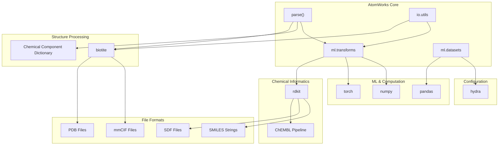
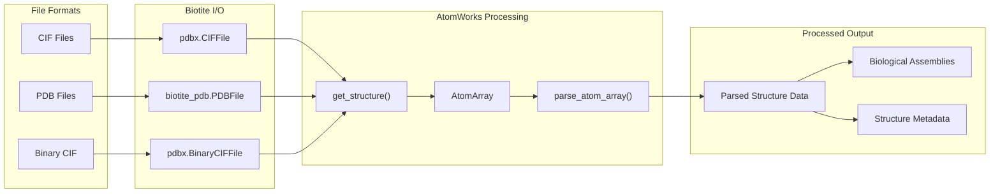
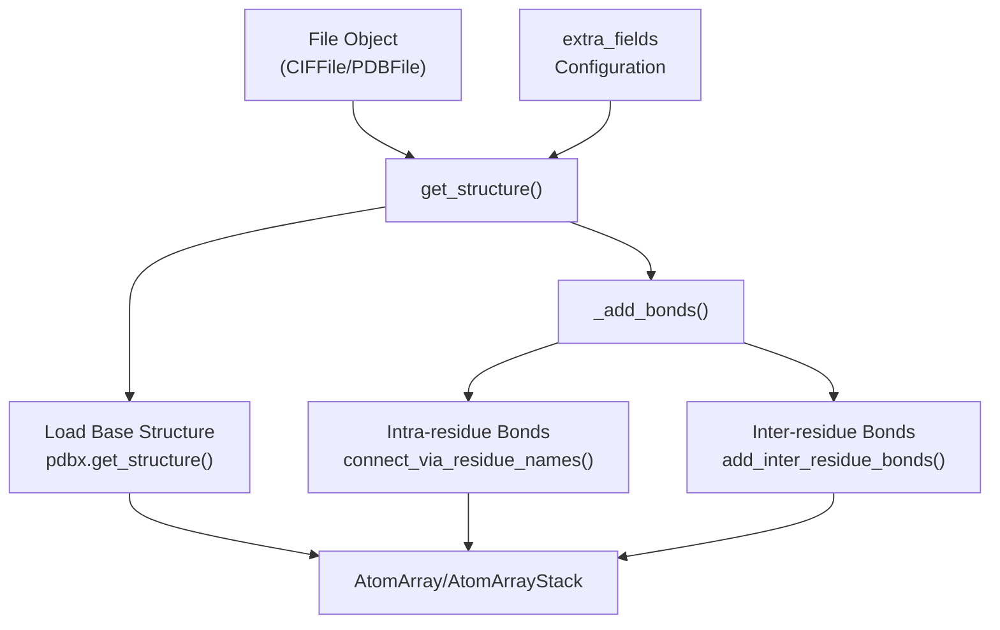
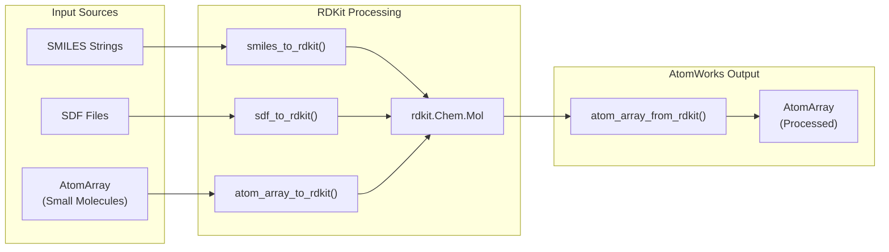
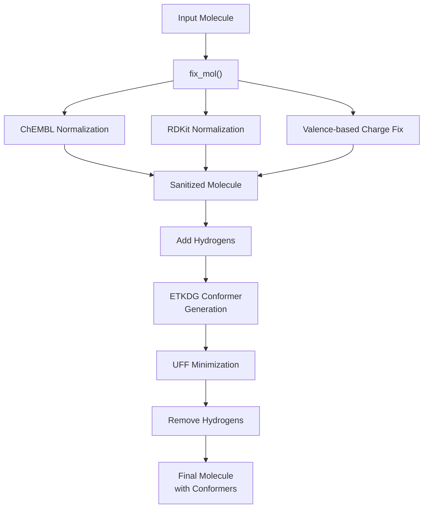
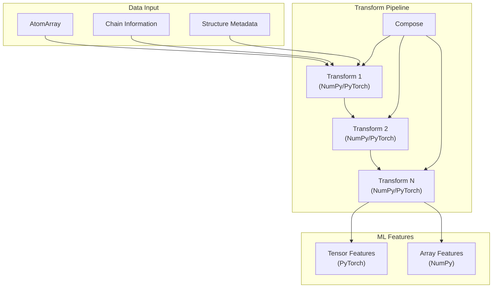
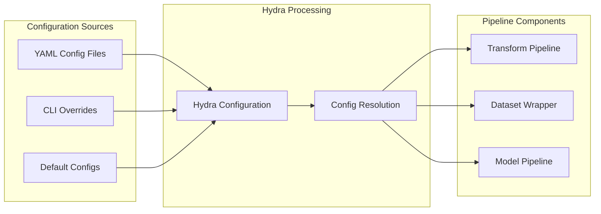
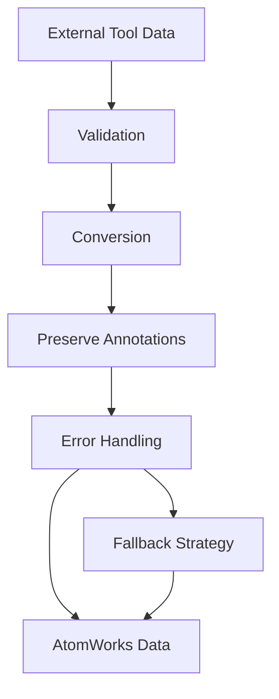

# External Tool Integration

Relevant source files

The following files were used as context for generating this wiki page:

- [src/atomworks/io/parser.py](src/atomworks/io/parser.py)
- [src/atomworks/io/tools/rdkit.py](src/atomworks/io/tools/rdkit.py)
- [src/atomworks/io/utils/io_utils.py](src/atomworks/io/utils/io_utils.py)
- [src/atomworks/ml/transforms/af3_reference_molecule.py](src/atomworks/ml/transforms/af3_reference_molecule.py)
- [src/atomworks/ml/transforms/featurize_unresolved_residues.py](src/atomworks/ml/transforms/featurize_unresolved_residues.py)
- [src/atomworks/ml/transforms/filters.py](src/atomworks/ml/transforms/filters.py)
- [tests/io/components/test_remove_hydrogens.py](tests/io/components/test_remove_hydrogens.py)
- [tests/ml/pipelines/test_pipeline_regression.py](tests/ml/pipelines/test_pipeline_regression.py)
- [tests/ml/transforms/test_token_utils.py](tests/ml/transforms/test_token_utils.py)

This document covers AtomWorks' integration with external libraries and tools that provide core functionality for biological structure processing, chemical informatics, and machine learning. AtomWorks acts as a bridge between these tools, providing unified interfaces and data conversion utilities.

For information about extending AtomWorks with custom functionality, see [Extending AtomWorks](#6.2). For details on the core data processing pipeline, see [atomworks.io - Data Processing](#2).

## Integration Architecture Overview

AtomWorks integrates with several key external libraries to provide comprehensive biomolecular processing capabilities. The integration follows a layered architecture where external tools provide specialized functionality while AtomWorks provides unified interfaces and seamless data conversion.

Sources: [src/atomworks/io/parser.py:1-766](), [src/atomworks/io/utils/io_utils.py:1-780](), [src/atomworks/io/tools/rdkit.py:1-900]()

## Biotite Integration

Biotite serves as the primary external library for biological structure processing in AtomWorks. All structural data is represented using Biotite's `AtomArray` and `AtomArrayStack` objects, which provide the foundation for AtomWorks' data model.

### Core Data Structures

AtomWorks extensively uses Biotite's structure representations:

- **AtomArray**: Single model atomic structures with annotations
- **AtomArrayStack**: Multi-model structures (e.g., NMR ensembles)
- **BondList**: Bond connectivity information

Sources: [src/atomworks/io/parser.py:12-18](), [src/atomworks/io/utils/io_utils.py:16-22]()

### Structure Loading and Processing

The `get_structure()` function provides enhanced Biotite integration with additional features for handling bonds and annotations:

Sources: [src/atomworks/io/utils/io_utils.py:180-281](), [src/atomworks/io/utils/io_utils.py:84-177]()

### Bond Handling Integration

AtomWorks extends Biotite's bond handling to correctly process complex biological structures:

- **Intra-residue bonds**: Uses Biotite's CCD-based bond inference
- **Inter-residue bonds**: Custom logic for disulfide bonds, metal coordination, and covalent modifications
- **Bond type correction**: Fixes formal charges and bond orders for inter-residue connections

Sources: [src/atomworks/io/utils/io_utils.py:84-177]()

## RDKit Integration

RDKit provides chemical informatics capabilities for small molecule processing, conformer generation, and molecular standardization. AtomWorks integrates RDKit primarily for ligand and small molecule handling.

### Molecule Conversion Pipeline

Sources: [src/atomworks/io/tools/rdkit.py:390-481](), [src/atomworks/io/tools/rdkit.py:483-632](), [src/atomworks/io/tools/rdkit.py:633-900]()

### Conformer Generation and Standardization

RDKit integration includes sophisticated conformer generation and molecule standardization:

- **Conformer generation**: Uses ETKDG algorithms with UFF minimization
- **ChEMBL standardization**: Implements ChEMBL structure pipeline for molecule normalization
- **Valence correction**: Automatic fixing of formal charges and bond orders

Sources: [src/atomworks/io/tools/rdkit.py:266-346](), [src/atomworks/io/tools/rdkit.py:390-446]()

### Bond Type Mapping

AtomWorks provides bidirectional conversion between Biotite and RDKit bond representations:

| Biotite BondType | RDKit BondType | Aromatic Flag |
|------------------|----------------|---------------|
| `SINGLE` | `SINGLE` | `False` |
| `DOUBLE` | `DOUBLE` | `False` |
| `TRIPLE` | `TRIPLE` | `False` |
| `AROMATIC_SINGLE` | `SINGLE` | `True` |
| `AROMATIC_DOUBLE` | `DOUBLE` | `True` |

Sources: [src/atomworks/io/tools/rdkit.py:60-97]()

## ML Framework Integration

AtomWorks integrates with PyTorch and NumPy for machine learning workflows, providing tensor-based representations and GPU acceleration support.

### Transform Pipeline Integration

Sources: [tests/ml/pipelines/test_pipeline_regression.py:27-67](), [src/atomworks/ml/transforms/featurize_unresolved_residues.py:1-397]()

### Tensor Operations and GPU Support

AtomWorks transforms utilize PyTorch tensors for efficient computation and GPU acceleration:

- **Coordinate transformations**: Rigid body transformations using PyTorch tensors
- **Feature encoding**: One-hot encodings and embeddings as PyTorch tensors
- **Batch processing**: Efficient batch operations for multiple structures

Sources: [src/atomworks/ml/transforms/af3_reference_molecule.py:370-372]()

## Configuration and Data Management

AtomWorks integrates with Hydra for configuration management and Pandas for structured data handling, enabling flexible and reproducible workflows.

### Hydra Configuration Integration

Sources: [tests/ml/pipelines/test_pipeline_regression.py:27-67]()

### Dataset Management with Pandas

AtomWorks uses Pandas for structured data management:

- **Metadata handling**: Structure metadata stored as DataFrames
- **Dataset indexing**: Efficient querying and filtering of large datasets
- **Caching support**: Pickle-based caching with Pandas serialization

Sources: [src/atomworks/io/parser.py:234-236](), [src/atomworks/io/parser.py:315-316]()

## Integration Patterns and Best Practices

### Data Conversion Patterns

AtomWorks follows consistent patterns for converting between external tool representations:

1. **Preserve Annotations**: Custom decorators maintain metadata during conversions
2. **Error Handling**: Graceful fallbacks when external tools fail
3. **Memory Efficiency**: Lazy loading and streaming for large datasets

Sources: [src/atomworks/io/tools/rdkit.py:163-196](), [src/atomworks/io/parser.py:254-257]()

### Performance Optimization

- **Caching**: Function-level caching for expensive operations
- **Batch Processing**: Vectorized operations where possible
- **Memory Management**: Explicit cleanup of temporary objects

Sources: [src/atomworks/io/tools/rdkit.py:128-137](), [src/atomworks/ml/transforms/filters.py:30-43]()

---