# Extending AtomWorks

<details>
<summary>Relevant source files</summary>

The following files were used as context for generating this wiki page:

- [src/atomworks/ml/pipelines/af3.py](src/atomworks/ml/pipelines/af3.py)
- [src/atomworks/ml/pipelines/rf2aa.py](src/atomworks/ml/pipelines/rf2aa.py)
- [src/atomworks/ml/transforms/encoding.py](src/atomworks/ml/transforms/encoding.py)
- [src/atomworks/ml/transforms/template.py](src/atomworks/ml/transforms/template.py)
- [tests/io/components/test_regression.py](tests/io/components/test_regression.py)
- [tests/io/tools/test_rdkit.py](tests/io/tools/test_rdkit.py)
- [tests/ml/conftest.py](tests/ml/conftest.py)
- [tests/ml/transforms/msa/test_featurize_msa.py](tests/ml/transforms/msa/test_featurize_msa.py)
- [tests/ml/utils/test_io.py](tests/ml/utils/test_io.py)

</details>


This document provides guidance for developers on creating custom components within the AtomWorks framework. It covers the primary extension points: custom parsers, transforms, dataset wrappers, and token encodings. For information about using existing AtomWorks components, see [Overview](#1). For details on the core processing pipeline, see [atomworks.io - Data Processing](#2) and [atomworks.ml - Machine Learning](#3).

## Extension Architecture Overview

AtomWorks provides several well-defined extension points that allow developers to customize data processing pipelines without modifying core functionality.

**AtomWorks Extension Points Architecture**
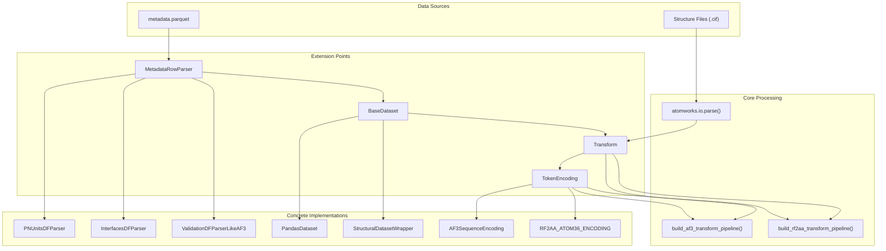

Sources: [src/atomworks/ml/datasets/parsers/base.py:27-85](), [src/atomworks/ml/transforms/base.py:26-42](), [src/atomworks/ml/datasets/datasets.py:28-59](), [src/atomworks/ml/encoding_definitions.py:254-286](), [src/atomworks/ml/pipelines/af3.py:84-133](), [src/atomworks/ml/pipelines/rf2aa.py:154-205]()

## Creating Custom MetadataRowParsers

`MetadataRowParser` subclasses convert dataset rows into a standardized format for the AtomWorks pipeline. The base class defines a required schema and validation framework.

**MetadataRowParser Class Hierarchy**
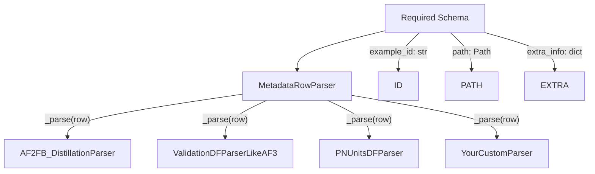

### Implementation Pattern

Custom parsers must implement the `_parse` method and return a dictionary conforming to the required schema. The base `MetadataRowParser` validates outputs against a predefined schema:

```python
class YourCustomParser(MetadataRowParser):
    def _parse(self, row: pd.Series) -> dict[str, Any]:
        return {
            "example_id": row["your_id_column"],
            "path": Path(row["your_path_column"]),
            "assembly_id": "1",  # or row["assembly_column"]
            "extra_info": {
                "custom_field": row.get("custom_data", None),
                "source_metadata": row.to_dict()  # Preserve original row data
            }
        }
```

The `MetadataRowParser.parse()` method automatically validates the output schema and handles common preprocessing like path resolution.

### Required Schema Elements

| Field | Type | Purpose |
|-------|------|---------|
| `example_id` | `str` | Unique identifier for the example |
| `path` | `Path` | Path to structure file for `atomworks.io.parse` |
| `extra_info` | `dict` | Additional metadata for transforms |

### Parser Examples

The `AF2FB_DistillationParser` demonstrates handling sharded file structures:

Sources: [src/atomworks/ml/datasets/parsers/custom_metadata_row_parsers.py:12-95](), [src/atomworks/ml/datasets/parsers/base.py:47-85]()

## Creating Custom Transforms

`Transform` subclasses modify molecular data within processing pipelines. They implement a `forward` method and can include input validation through `check_input`.

**Transform Processing Flow**
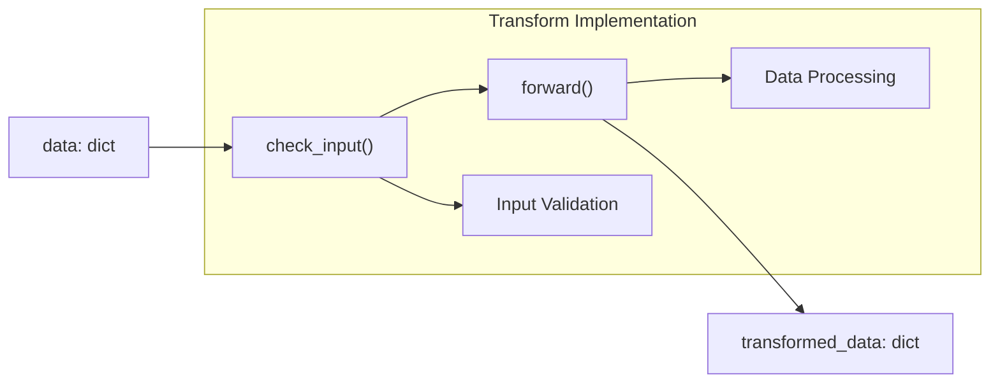

### Transform Base Pattern

```python
class YourTransform(Transform):
    def __init__(self, your_parameter: float = 1.0):
        self.your_parameter = your_parameter
    
    def check_input(self, data: dict) -> None:
        check_contains_keys(data, ["atom_array", "chain_info"])
        check_is_instance(data, "atom_array", AtomArray)
    
    def forward(self, data: dict[str, Any]) -> dict[str, Any]:
        # Transform the data
        modified_atom_array = self._process_atom_array(data["atom_array"])
        
        # Return modified data
        return {**data, "atom_array": modified_atom_array}
```

### Complex Transform Examples

AtomWorks includes several sophisticated transforms that demonstrate advanced patterns for molecular data processing.

**AddRFTemplates Transform Architecture**
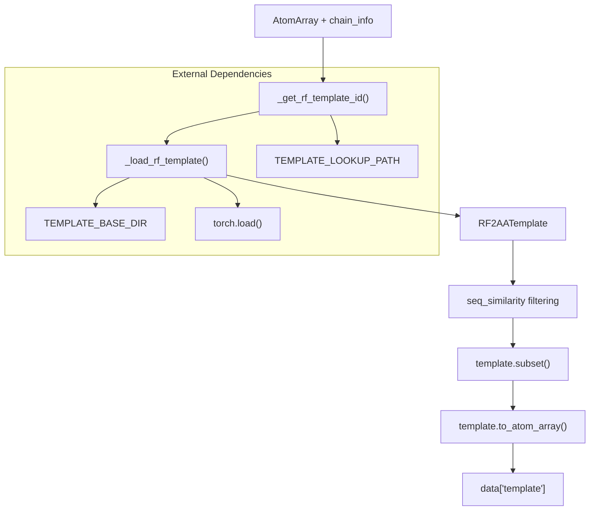

**FeaturizeTemplatesLikeAF3 Transform Flow**
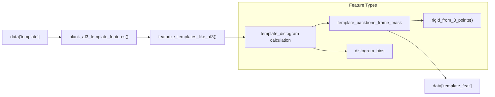

Key patterns in complex transforms:
- Template loading with disk-based caching via `torch.load()`
- Multi-chain processing with `chain_instance_iter()`
- Geometric computations using `rigid_from_3_points()`
- Configurable filtering with sequence similarity thresholds
- Integration with external environment variables for data paths

Sources: [src/atomworks/ml/transforms/template.py:305-459](), [src/atomworks/ml/transforms/template.py:700-800](), [src/atomworks/ml/transforms/dna/pad_dna.py:217-329]()

## Creating Custom Dataset Wrappers

Dataset wrappers provide data loading and processing coordination. AtomWorks offers several base classes for different use cases.

**Dataset Class Hierarchy**
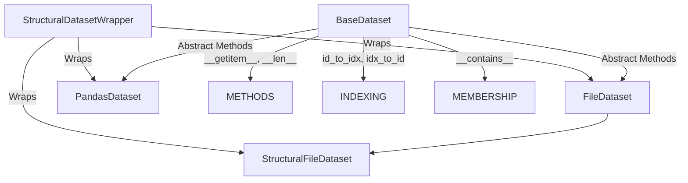

### Dataset Implementation Requirements

All custom datasets must implement the `BaseDataset` interface. The abstract base class enforces a consistent API across all dataset implementations:

| Method | Purpose | Return Type | Implementation Notes |
|--------|---------|-------------|---------------------|
| `__getitem__(idx)` | Retrieve item by index | `Any` | Must handle integer indices |
| `__len__()` | Dataset size | `int` | Should be fast (cached if needed) |
| `__contains__(example_id)` | Check if ID exists | `bool` | String-based membership test |
| `id_to_idx(example_id)` | Convert ID to index | `int` | Raises `KeyError` if not found |
| `idx_to_id(idx)` | Convert index to ID | `str` | Raises `IndexError` if out of bounds |

The `BaseDataset` provides additional utility methods like `get_example_ids()` which returns all valid example IDs as a list.

### File-Based Dataset Example

`StructuralFileDataset` demonstrates file system integration with automatic ID generation:

```python
class StructuralFileDataset(FileDataset):
    @cached_property
    def data(self) -> pd.DataFrame:
        # Generate example IDs from file paths
        example_ids = []
        for file_path in self.file_paths:
            filename = Path(file_path).stem
            while "." in filename:  # Handle .cif.gz
                filename = Path(filename).stem
            example_ids.append(filename)
        
        return pd.DataFrame({
            "path": self.file_paths,
            "example_id": example_ids,
        }).set_index("example_id")
```

### StructuralDatasetWrapper Integration

The `StructuralDatasetWrapper` coordinates parsing, transformation, and error handling:

**StructuralDatasetWrapper Flow**
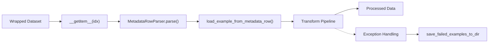

Sources: [src/atomworks/ml/datasets/datasets.py:61-209](), [src/atomworks/ml/datasets/datasets.py:210-359]()

## Creating Custom Token Encodings

`TokenEncoding` defines molecular representations for machine learning models. Custom encodings specify atom mappings and handle unknown residues.

**TokenEncoding Structure**
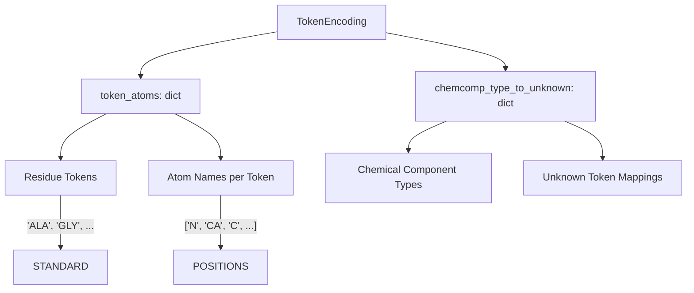

### Custom Encoding Pattern

Custom encodings follow the `TokenEncoding` class structure with explicit atom ordering and unknown token handling:

```python
CUSTOM_ENCODING = TokenEncoding(
    token_atoms={
        'YOUR_RES1': ['ATOM1', 'ATOM2', 'ATOM3', ''],
        'YOUR_RES2': ['ATOM1', 'ATOM2', '', ''],
        'UNK': ['', '', '', ''],  # Unknown token
        # Add atom-level tokens for atomized molecules
        6: ['6', '', '', ''],  # Carbon atom
        7: ['7', '', '', ''],  # Nitrogen atom
    },
    chemcomp_type_to_unknown={
        'L-PEPTIDE LINKING': 'UNK',
        'RNA LINKING': 'UNK', 
        'DNA LINKING': 'UNK',
        'NON-POLYMER': 'UNK',
    }
)
```

The `TokenEncoding` class automatically generates lookup dictionaries (`token_to_idx`, `atom_to_idx`) and validation methods (`resolve_unknown_token_name`).

### Encoding Requirements

- All token arrays must have the same length
- Empty positions use empty strings `''`
- Unknown token mappings must reference valid tokens
- Chemical component types must be uppercase

### Built-in Encoding Examples

AtomWorks provides several standard encodings for different model architectures:

| Encoding | Atoms per Token | Total Tokens | Use Case |
|----------|----------------|--------------|----------|
| `AF2_ATOM14_ENCODING` | 14 | 21 | AlphaFold2-style protein modeling |
| `AF2_ATOM37_ENCODING` | 37 | 21 | Extended protein atom representation |
| `RF2AA_ATOM36_ENCODING` | 36 | 89 | RoseTTAFold2AA with proteins + nucleic acids |
| `LEGACY_RF2_ATOM14_ENCODING` | 14 | 21 | Legacy RF template compatibility |

**AF3SequenceEncoding Pattern**
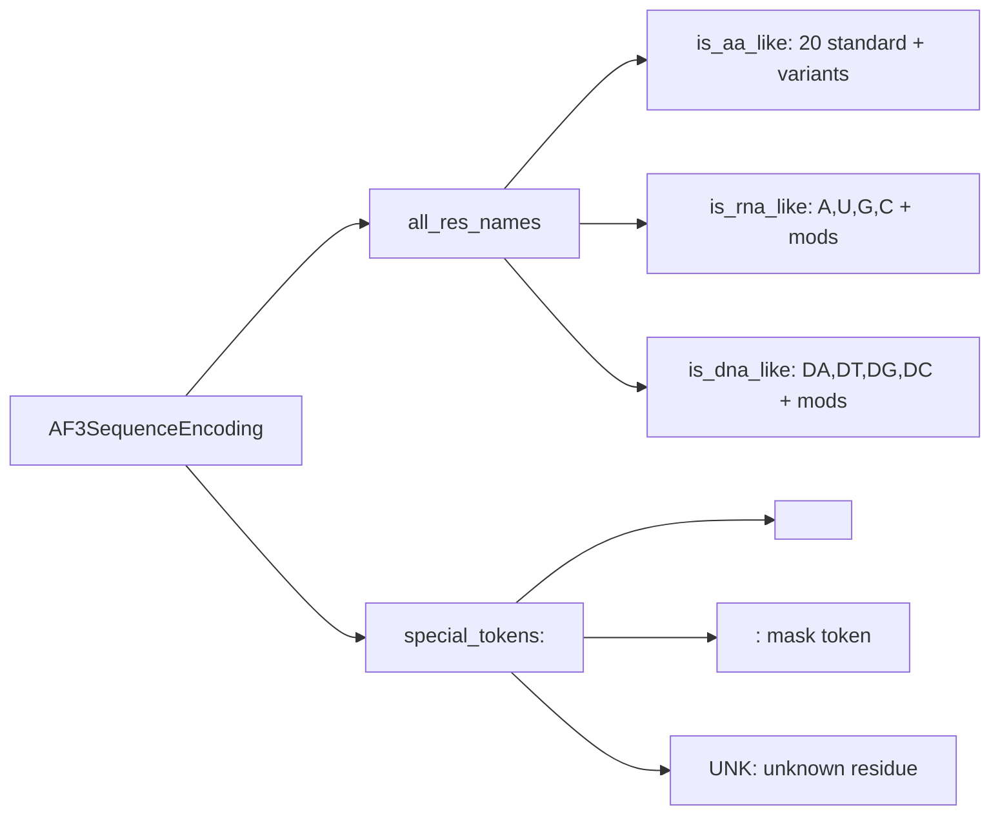

The `AF3SequenceEncoding` class extends basic encodings with biochemical classification methods and one-hot encoding support.

Sources: [src/atomworks/ml/encoding_definitions.py:36-251](), [src/atomworks/ml/encoding_definitions.py:254-286](), [src/atomworks/ml/encoding_definitions.py:289-318]()

## Testing Custom Extensions

AtomWorks provides testing utilities and patterns for validating custom components.

### Parser Testing

```python
def test_your_custom_parser():
    parser = YourCustomParser()
    sample_row = pd.Series({
        'your_id_column': 'test_id',
        'your_path_column': '/path/to/file.cif'
    })
    
    result = parser.parse(sample_row)
    
    assert result['example_id'] == 'test_id'
    assert isinstance(result['path'], Path)
    assert isinstance(result['extra_info'], dict)
```

### Transform Testing

```python
def test_your_transform():
    from atomworks.ml.utils.testing import cached_parse
    
    # Load test data
    data = cached_parse("test_structure.cif")
    
    # Apply transform
    transform = YourTransform(your_parameter=2.0)
    result = transform(data)
    
    # Validate output
    assert "atom_array" in result
    assert len(result["atom_array"]) > 0
```

### Integration Testing

AtomWorks provides comprehensive test fixtures for pipeline validation. Use the fixtures from `tests/ml/conftest.py` for end-to-end testing:

**Test Infrastructure**
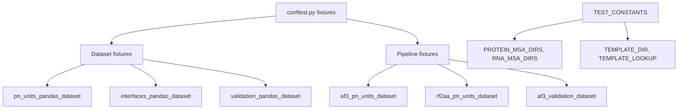

Example integration test using fixtures:

```python
def test_custom_pipeline_integration(af3_pn_units_dataset):
    """Test custom components with real AF3 pipeline"""
    # Get first example
    example = af3_pn_units_dataset[0]
    
    # Validate pipeline output structure
    assert "feats" in example
    assert "ground_truth" in example
    assert "example_id" in example
    
    # Test custom transform integration
    custom_transform = YourCustomTransform()
    modified_data = custom_transform(example)
    assert "your_custom_field" in modified_data
```

Sources: [tests/ml/conftest.py:223-293](), [tests/ml/conftest.py:300-365](), [src/atomworks/ml/utils/testing.py:1-30]()

## Integration Patterns

### Pipeline Integration

Custom components integrate into AtomWorks pipelines through the `Compose` transform and `StructuralDatasetWrapper`:

**Custom Pipeline Integration**
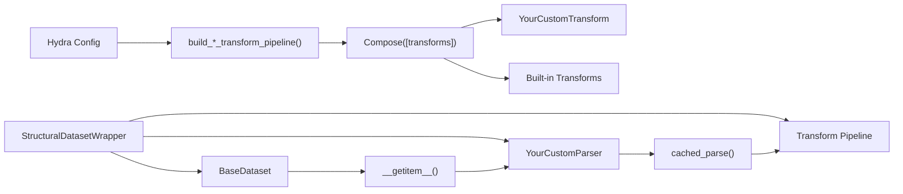

Example integration with AF3 pipeline:

```python
def build_custom_af3_pipeline(**kwargs):
    """Custom AF3 pipeline with your extensions"""
    return Compose([
        # Early processing
        RemoveHydrogens(),
        YourCustomStructureValidator(),
        
        # Standard AF3 transforms
        AddGlobalAtomIdAnnotation(),
        AtomizeByCCDName(atomize_by_default=True),
        
        # Your custom processing
        YourCustomFeatureExtractor(param=1.0),
        
        # Continue with AF3 pipeline...
    ])

# Integration with StructuralDatasetWrapper
dataset = StructuralDatasetWrapper(
    dataset=your_pandas_dataset,
    dataset_parser=YourCustomParser(),
    transform=build_custom_af3_pipeline(**config),
    cif_parser_args={"cache_dir": cache_dir}
)
```

### Executable Integration

For transforms requiring external tools, AtomWorks provides the `Executable` base class following the `X3DNAFiber` pattern:

**Executable Integration Architecture**
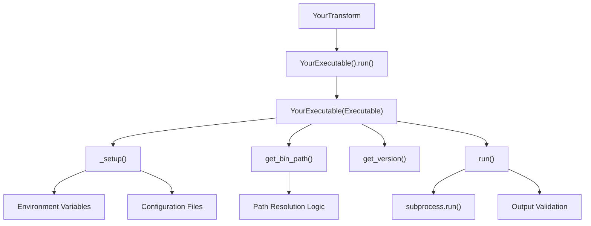

Example executable integration:

```python
class YourExecutable(Executable):
    def _setup(self) -> None:
        """Validate executable availability"""
        if not self.get_bin_path():
            raise ExecutableNotFoundError("your_tool not found")
    
    def get_bin_path(self) -> Path | None:
        """Get path to executable binary"""
        return self._find_executable("your_tool")
    
    def run(self, input_data: dict) -> dict:
        """Execute external tool"""
        cmd = [str(self.get_bin_path()), "--input", input_data["file"]]
        result = subprocess.run(cmd, capture_output=True, text=True)
        return {"output": result.stdout, "success": result.returncode == 0}
```

Sources: [src/atomworks/ml/executables/x3dna.py:10-63](), [src/atomworks/ml/transforms/dna/pad_dna.py:570-618]()

### Error Handling

Implement comprehensive error handling for production use:

```python
class YourTransform(Transform):
    def forward(self, data: dict[str, Any]) -> dict[str, Any]:
        try:
            return self._process_data(data)
        except YourSpecificError as e:
            logger.warning(f"Transform failed: {e}")
            return data  # Return unmodified data
        except Exception as e:
            logger.error(f"Unexpected error: {e}")
            raise
```

Sources: [src/atomworks/ml/executables/x3dna.py:10-63](), [src/atomworks/ml/datasets/datasets.py:308-327](), [src/atomworks/ml/transforms/dna/pad_dna.py:570-618]()